<!-- Generated by tools/gallery.mjs from showcase.yaml and build.json; do not edit. -->
# Kition Showcase

Kition Showcase: sample files for every kit, built with the kits' own commands and rendered by their own engines.

[Kition](https://kition.ai) · [Developer docs](https://developer.kition.ai)

Each sample is a `showcase.yaml`: a list of the kit's own engine commands, and checks on what they must produce. `tools/build.mjs` runs them through the kit, which saves the document and renders its thumbnail itself, so the gallery shows exactly what Kition draws.

The samples double as tests: `node tools/build.mjs --check` rebuilds every sample against the kits' current code and fails when a thumbnail moves beyond the render tolerance or a check fails.

**364 samples** in 16 kits. The same gallery as a static website for https://kition.ai/showcase, a page per kit and per sample (search, filters, downloads): `node tools/site.mjs` builds it into `dist/`.

| | Kit | Samples | Categories | |
|---|---|---:|---:|---|
| <a href="note/">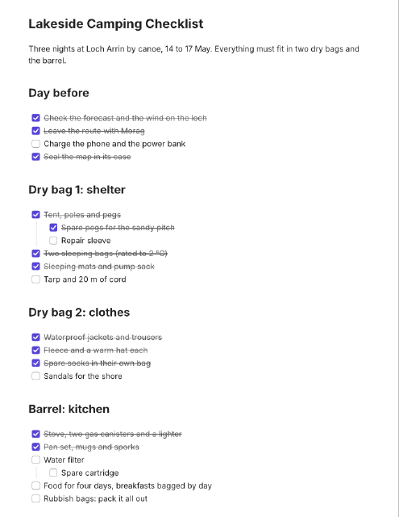</a> | **[Note](note/)** | 11 | 5 | Markdown notes, Obsidian-flavoured: headings, lists, tasks, tables, callouts, links and code. Saved as .md. |
| <a href="table/">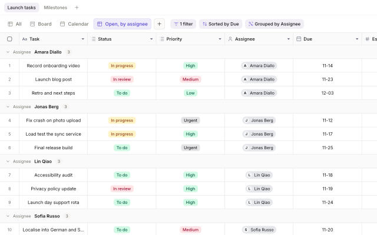</a> | **[Table](table/)** | 11 | 5 | Relational tables: typed fields, linked records, views, filters, sorts and grouping. Saved as .ktable. |
| <a href="board/">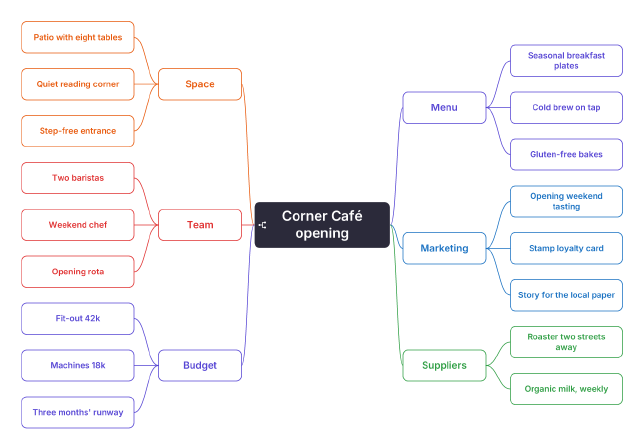</a> | **[Board](board/)** | 12 | 5 | Infinite whiteboards: shapes, sticky notes, connectors, freehand, frames and mind maps. Saved as .kboard. |
| <a href="doc/"></a> | **[Doc](doc/)** | 36 | 6 | Word-processing documents: styles, lists, tables, headers and footers, sections, columns and fields. Saved as .docx. |
| <a href="sheet/">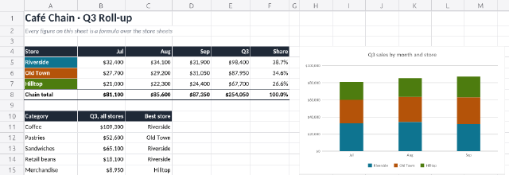</a> | **[Sheet](sheet/)** | 41 | 7 | Spreadsheets: formulas, number formats, styles, merged cells, tables, charts and several sheets. Saved as .xlsx. |
| <a href="slide/">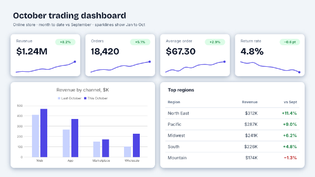</a> | **[Slide](slide/)** | 42 | 7 | Presentations: layouts, themes, shapes, text, tables, charts, transitions and animations. Saved as .pptx. |
| <a href="pdf/">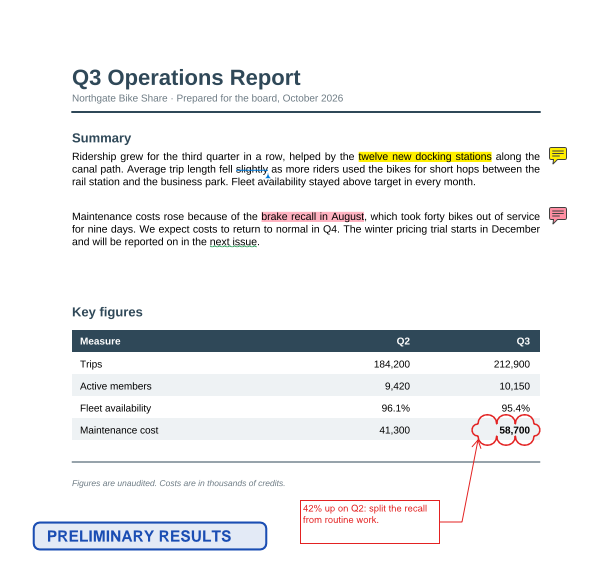</a> | **[PDF](pdf/)** | 11 | 5 | PDF documents: pages, text, annotations, forms, bookmarks, links and redaction. Saved as PDF. |
| <a href="html/">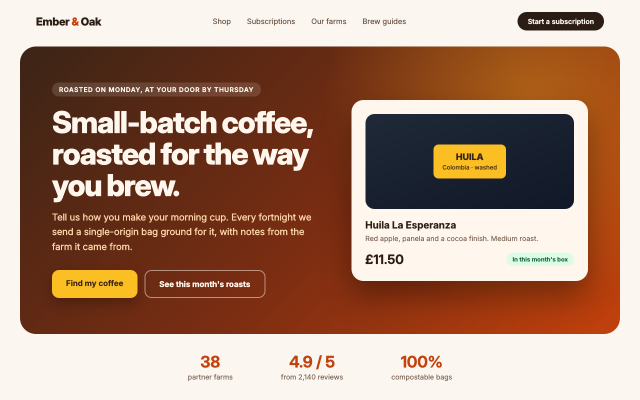</a> | **[HTML](html/)** | 11 | 6 | Web pages drawn by Kition's own HTML and CSS renderer: layout, typography, flex, grid and tables. Saved as .html. |
| <a href="photo/">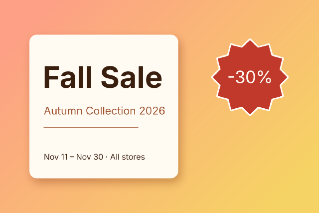</a> | **[Photo](photo/)** | 60 | 10 | Layered images: shapes, type, adjustment and fill layers, styles, masks, filters. Saved as PSD. |
| <a href="vector/">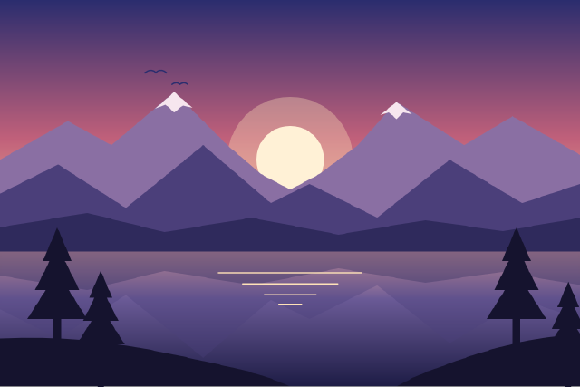</a> | **[Vector](vector/)** | 11 | 5 | Vector illustration: paths, shapes, gradients, strokes, type and artboards. Saved as .kvector. |
| <a href="layout/">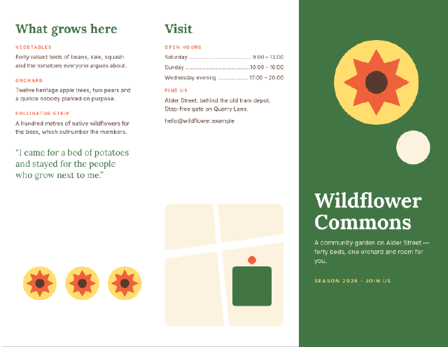</a> | **[Layout](layout/)** | 10 | 5 | Page layout: frames, text flow, master pages, styles, colour swatches and grids. Saved as .klayout. |
| <a href="design/">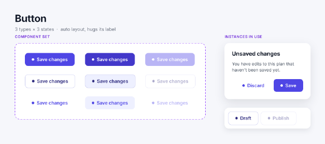</a> | **[Design](design/)** | 10 | 5 | Interface design and prototyping: frames, auto layout, components, variants and constraints. Saved as .kdesign. |
| <a href="film/">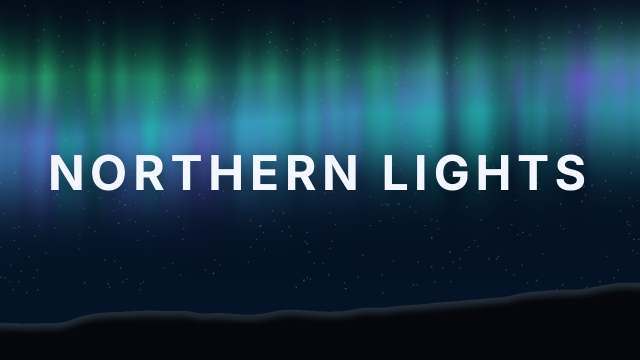</a> | **[Film](film/)** | 63 | 8 | Video edits: synthetic footage, titles, shapes, effects, keyframes, transitions and audio. Saved as .kfilm. |
| <a href="motion/">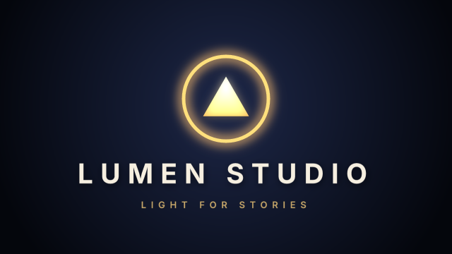</a> | **[Motion](motion/)** | 12 | 5 | Motion graphics and visual effects: layers, shapes, text animators, keyframes and effects. Saved as .kmotion. |
| <a href="cad/">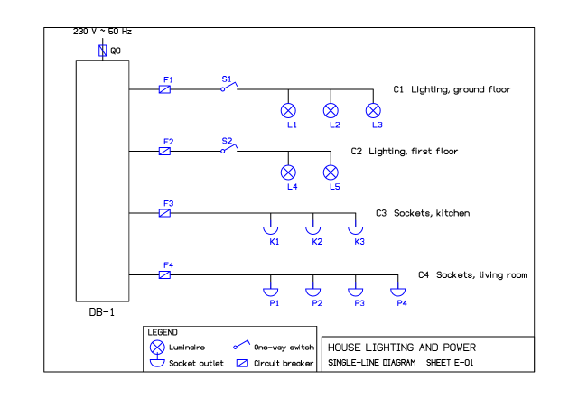</a> | **[CAD](cad/)** | 11 | 5 | 2D drafting: lines, arcs, polylines, hatches, dimensions, layers and blocks. Saved as DXF. |
| <a href="scene/">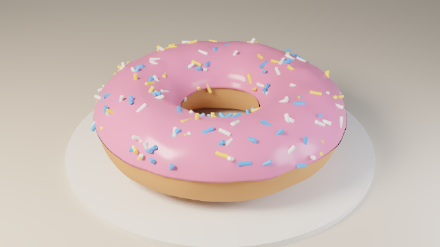</a> | **[Scene](scene/)** | 12 | 5 | 3D scenes: primitives, modifiers, sculpting, curves, text, materials, lights and cameras. Saved as .kscene. |

## Featured

<table>
<tr>
<td width="33%" valign="top">
<a href="film/aurora-title-card/"></a><br>
<sub>Film · ▶ animated</sub><br>
<b><a href="film/aurora-title-card/">Aurora Title Card</a></b><br>
<sub>An opening title fades in over a moving aurora, with a slow push-in on the footage.</sub><br>
<sub><i>1280 × 720 @ 24 fps; 16.0 s; 2 video clips; 1 effect; 2 animated effects</i></sub><br>
<code>titles</code> <code>keyframes</code> <code>opacity</code> <code>motion</code> <code>demo-footage</code>
</td>
<td width="33%" valign="top">
<a href="film/desert-narration-subtitles/">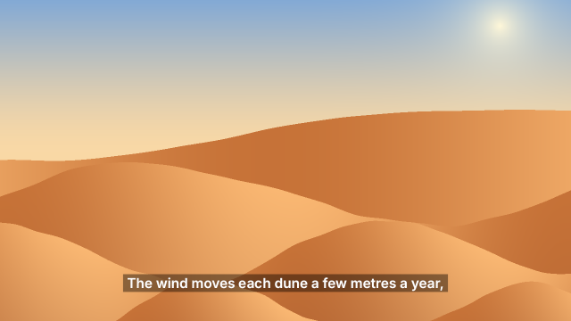</a><br>
<sub>Film · ▶ animated</sub><br>
<b><a href="film/desert-narration-subtitles/">Desert Narration Subtitles</a></b><br>
<sub>A nature documentary's narration is subtitled line by line on an English caption track with a boxed, broadcast-style look.</sub><br>
<sub><i>1280 × 720 @ 24 fps; 12.0 s; 1 video clip; 1 audio clip</i></sub><br>
<code>captions</code> <code>subtitles</code> <code>narration</code> <code>demo-footage</code>
</td>
<td width="33%" valign="top">
<a href="film/documentary-chapter-markers/">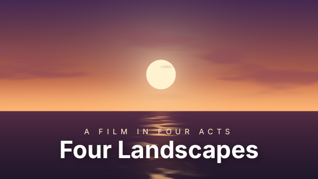</a><br>
<sub>Film · ▶ animated</sub><br>
<b><a href="film/documentary-chapter-markers/">Documentary Chapter Markers</a></b><br>
<sub>A landscape documentary's review cut carries chapter markers for each act, colour-coded notes, a range marker and In/Out points for export.</sub><br>
<sub><i>1280 × 720 @ 24 fps; 16.0 s; 5 video clips; 4 audio clips; 2 effects; 8 markers</i></sub><br>
<code>markers</code> <code>chapters</code> <code>in-out</code> <code>review</code> <code>titles</code> <code>demo-footage</code>
</td>
</tr>
<tr>
<td width="33%" valign="top">
<a href="film/ken-burns-sunset-push/">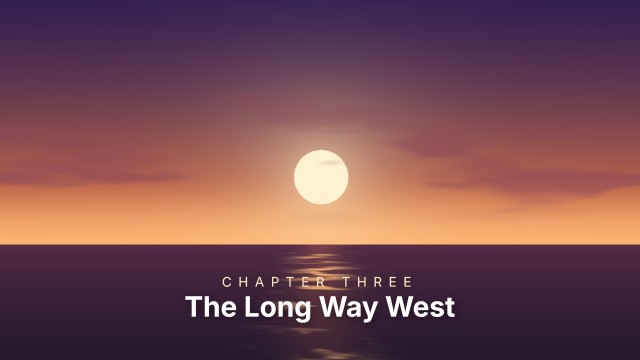</a><br>
<sub>Film · ▶ animated</sub><br>
<b><a href="film/ken-burns-sunset-push/">Ken Burns Sunset Push-In</a></b><br>
<sub>A slow eased push-in that drifts the sun to the centre of frame, the Ken Burns move on Motion scale and position keyframes.</sub><br>
<sub><i>1920 × 1080 @ 24 fps; 18.0 s; 2 video clips; 2 effects; 2 animated effects</i></sub><br>
<code>keyframes</code> <code>motion</code> <code>easing</code> <code>ken-burns</code> <code>demo-footage</code>
</td>
<td width="33%" valign="top">
<a href="film/music-ducking-under-dialogue/">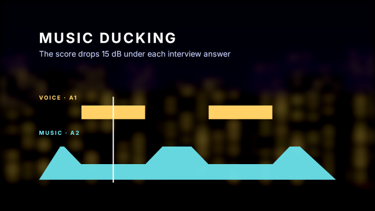</a><br>
<sub>Film · ▶ animated</sub><br>
<b><a href="film/music-ducking-under-dialogue/">Music Ducking Under Dialogue</a></b><br>
<sub>A music bed that dips 15 dB whenever an interview answer plays, written by Essential Sound auto-ducking, with a diagram of the mix.</sub><br>
<sub><i>1920 × 1080 @ 24 fps; 14.0 s; 3 video clips; 3 audio clips; 10 effects; 2 animated effects; 2 transitions</i></sub><br>
<code>audio</code> <code>ducking</code> <code>essential-sound</code> <code>music</code> <code>keyframes</code> <code>demo-footage</code>
</td>
<td width="33%" valign="top">
<a href="film/six-places-beat-montage/">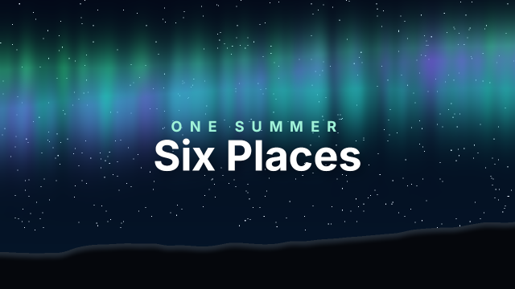</a><br>
<sub>Film · ▶ animated</sub><br>
<b><a href="film/six-places-beat-montage/">Six Places Beat Montage</a></b><br>
<sub>A summer travel recap cuts six scenes on the bar lines of its music, marked first and then edited to the markers.</sub><br>
<sub><i>1280 × 720 @ 24 fps; 12.0 s; 7 video clips; 1 audio clip; 2 effects; 7 markers</i></sub><br>
<code>montage</code> <code>markers</code> <code>razor</code> <code>music</code> <code>titles</code> <code>demo-footage</code>
</td>
</tr>
<tr>
<td width="33%" valign="top">
<a href="film/sunset-to-aurora-dissolve/">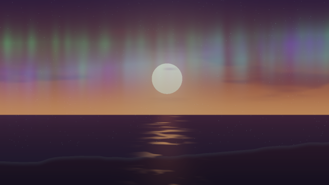</a><br>
<sub>Film · ▶ animated</sub><br>
<b><a href="film/sunset-to-aurora-dissolve/">Sunset to Aurora Dissolve</a></b><br>
<sub>A travel film lets the last light over the ocean melt into the night sky with a 1.5 second cross dissolve.</sub><br>
<sub><i>1280 × 720 @ 24 fps; 10.0 s; 2 video clips; 2 audio clips; 1 transition</i></sub><br>
<code>transitions</code> <code>cross-dissolve</code> <code>demo-footage</code>
</td>
<td width="33%" valign="top">
<a href="film/teal-orange-sunset-grade/">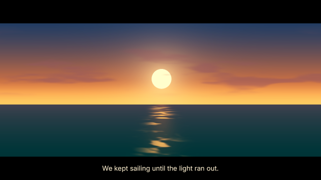</a><br>
<sub>Film · ▶ animated</sub><br>
<b><a href="film/teal-orange-sunset-grade/">Teal &amp; Orange Sunset Grade</a></b><br>
<sub>A sunset at sea graded with Lumetri Color into a cinematic teal-and-orange look, framed in a 2.39:1 letterbox.</sub><br>
<sub><i>1920 × 1080 @ 24 fps; 18.0 s; 3 video clips; 4 effects</i></sub><br>
<code>color</code> <code>lumetri</code> <code>grading</code> <code>letterbox</code> <code>demo-footage</code>
</td>
<td width="33%" valign="top">
<a href="photo/autumn-sale-poster/"></a><br>
<sub>Photo</sub><br>
<b><a href="photo/autumn-sale-poster/">Autumn Sale Poster</a></b><br>
<sub>A retail poster with a gradient fill layer, a shadowed card, a star badge and type.</sub><br>
<sub><i>1200 × 800 px; 9 layers; 4 type layers; 3 shape layers; 1 fill layer; 2 styled layers; 1 mask</i></sub><br>
<code>gradient</code> <code>shapes</code> <code>layer-styles</code> <code>type</code>
</td>
</tr>
</table>

## Build and test

```sh
pnpm install
node tools/build.mjs                 # build every sample and the galleries
node tools/build.mjs film/          # one kit, or one sample: photo/autumn-poster
node tools/build.mjs --check         # rebuild into a temporary folder and compare
```

The kits are expected next to this repository (`../kition-film`, `../kition-photo`, …; or set `KITION_ROOT`), with fonts from `../kition-fonts`. See [CONTRIBUTING.md](CONTRIBUTING.md) for the sample format.

## License

The tooling is Apache-2.0 ([LICENSE](LICENSE)). The sample files are original works, made with the kits' own commands; you are free to use them under the same license.
