<!-- Generated by tools/gallery.mjs from showcase.yaml and build.json; do not edit. -->
# Board showcase

Infinite whiteboards: shapes, sticky notes, connectors, freehand, frames and mind maps. Saved as .kboard. Every sample is built from `showcase.yaml` by the kit's own commands and drawn by its own engine (`kition-board`).

**12 samples** · 5 categories · 8 features of `kition-board/features.yaml` · [all kits](../README.md)

[Brainstorming](#brainstorming) (3) · [Diagrams & Flows](#diagrams--flows) (3) · [Mind Maps](#mind-maps) (1) · [Planning](#planning) (4) · [Retrospectives](#retrospectives) (1)

## Brainstorming

<table>
<tr>
<td width="33%" valign="top">
<a href="balcony-gardener-persona/">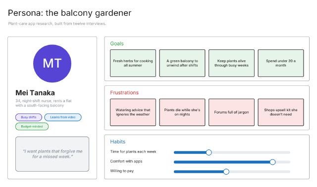</a> 
Board 
<b><a href="balcony-gardener-persona/">Balcony Gardener Persona</a></b> 
A user persona board with an avatar, a quote, trait chips, goal and frustration notes and habit sliders. 
<i>1 page; 36 elements</i> 
<code>persona</code> <code>ux-research</code> <code>sticky-notes</code> <code>frames</code>
</td>
<td width="33%" valign="top">
<a href="field-app-feature-brainstorm/">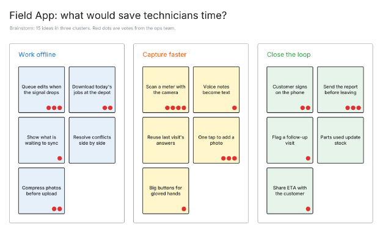</a> 
Board 
<b><a href="field-app-feature-brainstorm/">Field App Feature Brainstorm</a></b> 
Fifteen sticky-note ideas sorted into three coloured clusters, with red dot votes on the favourites. 
<i>1 page; 47 elements</i> 
<code>sticky-notes</code> <code>frames</code> <code>clusters</code> <code>dot-voting</code>
</td>
<td width="33%" valign="top">
<a href="new-hire-onboarding-brainstorm/">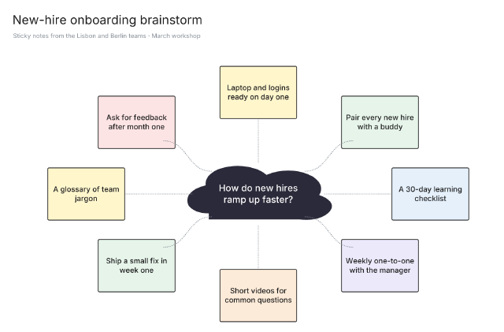</a> 
Board 
<b><a href="new-hire-onboarding-brainstorm/">New-Hire Onboarding Brainstorm</a></b> 
Sticky notes from two offices arranged around a cloud-shaped question, joined by dotted curved connectors. 
<i>1 page; 19 elements</i> 
<code>sticky-notes</code> <code>connectors</code>
</td>
</tr>
</table>

## Diagrams & Flows

<table>
<tr>
<td width="33%" valign="top">
<a href="checkout-user-journey/">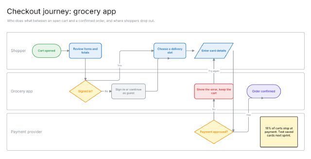</a> 
Board 
<b><a href="checkout-user-journey/">Checkout User Journey</a></b> 
A swim-lane flowchart of a grocery app's checkout, with decision diamonds, Yes and No branches and a retry loop. 
<i>1 page; 28 elements</i> 
<code>flowchart</code> <code>connectors</code> <code>swim-lanes</code> <code>user-journey</code>
</td>
<td width="33%" valign="top">
<a href="design-studio-org-chart/">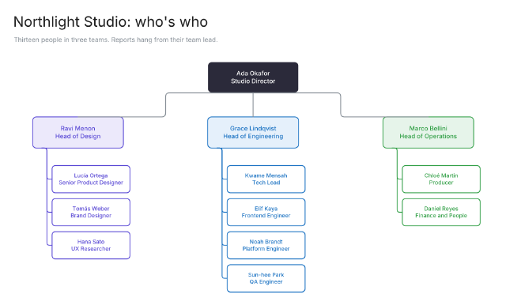</a> 
Board 
<b><a href="design-studio-org-chart/">Design Studio Org Chart</a></b> 
A three-team org chart with a director, department heads and their reports, joined by elbow connectors. 
<i>1 page; 27 elements</i> 
<code>org-chart</code> <code>connectors</code>
</td>
<td width="33%" valign="top">
<a href="web-shop-architecture/">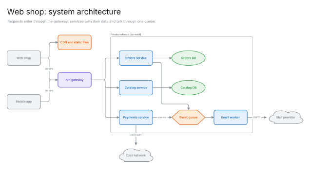</a> 
Board 
<b><a href="web-shop-architecture/">Web Shop Architecture</a></b> 
A system diagram of an online shop, with clients, a gateway, services and their data stores inside a private network frame. 
<i>1 page; 29 elements</i> 
<code>architecture</code> <code>connectors</code> <code>frames</code>
</td>
</tr>
</table>

## Mind Maps

<table>
<tr>
<td width="33%" valign="top">
<a href="cafe-launch-mind-map/">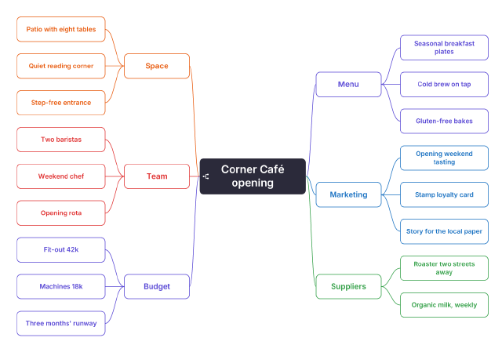</a> 
Board 
<b><a href="cafe-launch-mind-map/">Café Opening Mind Map</a></b> 
A two-sided mind map planning a neighbourhood café: menu, marketing, suppliers, space, team and budget. 
<i>1 page; 47 elements</i> 
<code>mind-map</code> <code>planning</code>
</td>
<td width="33%"></td>
<td width="33%"></td>
</tr>
</table>

## Planning

<table>
<tr>
<td width="33%" valign="top">
<a href="bike-coop-swot-analysis/">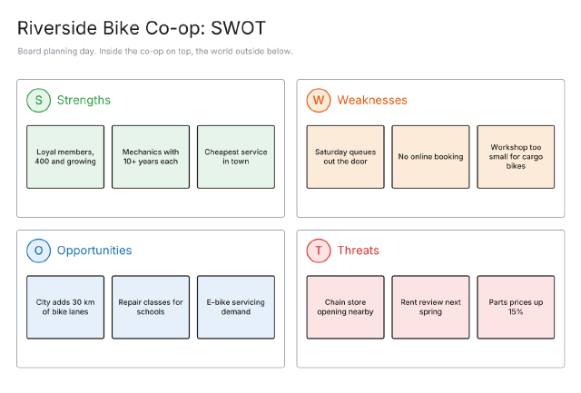</a> 
Board 
<b><a href="bike-coop-swot-analysis/">Bike Co-op SWOT Analysis</a></b> 
A four-quadrant SWOT board for a community bike workshop, with lettered badges and sticky notes in each frame. 
<i>1 page; 26 elements</i> 
<code>swot</code> <code>frames</code> <code>sticky-notes</code> <code>strategy</code>
</td>
<td width="33%" valign="top">
<a href="notes-app-roadmap-2027/">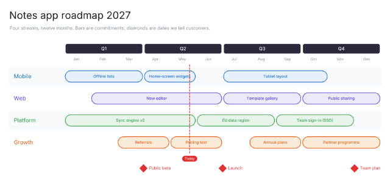</a> 
Board 
<b><a href="notes-app-roadmap-2027/">Product Roadmap 2027</a></b> 
A twelve-month roadmap with quarter headers, four colour-coded streams of bars, milestones and a dashed today line. 
<i>1 page; 47 elements</i> 
<code>roadmap</code> <code>timeline</code> <code>planning</code>
</td>
<td width="33%" valign="top">
<a href="recycling-ad-storyboard/">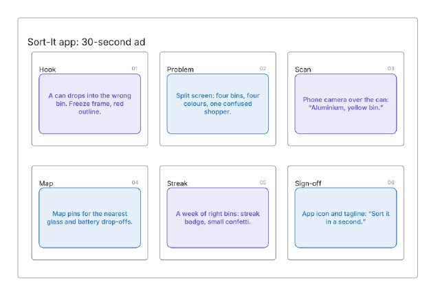</a> 
Board 
<b><a href="recycling-ad-storyboard/">Recycling App Ad Storyboard</a></b> 
A six-panel storyboard for a 30-second app advert, made from the storyboard template, with the voice-over on a second page. 
<i>2 pages; 33 elements</i> 
<code>storyboard</code> <code>templates</code> <code>pages</code> <code>video</code>
</td>
</tr>
<tr>
<td width="33%" valign="top">
<a href="sprint-kanban-board/">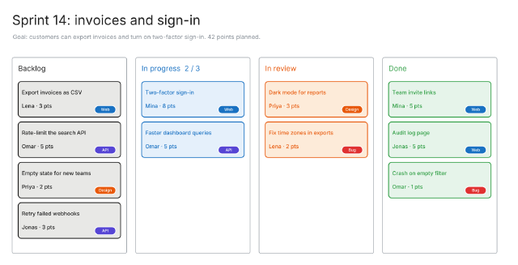</a> 
Board 
<b><a href="sprint-kanban-board/">Sprint Kanban Board</a></b> 
A four-column sprint board with task cards, owners, story points and coloured team tags. 
<i>1 page; 32 elements</i> 
<code>kanban</code> <code>frames</code> <code>sprint</code>
</td>
<td width="33%"></td>
<td width="33%"></td>
</tr>
</table>

## Retrospectives

<table>
<tr>
<td width="33%" valign="top">
<a href="start-stop-continue-retro/">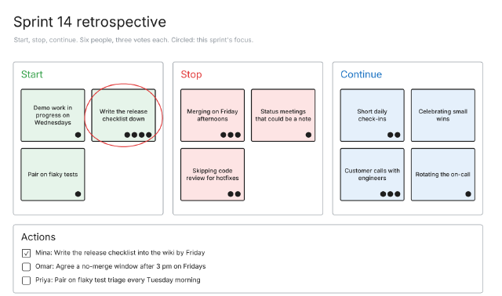</a> 
Board 
<b><a href="start-stop-continue-retro/">Start, Stop, Continue Retro</a></b> 
A sprint retrospective with three columns of sticky notes, dot votes, a hand-drawn circle and an action list. 
<i>1 page; 45 elements</i> 
<code>retrospective</code> <code>sticky-notes</code> <code>dot-voting</code> <code>freehand</code>
</td>
<td width="33%"></td>
<td width="33%"></td>
</tr>
</table>

## Tags

`architecture` 1 · `clusters` 1 · `connectors` 4 · `dot-voting` 2 · `flowchart` 1 · `frames` 5 · `freehand` 1 · `kanban` 1 · `mind-map` 1 · `org-chart` 1 · `pages` 1 · `persona` 1 · `planning` 2 · `retrospective` 1 · `roadmap` 1 · `sprint` 1 · `sticky-notes` 5 · `storyboard` 1 · `strategy` 1 · `swim-lanes` 1 · `swot` 1 · `templates` 1 · `timeline` 1 · `user-journey` 1 · `ux-research` 1 · `video` 1
