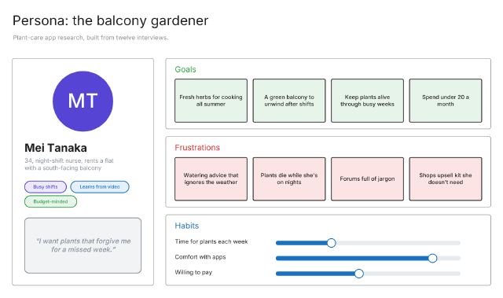

<!-- Generated by tools/gallery.mjs from showcase.yaml and build.json; do not edit. -->
# Balcony Gardener Persona

[Board](../README.md) › [Brainstorming](../README.md#brainstorming) · `persona` `ux-research` `sticky-notes` `frames`

A user persona board with an avatar, a quote, trait chips, goal and frustration notes and habit sliders.



| | |
|---|---|
| Document | [balcony-gardener-persona.kboard](balcony-gardener-persona.kboard) (13 KB) |
| Contents | 1 page; 36 elements |
| Features | `board.elements`, `board.frames` |
| Built by | `kition-board` @ `e042761805`: 8 commands in 6 ms |

## About

A research persona laid out in four frames: the profile with an initials avatar, the name in bold
and a quote in italic (`text.mark`), goals and frustrations as sticky notes, and habits drawn as
slider tracks from rounded rectangles.

## Checks

- `inspect.elements`: `36`
- `results.goals.created`: `{"count":5}`
- `results.habits.created`: `{"count":13}`
- diagnostics: none (the kit's check finds nothing wrong)
- the saved document opens again; the thumbnail matches `thumb.png` within the `render` tolerance

## Steps

<details><summary>8 commands (from <a href="showcase.yaml">showcase.yaml</a>)</summary>

```yaml
- command: element.create
  params:
    elements:
      - kind: text
        position:
          - 40
          - 40
        text: "Persona: the balcony gardener"
        fontSize: 44
        strokeColor: ink
      - kind: text
        position:
          - 42
          - 110
        text: Plant-care app research, built from twelve interviews.
        fontSize: 20
        strokeColor: gray
  as: heading
- command: element.create
  params:
    elements:
      - kind: frame
        position:
          - 40
          - 190
        size:
          - 460
          - 740
        text: ""
      - kind: frame
        position:
          - 540
          - 190
        size:
          - 1060
          - 230
        text: ""
      - kind: frame
        position:
          - 540
          - 445
        size:
          - 1060
          - 230
        text: ""
      - kind: frame
        position:
          - 540
          - 700
        size:
          - 1060
          - 230
        text: ""
  as: f
- command: element.create
  params:
    elements:
      - kind: shape
        shapeType: ellipse
        parent: $f.created.0
        position:
          - 170
          - 230
        size:
          - 200
          - 200
        text: MT
        fillColor: "#5645d4"
        fillStyle: solid
        strokeColor: white
        fontSize: 64
      - kind: text
        parent: $f.created.0
        position:
          - 80
          - 460
        text: Mei Tanaka
        fontSize: 36
        strokeColor: ink
      - kind: text
        parent: $f.created.0
        position:
          - 80
          - 512
        text: |-
          34, night-shift nurse, rents a flat
          with a south-facing balcony
        fontSize: 19
        strokeColor: gray
      - kind: shape
        shapeType: pill
        parent: $f.created.0
        position:
          - 80
          - 590
        size:
          - 136
          - 38
        text: Busy shifts
        fillColor: purple
        fillStyle: solid
        strokeColor: purple
        fontSize: 15
      - kind: shape
        shapeType: pill
        parent: $f.created.0
        position:
          - 230
          - 590
        size:
          - 190
          - 38
        text: Learns from video
        fillColor: blue
        fillStyle: solid
        strokeColor: blue
        fontSize: 15
      - kind: shape
        shapeType: pill
        parent: $f.created.0
        position:
          - 80
          - 638
        size:
          - 170
          - 38
        text: Budget-minded
        fillColor: green
        fillStyle: solid
        strokeColor: green
        fontSize: 15
      - kind: shape
        parent: $f.created.0
        position:
          - 80
          - 710
        size:
          - 380
          - 180
        text: |-
          “I want plants that forgive me
          for a missed week.”
        fillColor: gray
        fillStyle: solid
        strokeColor: gray
        roundness: 14
        fontSize: 22
  as: card
- command: text.mark
  params:
    id: $card.created.1
    range:
      - 0
      - 10
    mark: bold
- command: text.mark
  params:
    id: $card.created.6
    range:
      - 0
      - 50
    mark: italic
- command: element.create
  params:
    elements:
      - kind: text
        parent: $f.created.1
        position:
          - 570
          - 210
        text: Goals
        fontSize: 26
        strokeColor: green
      - kind: shape
        shapeStyle: sticky
        parent: $f.created.1
        position:
          - 570
          - 258
        size:
          - 235
          - 140
        text: Fresh herbs for cooking all summer
        fillColor: green
        fontSize: 18
      - kind: shape
        shapeStyle: sticky
        parent: $f.created.1
        position:
          - 825
          - 258
        size:
          - 235
          - 140
        text: A green balcony to unwind after shifts
        fillColor: green
        fontSize: 18
      - kind: shape
        shapeStyle: sticky
        parent: $f.created.1
        position:
          - 1080
          - 258
        size:
          - 235
          - 140
        text: Keep plants alive through busy weeks
        fillColor: green
        fontSize: 18
      - kind: shape
        shapeStyle: sticky
        parent: $f.created.1
        position:
          - 1335
          - 258
        size:
          - 235
          - 140
        text: Spend under 20 a month
        fillColor: green
        fontSize: 18
  as: goals
- command: element.create
  params:
    elements:
      - kind: text
        parent: $f.created.2
        position:
          - 570
          - 465
        text: Frustrations
        fontSize: 26
        strokeColor: red
      - kind: shape
        shapeStyle: sticky
        parent: $f.created.2
        position:
          - 570
          - 513
        size:
          - 235
          - 140
        text: Watering advice that ignores the weather
        fillColor: red
        fontSize: 18
      - kind: shape
        shapeStyle: sticky
        parent: $f.created.2
        position:
          - 825
          - 513
        size:
          - 235
          - 140
        text: Plants die while she's on nights
        fillColor: red
        fontSize: 18
      - kind: shape
        shapeStyle: sticky
        parent: $f.created.2
        position:
          - 1080
          - 513
        size:
          - 235
          - 140
        text: Forums full of jargon
        fillColor: red
        fontSize: 18
      - kind: shape
        shapeStyle: sticky
        parent: $f.created.2
        position:
          - 1335
          - 513
        size:
          - 235
          - 140
        text: Shops upsell kit she doesn't need
        fillColor: red
        fontSize: 18
  as: pains
- command: element.create
  params:
    elements:
      - kind: text
        parent: $f.created.3
        position:
          - 570
          - 720
        text: Habits
        fontSize: 26
        strokeColor: blue
      - kind: text
        parent: $f.created.3
        position:
          - 570
          - 776
        text: Time for plants each week
        fontSize: 19
        strokeColor: ink
      - kind: shape
        parent: $f.created.3
        position:
          - 900
          - 786
        size:
          - 600
          - 12
        fillColor: "#e9ecef"
        fillStyle: solid
        strokeColor: "#e9ecef"
        roundness: 6
      - kind: shape
        parent: $f.created.3
        position:
          - 900
          - 786
        size:
          - 180
          - 12
        fillColor: "#1971c2"
        fillStyle: solid
        strokeColor: "#1971c2"
        roundness: 6
      - kind: shape
        shapeType: ellipse
        parent: $f.created.3
        position:
          - 1066
          - 778
        size:
          - 28
          - 28
        fillColor: white
        fillStyle: solid
        strokeColor: "#1971c2"
        strokeSize: m
      - kind: text
        parent: $f.created.3
        position:
          - 570
          - 826
        text: Comfort with apps
        fontSize: 19
        strokeColor: ink
      - kind: shape
        parent: $f.created.3
        position:
          - 900
          - 836
        size:
          - 600
          - 12
        fillColor: "#e9ecef"
        fillStyle: solid
        strokeColor: "#e9ecef"
        roundness: 6
      - kind: shape
        parent: $f.created.3
        position:
          - 900
          - 836
        size:
          - 510
          - 12
        fillColor: "#1971c2"
        fillStyle: solid
        strokeColor: "#1971c2"
        roundness: 6
      - kind: shape
        shapeType: ellipse
        parent: $f.created.3
        position:
          - 1396
          - 828
        size:
          - 28
          - 28
        fillColor: white
        fillStyle: solid
        strokeColor: "#1971c2"
        strokeSize: m
      - kind: text
        parent: $f.created.3
        position:
          - 570
          - 876
        text: Willing to pay
        fontSize: 19
        strokeColor: ink
      - kind: shape
        parent: $f.created.3
        position:
          - 900
          - 886
        size:
          - 600
          - 12
        fillColor: "#e9ecef"
        fillStyle: solid
        strokeColor: "#e9ecef"
        roundness: 6
      - kind: shape
        parent: $f.created.3
        position:
          - 900
          - 886
        size:
          - 270
          - 12
        fillColor: "#1971c2"
        fillStyle: solid
        strokeColor: "#1971c2"
        roundness: 6
      - kind: shape
        shapeType: ellipse
        parent: $f.created.3
        position:
          - 1156
          - 878
        size:
          - 28
          - 28
        fillColor: white
        fillStyle: solid
        strokeColor: "#1971c2"
        strokeSize: m
  as: habits
```

</details>
