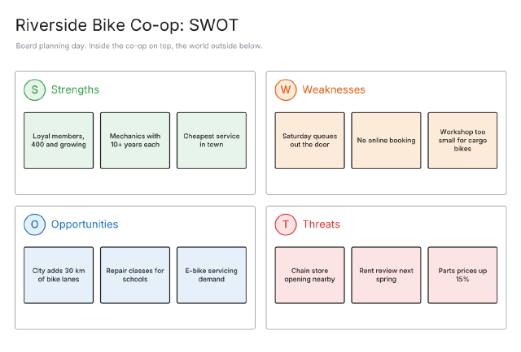

<!-- Generated by tools/gallery.mjs from showcase.yaml and build.json; do not edit. -->
# Bike Co-op SWOT Analysis

[Board](../README.md) › [Planning](../README.md#planning) · `swot` `frames` `sticky-notes` `strategy`

A four-quadrant SWOT board for a community bike workshop, with lettered badges and sticky notes in each frame.



| | |
|---|---|
| Document | [bike-coop-swot-analysis.kboard](bike-coop-swot-analysis.kboard) (9 KB) |
| Contents | 1 page; 26 elements |
| Features | `board.elements`, `board.frames` |
| Built by | `kition-board` @ `e042761805`: 6 commands in 6 ms |

## About

Strengths, weaknesses, opportunities and threats as four frames on a grid, each with a lettered
ellipse badge and three sticky notes the board agreed on.

## Checks

- `inspect.elements`: `26`
- `results.q.created`: `{"count":4}`
- `results.s3.created`: `{"count":5}`
- diagnostics: none (the kit's check finds nothing wrong)
- the saved document opens again; the thumbnail matches `thumb.png` within the `render` tolerance

## Steps

<details><summary>6 commands (from <a href="showcase.yaml">showcase.yaml</a>)</summary>

```yaml
- command: element.create
  params:
    elements:
      - kind: text
        position:
          - 40
          - 40
        text: "Riverside Bike Co-op: SWOT"
        fontSize: 44
        strokeColor: ink
      - kind: text
        position:
          - 42
          - 110
        text: Board planning day. Inside the co-op on top, the world outside below.
        fontSize: 20
        strokeColor: gray
  as: heading
- command: element.create
  params:
    elements:
      - kind: frame
        position:
          - 40
          - 190
        size:
          - 640
          - 330
        text: ""
      - kind: frame
        position:
          - 710
          - 190
        size:
          - 640
          - 330
        text: ""
      - kind: frame
        position:
          - 40
          - 550
        size:
          - 640
          - 330
        text: ""
      - kind: frame
        position:
          - 710
          - 550
        size:
          - 640
          - 330
        text: ""
  as: q
- command: element.create
  params:
    elements:
      - kind: shape
        shapeType: ellipse
        parent: $q.created.0
        position:
          - 64
          - 212
        size:
          - 56
          - 56
        text: S
        fillColor: green
        fillStyle: solid
        strokeColor: green
        fontSize: 28
      - kind: text
        parent: $q.created.0
        position:
          - 136
          - 222
        text: Strengths
        fontSize: 28
        strokeColor: green
      - kind: shape
        shapeStyle: sticky
        parent: $q.created.0
        position:
          - 64
          - 300
        size:
          - 184
          - 150
        text: Loyal members, 400 and growing
        fillColor: green
        fontSize: 18
      - kind: shape
        shapeStyle: sticky
        parent: $q.created.0
        position:
          - 268
          - 300
        size:
          - 184
          - 150
        text: Mechanics with 10+ years each
        fillColor: green
        fontSize: 18
      - kind: shape
        shapeStyle: sticky
        parent: $q.created.0
        position:
          - 472
          - 300
        size:
          - 184
          - 150
        text: Cheapest service in town
        fillColor: green
        fontSize: 18
  as: s0
- command: element.create
  params:
    elements:
      - kind: shape
        shapeType: ellipse
        parent: $q.created.1
        position:
          - 734
          - 212
        size:
          - 56
          - 56
        text: W
        fillColor: orange
        fillStyle: solid
        strokeColor: orange
        fontSize: 28
      - kind: text
        parent: $q.created.1
        position:
          - 806
          - 222
        text: Weaknesses
        fontSize: 28
        strokeColor: orange
      - kind: shape
        shapeStyle: sticky
        parent: $q.created.1
        position:
          - 734
          - 300
        size:
          - 184
          - 150
        text: Saturday queues out the door
        fillColor: orange
        fontSize: 18
      - kind: shape
        shapeStyle: sticky
        parent: $q.created.1
        position:
          - 938
          - 300
        size:
          - 184
          - 150
        text: No online booking
        fillColor: orange
        fontSize: 18
      - kind: shape
        shapeStyle: sticky
        parent: $q.created.1
        position:
          - 1142
          - 300
        size:
          - 184
          - 150
        text: Workshop too small for cargo bikes
        fillColor: orange
        fontSize: 18
  as: s1
- command: element.create
  params:
    elements:
      - kind: shape
        shapeType: ellipse
        parent: $q.created.2
        position:
          - 64
          - 572
        size:
          - 56
          - 56
        text: O
        fillColor: blue
        fillStyle: solid
        strokeColor: blue
        fontSize: 28
      - kind: text
        parent: $q.created.2
        position:
          - 136
          - 582
        text: Opportunities
        fontSize: 28
        strokeColor: blue
      - kind: shape
        shapeStyle: sticky
        parent: $q.created.2
        position:
          - 64
          - 660
        size:
          - 184
          - 150
        text: City adds 30 km of bike lanes
        fillColor: blue
        fontSize: 18
      - kind: shape
        shapeStyle: sticky
        parent: $q.created.2
        position:
          - 268
          - 660
        size:
          - 184
          - 150
        text: Repair classes for schools
        fillColor: blue
        fontSize: 18
      - kind: shape
        shapeStyle: sticky
        parent: $q.created.2
        position:
          - 472
          - 660
        size:
          - 184
          - 150
        text: E-bike servicing demand
        fillColor: blue
        fontSize: 18
  as: s2
- command: element.create
  params:
    elements:
      - kind: shape
        shapeType: ellipse
        parent: $q.created.3
        position:
          - 734
          - 572
        size:
          - 56
          - 56
        text: T
        fillColor: red
        fillStyle: solid
        strokeColor: red
        fontSize: 28
      - kind: text
        parent: $q.created.3
        position:
          - 806
          - 582
        text: Threats
        fontSize: 28
        strokeColor: red
      - kind: shape
        shapeStyle: sticky
        parent: $q.created.3
        position:
          - 734
          - 660
        size:
          - 184
          - 150
        text: Chain store opening nearby
        fillColor: red
        fontSize: 18
      - kind: shape
        shapeStyle: sticky
        parent: $q.created.3
        position:
          - 938
          - 660
        size:
          - 184
          - 150
        text: Rent review next spring
        fillColor: red
        fontSize: 18
      - kind: shape
        shapeStyle: sticky
        parent: $q.created.3
        position:
          - 1142
          - 660
        size:
          - 184
          - 150
        text: Parts prices up 15%
        fillColor: red
        fontSize: 18
  as: s3
```

</details>
