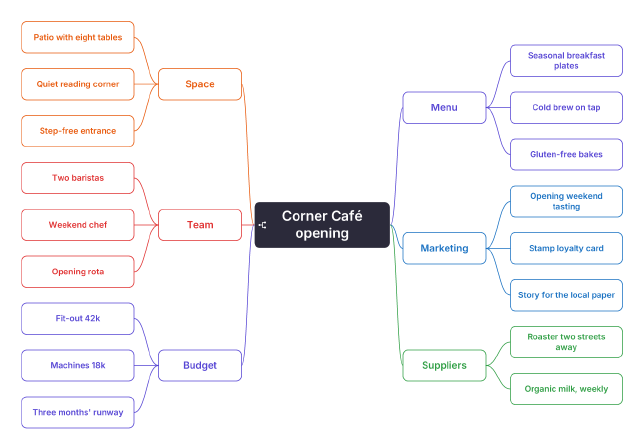

<!-- Generated by tools/gallery.mjs from showcase.yaml and build.json; do not edit. -->
# Café Opening Mind Map

[Board](../README.md) › [Mind Maps](../README.md#mind-maps) · `mind-map` `planning`

A two-sided mind map planning a neighbourhood café: menu, marketing, suppliers, space, team and budget.



| | |
|---|---|
| Document | [cafe-launch-mind-map.kboard](cafe-launch-mind-map.kboard) (22 KB) |
| Contents | 1 page; 47 elements |
| Features | `board.mindmap` |
| Built by | `kition-board` @ `e042761805`: 49 commands in 28 ms |

## About

One root and six branches, each added with mindmap.addChild; the kit lays the map out on both
sides of the root and gives every branch its own colour.

## Checks

- `inspect.elements`: `47`
- `results.b0.node`: `{"matches":"^[0-9a-f-]+$"}`
- `results.b5k2.created`: `{"count":2}`
- diagnostics: none (the kit's check finds nothing wrong)
- the saved document opens again; the thumbnail matches `thumb.png` within the `render` tolerance

## Steps

<details><summary>49 commands (from <a href="showcase.yaml">showcase.yaml</a>)</summary>

```yaml
- command: element.create
  params:
    elements:
      - kind: shape
        shapeStyle: mind-node
        position:
          - 900
          - 500
        size:
          - 280
          - 96
        text: Corner Café opening
        fillColor: "#2b2a3a"
        strokeColor: white
        fillStyle: solid
        fontSize: 28
  as: root
- command: mindmap.setDirection
  params:
    node: $root.created.0
    direction: both
- command: mindmap.addChild
  params:
    node: $root.created.0
    text: Menu
    side: right
  as: b0
- command: mindmap.addChild
  params:
    node: $b0.node
    text: Seasonal breakfast plates
  as: b0k0
- command: element.update
  params:
    id: $b0k0.node
    set:
      size:
        - 230
        - 64
      fontSize: 17
- command: mindmap.addChild
  params:
    node: $b0.node
    text: Cold brew on tap
  as: b0k1
- command: element.update
  params:
    id: $b0k1.node
    set:
      size:
        - 230
        - 64
      fontSize: 17
- command: mindmap.addChild
  params:
    node: $b0.node
    text: Gluten-free bakes
  as: b0k2
- command: element.update
  params:
    id: $b0k2.node
    set:
      size:
        - 230
        - 64
      fontSize: 17
- command: element.update
  params:
    id: $b0.node
    set:
      size:
        - 170
        - 64
      fontSize: 20
- command: mindmap.addChild
  params:
    node: $root.created.0
    text: Marketing
    side: right
  as: b1
- command: mindmap.addChild
  params:
    node: $b1.node
    text: Opening weekend tasting
  as: b1k0
- command: element.update
  params:
    id: $b1k0.node
    set:
      size:
        - 230
        - 64
      fontSize: 17
- command: mindmap.addChild
  params:
    node: $b1.node
    text: Stamp loyalty card
  as: b1k1
- command: element.update
  params:
    id: $b1k1.node
    set:
      size:
        - 230
        - 64
      fontSize: 17
- command: mindmap.addChild
  params:
    node: $b1.node
    text: Story for the local paper
  as: b1k2
- command: element.update
  params:
    id: $b1k2.node
    set:
      size:
        - 230
        - 64
      fontSize: 17
- command: element.update
  params:
    id: $b1.node
    set:
      size:
        - 170
        - 64
      fontSize: 20
- command: mindmap.addChild
  params:
    node: $root.created.0
    text: Suppliers
    side: right
  as: b2
- command: mindmap.addChild
  params:
    node: $b2.node
    text: Roaster two streets away
  as: b2k0
- command: element.update
  params:
    id: $b2k0.node
    set:
      size:
        - 230
        - 64
      fontSize: 17
- command: mindmap.addChild
  params:
    node: $b2.node
    text: Organic milk, weekly
  as: b2k1
- command: element.update
  params:
    id: $b2k1.node
    set:
      size:
        - 230
        - 64
      fontSize: 17
- command: element.update
  params:
    id: $b2.node
    set:
      size:
        - 170
        - 64
      fontSize: 20
- command: mindmap.addChild
  params:
    node: $root.created.0
    text: Space
    side: left
  as: b3
- command: mindmap.addChild
  params:
    node: $b3.node
    text: Patio with eight tables
  as: b3k0
- command: element.update
  params:
    id: $b3k0.node
    set:
      size:
        - 230
        - 64
      fontSize: 17
- command: mindmap.addChild
  params:
    node: $b3.node
    text: Quiet reading corner
  as: b3k1
- command: element.update
  params:
    id: $b3k1.node
    set:
      size:
        - 230
        - 64
      fontSize: 17
- command: mindmap.addChild
  params:
    node: $b3.node
    text: Step-free entrance
  as: b3k2
- command: element.update
  params:
    id: $b3k2.node
    set:
      size:
        - 230
        - 64
      fontSize: 17
- command: element.update
  params:
    id: $b3.node
    set:
      size:
        - 170
        - 64
      fontSize: 20
- command: mindmap.addChild
  params:
    node: $root.created.0
    text: Team
    side: left
  as: b4
- command: mindmap.addChild
  params:
    node: $b4.node
    text: Two baristas
  as: b4k0
- command: element.update
  params:
    id: $b4k0.node
    set:
      size:
        - 230
        - 64
      fontSize: 17
- command: mindmap.addChild
  params:
    node: $b4.node
    text: Weekend chef
  as: b4k1
- command: element.update
  params:
    id: $b4k1.node
    set:
      size:
        - 230
        - 64
      fontSize: 17
- command: mindmap.addChild
  params:
    node: $b4.node
    text: Opening rota
  as: b4k2
- command: element.update
  params:
    id: $b4k2.node
    set:
      size:
        - 230
        - 64
      fontSize: 17
- command: element.update
  params:
    id: $b4.node
    set:
      size:
        - 170
        - 64
      fontSize: 20
- command: mindmap.addChild
  params:
    node: $root.created.0
    text: Budget
    side: left
  as: b5
- command: mindmap.addChild
  params:
    node: $b5.node
    text: Fit-out 42k
  as: b5k0
- command: element.update
  params:
    id: $b5k0.node
    set:
      size:
        - 230
        - 64
      fontSize: 17
- command: mindmap.addChild
  params:
    node: $b5.node
    text: Machines 18k
  as: b5k1
- command: element.update
  params:
    id: $b5k1.node
    set:
      size:
        - 230
        - 64
      fontSize: 17
- command: mindmap.addChild
  params:
    node: $b5.node
    text: Three months' runway
  as: b5k2
- command: element.update
  params:
    id: $b5k2.node
    set:
      size:
        - 230
        - 64
      fontSize: 17
- command: element.update
  params:
    id: $b5.node
    set:
      size:
        - 170
        - 64
      fontSize: 20
- command: layout.mindmap
  params:
    root: $root.created.0
```

</details>
