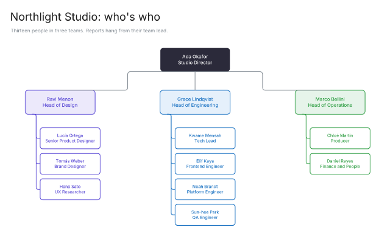

<!-- Generated by tools/gallery.mjs from showcase.yaml and build.json; do not edit. -->
# Design Studio Org Chart

[Board](../README.md) › [Diagrams & Flows](../README.md#diagrams--flows) · `org-chart` `connectors`

A three-team org chart with a director, department heads and their reports, joined by elbow connectors.



| | |
|---|---|
| Document | [design-studio-org-chart.kboard](design-studio-org-chart.kboard) (11 KB) |
| Contents | 1 page; 27 elements |
| Features | `board.elements`, `board.connectors` |
| Built by | `kition-board` @ `e042761805`: 17 commands in 2 ms |

## About

Boxes for people, colour-coded by team, joined by elbow connectors without arrowheads. Each
report hangs from its head's left edge, the usual layout when a team is longer than it is wide.

## Checks

- `inspect.elements`: `27`
- `results.d1.created`: `{"count":5}`
- diagnostics: none (the kit's check finds nothing wrong)
- the saved document opens again; the thumbnail matches `thumb.png` within the `render` tolerance

## Steps

<details><summary>17 commands (from <a href="showcase.yaml">showcase.yaml</a>)</summary>

```yaml
- command: element.create
  params:
    elements:
      - kind: text
        position:
          - 40
          - 40
        text: "Northlight Studio: who's who"
        fontSize: 44
        strokeColor: ink
      - kind: text
        position:
          - 42
          - 110
        text: Thirteen people in three teams. Reports hang from their team lead.
        fontSize: 20
        strokeColor: gray
  as: heading
- command: element.create
  params:
    elements:
      - kind: shape
        position:
          - 640
          - 190
        size:
          - 280
          - 96
        text: |-
          Ada Okafor
          Studio Director
        fillColor: "#2b2a3a"
        fillStyle: solid
        strokeColor: white
        roundness: 12
        fontSize: 19
  as: root
- command: element.create
  params:
    elements:
      - kind: shape
        position:
          - 100
          - 360
        size:
          - 280
          - 96
        text: |-
          Ravi Menon
          Head of Design
        fillColor: purple
        fillStyle: solid
        strokeColor: purple
        roundness: 12
        fontSize: 19
      - kind: shape
        position:
          - 160
          - 510
        size:
          - 240
          - 84
        text: |-
          Lucía Ortega
          Senior Product Designer
        fillColor: white
        fillStyle: solid
        strokeColor: purple
        roundness: 10
        fontSize: 17
      - kind: shape
        position:
          - 160
          - 612
        size:
          - 240
          - 84
        text: |-
          Tomás Weber
          Brand Designer
        fillColor: white
        fillStyle: solid
        strokeColor: purple
        roundness: 10
        fontSize: 17
      - kind: shape
        position:
          - 160
          - 714
        size:
          - 240
          - 84
        text: |-
          Hana Sato
          UX Researcher
        fillColor: white
        fillStyle: solid
        strokeColor: purple
        roundness: 10
        fontSize: 17
  as: d0
- command: connector.create
  params:
    from:
      element: $root.created.0
      anchor:
        - 0.5
        - 1
    to:
      element: $d0.created.0
      anchor:
        - 0.5
        - 0
    type: elbow
    endArrowhead: none
    style:
      strokeColor: gray
- command: connector.create
  params:
    from:
      element: $d0.created.0
      anchor:
        - 0.1
        - 1
    to:
      element: $d0.created.1
      anchor:
        - 0
        - 0.5
    type: elbow
    endArrowhead: none
    style:
      strokeColor: purple
- command: connector.create
  params:
    from:
      element: $d0.created.0
      anchor:
        - 0.1
        - 1
    to:
      element: $d0.created.2
      anchor:
        - 0
        - 0.5
    type: elbow
    endArrowhead: none
    style:
      strokeColor: purple
- command: connector.create
  params:
    from:
      element: $d0.created.0
      anchor:
        - 0.1
        - 1
    to:
      element: $d0.created.3
      anchor:
        - 0
        - 0.5
    type: elbow
    endArrowhead: none
    style:
      strokeColor: purple
- command: element.create
  params:
    elements:
      - kind: shape
        position:
          - 640
          - 360
        size:
          - 280
          - 96
        text: |-
          Grace Lindqvist
          Head of Engineering
        fillColor: blue
        fillStyle: solid
        strokeColor: blue
        roundness: 12
        fontSize: 19
      - kind: shape
        position:
          - 700
          - 510
        size:
          - 240
          - 84
        text: |-
          Kwame Mensah
          Tech Lead
        fillColor: white
        fillStyle: solid
        strokeColor: blue
        roundness: 10
        fontSize: 17
      - kind: shape
        position:
          - 700
          - 612
        size:
          - 240
          - 84
        text: |-
          Elif Kaya
          Frontend Engineer
        fillColor: white
        fillStyle: solid
        strokeColor: blue
        roundness: 10
        fontSize: 17
      - kind: shape
        position:
          - 700
          - 714
        size:
          - 240
          - 84
        text: |-
          Noah Brandt
          Platform Engineer
        fillColor: white
        fillStyle: solid
        strokeColor: blue
        roundness: 10
        fontSize: 17
      - kind: shape
        position:
          - 700
          - 816
        size:
          - 240
          - 84
        text: |-
          Sun-hee Park
          QA Engineer
        fillColor: white
        fillStyle: solid
        strokeColor: blue
        roundness: 10
        fontSize: 17
  as: d1
- command: connector.create
  params:
    from:
      element: $root.created.0
      anchor:
        - 0.5
        - 1
    to:
      element: $d1.created.0
      anchor:
        - 0.5
        - 0
    type: elbow
    endArrowhead: none
    style:
      strokeColor: gray
- command: connector.create
  params:
    from:
      element: $d1.created.0
      anchor:
        - 0.1
        - 1
    to:
      element: $d1.created.1
      anchor:
        - 0
        - 0.5
    type: elbow
    endArrowhead: none
    style:
      strokeColor: blue
- command: connector.create
  params:
    from:
      element: $d1.created.0
      anchor:
        - 0.1
        - 1
    to:
      element: $d1.created.2
      anchor:
        - 0
        - 0.5
    type: elbow
    endArrowhead: none
    style:
      strokeColor: blue
- command: connector.create
  params:
    from:
      element: $d1.created.0
      anchor:
        - 0.1
        - 1
    to:
      element: $d1.created.3
      anchor:
        - 0
        - 0.5
    type: elbow
    endArrowhead: none
    style:
      strokeColor: blue
- command: connector.create
  params:
    from:
      element: $d1.created.0
      anchor:
        - 0.1
        - 1
    to:
      element: $d1.created.4
      anchor:
        - 0
        - 0.5
    type: elbow
    endArrowhead: none
    style:
      strokeColor: blue
- command: element.create
  params:
    elements:
      - kind: shape
        position:
          - 1180
          - 360
        size:
          - 280
          - 96
        text: |-
          Marco Bellini
          Head of Operations
        fillColor: green
        fillStyle: solid
        strokeColor: green
        roundness: 12
        fontSize: 19
      - kind: shape
        position:
          - 1240
          - 510
        size:
          - 240
          - 84
        text: |-
          Chloé Martin
          Producer
        fillColor: white
        fillStyle: solid
        strokeColor: green
        roundness: 10
        fontSize: 17
      - kind: shape
        position:
          - 1240
          - 612
        size:
          - 240
          - 84
        text: |-
          Daniel Reyes
          Finance and People
        fillColor: white
        fillStyle: solid
        strokeColor: green
        roundness: 10
        fontSize: 17
  as: d2
- command: connector.create
  params:
    from:
      element: $root.created.0
      anchor:
        - 0.5
        - 1
    to:
      element: $d2.created.0
      anchor:
        - 0.5
        - 0
    type: elbow
    endArrowhead: none
    style:
      strokeColor: gray
- command: connector.create
  params:
    from:
      element: $d2.created.0
      anchor:
        - 0.1
        - 1
    to:
      element: $d2.created.1
      anchor:
        - 0
        - 0.5
    type: elbow
    endArrowhead: none
    style:
      strokeColor: green
- command: connector.create
  params:
    from:
      element: $d2.created.0
      anchor:
        - 0.1
        - 1
    to:
      element: $d2.created.2
      anchor:
        - 0
        - 0.5
    type: elbow
    endArrowhead: none
    style:
      strokeColor: green
```

</details>
