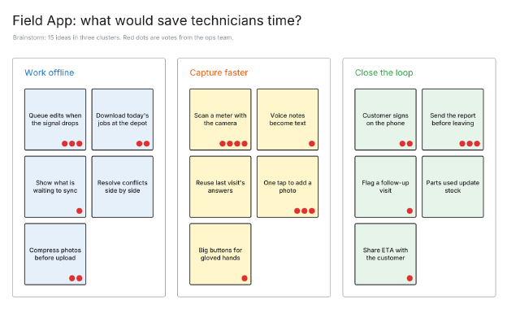

<!-- Generated by tools/gallery.mjs from showcase.yaml and build.json; do not edit. -->
# Field App Feature Brainstorm

[Board](../README.md) › [Brainstorming](../README.md#brainstorming) · `sticky-notes` `frames` `clusters` `dot-voting`

Fifteen sticky-note ideas sorted into three coloured clusters, with red dot votes on the favourites.



| | |
|---|---|
| Document | [field-app-feature-brainstorm.kboard](field-app-feature-brainstorm.kboard) (16 KB) |
| Contents | 1 page; 47 elements |
| Features | `board.elements`, `board.frames`, `board.text` |
| Built by | `kition-board` @ `e042761805`: 5 commands in 2 ms |

## About

A product team's affinity map: each frame is a theme, each sticky note one idea, and the small red
dots are the votes the operations team placed after the session.

## Checks

- `inspect.pages`: `{"count":1}`
- `inspect.elements`: `47`
- `results.frames.created`: `{"count":3}`
- `results.c0.created`: `{"count":14}`
- diagnostics: none (the kit's check finds nothing wrong)
- the saved document opens again; the thumbnail matches `thumb.png` within the `render` tolerance

## Steps

<details><summary>5 commands (from <a href="showcase.yaml">showcase.yaml</a>)</summary>

```yaml
- command: element.create
  params:
    elements:
      - kind: text
        position:
          - 40
          - 40
        text: "Field App: what would save technicians time?"
        fontSize: 44
        strokeColor: ink
      - kind: text
        position:
          - 42
          - 110
        text: "Brainstorm: 15 ideas in three clusters. Red dots are votes from the ops team."
        fontSize: 20
        strokeColor: gray
  as: heading
- command: element.create
  params:
    elements:
      - kind: frame
        position:
          - 40
          - 190
        size:
          - 500
          - 780
        text: ""
      - kind: frame
        position:
          - 580
          - 190
        size:
          - 500
          - 780
        text: ""
      - kind: frame
        position:
          - 1120
          - 190
        size:
          - 500
          - 780
        text: ""
  as: frames
- command: element.create
  params:
    elements:
      - kind: text
        parent: $frames.created.0
        position:
          - 80
          - 220
        text: Work offline
        fontSize: 28
        strokeColor: blue
      - kind: shape
        shapeStyle: sticky
        parent: $frames.created.0
        position:
          - 80
          - 290
        size:
          - 200
          - 200
        text: Queue edits when the signal drops
        fillColor: blue
        fontSize: 20
      - kind: shape
        shapeType: ellipse
        parent: $frames.created.0
        position:
          - 250
          - 460
        size:
          - 18
          - 18
        fillColor: "#e03131"
        fillStyle: solid
        strokeColor: "#e03131"
        strokeSize: s
      - kind: shape
        shapeType: ellipse
        parent: $frames.created.0
        position:
          - 226
          - 460
        size:
          - 18
          - 18
        fillColor: "#e03131"
        fillStyle: solid
        strokeColor: "#e03131"
        strokeSize: s
      - kind: shape
        shapeType: ellipse
        parent: $frames.created.0
        position:
          - 202
          - 460
        size:
          - 18
          - 18
        fillColor: "#e03131"
        fillStyle: solid
        strokeColor: "#e03131"
        strokeSize: s
      - kind: shape
        shapeStyle: sticky
        parent: $frames.created.0
        position:
          - 300
          - 290
        size:
          - 200
          - 200
        text: Download today's jobs at the depot
        fillColor: blue
        fontSize: 20
      - kind: shape
        shapeType: ellipse
        parent: $frames.created.0
        position:
          - 470
          - 460
        size:
          - 18
          - 18
        fillColor: "#e03131"
        fillStyle: solid
        strokeColor: "#e03131"
        strokeSize: s
      - kind: shape
        shapeType: ellipse
        parent: $frames.created.0
        position:
          - 446
          - 460
        size:
          - 18
          - 18
        fillColor: "#e03131"
        fillStyle: solid
        strokeColor: "#e03131"
        strokeSize: s
      - kind: shape
        shapeStyle: sticky
        parent: $frames.created.0
        position:
          - 80
          - 510
        size:
          - 200
          - 200
        text: Show what is waiting to sync
        fillColor: blue
        fontSize: 20
      - kind: shape
        shapeType: ellipse
        parent: $frames.created.0
        position:
          - 250
          - 680
        size:
          - 18
          - 18
        fillColor: "#e03131"
        fillStyle: solid
        strokeColor: "#e03131"
        strokeSize: s
      - kind: shape
        shapeStyle: sticky
        parent: $frames.created.0
        position:
          - 300
          - 510
        size:
          - 200
          - 200
        text: Resolve conflicts side by side
        fillColor: blue
        fontSize: 20
      - kind: shape
        shapeStyle: sticky
        parent: $frames.created.0
        position:
          - 80
          - 730
        size:
          - 200
          - 200
        text: Compress photos before upload
        fillColor: blue
        fontSize: 20
      - kind: shape
        shapeType: ellipse
        parent: $frames.created.0
        position:
          - 250
          - 900
        size:
          - 18
          - 18
        fillColor: "#e03131"
        fillStyle: solid
        strokeColor: "#e03131"
        strokeSize: s
      - kind: shape
        shapeType: ellipse
        parent: $frames.created.0
        position:
          - 226
          - 900
        size:
          - 18
          - 18
        fillColor: "#e03131"
        fillStyle: solid
        strokeColor: "#e03131"
        strokeSize: s
  as: c0
- command: element.create
  params:
    elements:
      - kind: text
        parent: $frames.created.1
        position:
          - 620
          - 220
        text: Capture faster
        fontSize: 28
        strokeColor: orange
      - kind: shape
        shapeStyle: sticky
        parent: $frames.created.1
        position:
          - 620
          - 290
        size:
          - 200
          - 200
        text: Scan a meter with the camera
        fillColor: yellow
        fontSize: 20
      - kind: shape
        shapeType: ellipse
        parent: $frames.created.1
        position:
          - 790
          - 460
        size:
          - 18
          - 18
        fillColor: "#e03131"
        fillStyle: solid
        strokeColor: "#e03131"
        strokeSize: s
      - kind: shape
        shapeType: ellipse
        parent: $frames.created.1
        position:
          - 766
          - 460
        size:
          - 18
          - 18
        fillColor: "#e03131"
        fillStyle: solid
        strokeColor: "#e03131"
        strokeSize: s
      - kind: shape
        shapeType: ellipse
        parent: $frames.created.1
        position:
          - 742
          - 460
        size:
          - 18
          - 18
        fillColor: "#e03131"
        fillStyle: solid
        strokeColor: "#e03131"
        strokeSize: s
      - kind: shape
        shapeType: ellipse
        parent: $frames.created.1
        position:
          - 718
          - 460
        size:
          - 18
          - 18
        fillColor: "#e03131"
        fillStyle: solid
        strokeColor: "#e03131"
        strokeSize: s
      - kind: shape
        shapeStyle: sticky
        parent: $frames.created.1
        position:
          - 840
          - 290
        size:
          - 200
          - 200
        text: Voice notes become text
        fillColor: yellow
        fontSize: 20
      - kind: shape
        shapeType: ellipse
        parent: $frames.created.1
        position:
          - 1010
          - 460
        size:
          - 18
          - 18
        fillColor: "#e03131"
        fillStyle: solid
        strokeColor: "#e03131"
        strokeSize: s
      - kind: shape
        shapeStyle: sticky
        parent: $frames.created.1
        position:
          - 620
          - 510
        size:
          - 200
          - 200
        text: Reuse last visit's answers
        fillColor: yellow
        fontSize: 20
      - kind: shape
        shapeStyle: sticky
        parent: $frames.created.1
        position:
          - 840
          - 510
        size:
          - 200
          - 200
        text: One tap to add a photo
        fillColor: yellow
        fontSize: 20
      - kind: shape
        shapeType: ellipse
        parent: $frames.created.1
        position:
          - 1010
          - 680
        size:
          - 18
          - 18
        fillColor: "#e03131"
        fillStyle: solid
        strokeColor: "#e03131"
        strokeSize: s
      - kind: shape
        shapeType: ellipse
        parent: $frames.created.1
        position:
          - 986
          - 680
        size:
          - 18
          - 18
        fillColor: "#e03131"
        fillStyle: solid
        strokeColor: "#e03131"
        strokeSize: s
      - kind: shape
        shapeType: ellipse
        parent: $frames.created.1
        position:
          - 962
          - 680
        size:
          - 18
          - 18
        fillColor: "#e03131"
        fillStyle: solid
        strokeColor: "#e03131"
        strokeSize: s
      - kind: shape
        shapeStyle: sticky
        parent: $frames.created.1
        position:
          - 620
          - 730
        size:
          - 200
          - 200
        text: Big buttons for gloved hands
        fillColor: yellow
        fontSize: 20
      - kind: shape
        shapeType: ellipse
        parent: $frames.created.1
        position:
          - 790
          - 900
        size:
          - 18
          - 18
        fillColor: "#e03131"
        fillStyle: solid
        strokeColor: "#e03131"
        strokeSize: s
  as: c1
- command: element.create
  params:
    elements:
      - kind: text
        parent: $frames.created.2
        position:
          - 1160
          - 220
        text: Close the loop
        fontSize: 28
        strokeColor: green
      - kind: shape
        shapeStyle: sticky
        parent: $frames.created.2
        position:
          - 1160
          - 290
        size:
          - 200
          - 200
        text: Customer signs on the phone
        fillColor: green
        fontSize: 20
      - kind: shape
        shapeType: ellipse
        parent: $frames.created.2
        position:
          - 1330
          - 460
        size:
          - 18
          - 18
        fillColor: "#e03131"
        fillStyle: solid
        strokeColor: "#e03131"
        strokeSize: s
      - kind: shape
        shapeType: ellipse
        parent: $frames.created.2
        position:
          - 1306
          - 460
        size:
          - 18
          - 18
        fillColor: "#e03131"
        fillStyle: solid
        strokeColor: "#e03131"
        strokeSize: s
      - kind: shape
        shapeStyle: sticky
        parent: $frames.created.2
        position:
          - 1380
          - 290
        size:
          - 200
          - 200
        text: Send the report before leaving
        fillColor: green
        fontSize: 20
      - kind: shape
        shapeType: ellipse
        parent: $frames.created.2
        position:
          - 1550
          - 460
        size:
          - 18
          - 18
        fillColor: "#e03131"
        fillStyle: solid
        strokeColor: "#e03131"
        strokeSize: s
      - kind: shape
        shapeType: ellipse
        parent: $frames.created.2
        position:
          - 1526
          - 460
        size:
          - 18
          - 18
        fillColor: "#e03131"
        fillStyle: solid
        strokeColor: "#e03131"
        strokeSize: s
      - kind: shape
        shapeType: ellipse
        parent: $frames.created.2
        position:
          - 1502
          - 460
        size:
          - 18
          - 18
        fillColor: "#e03131"
        fillStyle: solid
        strokeColor: "#e03131"
        strokeSize: s
      - kind: shape
        shapeStyle: sticky
        parent: $frames.created.2
        position:
          - 1160
          - 510
        size:
          - 200
          - 200
        text: Flag a follow-up visit
        fillColor: green
        fontSize: 20
      - kind: shape
        shapeType: ellipse
        parent: $frames.created.2
        position:
          - 1330
          - 680
        size:
          - 18
          - 18
        fillColor: "#e03131"
        fillStyle: solid
        strokeColor: "#e03131"
        strokeSize: s
      - kind: shape
        shapeStyle: sticky
        parent: $frames.created.2
        position:
          - 1380
          - 510
        size:
          - 200
          - 200
        text: Parts used update stock
        fillColor: green
        fontSize: 20
      - kind: shape
        shapeStyle: sticky
        parent: $frames.created.2
        position:
          - 1160
          - 730
        size:
          - 200
          - 200
        text: Share ETA with the customer
        fillColor: green
        fontSize: 20
      - kind: shape
        shapeType: ellipse
        parent: $frames.created.2
        position:
          - 1330
          - 900
        size:
          - 18
          - 18
        fillColor: "#e03131"
        fillStyle: solid
        strokeColor: "#e03131"
        strokeSize: s
  as: c2
```

</details>
