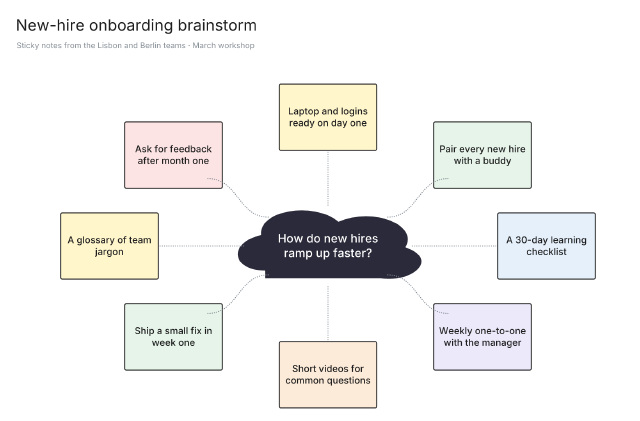

<!-- Generated by tools/gallery.mjs from showcase.yaml and build.json; do not edit. -->
# New-Hire Onboarding Brainstorm

[Board](../README.md) › [Brainstorming](../README.md#brainstorming) · `sticky-notes` `connectors`

Sticky notes from two offices arranged around a cloud-shaped question, joined by dotted curved connectors.



| | |
|---|---|
| Document | [new-hire-onboarding-brainstorm.kboard](new-hire-onboarding-brainstorm.kboard) (9 KB) |
| Contents | 1 page; 19 elements |
| Features | `board.elements`, `board.connectors`, `board.text` |
| Built by | `kition-board` @ `04db484f2e`: 10 commands in 3 ms |

## About

A shared brainstorm between two offices on how new colleagues get up to speed. Eight sticky notes
ring a dark cloud that holds the question, each tied to it by a dotted curved connector anchored
on the side facing the note, so the lines fan out evenly. Inter draws every label.

## Checks

- `inspect.elements`: `19`
- `results.notes.created`: `{"count":8}`
- diagnostics: none (the kit's check finds nothing wrong)
- the saved document opens again; the thumbnail matches `thumb.png` within the `render` tolerance

## Steps

<details><summary>10 commands (from <a href="showcase.yaml">showcase.yaml</a>)</summary>

```yaml
- command: element.create
  params:
    elements:
      - kind: text
        position:
          - 40
          - 40
        text: New-hire onboarding brainstorm
        fontSize: 40
        strokeColor: ink
      - kind: text
        position:
          - 42
          - 104
        text: Sticky notes from the Lisbon and Berlin teams · March workshop
        fontSize: 20
        strokeColor: gray
      - kind: shape
        shapeType: cloud
        position:
          - 570
          - 485
        size:
          - 540
          - 290
        text: |-
          How do new hires
          ramp up faster?
        fillColor: "#2b2a3a"
        fillStyle: solid
        strokeColor: white
        fontSize: 30
  as: hub
- command: element.create
  params:
    elements:
      - kind: shape
        shapeStyle: sticky
        position:
          - 715
          - 215
        size:
          - 250
          - 170
        text: Laptop and logins ready on day one
        fillColor: yellow
        fontSize: 24
      - kind: shape
        shapeStyle: sticky
        position:
          - 1111
          - 312
        size:
          - 250
          - 170
        text: Pair every new hire with a buddy
        fillColor: green
        fontSize: 24
      - kind: shape
        shapeStyle: sticky
        position:
          - 1275
          - 545
        size:
          - 250
          - 170
        text: A 30-day learning checklist
        fillColor: blue
        fontSize: 24
      - kind: shape
        shapeStyle: sticky
        position:
          - 1111
          - 778
        size:
          - 250
          - 170
        text: Weekly one-to-one with the manager
        fillColor: purple
        fontSize: 24
      - kind: shape
        shapeStyle: sticky
        position:
          - 715
          - 875
        size:
          - 250
          - 170
        text: Short videos for common questions
        fillColor: orange
        fontSize: 24
      - kind: shape
        shapeStyle: sticky
        position:
          - 319
          - 778
        size:
          - 250
          - 170
        text: Ship a small fix in week one
        fillColor: green
        fontSize: 24
      - kind: shape
        shapeStyle: sticky
        position:
          - 155
          - 545
        size:
          - 250
          - 170
        text: A glossary of team jargon
        fillColor: yellow
        fontSize: 24
      - kind: shape
        shapeStyle: sticky
        position:
          - 319
          - 312
        size:
          - 250
          - 170
        text: Ask for feedback after month one
        fillColor: red
        fontSize: 24
  as: notes
- command: connector.create
  params:
    from:
      element: $hub.created.2
      anchor:
        - 0.5
        - 0.14
    to:
      element: $notes.created.0
      anchor:
        - 0.5
        - 1
    type: curved
    endArrowhead: none
    style:
      strokeColor: gray
      dashStyle: dotted
- command: connector.create
  params:
    from:
      element: $hub.created.2
      anchor:
        - 0.783
        - 0.245
    to:
      element: $notes.created.1
      anchor:
        - 0.146
        - 0.854
    type: curved
    endArrowhead: none
    style:
      strokeColor: gray
      dashStyle: dotted
- command: connector.create
  params:
    from:
      element: $hub.created.2
      anchor:
        - 0.9
        - 0.5
    to:
      element: $notes.created.2
      anchor:
        - 0
        - 0.5
    type: curved
    endArrowhead: none
    style:
      strokeColor: gray
      dashStyle: dotted
- command: connector.create
  params:
    from:
      element: $hub.created.2
      anchor:
        - 0.783
        - 0.755
    to:
      element: $notes.created.3
      anchor:
        - 0.146
        - 0.146
    type: curved
    endArrowhead: none
    style:
      strokeColor: gray
      dashStyle: dotted
- command: connector.create
  params:
    from:
      element: $hub.created.2
      anchor:
        - 0.5
        - 0.86
    to:
      element: $notes.created.4
      anchor:
        - 0.5
        - 0
    type: curved
    endArrowhead: none
    style:
      strokeColor: gray
      dashStyle: dotted
- command: connector.create
  params:
    from:
      element: $hub.created.2
      anchor:
        - 0.217
        - 0.755
    to:
      element: $notes.created.5
      anchor:
        - 0.854
        - 0.146
    type: curved
    endArrowhead: none
    style:
      strokeColor: gray
      dashStyle: dotted
- command: connector.create
  params:
    from:
      element: $hub.created.2
      anchor:
        - 0.1
        - 0.5
    to:
      element: $notes.created.6
      anchor:
        - 1
        - 0.5
    type: curved
    endArrowhead: none
    style:
      strokeColor: gray
      dashStyle: dotted
- command: connector.create
  params:
    from:
      element: $hub.created.2
      anchor:
        - 0.217
        - 0.245
    to:
      element: $notes.created.7
      anchor:
        - 0.854
        - 0.854
    type: curved
    endArrowhead: none
    style:
      strokeColor: gray
      dashStyle: dotted
```

</details>
