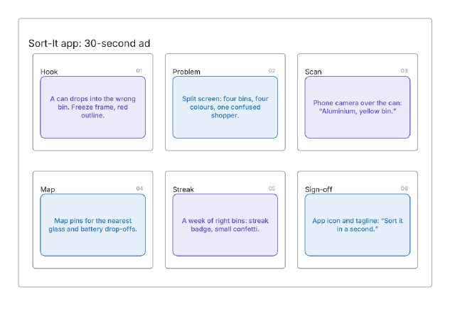

<!-- Generated by tools/gallery.mjs from showcase.yaml and build.json; do not edit. -->
# Recycling App Ad Storyboard

[Board](../README.md) › [Planning](../README.md#planning) · `storyboard` `templates` `pages` `video`

A six-panel storyboard for a 30-second app advert, made from the storyboard template, with the voice-over on a second page.



| | |
|---|---|
| Document | [recycling-ad-storyboard.kboard](recycling-ad-storyboard.kboard) (13 KB) |
| Contents | 2 pages; 33 elements |
| Features | `board.templates`, `board.pages`, `board.frames` |
| Built by | `kition-board` @ `e042761805`: 16 commands in 3 ms |

## About

template.insert lays out the storyboard (a frame, six panel frames with a label, a number and a
picture placeholder each); element.setText fills in the shots. A second page holds the voice-over
script, timed in five-second beats.

## Checks

- `inspect.pages`: `{"count":2}`
- `inspect.pages.0.elements`: `26`
- `inspect.pages.1`: `{"name":"Voice-over script","elements":7}`
- `results.t.template`: `"storyboard"`
- `results.t.created`: `{"count":26}`
- diagnostics: none (the kit's check finds nothing wrong)
- the saved document opens again; the thumbnail matches `thumb.png` within the `render` tolerance

## Steps

<details><summary>16 commands (from <a href="showcase.yaml">showcase.yaml</a>)</summary>

```yaml
- command: template.insert
  params:
    template: storyboard
    at:
      - 600
      - 400
  as: t
- command: element.setText
  params:
    id: $t.created.1
    text: "Sort-It app: 30-second ad"
- command: element.setText
  params:
    id: $t.created.3
    text: Hook
- command: element.setText
  params:
    id: $t.created.5
    text: A can drops into the wrong bin. Freeze frame, red outline.
- command: element.setText
  params:
    id: $t.created.7
    text: Problem
- command: element.setText
  params:
    id: $t.created.9
    text: "Split screen: four bins, four colours, one confused shopper."
- command: element.setText
  params:
    id: $t.created.11
    text: Scan
- command: element.setText
  params:
    id: $t.created.13
    text: "Phone camera over the can: “Aluminium, yellow bin.”"
- command: element.setText
  params:
    id: $t.created.15
    text: Map
- command: element.setText
  params:
    id: $t.created.17
    text: Map pins for the nearest glass and battery drop-offs.
- command: element.setText
  params:
    id: $t.created.19
    text: Streak
- command: element.setText
  params:
    id: $t.created.21
    text: "A week of right bins: streak badge, small confetti."
- command: element.setText
  params:
    id: $t.created.23
    text: Sign-off
- command: element.setText
  params:
    id: $t.created.25
    text: "App icon and tagline: “Sort it in a second.”"
- command: page.create
  params:
    name: Voice-over script
  as: script
- command: element.create
  params:
    page: $script.page
    elements:
      - kind: text
        position:
          - 0
          - 0
        text: Voice-over script
        fontSize: 40
        strokeColor: ink
      - kind: text
        position:
          - 0
          - 80
        text: 0–5 s  Ever wondered which bin?
        fontSize: 24
        strokeColor: ink
      - kind: text
        position:
          - 0
          - 124
        text: 5–10 s  Four bins. Too many rules.
        fontSize: 24
        strokeColor: ink
      - kind: text
        position:
          - 0
          - 168
        text: 10–15 s  Point your camera. Sort-It tells you.
        fontSize: 24
        strokeColor: ink
      - kind: text
        position:
          - 0
          - 212
        text: 15–20 s  Glass and batteries? We know where.
        fontSize: 24
        strokeColor: ink
      - kind: text
        position:
          - 0
          - 256
        text: 20–25 s  Get it right all week.
        fontSize: 24
        strokeColor: ink
      - kind: text
        position:
          - 0
          - 300
        text: 25–30 s  Sort-It. Sort it in a second.
        fontSize: 24
        strokeColor: ink
  as: vo
```

</details>
