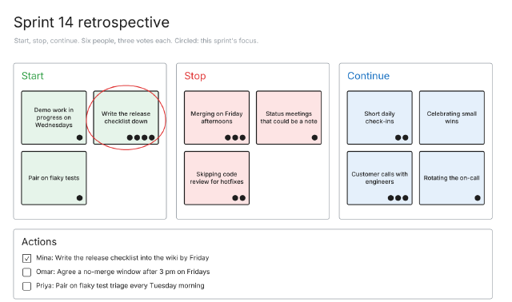

<!-- Generated by tools/gallery.mjs from showcase.yaml and build.json; do not edit. -->
# Start, Stop, Continue Retro

[Board](../README.md) › [Retrospectives](../README.md#retrospectives) · `retrospective` `sticky-notes` `dot-voting` `freehand`

A sprint retrospective with three columns of sticky notes, dot votes, a hand-drawn circle and an action list.



| | |
|---|---|
| Document | [start-stop-continue-retro.kboard](start-stop-continue-retro.kboard) (17 KB) |
| Contents | 1 page; 45 elements |
| Features | `board.elements`, `board.frames`, `board.drawing` |
| Built by | `kition-board` @ `e042761805`: 8 commands in 2 ms |

## About

The classic three-column retro. Every column is a frame; the black dots are votes, the red ring is a
freehand stroke around the note the team chose to act on, and the action list below has owners.

## Checks

- `inspect.elements`: `45`
- `results.cols.created`: `{"count":3}`
- `results.circle.created`: `{"count":1}`
- diagnostics: none (the kit's check finds nothing wrong)
- the saved document opens again; the thumbnail matches `thumb.png` within the `render` tolerance

## Steps

<details><summary>8 commands (from <a href="showcase.yaml">showcase.yaml</a>)</summary>

```yaml
- command: element.create
  params:
    elements:
      - kind: text
        position:
          - 40
          - 40
        text: Sprint 14 retrospective
        fontSize: 44
        strokeColor: ink
      - kind: text
        position:
          - 42
          - 110
        text: "Start, stop, continue. Six people, three votes each. Circled: this sprint's focus."
        fontSize: 20
        strokeColor: gray
  as: heading
- command: element.create
  params:
    elements:
      - kind: frame
        position:
          - 40
          - 190
        size:
          - 460
          - 470
        text: ""
      - kind: frame
        position:
          - 530
          - 190
        size:
          - 460
          - 470
        text: ""
      - kind: frame
        position:
          - 1020
          - 190
        size:
          - 460
          - 470
        text: ""
  as: cols
- command: element.create
  params:
    elements:
      - kind: text
        parent: $cols.created.0
        position:
          - 64
          - 210
        text: Start
        fontSize: 30
        strokeColor: green
      - kind: shape
        shapeStyle: sticky
        parent: $cols.created.0
        position:
          - 64
          - 274
        size:
          - 195
          - 160
        text: Demo work in progress on Wednesdays
        fillColor: green
        strokeColor: ink
        fontSize: 18
      - kind: shape
        shapeType: ellipse
        parent: $cols.created.0
        position:
          - 231
          - 406
        size:
          - 16
          - 16
        fillColor: "#1e1e1e"
        fillStyle: solid
        strokeColor: "#1e1e1e"
        strokeSize: s
      - kind: shape
        shapeStyle: sticky
        parent: $cols.created.0
        position:
          - 281
          - 274
        size:
          - 195
          - 160
        text: Write the release checklist down
        fillColor: green
        strokeColor: ink
        fontSize: 18
      - kind: shape
        shapeType: ellipse
        parent: $cols.created.0
        position:
          - 448
          - 406
        size:
          - 16
          - 16
        fillColor: "#1e1e1e"
        fillStyle: solid
        strokeColor: "#1e1e1e"
        strokeSize: s
      - kind: shape
        shapeType: ellipse
        parent: $cols.created.0
        position:
          - 426
          - 406
        size:
          - 16
          - 16
        fillColor: "#1e1e1e"
        fillStyle: solid
        strokeColor: "#1e1e1e"
        strokeSize: s
      - kind: shape
        shapeType: ellipse
        parent: $cols.created.0
        position:
          - 404
          - 406
        size:
          - 16
          - 16
        fillColor: "#1e1e1e"
        fillStyle: solid
        strokeColor: "#1e1e1e"
        strokeSize: s
      - kind: shape
        shapeType: ellipse
        parent: $cols.created.0
        position:
          - 382
          - 406
        size:
          - 16
          - 16
        fillColor: "#1e1e1e"
        fillStyle: solid
        strokeColor: "#1e1e1e"
        strokeSize: s
      - kind: shape
        shapeStyle: sticky
        parent: $cols.created.0
        position:
          - 64
          - 456
        size:
          - 195
          - 160
        text: Pair on flaky tests
        fillColor: green
        strokeColor: ink
        fontSize: 18
      - kind: shape
        shapeType: ellipse
        parent: $cols.created.0
        position:
          - 231
          - 588
        size:
          - 16
          - 16
        fillColor: "#1e1e1e"
        fillStyle: solid
        strokeColor: "#1e1e1e"
        strokeSize: s
  as: c0
- command: element.create
  params:
    elements:
      - kind: text
        parent: $cols.created.1
        position:
          - 554
          - 210
        text: Stop
        fontSize: 30
        strokeColor: red
      - kind: shape
        shapeStyle: sticky
        parent: $cols.created.1
        position:
          - 554
          - 274
        size:
          - 195
          - 160
        text: Merging on Friday afternoons
        fillColor: red
        strokeColor: ink
        fontSize: 18
      - kind: shape
        shapeType: ellipse
        parent: $cols.created.1
        position:
          - 721
          - 406
        size:
          - 16
          - 16
        fillColor: "#1e1e1e"
        fillStyle: solid
        strokeColor: "#1e1e1e"
        strokeSize: s
      - kind: shape
        shapeType: ellipse
        parent: $cols.created.1
        position:
          - 699
          - 406
        size:
          - 16
          - 16
        fillColor: "#1e1e1e"
        fillStyle: solid
        strokeColor: "#1e1e1e"
        strokeSize: s
      - kind: shape
        shapeType: ellipse
        parent: $cols.created.1
        position:
          - 677
          - 406
        size:
          - 16
          - 16
        fillColor: "#1e1e1e"
        fillStyle: solid
        strokeColor: "#1e1e1e"
        strokeSize: s
      - kind: shape
        shapeStyle: sticky
        parent: $cols.created.1
        position:
          - 771
          - 274
        size:
          - 195
          - 160
        text: Status meetings that could be a note
        fillColor: red
        strokeColor: ink
        fontSize: 18
      - kind: shape
        shapeType: ellipse
        parent: $cols.created.1
        position:
          - 938
          - 406
        size:
          - 16
          - 16
        fillColor: "#1e1e1e"
        fillStyle: solid
        strokeColor: "#1e1e1e"
        strokeSize: s
      - kind: shape
        shapeStyle: sticky
        parent: $cols.created.1
        position:
          - 554
          - 456
        size:
          - 195
          - 160
        text: Skipping code review for hotfixes
        fillColor: red
        strokeColor: ink
        fontSize: 18
      - kind: shape
        shapeType: ellipse
        parent: $cols.created.1
        position:
          - 721
          - 588
        size:
          - 16
          - 16
        fillColor: "#1e1e1e"
        fillStyle: solid
        strokeColor: "#1e1e1e"
        strokeSize: s
      - kind: shape
        shapeType: ellipse
        parent: $cols.created.1
        position:
          - 699
          - 588
        size:
          - 16
          - 16
        fillColor: "#1e1e1e"
        fillStyle: solid
        strokeColor: "#1e1e1e"
        strokeSize: s
  as: c1
- command: element.create
  params:
    elements:
      - kind: text
        parent: $cols.created.2
        position:
          - 1044
          - 210
        text: Continue
        fontSize: 30
        strokeColor: blue
      - kind: shape
        shapeStyle: sticky
        parent: $cols.created.2
        position:
          - 1044
          - 274
        size:
          - 195
          - 160
        text: Short daily check-ins
        fillColor: blue
        strokeColor: ink
        fontSize: 18
      - kind: shape
        shapeType: ellipse
        parent: $cols.created.2
        position:
          - 1211
          - 406
        size:
          - 16
          - 16
        fillColor: "#1e1e1e"
        fillStyle: solid
        strokeColor: "#1e1e1e"
        strokeSize: s
      - kind: shape
        shapeType: ellipse
        parent: $cols.created.2
        position:
          - 1189
          - 406
        size:
          - 16
          - 16
        fillColor: "#1e1e1e"
        fillStyle: solid
        strokeColor: "#1e1e1e"
        strokeSize: s
      - kind: shape
        shapeStyle: sticky
        parent: $cols.created.2
        position:
          - 1261
          - 274
        size:
          - 195
          - 160
        text: Celebrating small wins
        fillColor: blue
        strokeColor: ink
        fontSize: 18
      - kind: shape
        shapeStyle: sticky
        parent: $cols.created.2
        position:
          - 1044
          - 456
        size:
          - 195
          - 160
        text: Customer calls with engineers
        fillColor: blue
        strokeColor: ink
        fontSize: 18
      - kind: shape
        shapeType: ellipse
        parent: $cols.created.2
        position:
          - 1211
          - 588
        size:
          - 16
          - 16
        fillColor: "#1e1e1e"
        fillStyle: solid
        strokeColor: "#1e1e1e"
        strokeSize: s
      - kind: shape
        shapeType: ellipse
        parent: $cols.created.2
        position:
          - 1189
          - 588
        size:
          - 16
          - 16
        fillColor: "#1e1e1e"
        fillStyle: solid
        strokeColor: "#1e1e1e"
        strokeSize: s
      - kind: shape
        shapeType: ellipse
        parent: $cols.created.2
        position:
          - 1167
          - 588
        size:
          - 16
          - 16
        fillColor: "#1e1e1e"
        fillStyle: solid
        strokeColor: "#1e1e1e"
        strokeSize: s
      - kind: shape
        shapeStyle: sticky
        parent: $cols.created.2
        position:
          - 1261
          - 456
        size:
          - 195
          - 160
        text: Rotating the on-call
        fillColor: blue
        strokeColor: ink
        fontSize: 18
      - kind: shape
        shapeType: ellipse
        parent: $cols.created.2
        position:
          - 1428
          - 588
        size:
          - 16
          - 16
        fillColor: "#1e1e1e"
        fillStyle: solid
        strokeColor: "#1e1e1e"
        strokeSize: s
  as: c2
- command: stroke.create
  params:
    points:
      - - 308.8
        - 273.9
      - - 328.4
        - 264.9
      - - 350.7
        - 259.2
      - - 374.9
        - 257
      - - 399.3
        - 258.2
      - - 422.4
        - 262.9
      - - 442.8
        - 270.9
      - - 460.1
        - 282.3
      - - 474.2
        - 296.9
      - - 485.5
        - 314.2
      - - 493.6
        - 333.6
      - - 498
        - 354
      - - 497.6
        - 374.4
      - - 491.6
        - 393.8
      - - 480
        - 411.1
      - - 463.4
        - 425.7
      - - 443.3
        - 437.1
      - - 421.2
        - 445.1
      - - 398.3
        - 449.8
      - - 375.1
        - 451
      - - 352
        - 448.8
      - - 329.2
        - 443.1
      - - 307.5
        - 434.1
      - - 288.3
        - 421.7
      - - 273
        - 406.3
      - - 263
        - 388.3
      - - 258.7
        - 368.5
      - - 259.8
        - 348
      - - 265.4
        - 327.8
      - - 274.5
        - 308.9
      - - 286.6
        - 292.4
      - - 301.6
        - 278.7
      - - 319.9
        - 268.2
      - - 341.1
        - 261.2
    style:
      strokeColor: "#e03131"
      strokeSize: m
  as: circle
- command: frame.create
  params:
    box:
      - 40
      - 690
      - 1480
      - 900
    title: ""
  as: actions
- command: element.create
  params:
    elements:
      - kind: text
        parent: $actions.frame
        position:
          - 64
          - 710
        text: Actions
        fontSize: 30
        strokeColor: ink
      - kind: shape
        shapeType: check-box
        parent: $actions.frame
        position:
          - 68
          - 766
        size:
          - 24
          - 24
        fillColor: white
        fillStyle: solid
        strokeColor: ink
        strokeSize: s
      - kind: text
        parent: $actions.frame
        position:
          - 108
          - 764
        text: "Mina: Write the release checklist into the wiki by Friday"
        fontSize: 20
        strokeColor: ink
      - kind: shape
        shapeType: rectangle
        parent: $actions.frame
        position:
          - 68
          - 808
        size:
          - 24
          - 24
        fillColor: white
        fillStyle: solid
        strokeColor: ink
        strokeSize: s
      - kind: text
        parent: $actions.frame
        position:
          - 108
          - 806
        text: "Omar: Agree a no-merge window after 3 pm on Fridays"
        fontSize: 20
        strokeColor: ink
      - kind: shape
        shapeType: rectangle
        parent: $actions.frame
        position:
          - 68
          - 850
        size:
          - 24
          - 24
        fillColor: white
        fillStyle: solid
        strokeColor: ink
        strokeSize: s
      - kind: text
        parent: $actions.frame
        position:
          - 108
          - 848
        text: "Priya: Pair on flaky test triage every Tuesday morning"
        fontSize: 20
        strokeColor: ink
  as: items
```

</details>
