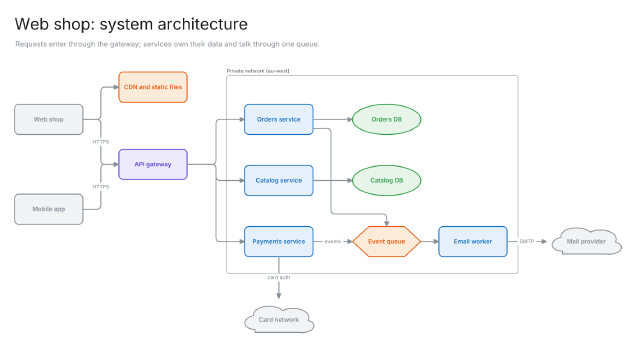

<!-- Generated by tools/gallery.mjs from showcase.yaml and build.json; do not edit. -->
# Web Shop Architecture

[Board](../README.md) › [Diagrams & Flows](../README.md#diagrams--flows) · `architecture` `connectors` `frames`

A system diagram of an online shop, with clients, a gateway, services and their data stores inside a private network frame.



| | |
|---|---|
| Document | [web-shop-architecture.kboard](web-shop-architecture.kboard) (11 KB) |
| Contents | 1 page; 29 elements |
| Features | `board.elements`, `board.connectors`, `board.frames` |
| Built by | `kition-board` @ `e042761805`: 17 commands in 2 ms |

## About

Services, databases (ellipses) and the event queue (a hexagon) sit inside a frame for the private
network; clients, the CDN and the card network stay outside. Elbow connectors bound to the nodes
carry the protocol labels.

## Checks

- `inspect.elements`: `29`
- `results.in.created`: `{"count":7}`
- `results.vpc.created`: `{"count":1}`
- diagnostics: none (the kit's check finds nothing wrong)
- the saved document opens again; the thumbnail matches `thumb.png` within the `render` tolerance

## Steps

<details><summary>17 commands (from <a href="showcase.yaml">showcase.yaml</a>)</summary>

```yaml
- command: element.create
  params:
    elements:
      - kind: text
        position:
          - 40
          - 40
        text: "Web shop: system architecture"
        fontSize: 44
        strokeColor: ink
      - kind: text
        position:
          - 42
          - 110
        text: Requests enter through the gateway; services own their data and talk through one queue.
        fontSize: 20
        strokeColor: gray
  as: heading
- command: element.create
  params:
    elements:
      - kind: frame
        position:
          - 630
          - 210
        size:
          - 810
          - 550
        text: Private network (eu-west)
  as: vpc
- command: element.create
  params:
    elements:
      - kind: shape
        shapeStyle: flow-node
        shapeType: rectangle
        position:
          - 40
          - 290
        size:
          - 190
          - 84
        text: Web shop
        fillColor: gray
        strokeColor: gray
        fillStyle: solid
        fontSize: 17
        key: web
      - kind: shape
        shapeStyle: flow-node
        shapeType: rectangle
        position:
          - 40
          - 540
        size:
          - 190
          - 84
        text: Mobile app
        fillColor: gray
        strokeColor: gray
        fillStyle: solid
        fontSize: 17
        key: mobile
      - kind: shape
        shapeStyle: flow-node
        shapeType: rectangle
        position:
          - 330
          - 200
        size:
          - 190
          - 84
        text: CDN and static files
        fillColor: orange
        strokeColor: orange
        fillStyle: solid
        fontSize: 17
        key: cdn
      - kind: shape
        shapeStyle: flow-node
        shapeType: rectangle
        position:
          - 330
          - 415
        size:
          - 190
          - 84
        text: API gateway
        fillColor: purple
        strokeColor: purple
        fillStyle: solid
        fontSize: 17
        key: gw
      - kind: shape
        shapeStyle: flow-node
        shapeType: cloud
        position:
          - 665
          - 830
        size:
          - 220
          - 120
        text: Card network
        fillColor: gray
        strokeColor: gray
        fillStyle: solid
        fontSize: 17
        key: card
      - kind: shape
        shapeStyle: flow-node
        shapeType: cloud
        position:
          - 1520
          - 612
        size:
          - 220
          - 120
        text: Mail provider
        fillColor: gray
        strokeColor: gray
        fillStyle: solid
        fontSize: 17
        key: smtp
  as: out
- command: element.create
  params:
    elements:
      - kind: shape
        shapeStyle: flow-node
        shapeType: rectangle
        position:
          - 680
          - 290
        size:
          - 190
          - 84
        text: Orders service
        fillColor: blue
        strokeColor: blue
        fillStyle: solid
        fontSize: 17
        key: orders
        parent: $vpc.created.0
      - kind: shape
        shapeStyle: flow-node
        shapeType: rectangle
        position:
          - 680
          - 460
        size:
          - 190
          - 84
        text: Catalog service
        fillColor: blue
        strokeColor: blue
        fillStyle: solid
        fontSize: 17
        key: catalog
        parent: $vpc.created.0
      - kind: shape
        shapeStyle: flow-node
        shapeType: rectangle
        position:
          - 680
          - 630
        size:
          - 190
          - 84
        text: Payments service
        fillColor: blue
        strokeColor: blue
        fillStyle: solid
        fontSize: 17
        key: pay
        parent: $vpc.created.0
      - kind: shape
        shapeStyle: flow-node
        shapeType: ellipse
        position:
          - 980
          - 290
        size:
          - 190
          - 84
        text: Orders DB
        fillColor: green
        strokeColor: green
        fillStyle: solid
        fontSize: 17
        key: odb
        parent: $vpc.created.0
      - kind: shape
        shapeStyle: flow-node
        shapeType: ellipse
        position:
          - 980
          - 460
        size:
          - 190
          - 84
        text: Catalog DB
        fillColor: green
        strokeColor: green
        fillStyle: solid
        fontSize: 17
        key: cdb
        parent: $vpc.created.0
      - kind: shape
        shapeStyle: flow-node
        shapeType: hexagon
        position:
          - 980
          - 630
        size:
          - 190
          - 84
        text: Event queue
        fillColor: orange
        strokeColor: orange
        fillStyle: solid
        fontSize: 17
        key: queue
        parent: $vpc.created.0
      - kind: shape
        shapeStyle: flow-node
        shapeType: rectangle
        position:
          - 1220
          - 630
        size:
          - 190
          - 84
        text: Email worker
        fillColor: blue
        strokeColor: blue
        fillStyle: solid
        fontSize: 17
        key: mail
        parent: $vpc.created.0
  as: in
- command: connector.create
  params:
    from:
      element: $out.created.0
      anchor:
        - 1
        - 0.5
    to:
      element: $out.created.2
      anchor:
        - 0
        - 0.5
    type: elbow
    style:
      strokeColor: gray
- command: connector.create
  params:
    from:
      element: $out.created.0
      anchor:
        - 1
        - 0.5
    to:
      element: $out.created.3
      anchor:
        - 0
        - 0.5
    type: elbow
    style:
      strokeColor: gray
    label: HTTPS
- command: connector.create
  params:
    from:
      element: $out.created.1
      anchor:
        - 1
        - 0.5
    to:
      element: $out.created.3
      anchor:
        - 0
        - 0.5
    type: elbow
    style:
      strokeColor: gray
    label: HTTPS
- command: connector.create
  params:
    from:
      element: $out.created.3
      anchor:
        - 1
        - 0.5
    to:
      element: $in.created.0
      anchor:
        - 0
        - 0.5
    type: elbow
    style:
      strokeColor: gray
- command: connector.create
  params:
    from:
      element: $out.created.3
      anchor:
        - 1
        - 0.5
    to:
      element: $in.created.1
      anchor:
        - 0
        - 0.5
    type: elbow
    style:
      strokeColor: gray
- command: connector.create
  params:
    from:
      element: $out.created.3
      anchor:
        - 1
        - 0.5
    to:
      element: $in.created.2
      anchor:
        - 0
        - 0.5
    type: elbow
    style:
      strokeColor: gray
- command: connector.create
  params:
    from:
      element: $in.created.0
      anchor:
        - 1
        - 0.5
    to:
      element: $in.created.3
      anchor:
        - 0
        - 0.5
    type: elbow
    style:
      strokeColor: gray
- command: connector.create
  params:
    from:
      element: $in.created.1
      anchor:
        - 1
        - 0.5
    to:
      element: $in.created.4
      anchor:
        - 0
        - 0.5
    type: elbow
    style:
      strokeColor: gray
- command: connector.create
  params:
    from:
      element: $in.created.2
      anchor:
        - 1
        - 0.5
    to:
      element: $in.created.5
      anchor:
        - 0
        - 0.5
    type: elbow
    style:
      strokeColor: gray
    label: events
- command: connector.create
  params:
    from:
      element: $in.created.0
      anchor:
        - 1
        - 0.8
    to:
      element: $in.created.5
      anchor:
        - 0.5
        - 0
    type: elbow
    style:
      strokeColor: gray
    waypoints:
      - - 920
        - 357
      - - 920
        - 595
      - - 1075
        - 595
- command: connector.create
  params:
    from:
      element: $in.created.5
      anchor:
        - 1
        - 0.5
    to:
      element: $in.created.6
      anchor:
        - 0
        - 0.5
    type: elbow
    style:
      strokeColor: gray
- command: connector.create
  params:
    from:
      element: $in.created.6
      anchor:
        - 1
        - 0.5
    to:
      element: $out.created.5
      anchor:
        - 0
        - 0.5
    type: elbow
    style:
      strokeColor: gray
    label: SMTP
- command: connector.create
  params:
    from:
      element: $in.created.2
      anchor:
        - 0.5
        - 1
    to:
      element: $out.created.4
      anchor:
        - 0.5
        - 0
    type: straight
    style:
      strokeColor: gray
    label: card auth
```

</details>
