<!-- Generated by tools/gallery.mjs from showcase.yaml and build.json; do not edit. -->
# CAD showcase

2D drafting: lines, arcs, polylines, hatches, dimensions, layers and blocks. Saved as DXF. Every sample is built from `showcase.yaml` by the kit's own commands and drawn by its own engine (`kition-cad`).

**11 samples** · 5 categories · 18 features of `kition-cad/features.yaml` · [all kits](../README.md)

[Dimensions & Annotation](#dimensions--annotation) (2) · [Floor Plans](#floor-plans) (3) · [Mechanical Parts](#mechanical-parts) (3) · [Schematics](#schematics) (1) · [Site & Landscape](#site--landscape) (2)

## Dimensions & Annotation

<table>
<tr>
<td width="33%" valign="top">
<a href="a3-sheet-template-title-block/">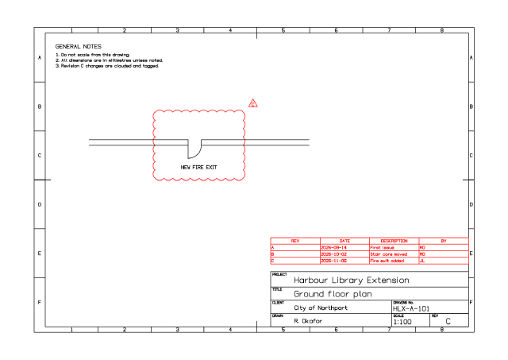</a> 
CAD 
<b><a href="a3-sheet-template-title-block/">A3 Sheet With Title Block</a></b> 
An A3 drawing sheet with zone references, a title block block filled through attributes, a revision table and a clouded, tagged change. 
<i>76 objects; 7 layers</i> 
<code>title-block</code> <code>sheet</code> <code>attributes</code> <code>revision-cloud</code> <code>table</code>
</td>
<td width="33%" valign="top">
<a href="mounting-plate-dimensioning/">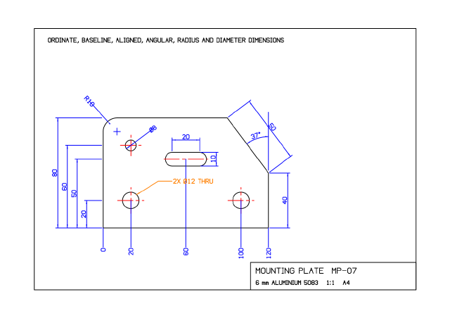</a> 
CAD 
<b><a href="mounting-plate-dimensioning/">Dimensioned Mounting Plate</a></b> 
One plate dimensioned seven ways - ordinate, baseline, aligned, angular, radius, diameter and linear - with centre marks and multileader notes. 
<i>35 objects; 7 layers</i> 
<code>dimensions</code> <code>ordinate</code> <code>baseline</code> <code>angular</code> <code>multileader</code> <code>mechanical</code>
</td>
<td width="33%"></td>
</tr>
</table>

## Floor Plans

<table>
<tr>
<td width="33%" valign="top">
<a href="open-office-desk-layout/">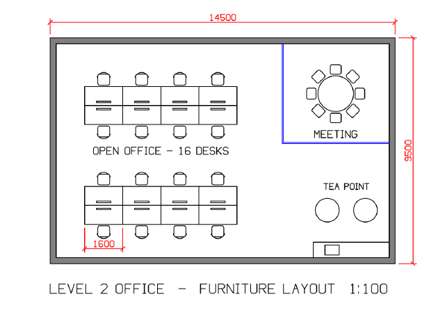</a> 
CAD 
<b><a href="open-office-desk-layout/">Open Office Desk Layout</a></b> 
A 1:100 office furniture plan with sixteen workstations from one block in arrays, a meeting room with eight chairs in a polar array and a tea point. 
<i>43 objects; 8 layers</i> 
<code>floor-plan</code> <code>furniture</code> <code>blocks</code> <code>array</code> <code>polar-array</code>
</td>
<td width="33%" valign="top">
<a href="two-bedroom-apartment-plan/">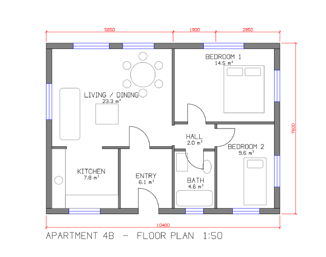</a> 
CAD 
<b><a href="two-bedroom-apartment-plan/">Two-Bedroom Apartment Plan</a></b> 
A 1:50 apartment floor plan with solid-filled walls, door swings, windows, furniture, room names with areas and dimensions. 
<i>95 objects; 9 layers</i> 
<code>floor-plan</code> <code>architecture</code> <code>hatch</code> <code>doors</code> <code>dimensions</code>
</td>
<td width="33%" valign="top">
<a href="u-shaped-staircase-plan/">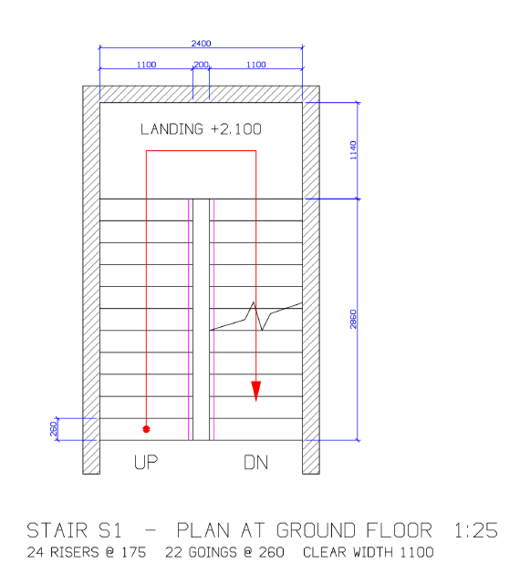</a> 
CAD 
<b><a href="u-shaped-staircase-plan/">U-Shaped Staircase Plan</a></b> 
A 1:25 plan of a two-flight stair with a landing, treads made with a rectangular array, a walking line with arrowhead, break line and chained dimensions. 
<i>45 objects; 9 layers</i> 
<code>floor-plan</code> <code>stairs</code> <code>array</code> <code>dimensions</code> <code>architecture</code>
</td>
</tr>
</table>

## Mechanical Parts

<table>
<tr>
<td width="33%" valign="top">
<a href="l-bracket-three-views/">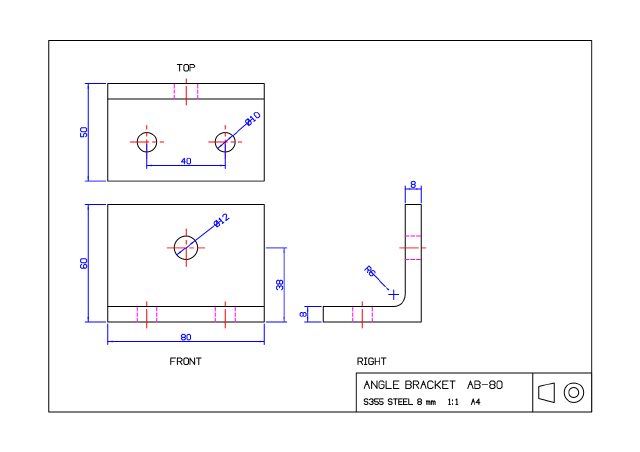</a> 
CAD 
<b><a href="l-bracket-three-views/">L-Bracket in Three Views</a></b> 
A bent steel angle bracket in third-angle projection - front, top and right views - with hidden lines, centre lines, a fillet and dimensions. 
<i>50 objects; 8 layers</i> 
<code>mechanical</code> <code>orthographic</code> <code>hidden-lines</code> <code>centre-lines</code> <code>dimensions</code>
</td>
<td width="33%" valign="top">
<a href="pipe-flange-dn100/">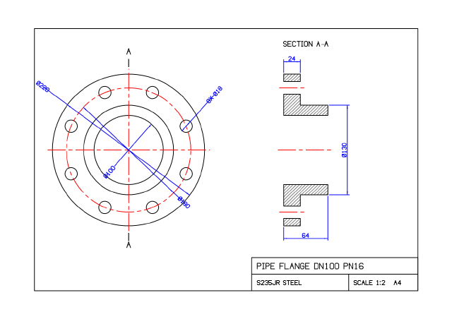</a> 
CAD 
<b><a href="pipe-flange-dn100/">Pipe Flange DN100</a></b> 
A front view and a hatched section of a bolted pipe flange at 1:2, with an eight-hole bolt circle, centre lines, diameters and a title block. 
<i>41 objects; 9 layers</i> 
<code>mechanical</code> <code>section</code> <code>hatch</code> <code>polar-array</code> <code>dimensions</code> <code>centre-lines</code>
</td>
<td width="33%" valign="top">
<a href="spur-gear-m4-z24/">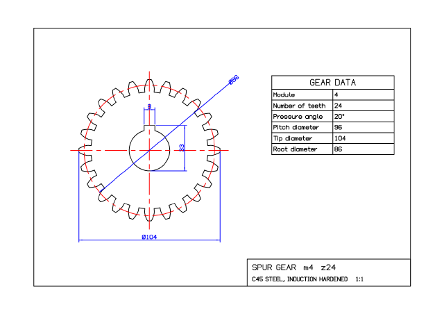</a> 
CAD 
<b><a href="spur-gear-m4-z24/">Spur Gear Profile</a></b> 
An involute spur gear, module 4 with 24 teeth, drawn as one closed polyline with a keyed bore, pitch circle and a gear data table. 
<i>14 objects; 7 layers</i> 
<code>mechanical</code> <code>gear</code> <code>polyline</code> <code>table</code> <code>dimensions</code>
</td>
</tr>
</table>

## Schematics

<table>
<tr>
<td width="33%" valign="top">
<a href="house-lighting-circuit-schematic/">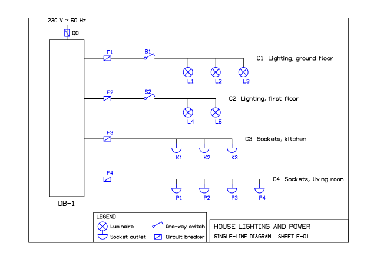</a> 
CAD 
<b><a href="house-lighting-circuit-schematic/">House Lighting Circuit Diagram</a></b> 
A single-line diagram of a house's lighting and socket circuits, drawn from four symbol blocks with attribute labels. 
<i>68 objects; 7 layers</i> 
<code>schematic</code> <code>electrical</code> <code>blocks</code> <code>attributes</code>
</td>
<td width="33%"></td>
<td width="33%"></td>
</tr>
</table>

## Site & Landscape

<table>
<tr>
<td width="33%" valign="top">
<a href="garden-house-site-plan/">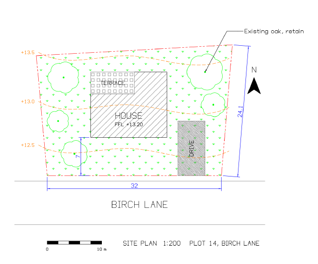</a> 
CAD 
<b><a href="garden-house-site-plan/">Garden House Site Plan</a></b> 
A 1:200 site plan with the plot boundary, a hatched house, drive and terrace, trees drawn as revision clouds, contours, a lawn, north arrow and scale bar. 
<i>47 objects; 10 layers</i> 
<code>site-plan</code> <code>landscape</code> <code>hatch</code> <code>splines</code> <code>revision-cloud</code>
</td>
<td width="33%" valign="top">
<a href="office-car-park-layout/">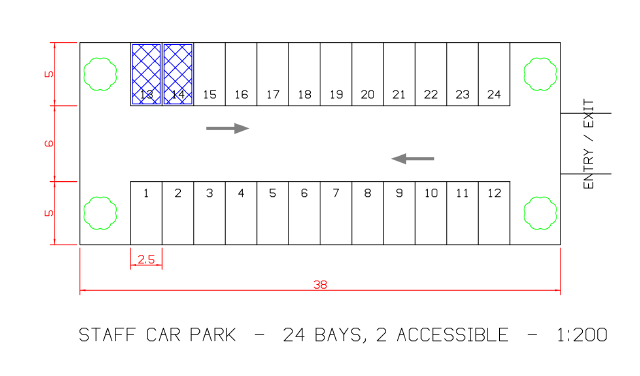</a> 
CAD 
<b><a href="office-car-park-layout/">Office Car Park Layout</a></b> 
A 24-bay car park with two rows of 2.5 × 5 m bays from rectangular arrays, two hatched accessible bays, aisle arrows, trees and dimensions. 
<i>71 objects; 9 layers</i> 
<code>site-plan</code> <code>parking</code> <code>array</code> <code>hatch</code>
</td>
<td width="33%"></td>
</tr>
</table>

## Tags

`angular` 1 · `architecture` 2 · `array` 3 · `attributes` 2 · `baseline` 1 · `blocks` 2 · `centre-lines` 2 · `dimensions` 6 · `doors` 1 · `electrical` 1 · `floor-plan` 3 · `furniture` 1 · `gear` 1 · `hatch` 4 · `hidden-lines` 1 · `landscape` 1 · `mechanical` 4 · `multileader` 1 · `ordinate` 1 · `orthographic` 1 · `parking` 1 · `polar-array` 2 · `polyline` 1 · `revision-cloud` 2 · `schematic` 1 · `section` 1 · `sheet` 1 · `site-plan` 2 · `splines` 1 · `stairs` 1 · `table` 2 · `title-block` 1
