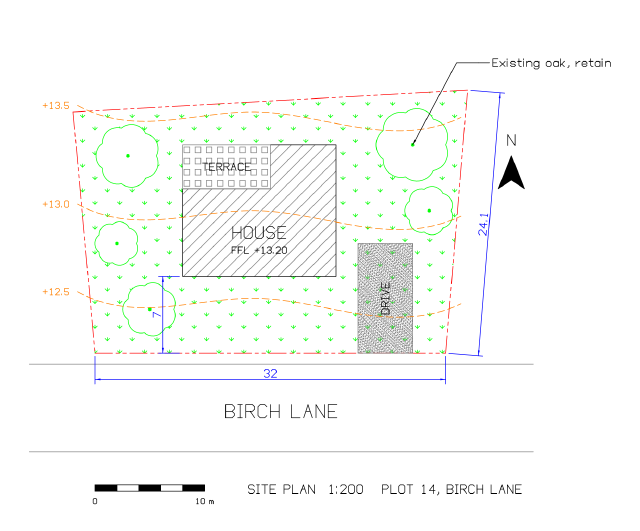

<!-- Generated by tools/gallery.mjs from showcase.yaml and build.json; do not edit. -->
# Garden House Site Plan

[CAD](../README.md) › [Site & Landscape](../README.md#site--landscape) · `site-plan` `landscape` `hatch` `splines` `revision-cloud`

A 1:200 site plan with the plot boundary, a hatched house, drive and terrace, trees drawn as revision clouds, contours, a lawn, north arrow and scale bar.



| | |
|---|---|
| Document | [garden-house-site-plan.dxf](garden-house-site-plan.dxf) (42 KB) |
| Contents | 47 objects; 10 layers |
| Features | `cad.draw.hatch`, `cad.draw.curves`, `cad.draw.shapes`, `cad.dimension.basic`, `cad.dimension.leaders`, `cad.layer.basics` |
| Built by | `kition-cad` @ `f0cd611603`: 79 commands in 23 ms |

## About

Drawn in metres. The boundary is on a red PHANTOM layer; the house, drive and terrace carry
ANSI31, AR-CONC and SQUARE hatches, and the lawn is a GRASS hatch picked from one point inside the
plot, so the house, drive and trees become islands. Each tree canopy is a circle turned into a
revision cloud; the contours are dashed splines with their levels.

## Checks

- `inspect.layers`: `{"any":{"name":"Planting"}}`
- `results.di.counts`: `{"Spline":3,"Hatch":6,"Multileader":1}`
- `results.dimstyle.current`: `"Site"`
- diagnostics: none (the kit's check finds nothing wrong)
- the saved document opens again; the thumbnail matches `thumb.png` within the `render` tolerance

## Steps

<details><summary>79 commands (from <a href="showcase.yaml">showcase.yaml</a>)</summary>

```yaml
- command: grid
  params:
    on: false
- command: lwdisplay
  params:
    on: true
- command: limits
  params:
    min:
      - -6
      - -14
    max:
      - 42
      - 30
- command: linetype
  params:
    load: DASHED
- command: linetype
  params:
    load: PHANTOM
- command: linetype
  params:
    load: CENTER
- command: dimstyle
  params:
    name: Site
    DIMTXT: 0.7
    DIMASZ: 0.5
    DIMEXO: 0.3
    DIMEXE: 0.4
    DIMGAP: 0.2
    DIMDEC: 1
  as: dimstyle
- command: layer.new
  params:
    name: Boundary
    color: "1"
    lineweight: "0.50"
    linetype: PHANTOM
- command: layer.new
  params:
    name: Building
    color: "7"
    lineweight: "0.70"
- command: layer.new
  params:
    name: Hardscape
    color: "8"
    lineweight: "0.25"
- command: layer.new
  params:
    name: Planting
    color: "3"
    lineweight: "0.25"
- command: layer.new
  params:
    name: Contours
    color: "30"
    linetype: DASHED
- command: layer.new
  params:
    name: Street
    color: "8"
    lineweight: "0.35"
- command: layer.new
  params:
    name: Annotation
    color: "7"
- command: layer.new
  params:
    name: Dims
    color: "5"
- command: ltscale
  params:
    scale: 0.05
- command: layer.current
  params:
    name: Boundary
- command: pline
  params:
    points:
      - - 0
        - 0
      - - 32
        - 0
      - - 34
        - 24
      - - -2
        - 22
    closed: true
  as: plot
- command: layer.current
  params:
    name: Building
- command: pline
  params:
    points:
      - - 8
        - 7
      - - 22
        - 7
      - - 22
        - 19
      - - 16
        - 19
      - - 16
        - 15
      - - 8
        - 15
    closed: true
  as: house
- command: layer.current
  params:
    name: Hardscape
- command: rectang
  params:
    p1:
      - 24
      - 0
    p2:
      - 29
      - 10
  as: drive
- command: rectang
  params:
    p1:
      - 8
      - 15
    p2:
      - 16
      - 19
  as: terrace
- command: hatch
  params:
    handles:
      - $drive.handle
    pattern: AR-CONC
    scale: 0.02
  as: h_drive
- command: hatch
  params:
    handles:
      - $terrace.handle
    pattern: SQUARE
    scale: 0.16
  as: h_terr
- command: hatch
  params:
    handles:
      - $house.handle
    pattern: ANSI31
    scale: 0.24
  as: h_house
- command: layer.current
  params:
    name: Planting
- command: circle
  params:
    center:
      - 3
      - 18
    radius: 2.6
  as: t0
- command: revcloud
  params:
    handle: $t0.handle
    arcLength: 2.3400000000000003
- command: donut
  params:
    center:
      - 3
      - 18
    inside: 0
    outside: 0.35
- command: circle
  params:
    center:
      - 5
      - 4
    radius: 2.2
  as: t1
- command: revcloud
  params:
    handle: $t1.handle
    arcLength: 1.9800000000000002
- command: donut
  params:
    center:
      - 5
      - 4
    inside: 0
    outside: 0.35
- command: circle
  params:
    center:
      - 29
      - 19
    radius: 3
  as: t2
- command: revcloud
  params:
    handle: $t2.handle
    arcLength: 2.7
- command: donut
  params:
    center:
      - 29
      - 19
    inside: 0
    outside: 0.35
- command: circle
  params:
    center:
      - 30.5
      - 13
    radius: 2
  as: t3
- command: revcloud
  params:
    handle: $t3.handle
    arcLength: 1.8
- command: donut
  params:
    center:
      - 30.5
      - 13
    inside: 0
    outside: 0.35
- command: circle
  params:
    center:
      - 2
      - 10
    radius: 1.8
  as: t4
- command: revcloud
  params:
    handle: $t4.handle
    arcLength: 1.62
- command: donut
  params:
    center:
      - 2
      - 10
    inside: 0
    outside: 0.35
- command: hatch
  params:
    points:
      - - 4
        - 13
    pattern: GRASS
    scale: 0.063
  as: lawn
- command: layer.current
  params:
    name: Contours
- command: spline
  params:
    fit:
      - - -1.6
        - 5.6
      - - 6
        - 4.2
      - - 14
        - 5
      - - 24
        - 3.6
      - - 33.4
        - 4.5
- command: text
  params:
    at:
      - -2.4
      - 5.6
    text: "+12.5"
    height: 0.6
    justify: MR
- command: spline
  params:
    fit:
      - - -1.6
        - 13.6
      - - 6
        - 12.2
      - - 14
        - 13
      - - 24
        - 11.6
      - - 33.4
        - 12.5
- command: text
  params:
    at:
      - -2.4
      - 13.6
    text: "+13.0"
    height: 0.6
    justify: MR
- command: spline
  params:
    fit:
      - - -1.6
        - 22.6
      - - 6
        - 21.2
      - - 14
        - 22
      - - 24
        - 20.6
      - - 33.4
        - 21.5
- command: text
  params:
    at:
      - -2.4
      - 22.6
    text: "+13.5"
    height: 0.6
    justify: MR
- command: layer.current
  params:
    name: Street
- command: line
  params:
    points:
      - - -6
        - -1
      - - 40
        - -1
- command: line
  params:
    points:
      - - -6
        - -9
      - - 40
        - -9
- command: layer.current
  params:
    name: Annotation
- command: layer.set
  params:
    name: Annotation
- command: text
  params:
    at:
      - 17
      - -5.3
    text: BIRCH LANE
    height: 1.2
    justify: MC
- command: text
  params:
    at:
      - 15
      - 11
    text: HOUSE
    height: 1.1
    justify: MC
- command: text
  params:
    at:
      - 15
      - 9.4
    text: FFL +13.20
    height: 0.6
    justify: MC
- command: text
  params:
    at:
      - 26.5
      - 5
    text: DRIVE
    height: 0.7
    justify: MC
    rotation: 90
- command: text
  params:
    at:
      - 12
      - 17
    text: TERRACE
    height: 0.7
    justify: MC
- command: mleaderstyle
  params:
    name: Site notes
    textHeight: 0.7
    arrowSize: 0.5
    landingGap: 0.3
    dogleg: 1
    current: true
  as: mls
- command: mleader
  params:
    points:
      - - 29
        - 19
      - - 33
        - 26.5
      - - 35
        - 26.5
    text: Existing oak, retain
  as: note
- command: pline
  params:
    points:
      - - 38
        - 18
      - - 39.2
        - 15
      - - 38
        - 15.8
      - - 36.8
        - 15
    closed: true
  as: na
- command: hatch
  params:
    handles:
      - $na.handle
    pattern: SOLID
- command: text
  params:
    at:
      - 38
      - 18.6
    text: N
    height: 1
    justify: BC
- command: rectang
  params:
    p1:
      - 0
      - -12.6
    p2:
      - 2
      - -12
  as: sb0
- command: rectang
  params:
    p1:
      - 2
      - -12.6
    p2:
      - 4
      - -12
  as: sb1
- command: rectang
  params:
    p1:
      - 4
      - -12.6
    p2:
      - 6
      - -12
  as: sb2
- command: rectang
  params:
    p1:
      - 6
      - -12.6
    p2:
      - 8
      - -12
  as: sb3
- command: rectang
  params:
    p1:
      - 8
      - -12.6
    p2:
      - 10
      - -12
  as: sb4
- command: hatch
  params:
    handles:
      - $sb0.handle
      - $sb2.handle
      - $sb4.handle
    pattern: SOLID
- command: text
  params:
    at:
      - 0
      - -13.5
    text: "0"
    height: 0.5
    justify: MC
- command: text
  params:
    at:
      - 10
      - -13.5
    text: 10 m
    height: 0.5
    justify: MC
- command: text
  params:
    at:
      - 14
      - -12.8
    text: SITE PLAN  1:200   PLOT 14, BIRCH LANE
    height: 0.8
- command: layer.current
  params:
    name: Dims
- command: dimlinear
  params:
    p1:
      - 0
      - 0
    p2:
      - 32
      - 0
    at:
      - 16
      - -2.4
  as: front
- command: dimlinear
  params:
    p1:
      - 8
      - 7
    p2:
      - 8
      - 0
    at:
      - 6.2
      - 3.5
  as: setback
- command: dimaligned
  params:
    p1:
      - 32
      - 0
    p2:
      - 34
      - 24
    at:
      - 36
      - 12
  as: side
- command: drawing.inspect
  params: {}
  as: di
```

</details>
