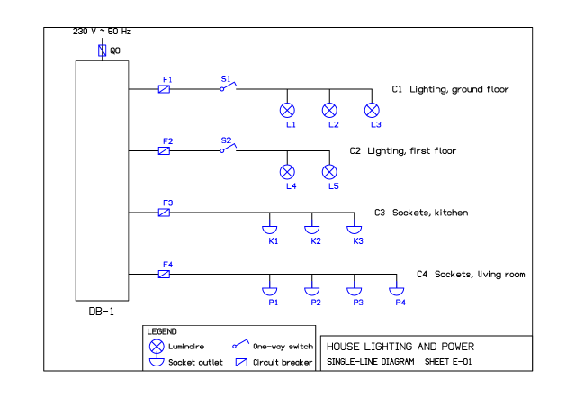

<!-- Generated by tools/gallery.mjs from showcase.yaml and build.json; do not edit. -->
# House Lighting Circuit Diagram

[CAD](../README.md) › [Schematics](../README.md#schematics) · `schematic` `electrical` `blocks` `attributes`

A single-line diagram of a house's lighting and socket circuits, drawn from four symbol blocks with attribute labels.



| | |
|---|---|
| Document | [house-lighting-circuit-schematic.dxf](house-lighting-circuit-schematic.dxf) (36 KB) |
| Contents | 68 objects; 7 layers |
| Features | `cad.block.define-insert`, `cad.block.manage`, `cad.draw.basic-geometry`, `cad.draw.text-labels`, `cad.layer.basics` |
| Built by | `kition-cad` @ `f0cd611603`: 161 commands in 20 ms |

## About

Each symbol (luminaire, switch, socket, breaker) is drawn once at the origin with an ID attribute,
made into a block, and inserted wherever it is needed with its own label: L1–L5, K1–K3, P1–P4.
The legend reuses the same blocks; count tallies the references.

## Checks

- `inspect.layers`: `{"any":{"name":"Symbols"}}`
- `results.di.blocks`: `{"count":4}`
- `results.di.counts`: `{"Block Reference":23}`
- `results.cnt.blocks`: `{"BREAKER":6,"LAMP":6,"SOCKET":8,"SWITCH":3}`
- diagnostics: none (the kit's check finds nothing wrong)
- the saved document opens again; the thumbnail matches `thumb.png` within the `render` tolerance

## Steps

<details><summary>161 commands (from <a href="showcase.yaml">showcase.yaml</a>)</summary>

```yaml
- command: grid
  params:
    on: false
- command: lwdisplay
  params:
    on: true
- command: limits
  params:
    min:
      - 0
      - 0
    max:
      - 297
      - 210
- command: linetype
  params:
    load: DASHED
- command: layer.new
  params:
    name: Frame
    color: "7"
    lineweight: "0.50"
- command: layer.new
  params:
    name: Wires
    color: "7"
    lineweight: "0.35"
- command: layer.new
  params:
    name: Symbols
    color: "5"
    lineweight: "0.35"
- command: layer.new
  params:
    name: Text
    color: "7"
- command: layer.new
  params:
    name: Notes
    color: "8"
- command: layer.current
  params:
    name: Symbols
- command: circle
  params:
    center:
      - 0
      - 0
    radius: 4
  as: LAMP_g0
- command: line
  params:
    points:
      - - -2.8284271247461903
        - -2.8284271247461903
      - - 2.8284271247461903
        - 2.8284271247461903
  as: LAMP_g1
- command: line
  params:
    points:
      - - -2.8284271247461903
        - 2.8284271247461903
      - - 2.8284271247461903
        - -2.8284271247461903
  as: LAMP_g2
- command: attdef
  params:
    tag: ID
    prompt: Reference
    default: "?"
    at:
      - 0
      - -9.5
    height: 3
  as: LAMP_a
- command: block
  params:
    name: LAMP
    base:
      - 0
      - 0
    handles:
      - $LAMP_g0.handle
      - $LAMP_g1.handles.0
      - $LAMP_g2.handles.0
      - $LAMP_a.handle
    keep: delete
    description: Luminaire
  as: blk_LAMP
- command: circle
  params:
    center:
      - 0
      - 0
    radius: 1
  as: SWITCH_g0
- command: line
  params:
    points:
      - - 0.9
        - 0.5
      - - 7
        - 4
  as: SWITCH_g1
- command: line
  params:
    points:
      - - 7
        - 4
      - - 8.2
        - 1.8
  as: SWITCH_g2
- command: attdef
  params:
    tag: ID
    prompt: Reference
    default: "?"
    at:
      - 0
      - 4.5
    height: 3
  as: SWITCH_a
- command: block
  params:
    name: SWITCH
    base:
      - 0
      - 0
    handles:
      - $SWITCH_g0.handle
      - $SWITCH_g1.handles.0
      - $SWITCH_g2.handles.0
      - $SWITCH_a.handle
    keep: delete
    description: One-way switch
  as: blk_SWITCH
- command: arc
  params:
    center:
      - 0
      - 0
    radius: 4
    start: 180
    end: 360
  as: SOCKET_g0
- command: line
  params:
    points:
      - - -4
        - 0
      - - 4
        - 0
  as: SOCKET_g1
- command: line
  params:
    points:
      - - 0
        - 0
      - - 0
        - 4
  as: SOCKET_g2
- command: attdef
  params:
    tag: ID
    prompt: Reference
    default: "?"
    at:
      - 0
      - -9.5
    height: 3
  as: SOCKET_a
- command: block
  params:
    name: SOCKET
    base:
      - 0
      - 0
    handles:
      - $SOCKET_g0.handle
      - $SOCKET_g1.handles.0
      - $SOCKET_g2.handles.0
      - $SOCKET_a.handle
    keep: delete
    description: Socket outlet
  as: blk_SOCKET
- command: rectang
  params:
    p1:
      - -3
      - -2
    p2:
      - 3
      - 2
  as: BREAKER_g0
- command: line
  params:
    points:
      - - -3
        - -2
      - - 3
        - 2
  as: BREAKER_g1
- command: attdef
  params:
    tag: ID
    prompt: Reference
    default: "?"
    at:
      - 0
      - 4
    height: 3
  as: BREAKER_a
- command: block
  params:
    name: BREAKER
    base:
      - 0
      - 0
    handles:
      - $BREAKER_g0.handle
      - $BREAKER_g1.handles.0
      - $BREAKER_a.handle
    keep: delete
    description: Circuit breaker
  as: blk_BREAKER
- command: layer.current
  params:
    name: Frame
- command: rectang
  params:
    p1:
      - 28
      - 50
    p2:
      - 58
      - 186
- command: layer.current
  params:
    name: Wires
- command: line
  params:
    points:
      - - 43
        - 186
      - - 43
        - 199
- command: layer.current
  params:
    name: Symbols
- command: insert
  params:
    name: BREAKER
    at:
      - 43
      - 192
    attribs:
      ID: ""
    rotation: 90
- command: layer.current
  params:
    name: Text
- command: text
  params:
    at:
      - 48
      - 190.5
    text: Q0
    height: 3
- command: layer.current
  params:
    name: Wires
- command: line
  params:
    points:
      - - 58
        - 170
      - - 75
        - 170
- command: line
  params:
    points:
      - - 81
        - 170
      - - 110
        - 170
- command: layer.current
  params:
    name: Symbols
- command: insert
  params:
    name: SWITCH
    at:
      - 111
      - 170
    attribs:
      ID: S1
- command: layer.current
  params:
    name: Wires
- command: line
  params:
    points:
      - - 119.2
        - 170
      - - 130
        - 170
- command: layer.current
  params:
    name: Wires
- command: line
  params:
    points:
      - - 130
        - 170
      - - 196
        - 170
- command: layer.current
  params:
    name: Symbols
- command: insert
  params:
    name: BREAKER
    at:
      - 78
      - 170
    attribs:
      ID: F1
- command: layer.current
  params:
    name: Wires
- command: line
  params:
    points:
      - - 148
        - 170
      - - 148
        - 162
- command: layer.current
  params:
    name: Symbols
- command: insert
  params:
    name: LAMP
    at:
      - 148
      - 158
    attribs:
      ID: L1
- command: layer.current
  params:
    name: Wires
- command: line
  params:
    points:
      - - 172
        - 170
      - - 172
        - 162
- command: layer.current
  params:
    name: Symbols
- command: insert
  params:
    name: LAMP
    at:
      - 172
      - 158
    attribs:
      ID: L2
- command: layer.current
  params:
    name: Wires
- command: line
  params:
    points:
      - - 196
        - 170
      - - 196
        - 162
- command: layer.current
  params:
    name: Symbols
- command: insert
  params:
    name: LAMP
    at:
      - 196
      - 158
    attribs:
      ID: L3
- command: layer.current
  params:
    name: Text
- command: text
  params:
    at:
      - 208
      - 168.5
    text: C1  Lighting, ground floor
    height: 3.2
- command: layer.current
  params:
    name: Wires
- command: line
  params:
    points:
      - - 58
        - 135
      - - 75
        - 135
- command: line
  params:
    points:
      - - 81
        - 135
      - - 110
        - 135
- command: layer.current
  params:
    name: Symbols
- command: insert
  params:
    name: SWITCH
    at:
      - 111
      - 135
    attribs:
      ID: S2
- command: layer.current
  params:
    name: Wires
- command: line
  params:
    points:
      - - 119.2
        - 135
      - - 130
        - 135
- command: layer.current
  params:
    name: Wires
- command: line
  params:
    points:
      - - 130
        - 135
      - - 172
        - 135
- command: layer.current
  params:
    name: Symbols
- command: insert
  params:
    name: BREAKER
    at:
      - 78
      - 135
    attribs:
      ID: F2
- command: layer.current
  params:
    name: Wires
- command: line
  params:
    points:
      - - 148
        - 135
      - - 148
        - 127
- command: layer.current
  params:
    name: Symbols
- command: insert
  params:
    name: LAMP
    at:
      - 148
      - 123
    attribs:
      ID: L4
- command: layer.current
  params:
    name: Wires
- command: line
  params:
    points:
      - - 172
        - 135
      - - 172
        - 127
- command: layer.current
  params:
    name: Symbols
- command: insert
  params:
    name: LAMP
    at:
      - 172
      - 123
    attribs:
      ID: L5
- command: layer.current
  params:
    name: Text
- command: text
  params:
    at:
      - 184
      - 133.5
    text: C2  Lighting, first floor
    height: 3.2
- command: layer.current
  params:
    name: Wires
- command: line
  params:
    points:
      - - 58
        - 100
      - - 75
        - 100
- command: line
  params:
    points:
      - - 81
        - 100
      - - 120
        - 100
- command: layer.current
  params:
    name: Wires
- command: line
  params:
    points:
      - - 120
        - 100
      - - 186
        - 100
- command: layer.current
  params:
    name: Symbols
- command: insert
  params:
    name: BREAKER
    at:
      - 78
      - 100
    attribs:
      ID: F3
- command: layer.current
  params:
    name: Wires
- command: line
  params:
    points:
      - - 138
        - 100
      - - 138
        - 92
- command: layer.current
  params:
    name: Symbols
- command: insert
  params:
    name: SOCKET
    at:
      - 138
      - 92
    attribs:
      ID: K1
- command: layer.current
  params:
    name: Wires
- command: line
  params:
    points:
      - - 162
        - 100
      - - 162
        - 92
- command: layer.current
  params:
    name: Symbols
- command: insert
  params:
    name: SOCKET
    at:
      - 162
      - 92
    attribs:
      ID: K2
- command: layer.current
  params:
    name: Wires
- command: line
  params:
    points:
      - - 186
        - 100
      - - 186
        - 92
- command: layer.current
  params:
    name: Symbols
- command: insert
  params:
    name: SOCKET
    at:
      - 186
      - 92
    attribs:
      ID: K3
- command: layer.current
  params:
    name: Text
- command: text
  params:
    at:
      - 198
      - 98.5
    text: C3  Sockets, kitchen
    height: 3.2
- command: layer.current
  params:
    name: Wires
- command: line
  params:
    points:
      - - 58
        - 65
      - - 75
        - 65
- command: line
  params:
    points:
      - - 81
        - 65
      - - 120
        - 65
- command: layer.current
  params:
    name: Wires
- command: line
  params:
    points:
      - - 120
        - 65
      - - 210
        - 65
- command: layer.current
  params:
    name: Symbols
- command: insert
  params:
    name: BREAKER
    at:
      - 78
      - 65
    attribs:
      ID: F4
- command: layer.current
  params:
    name: Wires
- command: line
  params:
    points:
      - - 138
        - 65
      - - 138
        - 57
- command: layer.current
  params:
    name: Symbols
- command: insert
  params:
    name: SOCKET
    at:
      - 138
      - 57
    attribs:
      ID: P1
- command: layer.current
  params:
    name: Wires
- command: line
  params:
    points:
      - - 162
        - 65
      - - 162
        - 57
- command: layer.current
  params:
    name: Symbols
- command: insert
  params:
    name: SOCKET
    at:
      - 162
      - 57
    attribs:
      ID: P2
- command: layer.current
  params:
    name: Wires
- command: line
  params:
    points:
      - - 186
        - 65
      - - 186
        - 57
- command: layer.current
  params:
    name: Symbols
- command: insert
  params:
    name: SOCKET
    at:
      - 186
      - 57
    attribs:
      ID: P3
- command: layer.current
  params:
    name: Wires
- command: line
  params:
    points:
      - - 210
        - 65
      - - 210
        - 57
- command: layer.current
  params:
    name: Symbols
- command: insert
  params:
    name: SOCKET
    at:
      - 210
      - 57
    attribs:
      ID: P4
- command: layer.current
  params:
    name: Text
- command: text
  params:
    at:
      - 222
      - 63.5
    text: C4  Sockets, living room
    height: 3.2
- command: layer.current
  params:
    name: Text
- command: text
  params:
    at:
      - 43
      - 200.5
    text: 230 V ~ 50 Hz
    height: 3
    justify: BC
- command: text
  params:
    at:
      - 43
      - 46
    text: DB-1
    height: 4
    justify: TC
- command: layer.current
  params:
    name: Frame
- command: rectang
  params:
    p1:
      - 66
      - 10
    p2:
      - 164
      - 36
- command: layer.current
  params:
    name: Text
- command: text
  params:
    at:
      - 69
      - 31
    text: LEGEND
    height: 3
- command: layer.current
  params:
    name: Symbols
- command: insert
  params:
    name: LAMP
    at:
      - 74
      - 24
    attribs:
      ID: ""
- command: layer.current
  params:
    name: Text
- command: text
  params:
    at:
      - 81
      - 22.7
    text: Luminaire
    height: 2.8
- command: layer.current
  params:
    name: Symbols
- command: insert
  params:
    name: SWITCH
    at:
      - 118
      - 24
    attribs:
      ID: ""
- command: layer.current
  params:
    name: Text
- command: text
  params:
    at:
      - 129
      - 22.7
    text: One-way switch
    height: 2.8
- command: layer.current
  params:
    name: Symbols
- command: insert
  params:
    name: SOCKET
    at:
      - 74
      - 17
    attribs:
      ID: ""
- command: layer.current
  params:
    name: Text
- command: text
  params:
    at:
      - 81
      - 13.7
    text: Socket outlet
    height: 2.8
- command: layer.current
  params:
    name: Symbols
- command: insert
  params:
    name: BREAKER
    at:
      - 122
      - 15
    attribs:
      ID: ""
- command: layer.current
  params:
    name: Text
- command: text
  params:
    at:
      - 129
      - 13.7
    text: Circuit breaker
    height: 2.8
- command: layer.current
  params:
    name: Symbols
- command: layer.current
  params:
    name: Frame
- command: rectang
  params:
    p1:
      - 10
      - 10
    p2:
      - 287
      - 205
- command: rectang
  params:
    p1:
      - 167
      - 10
    p2:
      - 287
      - 30
- command: layer.current
  params:
    name: Text
- command: text
  params:
    at:
      - 171
      - 22
    text: HOUSE LIGHTING AND POWER
    height: 4
- command: text
  params:
    at:
      - 171
      - 14
    text: SINGLE-LINE DIAGRAM   SHEET E-01
    height: 3
- command: count
  params: {}
  as: cnt
- command: drawing.inspect
  params: {}
  as: di
```

</details>
