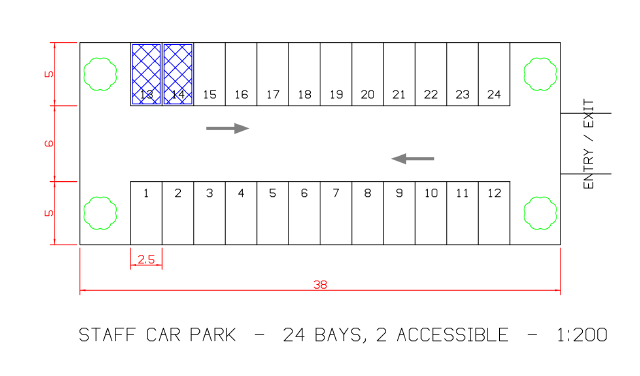

<!-- Generated by tools/gallery.mjs from showcase.yaml and build.json; do not edit. -->
# Office Car Park Layout

[CAD](../README.md) › [Site & Landscape](../README.md#site--landscape) · `site-plan` `parking` `array` `hatch`

A 24-bay car park with two rows of 2.5 × 5 m bays from rectangular arrays, two hatched accessible bays, aisle arrows, trees and dimensions.



| | |
|---|---|
| Document | [office-car-park-layout.dxf](office-car-park-layout.dxf) (41 KB) |
| Contents | 71 objects; 9 layers |
| Features | `cad.modify.array`, `cad.draw.hatch`, `cad.draw.shapes`, `cad.dimension.basic`, `cad.layer.basics` |
| Built by | `kition-cad` @ `f0cd611603`: 75 commands in 31 ms |

## About

Drawn in metres. One bay line per row is copied twelve times with arrayrect at the 2.5 m bay
width; the accessible bays are hatched on a blue layer; the one-way aisle arrows are polylines
whose middle segment tapers from 0.8 m to a point. Corner trees are circles turned into revision
clouds.

## Checks

- `inspect.layers`: `{"any":{"name":"Accessible"}}`
- `results.di.counts`: `{"Line":30,"Hatch":1,"Dimension":5}`
- diagnostics: none (the kit's check finds nothing wrong)
- the saved document opens again; the thumbnail matches `thumb.png` within the `render` tolerance

## Steps

<details><summary>75 commands (from <a href="showcase.yaml">showcase.yaml</a>)</summary>

```yaml
- command: grid
  params:
    on: false
- command: lwdisplay
  params:
    on: true
- command: limits
  params:
    min:
      - -4
      - -9
    max:
      - 42
      - 18
- command: linetype
  params:
    load: DASHED
- command: dimstyle
  params:
    name: Car park
    DIMTXT: 0.6
    DIMASZ: 0.45
    DIMEXO: 0.25
    DIMEXE: 0.35
    DIMGAP: 0.15
    DIMDEC: 1
  as: dimstyle
- command: layer.new
  params:
    name: Kerb
    color: "7"
    lineweight: "0.50"
- command: layer.new
  params:
    name: Markings
    color: "7"
    lineweight: "0.25"
- command: layer.new
  params:
    name: Accessible
    color: "5"
    lineweight: "0.25"
- command: layer.new
  params:
    name: Planting
    color: "3"
- command: layer.new
  params:
    name: Arrows
    color: "8"
- command: layer.new
  params:
    name: Text
    color: "7"
- command: layer.new
  params:
    name: Dims
    color: "1"
- command: ltscale
  params:
    scale: 0.08
- command: layer.current
  params:
    name: Kerb
- command: rectang
  params:
    p1:
      - 0
      - 0
    p2:
      - 38
      - 16
  as: site
- command: layer.current
  params:
    name: Markings
- command: line
  params:
    points:
      - - 4
        - 0
      - - 4
        - 5
  as: s1
- command: arrayrect
  params:
    handles:
      - $s1.handles.0
    rows: 1
    cols: 13
    colSpacing: 2.5
    rowSpacing: 1
- command: line
  params:
    points:
      - - 4
        - 11
      - - 4
        - 16
  as: s2
- command: arrayrect
  params:
    handles:
      - $s2.handles.0
    rows: 1
    cols: 13
    colSpacing: 2.5
    rowSpacing: 1
- command: line
  params:
    points:
      - - 4
        - 5
      - - 34
        - 5
- command: line
  params:
    points:
      - - 4
        - 11
      - - 34
        - 11
- command: layer.current
  params:
    name: Accessible
- command: rectang
  params:
    p1:
      - 4.15
      - 11.15
    p2:
      - 6.35
      - 15.85
  as: acc0
- command: rectang
  params:
    p1:
      - 6.65
      - 11.15
    p2:
      - 8.85
      - 15.85
  as: acc1
- command: hatch
  params:
    handles:
      - $acc0.handle
      - $acc1.handle
    pattern: ANSI37
    scale: 0.24
- command: layer.current
  params:
    name: Text
- command: text
  params:
    at:
      - 5.25
      - 4.1
    text: "1"
    height: 0.6
    justify: MC
- command: text
  params:
    at:
      - 5.25
      - 11.9
    text: "13"
    height: 0.6
    justify: MC
- command: text
  params:
    at:
      - 7.75
      - 4.1
    text: "2"
    height: 0.6
    justify: MC
- command: text
  params:
    at:
      - 7.75
      - 11.9
    text: "14"
    height: 0.6
    justify: MC
- command: text
  params:
    at:
      - 10.25
      - 4.1
    text: "3"
    height: 0.6
    justify: MC
- command: text
  params:
    at:
      - 10.25
      - 11.9
    text: "15"
    height: 0.6
    justify: MC
- command: text
  params:
    at:
      - 12.75
      - 4.1
    text: "4"
    height: 0.6
    justify: MC
- command: text
  params:
    at:
      - 12.75
      - 11.9
    text: "16"
    height: 0.6
    justify: MC
- command: text
  params:
    at:
      - 15.25
      - 4.1
    text: "5"
    height: 0.6
    justify: MC
- command: text
  params:
    at:
      - 15.25
      - 11.9
    text: "17"
    height: 0.6
    justify: MC
- command: text
  params:
    at:
      - 17.75
      - 4.1
    text: "6"
    height: 0.6
    justify: MC
- command: text
  params:
    at:
      - 17.75
      - 11.9
    text: "18"
    height: 0.6
    justify: MC
- command: text
  params:
    at:
      - 20.25
      - 4.1
    text: "7"
    height: 0.6
    justify: MC
- command: text
  params:
    at:
      - 20.25
      - 11.9
    text: "19"
    height: 0.6
    justify: MC
- command: text
  params:
    at:
      - 22.75
      - 4.1
    text: "8"
    height: 0.6
    justify: MC
- command: text
  params:
    at:
      - 22.75
      - 11.9
    text: "20"
    height: 0.6
    justify: MC
- command: text
  params:
    at:
      - 25.25
      - 4.1
    text: "9"
    height: 0.6
    justify: MC
- command: text
  params:
    at:
      - 25.25
      - 11.9
    text: "21"
    height: 0.6
    justify: MC
- command: text
  params:
    at:
      - 27.75
      - 4.1
    text: "10"
    height: 0.6
    justify: MC
- command: text
  params:
    at:
      - 27.75
      - 11.9
    text: "22"
    height: 0.6
    justify: MC
- command: text
  params:
    at:
      - 30.25
      - 4.1
    text: "11"
    height: 0.6
    justify: MC
- command: text
  params:
    at:
      - 30.25
      - 11.9
    text: "23"
    height: 0.6
    justify: MC
- command: text
  params:
    at:
      - 32.75
      - 4.1
    text: "12"
    height: 0.6
    justify: MC
- command: text
  params:
    at:
      - 32.75
      - 11.9
    text: "24"
    height: 0.6
    justify: MC
- command: layer.current
  params:
    name: Planting
- command: circle
  params:
    center:
      - 1.6
      - 2.5
    radius: 1.2
  as: tr12
- command: revcloud
  params:
    handle: $tr12.handle
    arcLength: 0.9
- command: circle
  params:
    center:
      - 1.6
      - 13.5
    radius: 1.2
  as: tr113
- command: revcloud
  params:
    handle: $tr113.handle
    arcLength: 0.9
- command: circle
  params:
    center:
      - 36.4
      - 2.5
    radius: 1.2
  as: tr362
- command: revcloud
  params:
    handle: $tr362.handle
    arcLength: 0.9
- command: circle
  params:
    center:
      - 36.4
      - 13.5
    radius: 1.2
  as: tr3613
- command: revcloud
  params:
    handle: $tr3613.handle
    arcLength: 0.9
- command: layer.current
  params:
    name: Arrows
- command: pline
  params:
    points:
      - p:
          - 10
          - 9.2
        startWidth: 0.25
        endWidth: 0.25
      - p:
          - 12.2
          - 9.2
        startWidth: 0.9
        endWidth: 0
      - p:
          - 13.4
          - 9.2
- command: pline
  params:
    points:
      - p:
          - 28
          - 6.8
        startWidth: 0.25
        endWidth: 0.25
      - p:
          - 25.8
          - 6.8
        startWidth: 0.9
        endWidth: 0
      - p:
          - 24.6
          - 6.8
- command: layer.current
  params:
    name: Kerb
- command: line
  params:
    points:
      - - 38
        - 5.6
      - - 42
        - 5.6
- command: line
  params:
    points:
      - - 38
        - 10.4
      - - 42
        - 10.4
- command: layer.current
  params:
    name: Text
- command: text
  params:
    at:
      - 40.2
      - 8
    text: ENTRY / EXIT
    height: 0.7
    justify: MC
    rotation: 90
- command: text
  params:
    at:
      - 0
      - -7.6
    text: STAFF CAR PARK  -  24 BAYS, 2 ACCESSIBLE  -  1:200
    height: 1
- command: layer.current
  params:
    name: Dims
- command: dimlinear
  params:
    p1:
      - 4
      - 0
    p2:
      - 6.5
      - 0
    at:
      - 5.25
      - -1.6
  as: bay
- command: dimlinear
  params:
    p1:
      - 0
      - 0
    p2:
      - 38
      - 0
    at:
      - 19
      - -3.6
  as: total
- command: dimlinear
  params:
    p1:
      - 0
      - 0
    p2:
      - 0
      - 5
    at:
      - -2
      - 2.5
  as: depth
- command: dimcontinue
  params:
    points:
      - - 0
        - 11
      - - 0
        - 16
- command: drawing.inspect
  params: {}
  as: di
```

</details>
