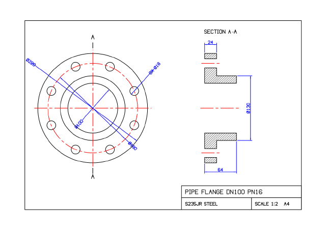

<!-- Generated by tools/gallery.mjs from showcase.yaml and build.json; do not edit. -->
# Pipe Flange DN100

[CAD](../README.md) › [Mechanical Parts](../README.md#mechanical-parts) · `mechanical` `section` `hatch` `polar-array` `dimensions` `centre-lines`

A front view and a hatched section of a bolted pipe flange at 1:2, with an eight-hole bolt circle, centre lines, diameters and a title block.



| | |
|---|---|
| Document | [pipe-flange-dn100.dxf](pipe-flange-dn100.dxf) (39 KB) |
| Contents | 41 objects; 9 layers |
| Features | `cad.draw.basic-geometry`, `cad.modify.array`, `cad.draw.hatch`, `cad.draw.centers`, `cad.dimension.basic`, `cad.dimension.styles`, `cad.layer.basics` |
| Built by | `kition-cad` @ `f0cd611603`: 64 commands in 12 ms |

## About

Drawn at half size on an A4 sheet: the dimension style's DIMLFAC of 2 makes every dimension read
full size. One bolt hole is copied round the pitch circle with arraypolar; section A–A is four
closed polylines filled with ANSI31; centre lines sit on a red CENTER layer. Two dimensions carry
a text override ("8X Ø18" and "Ø130"), which the check notes as information.

## Checks

- `inspect.layers`: `{"any":{"name":"Center"},"count":9}`
- `results.di.counts`: `{"Circle":12,"Hatch":1,"Dimension":7,"Polyline":8}`
- `results.dimstyle.current`: `"Mech-1to2"`
- diagnostics: `cad.dimension-text-overridden`, `cad.dimension-text-overridden`
- the saved document opens again; the thumbnail matches `thumb.png` within the `render` tolerance

## Steps

<details><summary>64 commands (from <a href="showcase.yaml">showcase.yaml</a>)</summary>

```yaml
- command: grid
  params:
    on: false
- command: lwdisplay
  params:
    on: true
- command: limits
  params:
    min:
      - 0
      - 0
    max:
      - 297
      - 210
- command: linetype
  params:
    load: CENTER
- command: linetype
  params:
    load: HIDDEN
- command: linetype
  params:
    load: DASHED
- command: linetype
  params:
    load: PHANTOM
- command: dimstyle
  params:
    name: Mech-1to2
    DIMTXT: 2.8
    DIMASZ: 2.5
    DIMEXO: 1
    DIMEXE: 1.5
    DIMGAP: 0.8
    DIMDEC: 0
    DIMLFAC: 2
  as: dimstyle
- command: layer.new
  params:
    name: Border
    color: "7"
    lineweight: "0.70"
- command: layer.new
  params:
    name: Outline
    color: "7"
    lineweight: "0.50"
- command: layer.new
  params:
    name: Thin
    color: "7"
    lineweight: "0.18"
- command: layer.new
  params:
    name: Center
    color: "1"
    linetype: CENTER
- command: layer.new
  params:
    name: Hatch
    color: "8"
- command: layer.new
  params:
    name: Dims
    color: "5"
- command: layer.new
  params:
    name: Text
    color: "7"
- command: ltscale
  params:
    scale: 0.4
- command: layer.current
  params:
    name: Outline
- command: circle
  params:
    center:
      - 78
      - 112
    radius: 55
  as: od
- command: circle
  params:
    center:
      - 78
      - 112
    radius: 32.5
  as: hub
- command: circle
  params:
    center:
      - 78
      - 112
    radius: 25
  as: bore
- command: circle
  params:
    center:
      - 119.5745789630079
      - 129.22075445642903
    radius: 4.5
  as: hole
- command: arraypolar
  params:
    handles:
      - $hole.handle
    center:
      - 78
      - 112
    count: 8
    angle: 360
  as: holes
- command: layer.current
  params:
    name: Center
- command: circle
  params:
    center:
      - 78
      - 112
    radius: 45
  as: pcd
- command: centermark
  params:
    handle: $od.handle
- command: layer.current
  params:
    name: Outline
- command: pline
  params:
    points:
      - - 190
        - 137
      - - 222
        - 137
      - - 222
        - 144.5
      - - 202
        - 144.5
      - - 202
        - 152.5
      - - 190
        - 152.5
    closed: true
  as: sec0
- command: pline
  params:
    points:
      - - 190
        - 161.5
      - - 202
        - 161.5
      - - 202
        - 167
      - - 190
        - 167
    closed: true
  as: sec1
- command: pline
  params:
    points:
      - - 190
        - 87
      - - 222
        - 87
      - - 222
        - 79.5
      - - 202
        - 79.5
      - - 202
        - 71.5
      - - 190
        - 71.5
    closed: true
  as: sec2
- command: pline
  params:
    points:
      - - 190
        - 62.5
      - - 202
        - 62.5
      - - 202
        - 57
      - - 190
        - 57
    closed: true
  as: sec3
- command: layer.current
  params:
    name: Hatch
- command: hatch
  params:
    handles:
      - $sec0.handle
      - $sec1.handle
      - $sec2.handle
      - $sec3.handle
    pattern: ANSI31
    scale: 0.5
- command: layer.current
  params:
    name: Center
- command: line
  params:
    points:
      - - 186
        - 112
      - - 226
        - 112
- command: line
  params:
    points:
      - - 187
        - 157
      - - 205
        - 157
- command: line
  params:
    points:
      - - 187
        - 67
      - - 205
        - 67
- command: layer.current
  params:
    name: Thin
- command: pline
  params:
    points:
      - - 78
        - 172
      - - 78
        - 178
    width: 0.6
- command: pline
  params:
    points:
      - - 78
        - 52
      - - 78
        - 46
    width: 0.6
- command: layer.current
  params:
    name: Dims
- command: dimdiameter
  params:
    handle: $od.handle
    at:
      - 16
      - 158
  as: d_od
- command: dimdiameter
  params:
    handle: $bore.handle
    at:
      - 64
      - 96
  as: d_bore
- command: dimdiameter
  params:
    handle: $pcd.handle
    at:
      - 118
      - 74
  as: d_pcd
- command: dimdiameter
  params:
    handle: $hole.handle
    at:
      - 140
      - 152
  as: d_hole
- command: properties.set
  params:
    handles:
      - $d_hole.handle
    textOverride: 8X Ø18
- command: dimlinear
  params:
    p1:
      - 190
      - 167
    p2:
      - 202
      - 167
    at:
      - 196
      - 176
  as: d_t
- command: dimlinear
  params:
    p1:
      - 190
      - 57
    p2:
      - 222
      - 79.5
    at:
      - 206
      - 48
  as: d_len
- command: dimlinear
  params:
    p1:
      - 222
      - 79.5
    p2:
      - 222
      - 144.5
    at:
      - 236
      - 112
  as: d_hubd
- command: properties.set
  params:
    handles:
      - $d_hubd.handle
    textOverride: Ø130
- command: layer.current
  params:
    name: Text
- command: text
  params:
    at:
      - 78
      - 180
    text: A
    height: 4
    justify: BC
- command: text
  params:
    at:
      - 78
      - 40
    text: A
    height: 4
    justify: BC
- command: text
  params:
    at:
      - 206
      - 186
    text: SECTION A–A
    height: 3.5
    justify: BC
- command: layer.current
  params:
    name: Border
- command: rectang
  params:
    p1:
      - 10
      - 10
    p2:
      - 287
      - 200
- command: rectang
  params:
    p1:
      - 167
      - 10
    p2:
      - 287
      - 34
- command: layer.current
  params:
    name: Thin
- command: line
  params:
    points:
      - - 167
        - 22
      - - 287
        - 22
- command: line
  params:
    points:
      - - 237
        - 10
      - - 237
        - 22
- command: layer.current
  params:
    name: Text
- command: text
  params:
    at:
      - 171
      - 26
    text: PIPE FLANGE DN100 PN16
    height: 4
- command: text
  params:
    at:
      - 171
      - 14.5
    text: S235JR STEEL
    height: 3
- command: text
  params:
    at:
      - 241
      - 14.5
    text: SCALE 1:2   A4
    height: 3
- command: drawing.inspect
  params: {}
  as: di
```

</details>
