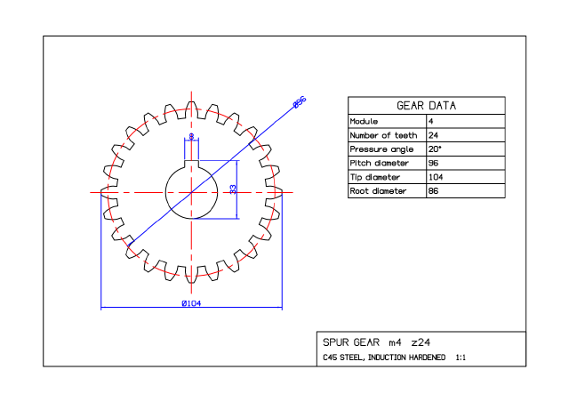

<!-- Generated by tools/gallery.mjs from showcase.yaml and build.json; do not edit. -->
# Spur Gear Profile

[CAD](../README.md) › [Mechanical Parts](../README.md#mechanical-parts) · `mechanical` `gear` `polyline` `table` `dimensions`

An involute spur gear, module 4 with 24 teeth, drawn as one closed polyline with a keyed bore, pitch circle and a gear data table.



| | |
|---|---|
| Document | [spur-gear-m4-z24.dxf](spur-gear-m4-z24.dxf) (51 KB) |
| Contents | 14 objects; 7 layers |
| Features | `cad.draw.lines`, `cad.draw.basic-geometry`, `cad.table.edit`, `cad.dimension.basic`, `cad.layer.basics` |
| Built by | `kition-cad` @ `f0cd611603`: 35 commands in 21 ms |

## About

The tooth flanks are true involutes from the base circle, computed point by point into a single
closed polyline of 552 vertices. The bore and keyway are one polyline with a bulge for the
arc; the pitch circle and axes are on a CENTER layer, and a table lists the gear data.

## Checks

- `results.di.counts`: `{"Polyline":4,"Circle":1,"Dimension":4}`
- `results.ts`: `{"exists":true}`
- `results.d_tip.handle`: `{"exists":true}`
- `inspect.layers`: `{"any":{"name":"Center"}}`
- diagnostics: none (the kit's check finds nothing wrong)
- the saved document opens again; the thumbnail matches `thumb.png` within the `render` tolerance

## Steps

<details><summary>35 commands (from <a href="showcase.yaml">showcase.yaml</a>)</summary>

```yaml
- command: grid
  params:
    on: false
- command: lwdisplay
  params:
    on: true
- command: limits
  params:
    min:
      - 0
      - 0
    max:
      - 297
      - 210
- command: linetype
  params:
    load: CENTER
- command: dimstyle
  params:
    name: Gear
    DIMTXT: 3
    DIMASZ: 2.5
    DIMEXO: 1
    DIMEXE: 1.5
    DIMGAP: 0.8
    DIMDEC: 0
  as: dimstyle
- command: layer.new
  params:
    name: Outline
    color: "7"
    lineweight: "0.50"
- command: layer.new
  params:
    name: Center
    color: "1"
    linetype: CENTER
- command: layer.new
  params:
    name: Dims
    color: "5"
- command: layer.new
  params:
    name: Text
    color: "7"
- command: layer.new
  params:
    name: Frame
    color: "7"
    lineweight: "0.50"
- command: ltscale
  params:
    scale: 0.5
- command: layer.current
  params:
    name: Outline
- command: pline
  params:
    points:
      - - 137.861
        - 106.548
      - - 139.96
        - 106.38
      - - 140.828
        - 106.423
      - - 141.703
        - 106.564
      - - 142.581
        - 106.772
      - - 143.462
        - 107.036
      - - 144.343
        - 107.351
      - - 145.224
        - 107.713
      - - 146.104
        - 108.12
      - - 146.98
        - 108.569
      - - 146.98
        - 111.431
      - - 146.104
        - 111.88
      - - 145.224
        - 112.287
      - - 144.343
        - 112.649
      - - 143.462
        - 112.964
      - - 142.581
        - 113.228
      - - 141.703
        - 113.436
      - - 140.828
        - 113.577
      - - 139.96
        - 113.62
      - - 137.861
        - 113.452
      - - 137.76
        - 114.534
      - - 137.632
        - 115.613
      - - 137.477
        - 116.688
      - - 137.294
        - 117.759
      - - 139.365
        - 118.139
      - - 140.192
        - 118.406
      - - 141.001
        - 118.769
      - - 141.796
        - 119.197
      - - 142.578
        - 119.68
      - - 143.348
        - 120.212
      - - 144.105
        - 120.79
      - - 144.849
        - 121.41
      - - 145.579
        - 122.071
      - - 144.839
        - 124.836
      - - 143.876
        - 125.043
      - - 142.921
        - 125.208
      - - 141.976
        - 125.33
      - - 141.044
        - 125.406
      - - 140.125
        - 125.433
      - - 139.222
        - 125.406
      - - 138.341
        - 125.316
      - - 137.491
        - 125.134
      - - 135.507
        - 124.427
      - - 135.13
        - 125.446
      - - 134.727
        - 126.455
      - - 134.298
        - 127.454
      - - 133.845
        - 128.442
      - - 135.746
        - 129.344
      - - 136.476
        - 129.816
      - - 137.164
        - 130.376
      - - 137.821
        - 130.995
      - - 138.451
        - 131.664
      - - 139.057
        - 132.377
      - - 139.639
        - 133.131
      - - 140.197
        - 133.923
      - - 140.732
        - 134.751
      - - 139.301
        - 137.229
      - - 138.317
        - 137.18
      - - 137.352
        - 137.093
      - - 136.408
        - 136.966
      - - 135.487
        - 136.798
      - - 134.593
        - 136.586
      - - 133.728
        - 136.327
      - - 132.9
        - 136.011
      - - 132.126
        - 135.615
      - - 130.393
        - 134.42
      - - 129.765
        - 135.306
      - - 129.114
        - 136.177
      - - 128.442
        - 137.03
      - - 127.748
        - 137.867
      - - 129.351
        - 139.231
      - - 129.934
        - 139.876
      - - 130.453
        - 140.595
      - - 130.928
        - 141.363
      - - 131.364
        - 142.172
      - - 131.764
        - 143.018
      - - 132.131
        - 143.897
      - - 132.465
        - 144.806
      - - 132.767
        - 145.744
      - - 130.744
        - 147.767
      - - 129.806
        - 147.465
      - - 128.897
        - 147.131
      - - 128.018
        - 146.764
      - - 127.172
        - 146.364
      - - 126.363
        - 145.928
      - - 125.595
        - 145.453
      - - 124.876
        - 144.934
      - - 124.231
        - 144.351
      - - 122.867
        - 142.748
      - - 122.03
        - 143.442
      - - 121.177
        - 144.114
      - - 120.306
        - 144.765
      - - 119.42
        - 145.393
      - - 120.615
        - 147.126
      - - 121.011
        - 147.9
      - - 121.327
        - 148.728
      - - 121.586
        - 149.593
      - - 121.798
        - 150.487
      - - 121.966
        - 151.408
      - - 122.093
        - 152.352
      - - 122.18
        - 153.317
      - - 122.229
        - 154.301
      - - 119.751
        - 155.732
      - - 118.923
        - 155.197
      - - 118.131
        - 154.639
      - - 117.377
        - 154.057
      - - 116.664
        - 153.451
      - - 115.995
        - 152.821
      - - 115.376
        - 152.164
      - - 114.816
        - 151.476
      - - 114.344
        - 150.746
      - - 113.442
        - 148.845
      - - 112.454
        - 149.298
      - - 111.455
        - 149.727
      - - 110.446
        - 150.13
      - - 109.427
        - 150.507
      - - 110.134
        - 152.491
      - - 110.316
        - 153.341
      - - 110.406
        - 154.222
      - - 110.433
        - 155.125
      - - 110.406
        - 156.044
      - - 110.33
        - 156.976
      - - 110.208
        - 157.921
      - - 110.043
        - 158.876
      - - 109.836
        - 159.839
      - - 107.071
        - 160.579
      - - 106.41
        - 159.849
      - - 105.79
        - 159.105
      - - 105.212
        - 158.348
      - - 104.68
        - 157.578
      - - 104.197
        - 156.796
      - - 103.769
        - 156.001
      - - 103.406
        - 155.192
      - - 103.139
        - 154.365
      - - 102.759
        - 152.294
      - - 101.688
        - 152.477
      - - 100.613
        - 152.632
      - - 99.534
        - 152.76
      - - 98.452
        - 152.861
      - - 98.62
        - 154.96
      - - 98.577
        - 155.828
      - - 98.436
        - 156.703
      - - 98.228
        - 157.581
      - - 97.964
        - 158.462
      - - 97.649
        - 159.343
      - - 97.287
        - 160.224
      - - 96.88
        - 161.104
      - - 96.431
        - 161.98
      - - 93.569
        - 161.98
      - - 93.12
        - 161.104
      - - 92.713
        - 160.224
      - - 92.351
        - 159.343
      - - 92.036
        - 158.462
      - - 91.772
        - 157.581
      - - 91.564
        - 156.703
      - - 91.423
        - 155.828
      - - 91.38
        - 154.96
      - - 91.548
        - 152.861
      - - 90.466
        - 152.76
      - - 89.387
        - 152.632
      - - 88.312
        - 152.477
      - - 87.241
        - 152.294
      - - 86.861
        - 154.365
      - - 86.594
        - 155.192
      - - 86.231
        - 156.001
      - - 85.803
        - 156.796
      - - 85.32
        - 157.578
      - - 84.788
        - 158.348
      - - 84.21
        - 159.105
      - - 83.59
        - 159.849
      - - 82.929
        - 160.579
      - - 80.164
        - 159.839
      - - 79.957
        - 158.876
      - - 79.792
        - 157.921
      - - 79.67
        - 156.976
      - - 79.594
        - 156.044
      - - 79.567
        - 155.125
      - - 79.594
        - 154.222
      - - 79.684
        - 153.341
      - - 79.866
        - 152.491
      - - 80.573
        - 150.507
      - - 79.554
        - 150.13
      - - 78.545
        - 149.727
      - - 77.546
        - 149.298
      - - 76.558
        - 148.845
      - - 75.656
        - 150.746
      - - 75.184
        - 151.476
      - - 74.624
        - 152.164
      - - 74.005
        - 152.821
      - - 73.336
        - 153.451
      - - 72.623
        - 154.057
      - - 71.869
        - 154.639
      - - 71.077
        - 155.197
      - - 70.249
        - 155.732
      - - 67.771
        - 154.301
      - - 67.82
        - 153.317
      - - 67.907
        - 152.352
      - - 68.034
        - 151.408
      - - 68.202
        - 150.487
      - - 68.414
        - 149.593
      - - 68.673
        - 148.728
      - - 68.989
        - 147.9
      - - 69.385
        - 147.126
      - - 70.58
        - 145.393
      - - 69.694
        - 144.765
      - - 68.823
        - 144.114
      - - 67.97
        - 143.442
      - - 67.133
        - 142.748
      - - 65.769
        - 144.351
      - - 65.124
        - 144.934
      - - 64.405
        - 145.453
      - - 63.637
        - 145.928
      - - 62.828
        - 146.364
      - - 61.982
        - 146.764
      - - 61.103
        - 147.131
      - - 60.194
        - 147.465
      - - 59.256
        - 147.767
      - - 57.233
        - 145.744
      - - 57.535
        - 144.806
      - - 57.869
        - 143.897
      - - 58.236
        - 143.018
      - - 58.636
        - 142.172
      - - 59.072
        - 141.363
      - - 59.547
        - 140.595
      - - 60.066
        - 139.876
      - - 60.649
        - 139.231
      - - 62.252
        - 137.867
      - - 61.558
        - 137.03
      - - 60.886
        - 136.177
      - - 60.235
        - 135.306
      - - 59.607
        - 134.42
      - - 57.874
        - 135.615
      - - 57.1
        - 136.011
      - - 56.272
        - 136.327
      - - 55.407
        - 136.586
      - - 54.513
        - 136.798
      - - 53.592
        - 136.966
      - - 52.648
        - 137.093
      - - 51.683
        - 137.18
      - - 50.699
        - 137.229
      - - 49.268
        - 134.751
      - - 49.803
        - 133.923
      - - 50.361
        - 133.131
      - - 50.943
        - 132.377
      - - 51.549
        - 131.664
      - - 52.179
        - 130.995
      - - 52.836
        - 130.376
      - - 53.524
        - 129.816
      - - 54.254
        - 129.344
      - - 56.155
        - 128.442
      - - 55.702
        - 127.454
      - - 55.273
        - 126.455
      - - 54.87
        - 125.446
      - - 54.493
        - 124.427
      - - 52.509
        - 125.134
      - - 51.659
        - 125.316
      - - 50.778
        - 125.406
      - - 49.875
        - 125.433
      - - 48.956
        - 125.406
      - - 48.024
        - 125.33
      - - 47.079
        - 125.208
      - - 46.124
        - 125.043
      - - 45.161
        - 124.836
      - - 44.421
        - 122.071
      - - 45.151
        - 121.41
      - - 45.895
        - 120.79
      - - 46.652
        - 120.212
      - - 47.422
        - 119.68
      - - 48.204
        - 119.197
      - - 48.999
        - 118.769
      - - 49.808
        - 118.406
      - - 50.635
        - 118.139
      - - 52.706
        - 117.759
      - - 52.523
        - 116.688
      - - 52.368
        - 115.613
      - - 52.24
        - 114.534
      - - 52.139
        - 113.452
      - - 50.04
        - 113.62
      - - 49.172
        - 113.577
      - - 48.297
        - 113.436
      - - 47.419
        - 113.228
      - - 46.538
        - 112.964
      - - 45.657
        - 112.649
      - - 44.776
        - 112.287
      - - 43.896
        - 111.88
      - - 43.02
        - 111.431
      - - 43.02
        - 108.569
      - - 43.896
        - 108.12
      - - 44.776
        - 107.713
      - - 45.657
        - 107.351
      - - 46.538
        - 107.036
      - - 47.419
        - 106.772
      - - 48.297
        - 106.564
      - - 49.172
        - 106.423
      - - 50.04
        - 106.38
      - - 52.139
        - 106.548
      - - 52.24
        - 105.466
      - - 52.368
        - 104.387
      - - 52.523
        - 103.312
      - - 52.706
        - 102.241
      - - 50.635
        - 101.861
      - - 49.808
        - 101.594
      - - 48.999
        - 101.231
      - - 48.204
        - 100.803
      - - 47.422
        - 100.32
      - - 46.652
        - 99.788
      - - 45.895
        - 99.21
      - - 45.151
        - 98.59
      - - 44.421
        - 97.929
      - - 45.161
        - 95.164
      - - 46.124
        - 94.957
      - - 47.079
        - 94.792
      - - 48.024
        - 94.67
      - - 48.956
        - 94.594
      - - 49.875
        - 94.567
      - - 50.778
        - 94.594
      - - 51.659
        - 94.684
      - - 52.509
        - 94.866
      - - 54.493
        - 95.573
      - - 54.87
        - 94.554
      - - 55.273
        - 93.545
      - - 55.702
        - 92.546
      - - 56.155
        - 91.558
      - - 54.254
        - 90.656
      - - 53.524
        - 90.184
      - - 52.836
        - 89.624
      - - 52.179
        - 89.005
      - - 51.549
        - 88.336
      - - 50.943
        - 87.623
      - - 50.361
        - 86.869
      - - 49.803
        - 86.077
      - - 49.268
        - 85.249
      - - 50.699
        - 82.771
      - - 51.683
        - 82.82
      - - 52.648
        - 82.907
      - - 53.592
        - 83.034
      - - 54.513
        - 83.202
      - - 55.407
        - 83.414
      - - 56.272
        - 83.673
      - - 57.1
        - 83.989
      - - 57.874
        - 84.385
      - - 59.607
        - 85.58
      - - 60.235
        - 84.694
      - - 60.886
        - 83.823
      - - 61.558
        - 82.97
      - - 62.252
        - 82.133
      - - 60.649
        - 80.769
      - - 60.066
        - 80.124
      - - 59.547
        - 79.405
      - - 59.072
        - 78.637
      - - 58.636
        - 77.828
      - - 58.236
        - 76.982
      - - 57.869
        - 76.103
      - - 57.535
        - 75.194
      - - 57.233
        - 74.256
      - - 59.256
        - 72.233
      - - 60.194
        - 72.535
      - - 61.103
        - 72.869
      - - 61.982
        - 73.236
      - - 62.828
        - 73.636
      - - 63.637
        - 74.072
      - - 64.405
        - 74.547
      - - 65.124
        - 75.066
      - - 65.769
        - 75.649
      - - 67.133
        - 77.252
      - - 67.97
        - 76.558
      - - 68.823
        - 75.886
      - - 69.694
        - 75.235
      - - 70.58
        - 74.607
      - - 69.385
        - 72.874
      - - 68.989
        - 72.1
      - - 68.673
        - 71.272
      - - 68.414
        - 70.407
      - - 68.202
        - 69.513
      - - 68.034
        - 68.592
      - - 67.907
        - 67.648
      - - 67.82
        - 66.683
      - - 67.771
        - 65.699
      - - 70.249
        - 64.268
      - - 71.077
        - 64.803
      - - 71.869
        - 65.361
      - - 72.623
        - 65.943
      - - 73.336
        - 66.549
      - - 74.005
        - 67.179
      - - 74.624
        - 67.836
      - - 75.184
        - 68.524
      - - 75.656
        - 69.254
      - - 76.558
        - 71.155
      - - 77.546
        - 70.702
      - - 78.545
        - 70.273
      - - 79.554
        - 69.87
      - - 80.573
        - 69.493
      - - 79.866
        - 67.509
      - - 79.684
        - 66.659
      - - 79.594
        - 65.778
      - - 79.567
        - 64.875
      - - 79.594
        - 63.956
      - - 79.67
        - 63.024
      - - 79.792
        - 62.079
      - - 79.957
        - 61.124
      - - 80.164
        - 60.161
      - - 82.929
        - 59.421
      - - 83.59
        - 60.151
      - - 84.21
        - 60.895
      - - 84.788
        - 61.652
      - - 85.32
        - 62.422
      - - 85.803
        - 63.204
      - - 86.231
        - 63.999
      - - 86.594
        - 64.808
      - - 86.861
        - 65.635
      - - 87.241
        - 67.706
      - - 88.312
        - 67.523
      - - 89.387
        - 67.368
      - - 90.466
        - 67.24
      - - 91.548
        - 67.139
      - - 91.38
        - 65.04
      - - 91.423
        - 64.172
      - - 91.564
        - 63.297
      - - 91.772
        - 62.419
      - - 92.036
        - 61.538
      - - 92.351
        - 60.657
      - - 92.713
        - 59.776
      - - 93.12
        - 58.896
      - - 93.569
        - 58.02
      - - 96.431
        - 58.02
      - - 96.88
        - 58.896
      - - 97.287
        - 59.776
      - - 97.649
        - 60.657
      - - 97.964
        - 61.538
      - - 98.228
        - 62.419
      - - 98.436
        - 63.297
      - - 98.577
        - 64.172
      - - 98.62
        - 65.04
      - - 98.452
        - 67.139
      - - 99.534
        - 67.24
      - - 100.613
        - 67.368
      - - 101.688
        - 67.523
      - - 102.759
        - 67.706
      - - 103.139
        - 65.635
      - - 103.406
        - 64.808
      - - 103.769
        - 63.999
      - - 104.197
        - 63.204
      - - 104.68
        - 62.422
      - - 105.212
        - 61.652
      - - 105.79
        - 60.895
      - - 106.41
        - 60.151
      - - 107.071
        - 59.421
      - - 109.836
        - 60.161
      - - 110.043
        - 61.124
      - - 110.208
        - 62.079
      - - 110.33
        - 63.024
      - - 110.406
        - 63.956
      - - 110.433
        - 64.875
      - - 110.406
        - 65.778
      - - 110.316
        - 66.659
      - - 110.134
        - 67.509
      - - 109.427
        - 69.493
      - - 110.446
        - 69.87
      - - 111.455
        - 70.273
      - - 112.454
        - 70.702
      - - 113.442
        - 71.155
      - - 114.344
        - 69.254
      - - 114.816
        - 68.524
      - - 115.376
        - 67.836
      - - 115.995
        - 67.179
      - - 116.664
        - 66.549
      - - 117.377
        - 65.943
      - - 118.131
        - 65.361
      - - 118.923
        - 64.803
      - - 119.751
        - 64.268
      - - 122.229
        - 65.699
      - - 122.18
        - 66.683
      - - 122.093
        - 67.648
      - - 121.966
        - 68.592
      - - 121.798
        - 69.513
      - - 121.586
        - 70.407
      - - 121.327
        - 71.272
      - - 121.011
        - 72.1
      - - 120.615
        - 72.874
      - - 119.42
        - 74.607
      - - 120.306
        - 75.235
      - - 121.177
        - 75.886
      - - 122.03
        - 76.558
      - - 122.867
        - 77.252
      - - 124.231
        - 75.649
      - - 124.876
        - 75.066
      - - 125.595
        - 74.547
      - - 126.363
        - 74.072
      - - 127.172
        - 73.636
      - - 128.018
        - 73.236
      - - 128.897
        - 72.869
      - - 129.806
        - 72.535
      - - 130.744
        - 72.233
      - - 132.767
        - 74.256
      - - 132.465
        - 75.194
      - - 132.131
        - 76.103
      - - 131.764
        - 76.982
      - - 131.364
        - 77.828
      - - 130.928
        - 78.637
      - - 130.453
        - 79.405
      - - 129.934
        - 80.124
      - - 129.351
        - 80.769
      - - 127.748
        - 82.133
      - - 128.442
        - 82.97
      - - 129.114
        - 83.823
      - - 129.765
        - 84.694
      - - 130.393
        - 85.58
      - - 132.126
        - 84.385
      - - 132.9
        - 83.989
      - - 133.728
        - 83.673
      - - 134.593
        - 83.414
      - - 135.487
        - 83.202
      - - 136.408
        - 83.034
      - - 137.352
        - 82.907
      - - 138.317
        - 82.82
      - - 139.301
        - 82.771
      - - 140.732
        - 85.249
      - - 140.197
        - 86.077
      - - 139.639
        - 86.869
      - - 139.057
        - 87.623
      - - 138.451
        - 88.336
      - - 137.821
        - 89.005
      - - 137.164
        - 89.624
      - - 136.476
        - 90.184
      - - 135.746
        - 90.656
      - - 133.845
        - 91.558
      - - 134.298
        - 92.546
      - - 134.727
        - 93.545
      - - 135.13
        - 94.554
      - - 135.507
        - 95.573
      - - 137.491
        - 94.866
      - - 138.341
        - 94.684
      - - 139.222
        - 94.594
      - - 140.125
        - 94.567
      - - 141.044
        - 94.594
      - - 141.976
        - 94.67
      - - 142.921
        - 94.792
      - - 143.876
        - 94.957
      - - 144.839
        - 95.164
      - - 145.579
        - 97.929
      - - 144.849
        - 98.59
      - - 144.105
        - 99.21
      - - 143.348
        - 99.788
      - - 142.578
        - 100.32
      - - 141.796
        - 100.803
      - - 141.001
        - 101.231
      - - 140.192
        - 101.594
      - - 139.365
        - 101.861
      - - 137.294
        - 102.241
      - - 137.477
        - 103.312
      - - 137.632
        - 104.387
      - - 137.76
        - 105.466
    closed: true
  as: gear
- command: pline
  params:
    points:
      - p:
          - 91
          - 124.457
        bulge: 0
      - p:
          - 91
          - 128.3
      - p:
          - 99
          - 128.3
      - p:
          - 99
          - 124.457
        bulge: -7.364208
    closed: true
  as: bore
- command: layer.current
  params:
    name: Center
- command: circle
  params:
    center:
      - 95
      - 110
    radius: 48
  as: pitch
- command: line
  params:
    points:
      - - 37
        - 110
      - - 153
        - 110
- command: line
  params:
    points:
      - - 95
        - 52
      - - 95
        - 168
- command: layer.current
  params:
    name: Dims
- command: dimstyle
  params:
    name: Gear-dia
    DIMTXT: 3
    DIMASZ: 2.5
    DIMEXO: 1
    DIMEXE: 1.5
    DIMGAP: 0.8
    DIMDEC: 0
    DIMPOST: Ø<>
- command: dimlinear
  params:
    p1:
      - 43
      - 110
    p2:
      - 147
      - 110
    at:
      - 95
      - 44
  as: d_tip
- command: dimstyle.current
  params:
    name: Gear
- command: dimdiameter
  params:
    handle: $pitch.handle
    at:
      - 157
      - 162
  as: d_pitch
- command: dimlinear
  params:
    p1:
      - 91
      - 128.3
    p2:
      - 99
      - 128.3
    at:
      - 95
      - 140
  as: d_key
- command: dimlinear
  params:
    p1:
      - 95
      - 95
    p2:
      - 99
      - 128.3
    at:
      - 121
      - 110
    rotation: 90
  as: d_keyh
- command: layer.current
  params:
    name: Text
- command: tablestyle
  params:
    name: Gear data
    textHeight: 3
    margin: 1.5
    current: true
  as: ts
- command: table
  params:
    at:
      - 185
      - 165
    cols: 2
    rows: 6
    colWidth: 45
    rowHeight: 8
    title: GEAR DATA
    cells:
      - - Module
        - "4"
      - - Number of teeth
        - "24"
      - - Pressure angle
        - 20°
      - - Pitch diameter
        - "96"
      - - Tip diameter
        - "104"
      - - Root diameter
        - "86"
  as: tbl
- command: layer.current
  params:
    name: Frame
- command: rectang
  params:
    p1:
      - 10
      - 10
    p2:
      - 287
      - 200
- command: rectang
  params:
    p1:
      - 167
      - 10
    p2:
      - 287
      - 30
- command: layer.current
  params:
    name: Text
- command: text
  params:
    at:
      - 171
      - 22
    text: SPUR GEAR  m4  z24
    height: 4
- command: text
  params:
    at:
      - 171
      - 14
    text: C45 STEEL, INDUCTION HARDENED   1:1
    height: 2.8
- command: drawing.inspect
  params: {}
  as: di
```

</details>
