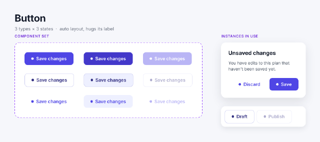
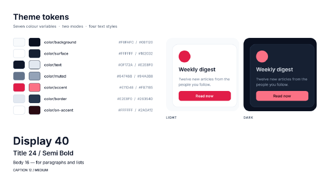
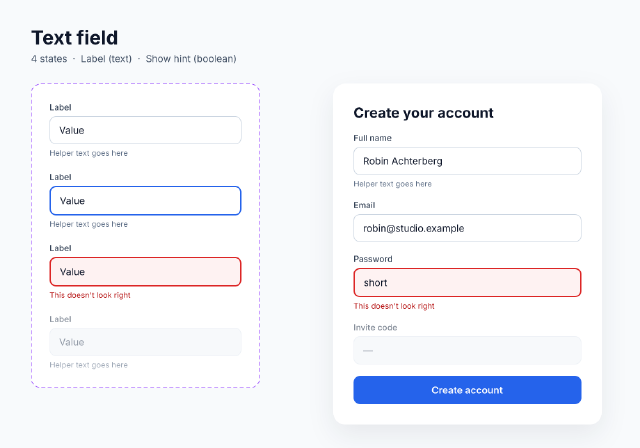
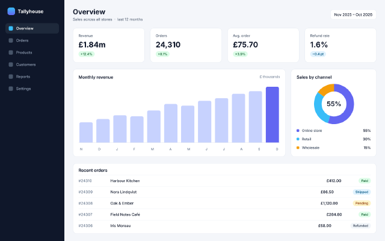
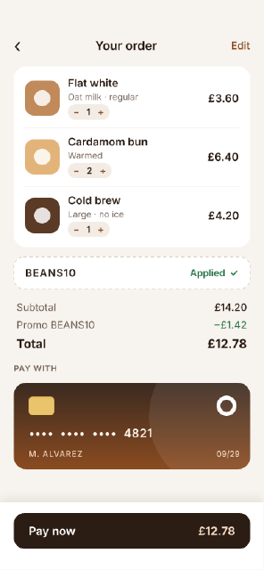
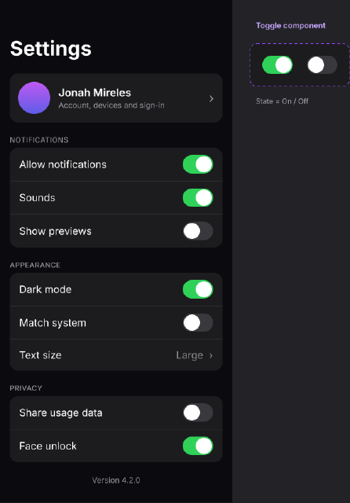
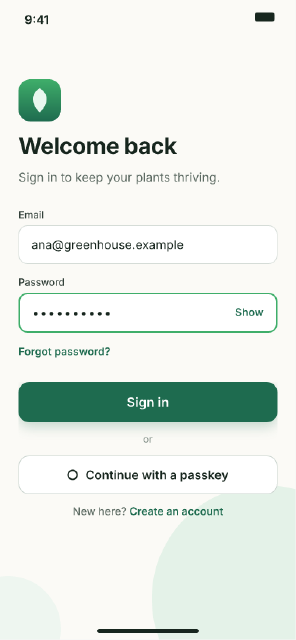
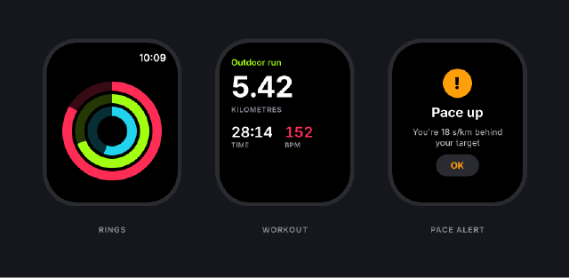
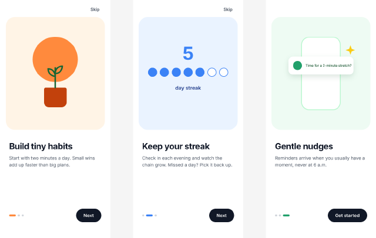
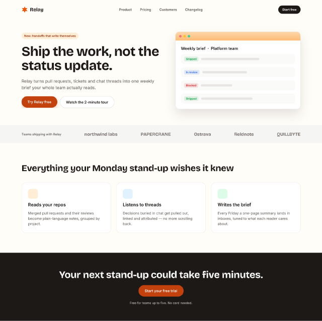

<!-- Generated by tools/gallery.mjs from showcase.yaml and build.json; do not edit. -->
# Design showcase

Interface design and prototyping: frames, auto layout, components, variants and constraints. Saved as .kdesign. Every sample is built from `showcase.yaml` by the kit's own commands and drawn by its own engine (`kition-design`).

**10 samples** · 5 categories · 15 features of `kition-design/features.yaml` · [all kits](../README.md)

[Components & Variants](#components--variants) (3) · [Dashboards](#dashboards) (1) · [Mobile Apps](#mobile-apps) (4) · [Prototypes](#prototypes) (1) · [Web Pages](#web-pages) (1)

## Components & Variants

<table>
<tr>
<td width="33%" valign="top">
 
Design 
<b><a href="button-component-set/">Button Component Set</a></b> 
A button component set with nine variants — Primary, Secondary and Ghost across Default, Hover and Disabled — and instances switched by property. 
<i>1 page; 51 layers; 1060 × 470 design</i> 
<code>components</code> <code>variants</code> <code>design-system</code> <code>auto-layout</code>
</td>
<td width="33%" valign="top">
 
Design 
<b><a href="design-tokens-light-dark/">Design Tokens, Light and Dark</a></b> 
A design-system tokens page — colour variables with Light and Dark modes bound to swatches and to one card shown in both modes, plus a type scale of text styles. 
<i>1 page; 60 layers; 1200 × 690 design</i> 
<code>design-system</code> <code>variables</code> <code>modes</code> <code>text-styles</code> <code>tokens</code>
</td>
<td width="33%" valign="top">
 
Design 
<b><a href="text-field-states/">Text Field States</a></b> 
A text-field component set with Default, Focused, Error and Disabled variants, a text property for its label and a boolean for its hint, used in a sign-up form. 
<i>1 page; 48 layers; 1000 × 700 design</i> 
<code>components</code> <code>variants</code> <code>component-properties</code> <code>forms</code> <code>design-system</code>
</td>
</tr>
</table>

## Dashboards

<table>
<tr>
<td width="33%" valign="top">
 
Design 
<b><a href="sales-analytics-dashboard/">Sales Analytics Dashboard</a></b> 
A 1440 × 900 desktop dashboard — sidebar navigation, KPI cards that share the width, a bar chart from auto-layout columns, a donut from arc ellipses and an orders list. 
<i>1 page; 134 layers; 1440 × 900 design</i> 
<code>dashboard</code> <code>desktop</code> <code>auto-layout</code> <code>charts</code>
</td>
<td width="33%"></td>
<td width="33%"></td>
</tr>
</table>

## Mobile Apps

<table>
<tr>
<td width="33%" valign="top">
 
Design 
<b><a href="coffee-checkout-screen/">Coffee Shop Checkout</a></b> 
A mobile checkout — cart lines with steppers, a promo field, a totals block with space-between rows, a saved card drawn with boolean shapes and a sticky pay bar. 
<i>1 page; 67 layers; 390 × 844 design</i> 
<code>mobile</code> <code>checkout</code> <code>auto-layout</code> <code>boolean</code> <code>e-commerce</code>
</td>
<td width="33%" valign="top">
 
Design 
<b><a href="dark-mode-settings/">Dark Mode Settings Screen</a></b> 
A dark-theme mobile settings screen of grouped lists, built from a Toggle component with On and Off variants and a reusable list-row layout. 
<i>1 page; 56 layers; 588 × 844 design</i> 
<code>mobile</code> <code>dark-mode</code> <code>components</code> <code>variants</code> <code>settings</code>
</td>
<td width="33%" valign="top">
 
Design 
<b><a href="plant-care-login/">Plant Care App Login</a></b> 
A mobile sign-in screen built entirely with nested auto layout — fill-width inputs, a hugging button row and a centred footer link. 
<i>1 page; 32 layers; 390 × 844 design</i> 
<code>mobile</code> <code>auto-layout</code> <code>form</code> <code>login</code>
</td>
</tr>
<tr>
<td width="33%" valign="top">
 
Design 
<b><a href="running-watch-app/">Running Watch App</a></b> 
Three smartwatch screens for a running app — activity rings from arc ellipses, a live workout readout and a pace alert — on a dark presentation board. 
<i>1 page; 30 layers; 860 × 420 design</i> 
<code>wearable</code> <code>watch</code> <code>arcs</code> <code>auto-layout</code> <code>dark-mode</code>
</td>
<td width="33%"></td>
<td width="33%"></td>
</tr>
</table>

## Prototypes

<table>
<tr>
<td width="33%" valign="top">
 
Design 
<b><a href="habit-app-onboarding-flow/">Habit App Onboarding Flow</a></b> 
A three-screen onboarding carousel wired as a prototype — Next buttons push to the following screen, Skip jumps to the end, and a flow starts on the first. 
<i>1 page; 55 layers; 1330 × 844 design</i> 
<code>prototype</code> <code>mobile</code> <code>onboarding</code> <code>interactions</code> <code>flows</code>
</td>
<td width="33%"></td>
<td width="33%"></td>
</tr>
</table>

## Web Pages

<table>
<tr>
<td width="33%" valign="top">
 
Design 
<b><a href="saas-landing-page/">SaaS Landing Page</a></b> 
A 1440 px marketing page — navigation, hero with a product mock, a customer strip, three feature cards in a wrapping row and a closing call to action. 
<i>1 page; 73 layers; 1440 × 1435 design</i> 
<code>landing-page</code> <code>desktop</code> <code>auto-layout</code> <code>web</code>
</td>
<td width="33%"></td>
<td width="33%"></td>
</tr>
</table>

## Tags

`arcs` 1 · `auto-layout` 6 · `boolean` 1 · `charts` 1 · `checkout` 1 · `component-properties` 1 · `components` 3 · `dark-mode` 2 · `dashboard` 1 · `design-system` 3 · `desktop` 2 · `e-commerce` 1 · `flows` 1 · `form` 1 · `forms` 1 · `interactions` 1 · `landing-page` 1 · `login` 1 · `mobile` 4 · `modes` 1 · `onboarding` 1 · `prototype` 1 · `settings` 1 · `text-styles` 1 · `tokens` 1 · `variables` 1 · `variants` 3 · `watch` 1 · `wearable` 1 · `web` 1
