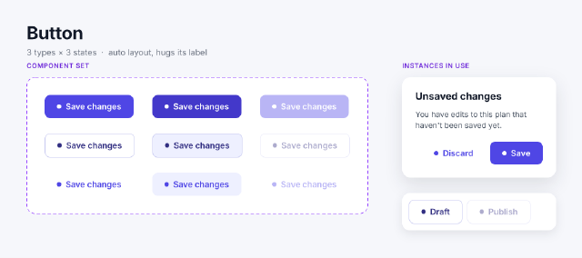

<!-- Generated by tools/gallery.mjs from showcase.yaml and build.json; do not edit. -->
# Button Component Set

[Design](../README.md) › [Components & Variants](../README.md#components--variants) · `components` `variants` `design-system` `auto-layout`

A button component set with nine variants — Primary, Secondary and Ghost across Default, Hover and Disabled — and instances switched by property.



| | |
|---|---|
| Document | [button-component-set.kdesign](button-component-set.kdesign) (56 KB) |
| Contents | 1 page; 51 layers; 1060 × 470 design |
| Features | `design.component.manage`, `design.component.instances`, `design.layout.auto`, `design.text.format`, `design.paint.fill-stroke` |
| Built by | `kition-design` @ `62939c71ba`: 60 commands in 23 ms |

## About

Nine main components named `Type=…, State=…` — each a horizontal auto layout frame hugging a dot
and a label — are combined into one component set with `component.combineVariants`, which turns
the names into two variant properties. The set itself is laid out as a 3 × 3 grid. On the right,
instances of the set build a confirmation dialog and a toolbar: `instance.setProperties` switches
them to the Ghost or Secondary type and the Disabled state, and their labels are text overrides.

## Checks

- `inspect.pages`: `{"count":1}`
- `results.setInfo`: `{"type":"COMPONENT_SET","name":"Button","children":{"count":9},"layout":{"mode":"grid","gridColumns":3}}`
- `results.props.properties`: `[{"name":"Type","type":"variant","default":"Primary","options":["Primary","Secondary","Ghost"]},{"name":"State","type":"variant","default":"Default","options":["Default","Hover","Disabled"]}]`
- `results.components`: `{"count":10}`
- `results.components.9`: `{"type":"COMPONENT_SET","name":"Button"}`
- `results.components.0`: `{"name":"Type=Primary, State=Default","instances":1}`
- `results.components.4`: `{"name":"Type=Secondary, State=Hover","instances":0}`
- `results.components.5`: `{"name":"Type=Secondary, State=Disabled","instances":1}`
- `results.components.6`: `{"name":"Type=Ghost, State=Default","instances":1}`
- `results.cancelNode`: `{"type":"INSTANCE"}`
- `results.missing.families`: `{"count":0}`
- diagnostics: none (the kit's check finds nothing wrong)
- the saved document opens again; the thumbnail matches `thumb.png` within the `render` tolerance

## Steps

<details><summary>60 commands (from <a href="showcase.yaml">showcase.yaml</a>)</summary>

```yaml
- command: select.all
  params: {}
  as: initial
- command: node.set
  params:
    ids:
      - $initial.selection.0
    props:
      name: Buttons
      fill: "#F6F7FB"
- command: frame.create
  params:
    x: 0
    y: 0
    width: 1060
    height: 470
    parent: $initial.selection.0
    name: Board
    props:
      fill: none
  as: board
- command: text.create
  params:
    text: Button
    x: 48
    y: 40
    parent: $board.id
    props:
      fontFamily: Inter
      fontStyle: Bold
      fontSize: 32
      fills:
        - "#111827"
- command: text.create
  params:
    text: 3 types × 3 states  ·  auto layout, hugs its label
    x: 48
    y: 86
    parent: $board.id
    props:
      fontFamily: Inter
      fontStyle: Regular
      fontSize: 15
      fills:
        - "#6B7280"
- command: node.create
  params:
    type: component
    parent: $board.id
    name: Type=Primary, State=Default
    x: 40
    y: 600
    props:
      layout: horizontal
      padding:
        - 12
        - 22
        - 12
        - 22
      gap: 8
      cornerRadius: 10
      sizingH: hug
      sizingV: hug
      crossAlign: center
      fill: "#4F46E5"
  as: v0
- command: node.create
  params:
    type: ellipse
    parent: $v0.id
    name: Icon
    width: 8
    height: 8
    props:
      fill: "#FFFFFF"
- command: text.create
  params:
    text: Save changes
    x: 0
    y: 0
    parent: $v0.id
    props:
      fontFamily: Inter
      fontStyle: Semi Bold
      fontSize: 15
      fills:
        - "#FFFFFF"
- command: node.create
  params:
    type: component
    parent: $board.id
    name: Type=Primary, State=Hover
    x: 50
    y: 600
    props:
      layout: horizontal
      padding:
        - 12
        - 22
        - 12
        - 22
      gap: 8
      cornerRadius: 10
      sizingH: hug
      sizingV: hug
      crossAlign: center
      fill: "#4338CA"
  as: v1
- command: node.create
  params:
    type: ellipse
    parent: $v1.id
    name: Icon
    width: 8
    height: 8
    props:
      fill: "#FFFFFF"
- command: text.create
  params:
    text: Save changes
    x: 0
    y: 0
    parent: $v1.id
    props:
      fontFamily: Inter
      fontStyle: Semi Bold
      fontSize: 15
      fills:
        - "#FFFFFF"
- command: node.create
  params:
    type: component
    parent: $board.id
    name: Type=Primary, State=Disabled
    x: 60
    y: 600
    props:
      layout: horizontal
      padding:
        - 12
        - 22
        - 12
        - 22
      gap: 8
      cornerRadius: 10
      sizingH: hug
      sizingV: hug
      crossAlign: center
      fill: "#4F46E5"
      opacity: 0.4
  as: v2
- command: node.create
  params:
    type: ellipse
    parent: $v2.id
    name: Icon
    width: 8
    height: 8
    props:
      fill: "#FFFFFF"
- command: text.create
  params:
    text: Save changes
    x: 0
    y: 0
    parent: $v2.id
    props:
      fontFamily: Inter
      fontStyle: Semi Bold
      fontSize: 15
      fills:
        - "#FFFFFF"
- command: node.create
  params:
    type: component
    parent: $board.id
    name: Type=Secondary, State=Default
    x: 70
    y: 600
    props:
      layout: horizontal
      padding:
        - 12
        - 22
        - 12
        - 22
      gap: 8
      cornerRadius: 10
      sizingH: hug
      sizingV: hug
      crossAlign: center
      fill: "#FFFFFF"
      stroke: "#C7C9F0"
      strokeWeight: 1
  as: v3
- command: node.create
  params:
    type: ellipse
    parent: $v3.id
    name: Icon
    width: 8
    height: 8
    props:
      fill: "#312E81"
- command: text.create
  params:
    text: Save changes
    x: 0
    y: 0
    parent: $v3.id
    props:
      fontFamily: Inter
      fontStyle: Semi Bold
      fontSize: 15
      fills:
        - "#312E81"
- command: node.create
  params:
    type: component
    parent: $board.id
    name: Type=Secondary, State=Hover
    x: 80
    y: 600
    props:
      layout: horizontal
      padding:
        - 12
        - 22
        - 12
        - 22
      gap: 8
      cornerRadius: 10
      sizingH: hug
      sizingV: hug
      crossAlign: center
      fill: "#EEF0FF"
      stroke: "#C7C9F0"
      strokeWeight: 1
  as: v4
- command: node.create
  params:
    type: ellipse
    parent: $v4.id
    name: Icon
    width: 8
    height: 8
    props:
      fill: "#312E81"
- command: text.create
  params:
    text: Save changes
    x: 0
    y: 0
    parent: $v4.id
    props:
      fontFamily: Inter
      fontStyle: Semi Bold
      fontSize: 15
      fills:
        - "#312E81"
- command: node.create
  params:
    type: component
    parent: $board.id
    name: Type=Secondary, State=Disabled
    x: 90
    y: 600
    props:
      layout: horizontal
      padding:
        - 12
        - 22
        - 12
        - 22
      gap: 8
      cornerRadius: 10
      sizingH: hug
      sizingV: hug
      crossAlign: center
      fill: "#FFFFFF"
      stroke: "#C7C9F0"
      strokeWeight: 1
      opacity: 0.4
  as: v5
- command: node.create
  params:
    type: ellipse
    parent: $v5.id
    name: Icon
    width: 8
    height: 8
    props:
      fill: "#312E81"
- command: text.create
  params:
    text: Save changes
    x: 0
    y: 0
    parent: $v5.id
    props:
      fontFamily: Inter
      fontStyle: Semi Bold
      fontSize: 15
      fills:
        - "#312E81"
- command: node.create
  params:
    type: component
    parent: $board.id
    name: Type=Ghost, State=Default
    x: 100
    y: 600
    props:
      layout: horizontal
      padding:
        - 12
        - 22
        - 12
        - 22
      gap: 8
      cornerRadius: 10
      sizingH: hug
      sizingV: hug
      crossAlign: center
      fill: none
  as: v6
- command: node.create
  params:
    type: ellipse
    parent: $v6.id
    name: Icon
    width: 8
    height: 8
    props:
      fill: "#4F46E5"
- command: text.create
  params:
    text: Save changes
    x: 0
    y: 0
    parent: $v6.id
    props:
      fontFamily: Inter
      fontStyle: Semi Bold
      fontSize: 15
      fills:
        - "#4F46E5"
- command: node.create
  params:
    type: component
    parent: $board.id
    name: Type=Ghost, State=Hover
    x: 110
    y: 600
    props:
      layout: horizontal
      padding:
        - 12
        - 22
        - 12
        - 22
      gap: 8
      cornerRadius: 10
      sizingH: hug
      sizingV: hug
      crossAlign: center
      fill: "#EEF0FF"
  as: v7
- command: node.create
  params:
    type: ellipse
    parent: $v7.id
    name: Icon
    width: 8
    height: 8
    props:
      fill: "#4F46E5"
- command: text.create
  params:
    text: Save changes
    x: 0
    y: 0
    parent: $v7.id
    props:
      fontFamily: Inter
      fontStyle: Semi Bold
      fontSize: 15
      fills:
        - "#4F46E5"
- command: node.create
  params:
    type: component
    parent: $board.id
    name: Type=Ghost, State=Disabled
    x: 120
    y: 600
    props:
      layout: horizontal
      padding:
        - 12
        - 22
        - 12
        - 22
      gap: 8
      cornerRadius: 10
      sizingH: hug
      sizingV: hug
      crossAlign: center
      fill: none
      opacity: 0.4
  as: v8
- command: node.create
  params:
    type: ellipse
    parent: $v8.id
    name: Icon
    width: 8
    height: 8
    props:
      fill: "#4F46E5"
- command: text.create
  params:
    text: Save changes
    x: 0
    y: 0
    parent: $v8.id
    props:
      fontFamily: Inter
      fontStyle: Semi Bold
      fontSize: 15
      fills:
        - "#4F46E5"
- command: component.combineVariants
  params:
    ids:
      - $v0.id
      - $v1.id
      - $v2.id
      - $v3.id
      - $v4.id
      - $v5.id
      - $v6.id
      - $v7.id
      - $v8.id
  as: set
- command: node.set
  params:
    ids:
      - $set.id
    props:
      name: Button
      x: 48
      y: 140
      layout: grid
      gridColumns: 3
      gridRows: 3
      gap: 32
      crossGap: 28
      padding: 32
      fill: "#FFFFFF"
      stroke: "#9747FF"
      strokeWeight: 1
      dashes:
        - 6
        - 4
      cornerRadius: 16
      sizingH: hug
      sizingV: hug
- command: node.get
  params:
    id: $set.id
  as: setInfo
- command: node.create
  params:
    type: frame
    parent: $board.id
    name: Dialog
    x: 732
    y: 140
    width: 280
    props:
      layout: vertical
      padding: 24
      gap: 12
      fill: "#FFFFFF"
      cornerRadius: 16
      sizingV: hug
      effects:
        - type: dropShadow
          color: "#1118271F"
          offset:
            - 0
            - 12
          radius: 32
  as: dialog
- command: text.create
  params:
    text: Unsaved changes
    x: 0
    y: 0
    parent: $dialog.id
    props:
      fontFamily: Inter
      fontStyle: Bold
      fontSize: 18
      fills:
        - "#111827"
- command: text.create
  params:
    text: You have edits to this plan that haven't been saved yet.
    x: 0
    y: 0
    parent: $dialog.id
    width: 232
    props:
      fontFamily: Inter
      fontStyle: Regular
      fontSize: 14
      lineHeight: 145%
      fills:
        - "#4B5563"
      textAutoResize: height
      sizingH: fill
- command: node.create
  params:
    type: frame
    parent: $dialog.id
    name: Actions
    props:
      layout: horizontal
      gap: 8
      mainAlign: max
      fill: none
      sizingH: fill
      sizingV: hug
      padding:
        - 8
        - 0
        - 0
        - 0
  as: dialogActions
- command: instance.create
  params:
    component: $set.id
    parent: $dialogActions.id
  as: cancel
- command: instance.setProperties
  params:
    ids:
      - $cancel.id
    properties:
      Type: Ghost
- command: node.get
  params:
    id: $cancel.id
  as: cancelNode
- command: node.set
  params:
    ids:
      - $cancelNode.children.1.id
    props:
      characters: Discard
- command: instance.create
  params:
    component: $set.id
    parent: $dialogActions.id
  as: save
- command: node.get
  params:
    id: $save.id
  as: saveNode
- command: node.set
  params:
    ids:
      - $saveNode.children.1.id
    props:
      characters: Save
- command: node.create
  params:
    type: frame
    parent: $board.id
    name: Toolbar
    x: 732
    y: 352
    width: 280
    props:
      layout: horizontal
      padding: 12
      gap: 8
      fill: "#FFFFFF"
      cornerRadius: 14
      sizingV: hug
      effects:
        - type: dropShadow
          color: "#1118271A"
          offset:
            - 0
            - 6
          radius: 18
  as: toolbar
- command: instance.create
  params:
    component: $set.id
    parent: $toolbar.id
  as: tb1
- command: instance.setProperties
  params:
    ids:
      - $tb1.id
    properties:
      Type: Secondary
- command: instance.create
  params:
    component: $set.id
    parent: $toolbar.id
  as: tb2
- command: instance.setProperties
  params:
    ids:
      - $tb2.id
    properties:
      Type: Secondary
      State: Disabled
- command: node.get
  params:
    id: $tb1.id
  as: tb1Node
- command: node.set
  params:
    ids:
      - $tb1Node.children.1.id
    props:
      characters: Draft
- command: node.get
  params:
    id: $tb2.id
  as: tb2Node
- command: node.set
  params:
    ids:
      - $tb2Node.children.1.id
    props:
      characters: Publish
- command: text.create
  params:
    text: Instances in use
    x: 732
    y: 112
    parent: $board.id
    props:
      fontFamily: Inter
      fontStyle: Semi Bold
      fontSize: 12
      letterSpacing: 6%
      textCase: upper
      fills:
        - "#6D28D9"
- command: text.create
  params:
    text: Component set
    x: 48
    y: 112
    parent: $board.id
    props:
      fontFamily: Inter
      fontStyle: Semi Bold
      fontSize: 12
      letterSpacing: 6%
      textCase: upper
      fills:
        - "#6D28D9"
- command: component.list
  params: {}
  as: components
- command: text.missingFonts
  params: {}
  as: missing
- command: component.properties
  params:
    id: $set.id
  as: props
```

</details>
