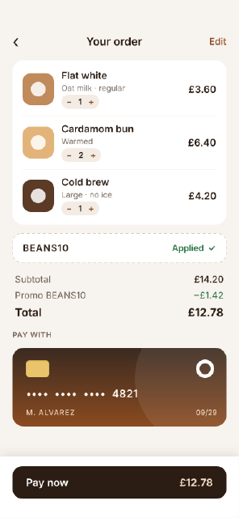

<!-- Generated by tools/gallery.mjs from showcase.yaml and build.json; do not edit. -->
# Coffee Shop Checkout

[Design](../README.md) › [Mobile Apps](../README.md#mobile-apps) · `mobile` `checkout` `auto-layout` `boolean` `e-commerce`

A mobile checkout — cart lines with steppers, a promo field, a totals block with space-between rows, a saved card drawn with boolean shapes and a sticky pay bar.



| | |
|---|---|
| Document | [coffee-checkout-screen.kdesign](coffee-checkout-screen.kdesign) (66 KB) |
| Contents | 1 page; 67 layers; 390 × 844 design |
| Features | `design.layout.auto`, `design.vector.boolean`, `design.object.frames-shapes-text`, `design.paint.fill-stroke`, `design.paint.effects`, `design.text.format` |
| Built by | `kition-design` @ `62939c71ba`: 71 commands in 39 ms |

## About

The screen is a vertical auto layout of a header, three cart rows, a promo field, the totals
and a payment card, with the pay bar pinned at the bottom as an ordinary child of the screen.
Cart rows hug vertically and put their price at the far edge with space-between; quantity
steppers are small horizontal layouts. The card's contactless mark is two circles subtracted
with `bool.subtract`, and its chip is a rounded rectangle with an inner shadow.

## Checks

- `inspect.pages`: `{"count":1}`
- `inspect.layers`: `67`
- `inspect.contentBounds`: `{"width":390,"height":844}`
- `results.ringInfo`: `{"type":"BOOLEAN_OPERATION","booleanOperation":"subtract","children":[{"name":"Outer","type":"ELLIPSE"},{"name":"Inner","type":"ELLIPSE"}]}`
- `results.cartInfo`: `{"name":"Cart","layout":{"mode":"vertical"},"children":{"count":3,"all":{"layout":{"mode":"horizontal"},"sizing":{"horizontal":"fill","vertical":"hug"}}}}`
- `results.missing.families`: `{"count":0}`
- diagnostics: none (the kit's check finds nothing wrong)
- the saved document opens again; the thumbnail matches `thumb.png` within the `render` tolerance

## Steps

<details><summary>71 commands (from <a href="showcase.yaml">showcase.yaml</a>)</summary>

```yaml
- command: select.all
  params: {}
  as: initial
- command: node.set
  params:
    ids:
      - $initial.selection.0
    props:
      name: Checkout
      fill: "#F7F3EE"
      clip: true
- command: node.create
  params:
    type: frame
    parent: $initial.selection.0
    name: Content
    x: 0
    y: 0
    width: 390
    props:
      layout: vertical
      gap: 14
      padding:
        - 50
        - 20
        - 20
        - 20
      fill: none
      sizingV: hug
  as: content
- command: node.create
  params:
    type: frame
    parent: $content.id
    name: Header
    props:
      layout: horizontal
      mainAlign: spaceBetween
      crossAlign: center
      fill: none
      sizingH: fill
      sizingV: hug
  as: header
- command: text.create
  params:
    text: ‹
    x: 0
    y: 0
    parent: $header.id
    props:
      fontFamily: Inter
      fontStyle: Regular
      fontSize: 28
      fills:
        - "#2B1D14"
- command: text.create
  params:
    text: Your order
    x: 0
    y: 0
    parent: $header.id
    props:
      fontFamily: Inter
      fontStyle: Semi Bold
      fontSize: 18
      fills:
        - "#2B1D14"
- command: text.create
  params:
    text: Edit
    x: 0
    y: 0
    parent: $header.id
    props:
      fontFamily: Inter
      fontStyle: Semi Bold
      fontSize: 15
      fills:
        - "#8A4B20"
- command: node.create
  params:
    type: frame
    parent: $content.id
    name: Cart
    props:
      layout: vertical
      gap: 0
      padding:
        - 4
        - 16
        - 4
        - 16
      cornerRadius: 18
      fill: "#FFFFFF"
      sizingH: fill
      sizingV: hug
  as: cart
- command: node.create
  params:
    type: frame
    parent: $cart.id
    name: Flat white
    props:
      layout: horizontal
      gap: 12
      crossAlign: center
      padding:
        - 11
        - 0
        - 11
        - 0
      fill: none
      sizingH: fill
      sizingV: hug
      stroke: "#F0E8E0"
      strokeSides:
        - 0
        - 0
        - 1
        - 0
      strokeWeight: 1
  as: row0
- command: node.create
  params:
    type: frame
    parent: $row0.id
    name: Thumb
    width: 52
    height: 52
    props:
      cornerRadius: 14
      fill: "#C08A5B"
  as: th0
- command: node.create
  params:
    type: ellipse
    parent: $th0.id
    name: Cup
    x: 14
    y: 14
    width: 24
    height: 24
    props:
      fill: "#FFFFFF"
      opacity: 0.85
- command: node.create
  params:
    type: frame
    parent: $row0.id
    name: Text
    props:
      layout: vertical
      gap: 3
      fill: none
      sizingH: fill
      sizingV: hug
  as: tx0
- command: text.create
  params:
    text: Flat white
    x: 0
    y: 0
    parent: $tx0.id
    props:
      fontFamily: Inter
      fontStyle: Semi Bold
      fontSize: 16
      fills:
        - "#2B1D14"
- command: text.create
  params:
    text: Oat milk · regular
    x: 0
    y: 0
    parent: $tx0.id
    props:
      fontFamily: Inter
      fontStyle: Regular
      fontSize: 13
      fills:
        - "#7A6A5E"
- command: node.create
  params:
    type: frame
    parent: $tx0.id
    name: Stepper
    props:
      layout: horizontal
      gap: 10
      crossAlign: center
      padding:
        - 3
        - 8
        - 3
        - 8
      cornerRadius: 999
      fill: "#F3ECE4"
      sizingH: hug
      sizingV: hug
  as: st0
- command: text.create
  params:
    text: −
    x: 0
    y: 0
    parent: $st0.id
    props:
      fontFamily: Inter
      fontStyle: Semi Bold
      fontSize: 14
      fills:
        - "#8A4B20"
- command: text.create
  params:
    text: "1"
    x: 0
    y: 0
    parent: $st0.id
    props:
      fontFamily: Inter
      fontStyle: Semi Bold
      fontSize: 13
      fills:
        - "#2B1D14"
- command: text.create
  params:
    text: +
    x: 0
    y: 0
    parent: $st0.id
    props:
      fontFamily: Inter
      fontStyle: Semi Bold
      fontSize: 14
      fills:
        - "#8A4B20"
- command: text.create
  params:
    text: £3.60
    x: 0
    y: 0
    parent: $row0.id
    props:
      fontFamily: Inter
      fontStyle: Semi Bold
      fontSize: 16
      fills:
        - "#2B1D14"
- command: node.create
  params:
    type: frame
    parent: $cart.id
    name: Cardamom bun
    props:
      layout: horizontal
      gap: 12
      crossAlign: center
      padding:
        - 11
        - 0
        - 11
        - 0
      fill: none
      sizingH: fill
      sizingV: hug
      stroke: "#F0E8E0"
      strokeSides:
        - 0
        - 0
        - 1
        - 0
      strokeWeight: 1
  as: row1
- command: node.create
  params:
    type: frame
    parent: $row1.id
    name: Thumb
    width: 52
    height: 52
    props:
      cornerRadius: 14
      fill: "#E3B47A"
  as: th1
- command: node.create
  params:
    type: ellipse
    parent: $th1.id
    name: Cup
    x: 14
    y: 14
    width: 24
    height: 24
    props:
      fill: "#FFFFFF"
      opacity: 0.85
- command: node.create
  params:
    type: frame
    parent: $row1.id
    name: Text
    props:
      layout: vertical
      gap: 3
      fill: none
      sizingH: fill
      sizingV: hug
  as: tx1
- command: text.create
  params:
    text: Cardamom bun
    x: 0
    y: 0
    parent: $tx1.id
    props:
      fontFamily: Inter
      fontStyle: Semi Bold
      fontSize: 16
      fills:
        - "#2B1D14"
- command: text.create
  params:
    text: Warmed
    x: 0
    y: 0
    parent: $tx1.id
    props:
      fontFamily: Inter
      fontStyle: Regular
      fontSize: 13
      fills:
        - "#7A6A5E"
- command: node.create
  params:
    type: frame
    parent: $tx1.id
    name: Stepper
    props:
      layout: horizontal
      gap: 10
      crossAlign: center
      padding:
        - 3
        - 8
        - 3
        - 8
      cornerRadius: 999
      fill: "#F3ECE4"
      sizingH: hug
      sizingV: hug
  as: st1
- command: text.create
  params:
    text: −
    x: 0
    y: 0
    parent: $st1.id
    props:
      fontFamily: Inter
      fontStyle: Semi Bold
      fontSize: 14
      fills:
        - "#8A4B20"
- command: text.create
  params:
    text: "2"
    x: 0
    y: 0
    parent: $st1.id
    props:
      fontFamily: Inter
      fontStyle: Semi Bold
      fontSize: 13
      fills:
        - "#2B1D14"
- command: text.create
  params:
    text: +
    x: 0
    y: 0
    parent: $st1.id
    props:
      fontFamily: Inter
      fontStyle: Semi Bold
      fontSize: 14
      fills:
        - "#8A4B20"
- command: text.create
  params:
    text: £6.40
    x: 0
    y: 0
    parent: $row1.id
    props:
      fontFamily: Inter
      fontStyle: Semi Bold
      fontSize: 16
      fills:
        - "#2B1D14"
- command: node.create
  params:
    type: frame
    parent: $cart.id
    name: Cold brew
    props:
      layout: horizontal
      gap: 12
      crossAlign: center
      padding:
        - 11
        - 0
        - 11
        - 0
      fill: none
      sizingH: fill
      sizingV: hug
  as: row2
- command: node.create
  params:
    type: frame
    parent: $row2.id
    name: Thumb
    width: 52
    height: 52
    props:
      cornerRadius: 14
      fill: "#5B3A26"
  as: th2
- command: node.create
  params:
    type: ellipse
    parent: $th2.id
    name: Cup
    x: 14
    y: 14
    width: 24
    height: 24
    props:
      fill: "#FFFFFF"
      opacity: 0.85
- command: node.create
  params:
    type: frame
    parent: $row2.id
    name: Text
    props:
      layout: vertical
      gap: 3
      fill: none
      sizingH: fill
      sizingV: hug
  as: tx2
- command: text.create
  params:
    text: Cold brew
    x: 0
    y: 0
    parent: $tx2.id
    props:
      fontFamily: Inter
      fontStyle: Semi Bold
      fontSize: 16
      fills:
        - "#2B1D14"
- command: text.create
  params:
    text: Large · no ice
    x: 0
    y: 0
    parent: $tx2.id
    props:
      fontFamily: Inter
      fontStyle: Regular
      fontSize: 13
      fills:
        - "#7A6A5E"
- command: node.create
  params:
    type: frame
    parent: $tx2.id
    name: Stepper
    props:
      layout: horizontal
      gap: 10
      crossAlign: center
      padding:
        - 3
        - 8
        - 3
        - 8
      cornerRadius: 999
      fill: "#F3ECE4"
      sizingH: hug
      sizingV: hug
  as: st2
- command: text.create
  params:
    text: −
    x: 0
    y: 0
    parent: $st2.id
    props:
      fontFamily: Inter
      fontStyle: Semi Bold
      fontSize: 14
      fills:
        - "#8A4B20"
- command: text.create
  params:
    text: "1"
    x: 0
    y: 0
    parent: $st2.id
    props:
      fontFamily: Inter
      fontStyle: Semi Bold
      fontSize: 13
      fills:
        - "#2B1D14"
- command: text.create
  params:
    text: +
    x: 0
    y: 0
    parent: $st2.id
    props:
      fontFamily: Inter
      fontStyle: Semi Bold
      fontSize: 14
      fills:
        - "#8A4B20"
- command: text.create
  params:
    text: £4.20
    x: 0
    y: 0
    parent: $row2.id
    props:
      fontFamily: Inter
      fontStyle: Semi Bold
      fontSize: 16
      fills:
        - "#2B1D14"
- command: node.create
  params:
    type: frame
    parent: $content.id
    name: Promo
    props:
      layout: horizontal
      mainAlign: spaceBetween
      crossAlign: center
      padding:
        - 14
        - 16
        - 14
        - 16
      cornerRadius: 14
      fill: "#FFFFFF"
      stroke: "#D9CBBE"
      strokeWeight: 1
      dashes:
        - 5
        - 4
      sizingH: fill
      sizingV: hug
  as: promo
- command: text.create
  params:
    text: BEANS10
    x: 0
    y: 0
    parent: $promo.id
    props:
      fontFamily: Inter
      fontStyle: Semi Bold
      fontSize: 15
      fills:
        - "#2B1D14"
      letterSpacing: 8%
- command: text.create
  params:
    text: Applied  ✓
    x: 0
    y: 0
    parent: $promo.id
    props:
      fontFamily: Inter
      fontStyle: Semi Bold
      fontSize: 14
      fills:
        - "#2F7A4A"
- command: node.create
  params:
    type: frame
    parent: $content.id
    name: Totals
    props:
      layout: vertical
      gap: 8
      padding:
        - 4
        - 4
        - 4
        - 4
      fill: none
      sizingH: fill
      sizingV: hug
  as: totals
- command: node.create
  params:
    type: frame
    parent: $totals.id
    name: Subtotal
    props:
      layout: horizontal
      mainAlign: spaceBetween
      fill: none
      sizingH: fill
      sizingV: hug
  as: tot0
- command: text.create
  params:
    text: Subtotal
    x: 0
    y: 0
    parent: $tot0.id
    props:
      fontFamily: Inter
      fontStyle: Regular
      fontSize: 15
      fills:
        - "#6F6055"
- command: text.create
  params:
    text: £14.20
    x: 0
    y: 0
    parent: $tot0.id
    props:
      fontFamily: Inter
      fontStyle: Medium
      fontSize: 15
      fills:
        - "#2B1D14"
- command: node.create
  params:
    type: frame
    parent: $totals.id
    name: Promo BEANS10
    props:
      layout: horizontal
      mainAlign: spaceBetween
      fill: none
      sizingH: fill
      sizingV: hug
  as: tot1
- command: text.create
  params:
    text: Promo BEANS10
    x: 0
    y: 0
    parent: $tot1.id
    props:
      fontFamily: Inter
      fontStyle: Regular
      fontSize: 15
      fills:
        - "#6F6055"
- command: text.create
  params:
    text: −£1.42
    x: 0
    y: 0
    parent: $tot1.id
    props:
      fontFamily: Inter
      fontStyle: Medium
      fontSize: 15
      fills:
        - "#2F7A4A"
- command: node.create
  params:
    type: frame
    parent: $totals.id
    name: Total
    props:
      layout: horizontal
      mainAlign: spaceBetween
      fill: none
      sizingH: fill
      sizingV: hug
  as: tot2
- command: text.create
  params:
    text: Total
    x: 0
    y: 0
    parent: $tot2.id
    props:
      fontFamily: Inter
      fontStyle: Bold
      fontSize: 18
      fills:
        - "#2B1D14"
- command: text.create
  params:
    text: £12.78
    x: 0
    y: 0
    parent: $tot2.id
    props:
      fontFamily: Inter
      fontStyle: Bold
      fontSize: 18
      fills:
        - "#2B1D14"
- command: text.create
  params:
    text: PAY WITH
    x: 0
    y: 0
    parent: $content.id
    props:
      fontFamily: Inter
      fontStyle: Semi Bold
      fontSize: 12
      fills:
        - "#7A6A5E"
      letterSpacing: 6%
- command: node.create
  params:
    type: frame
    parent: $content.id
    name: Card
    height: 128
    props:
      cornerRadius: 18
      fills:
        - type: linearGradient
          stops:
            - "#3B2A20"
            - "#8A4B20"
      sizingH: fill
      sizingV: fixed
      clip: true
  as: card
- command: node.create
  params:
    type: ellipse
    parent: $card.id
    name: Shine
    x: 200
    y: -60
    width: 220
    height: 220
    props:
      fill: "#FFFFFF"
      opacity: 0.08
- command: node.create
  params:
    type: rectangle
    parent: $card.id
    name: Chip
    x: 22
    y: 20
    width: 38
    height: 28
    props:
      cornerRadius: 6
      fill: "#E9C46A"
      effects:
        - type: innerShadow
          color: "#8A5A1A66"
          offset:
            - 0
            - 1
          radius: 2
- command: node.create
  params:
    type: ellipse
    parent: $card.id
    name: Outer
    x: 300
    y: 19
    width: 30
    height: 30
    props:
      fill: "#FFFFFF"
  as: outer
- command: node.create
  params:
    type: ellipse
    parent: $card.id
    name: Inner
    x: 306
    y: 25
    width: 18
    height: 18
    props:
      fill: "#FFFFFF"
  as: inner
- command: bool.subtract
  params:
    ids:
      - $outer.id
      - $inner.id
  as: ring
- command: text.create
  params:
    text: ••••  ••••  ••••  4821
    x: 22
    y: 64
    parent: $card.id
    props:
      fontFamily: Inter
      fontStyle: Semi Bold
      fontSize: 17
      letterSpacing: 4%
      fills:
        - "#FFF7EE"
- command: text.create
  params:
    text: M. ALVAREZ
    x: 22
    y: 98
    parent: $card.id
    props:
      fontFamily: Inter
      fontStyle: Medium
      fontSize: 12
      letterSpacing: 8%
      fills:
        - "#F3D9C2"
- command: text.create
  params:
    text: 09/29
    x: 300
    y: 98
    parent: $card.id
    props:
      fontFamily: Inter
      fontStyle: Medium
      fontSize: 12
      fills:
        - "#F3D9C2"
- command: node.create
  params:
    type: frame
    parent: $initial.selection.0
    name: Pay Bar
    x: 0
    y: 744
    width: 390
    height: 100
    props:
      layout: horizontal
      padding:
        - 16
        - 20
        - 30
        - 20
      fill: "#FFFFFF"
      effects:
        - type: dropShadow
          color: "#2B1D141A"
          offset:
            - 0
            - -4
          radius: 16
  as: payBar
- command: node.create
  params:
    type: frame
    parent: $payBar.id
    name: Pay Button
    props:
      layout: horizontal
      mainAlign: spaceBetween
      crossAlign: center
      padding:
        - 16
        - 22
        - 16
        - 22
      cornerRadius: 16
      fill: "#2B1D14"
      sizingH: fill
      sizingV: hug
  as: pay
- command: text.create
  params:
    text: Pay now
    x: 0
    y: 0
    parent: $pay.id
    props:
      fontFamily: Inter
      fontStyle: Semi Bold
      fontSize: 17
      fills:
        - "#FFFFFF"
- command: text.create
  params:
    text: £12.78
    x: 0
    y: 0
    parent: $pay.id
    props:
      fontFamily: Inter
      fontStyle: Bold
      fontSize: 17
      fills:
        - "#F3D9C2"
- command: node.get
  params:
    id: $ring.id
  as: ringInfo
- command: node.get
  params:
    id: $cart.id
  as: cartInfo
- command: text.missingFonts
  params: {}
  as: missing
```

</details>
