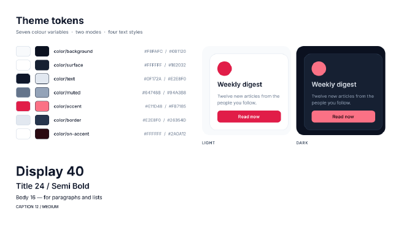

<!-- Generated by tools/gallery.mjs from showcase.yaml and build.json; do not edit. -->
# Design Tokens, Light and Dark

[Design](../README.md) › [Components & Variants](../README.md#components--variants) · `design-system` `variables` `modes` `text-styles` `tokens`

A design-system tokens page — colour variables with Light and Dark modes bound to swatches and to one card shown in both modes, plus a type scale of text styles.



| | |
|---|---|
| Document | [design-tokens-light-dark.kdesign](design-tokens-light-dark.kdesign) (71 KB) |
| Contents | 1 page; 60 layers; 1200 × 690 design |
| Features | `design.variable.manage`, `design.variable.bound`, `design.style.manage`, `design.text.format`, `design.layout.auto` |
| Built by | `kition-design` @ `62939c71ba`: 110 commands in 34 ms |

## About

A "Theme" variable collection has Light and Dark modes and seven colour variables. Every swatch,
card fill, text colour and button is bound to a variable with `variable.bind`, so the same card
frame duplicated twice shows both themes once `variable.setMode` puts the right copy in Dark.
The type scale on the left is four text styles (Display, Title, Body, Caption) made with
`style.create` and applied to their samples.

## Checks

- `inspect.pages`: `{"count":1}`
- `results.vars.collections`: `{"count":1,"all":{"name":"Theme","modes":[{"name":"Light"},{"name":"Dark"}]}}`
- `results.vars.variables`: `{"count":7,"all":{"resolvedType":"color","name":{"matches":"^color/"}},"any":{"name":"color/on-accent"}}`
- `results.textStyles`: `{"count":4,"all":{"type":"text","style":{"fontFamily":"Inter"}}}`
- `results.textStyles.0`: `{"name":"Type/Display","style":{"fontSize":40,"fontStyle":"Bold"}}`
- `results.darkInfo`: `{"name":"Dark","variableModes":{"Theme":"Dark"},"boundVariables":{"fills/0/color":{"matches":"^VariableID:"}}}`
- `results.dup.ids`: `{"count":1}`
- `results.missing.families`: `{"count":0}`
- diagnostics: none (the kit's check finds nothing wrong)
- the saved document opens again; the thumbnail matches `thumb.png` within the `render` tolerance

## Steps

<details><summary>110 commands (from <a href="showcase.yaml">showcase.yaml</a>)</summary>

```yaml
- command: select.all
  params: {}
  as: initial
- command: node.set
  params:
    ids:
      - $initial.selection.0
    props:
      name: Tokens
      fill: "#FFFFFF"
- command: variable.createCollection
  params:
    name: Theme
    modes:
      - Light
      - Dark
  as: theme
- command: variable.create
  params:
    collection: Theme
    name: color/background
    type: color
    values:
      Light: "#F8FAFC"
      Dark: "#0B1120"
  as: v_background
- command: variable.create
  params:
    collection: Theme
    name: color/surface
    type: color
    values:
      Light: "#FFFFFF"
      Dark: "#162032"
  as: v_surface
- command: variable.create
  params:
    collection: Theme
    name: color/text
    type: color
    values:
      Light: "#0F172A"
      Dark: "#E2E8F0"
  as: v_text
- command: variable.create
  params:
    collection: Theme
    name: color/muted
    type: color
    values:
      Light: "#64748B"
      Dark: "#94A3B8"
  as: v_muted
- command: variable.create
  params:
    collection: Theme
    name: color/accent
    type: color
    values:
      Light: "#E11D48"
      Dark: "#FB7185"
  as: v_accent
- command: variable.create
  params:
    collection: Theme
    name: color/border
    type: color
    values:
      Light: "#E2E8F0"
      Dark: "#26354D"
  as: v_border
- command: variable.create
  params:
    collection: Theme
    name: color/on-accent
    type: color
    values:
      Light: "#FFFFFF"
      Dark: "#2A0A12"
  as: v_onaccent
- command: variable.bind
  params:
    ids:
      - $initial.selection.0
    field: fills/0/color
    variable: $v_surface.id
- command: text.create
  params:
    text: Theme tokens
    x: 48
    y: 44
    parent: $initial.selection.0
    props:
      fontFamily: Inter
      fontStyle: Bold
      fontSize: 30
      fills:
        - "#0F172A"
- command: text.create
  params:
    text: Seven colour variables  ·  two modes  ·  four text styles
    x: 48
    y: 88
    parent: $initial.selection.0
    props:
      fontFamily: Inter
      fontStyle: Regular
      fontSize: 15
      fills:
        - "#475569"
- command: node.create
  params:
    type: frame
    parent: $initial.selection.0
    name: Swatches
    x: 48
    y: 140
    width: 520
    props:
      layout: vertical
      gap: 10
      fill: none
      sizingV: hug
  as: swatches
- command: node.create
  params:
    type: frame
    parent: $swatches.id
    name: Row background
    props:
      layout: horizontal
      gap: 14
      crossAlign: center
      fill: none
      sizingH: fill
      sizingV: hug
  as: row_background
- command: node.create
  params:
    type: rectangle
    parent: $row_background.id
    name: background light
    width: 44
    height: 32
    props:
      cornerRadius: 8
      stroke: "#CBD5E1"
      strokeWeight: 1
  as: sl_background
- command: variable.bind
  params:
    ids:
      - $sl_background.id
    field: fills/0/color
    variable: $v_background.id
- command: node.create
  params:
    type: frame
    parent: $row_background.id
    name: background dark
    width: 44
    height: 32
    props:
      cornerRadius: 8
      stroke: "#1E293B"
      strokeWeight: 1
  as: sd_background
- command: variable.bind
  params:
    ids:
      - $sd_background.id
    field: fills/0/color
    variable: $v_background.id
- command: variable.setMode
  params:
    ids:
      - $sd_background.id
    collection: Theme
    mode: Dark
- command: text.create
  params:
    text: color/background
    x: 0
    y: 0
    parent: $row_background.id
    props:
      fontFamily: Inter
      fontStyle: Medium
      fontSize: 14
      fills:
        - "#0F172A"
      sizingH: fill
- command: text.create
  params:
    text: "#F8FAFC  /  #0B1120"
    x: 0
    y: 0
    parent: $row_background.id
    props:
      fontFamily: Inter
      fontStyle: Regular
      fontSize: 13
      fills:
        - "#64748B"
- command: node.create
  params:
    type: frame
    parent: $swatches.id
    name: Row surface
    props:
      layout: horizontal
      gap: 14
      crossAlign: center
      fill: none
      sizingH: fill
      sizingV: hug
  as: row_surface
- command: node.create
  params:
    type: rectangle
    parent: $row_surface.id
    name: surface light
    width: 44
    height: 32
    props:
      cornerRadius: 8
      stroke: "#CBD5E1"
      strokeWeight: 1
  as: sl_surface
- command: variable.bind
  params:
    ids:
      - $sl_surface.id
    field: fills/0/color
    variable: $v_surface.id
- command: node.create
  params:
    type: frame
    parent: $row_surface.id
    name: surface dark
    width: 44
    height: 32
    props:
      cornerRadius: 8
      stroke: "#1E293B"
      strokeWeight: 1
  as: sd_surface
- command: variable.bind
  params:
    ids:
      - $sd_surface.id
    field: fills/0/color
    variable: $v_surface.id
- command: variable.setMode
  params:
    ids:
      - $sd_surface.id
    collection: Theme
    mode: Dark
- command: text.create
  params:
    text: color/surface
    x: 0
    y: 0
    parent: $row_surface.id
    props:
      fontFamily: Inter
      fontStyle: Medium
      fontSize: 14
      fills:
        - "#0F172A"
      sizingH: fill
- command: text.create
  params:
    text: "#FFFFFF  /  #162032"
    x: 0
    y: 0
    parent: $row_surface.id
    props:
      fontFamily: Inter
      fontStyle: Regular
      fontSize: 13
      fills:
        - "#64748B"
- command: node.create
  params:
    type: frame
    parent: $swatches.id
    name: Row text
    props:
      layout: horizontal
      gap: 14
      crossAlign: center
      fill: none
      sizingH: fill
      sizingV: hug
  as: row_text
- command: node.create
  params:
    type: rectangle
    parent: $row_text.id
    name: text light
    width: 44
    height: 32
    props:
      cornerRadius: 8
      stroke: "#CBD5E1"
      strokeWeight: 1
  as: sl_text
- command: variable.bind
  params:
    ids:
      - $sl_text.id
    field: fills/0/color
    variable: $v_text.id
- command: node.create
  params:
    type: frame
    parent: $row_text.id
    name: text dark
    width: 44
    height: 32
    props:
      cornerRadius: 8
      stroke: "#1E293B"
      strokeWeight: 1
  as: sd_text
- command: variable.bind
  params:
    ids:
      - $sd_text.id
    field: fills/0/color
    variable: $v_text.id
- command: variable.setMode
  params:
    ids:
      - $sd_text.id
    collection: Theme
    mode: Dark
- command: text.create
  params:
    text: color/text
    x: 0
    y: 0
    parent: $row_text.id
    props:
      fontFamily: Inter
      fontStyle: Medium
      fontSize: 14
      fills:
        - "#0F172A"
      sizingH: fill
- command: text.create
  params:
    text: "#0F172A  /  #E2E8F0"
    x: 0
    y: 0
    parent: $row_text.id
    props:
      fontFamily: Inter
      fontStyle: Regular
      fontSize: 13
      fills:
        - "#64748B"
- command: node.create
  params:
    type: frame
    parent: $swatches.id
    name: Row muted
    props:
      layout: horizontal
      gap: 14
      crossAlign: center
      fill: none
      sizingH: fill
      sizingV: hug
  as: row_muted
- command: node.create
  params:
    type: rectangle
    parent: $row_muted.id
    name: muted light
    width: 44
    height: 32
    props:
      cornerRadius: 8
      stroke: "#CBD5E1"
      strokeWeight: 1
  as: sl_muted
- command: variable.bind
  params:
    ids:
      - $sl_muted.id
    field: fills/0/color
    variable: $v_muted.id
- command: node.create
  params:
    type: frame
    parent: $row_muted.id
    name: muted dark
    width: 44
    height: 32
    props:
      cornerRadius: 8
      stroke: "#1E293B"
      strokeWeight: 1
  as: sd_muted
- command: variable.bind
  params:
    ids:
      - $sd_muted.id
    field: fills/0/color
    variable: $v_muted.id
- command: variable.setMode
  params:
    ids:
      - $sd_muted.id
    collection: Theme
    mode: Dark
- command: text.create
  params:
    text: color/muted
    x: 0
    y: 0
    parent: $row_muted.id
    props:
      fontFamily: Inter
      fontStyle: Medium
      fontSize: 14
      fills:
        - "#0F172A"
      sizingH: fill
- command: text.create
  params:
    text: "#64748B  /  #94A3B8"
    x: 0
    y: 0
    parent: $row_muted.id
    props:
      fontFamily: Inter
      fontStyle: Regular
      fontSize: 13
      fills:
        - "#64748B"
- command: node.create
  params:
    type: frame
    parent: $swatches.id
    name: Row accent
    props:
      layout: horizontal
      gap: 14
      crossAlign: center
      fill: none
      sizingH: fill
      sizingV: hug
  as: row_accent
- command: node.create
  params:
    type: rectangle
    parent: $row_accent.id
    name: accent light
    width: 44
    height: 32
    props:
      cornerRadius: 8
      stroke: "#CBD5E1"
      strokeWeight: 1
  as: sl_accent
- command: variable.bind
  params:
    ids:
      - $sl_accent.id
    field: fills/0/color
    variable: $v_accent.id
- command: node.create
  params:
    type: frame
    parent: $row_accent.id
    name: accent dark
    width: 44
    height: 32
    props:
      cornerRadius: 8
      stroke: "#1E293B"
      strokeWeight: 1
  as: sd_accent
- command: variable.bind
  params:
    ids:
      - $sd_accent.id
    field: fills/0/color
    variable: $v_accent.id
- command: variable.setMode
  params:
    ids:
      - $sd_accent.id
    collection: Theme
    mode: Dark
- command: text.create
  params:
    text: color/accent
    x: 0
    y: 0
    parent: $row_accent.id
    props:
      fontFamily: Inter
      fontStyle: Medium
      fontSize: 14
      fills:
        - "#0F172A"
      sizingH: fill
- command: text.create
  params:
    text: "#E11D48  /  #FB7185"
    x: 0
    y: 0
    parent: $row_accent.id
    props:
      fontFamily: Inter
      fontStyle: Regular
      fontSize: 13
      fills:
        - "#64748B"
- command: node.create
  params:
    type: frame
    parent: $swatches.id
    name: Row border
    props:
      layout: horizontal
      gap: 14
      crossAlign: center
      fill: none
      sizingH: fill
      sizingV: hug
  as: row_border
- command: node.create
  params:
    type: rectangle
    parent: $row_border.id
    name: border light
    width: 44
    height: 32
    props:
      cornerRadius: 8
      stroke: "#CBD5E1"
      strokeWeight: 1
  as: sl_border
- command: variable.bind
  params:
    ids:
      - $sl_border.id
    field: fills/0/color
    variable: $v_border.id
- command: node.create
  params:
    type: frame
    parent: $row_border.id
    name: border dark
    width: 44
    height: 32
    props:
      cornerRadius: 8
      stroke: "#1E293B"
      strokeWeight: 1
  as: sd_border
- command: variable.bind
  params:
    ids:
      - $sd_border.id
    field: fills/0/color
    variable: $v_border.id
- command: variable.setMode
  params:
    ids:
      - $sd_border.id
    collection: Theme
    mode: Dark
- command: text.create
  params:
    text: color/border
    x: 0
    y: 0
    parent: $row_border.id
    props:
      fontFamily: Inter
      fontStyle: Medium
      fontSize: 14
      fills:
        - "#0F172A"
      sizingH: fill
- command: text.create
  params:
    text: "#E2E8F0  /  #26354D"
    x: 0
    y: 0
    parent: $row_border.id
    props:
      fontFamily: Inter
      fontStyle: Regular
      fontSize: 13
      fills:
        - "#64748B"
- command: node.create
  params:
    type: frame
    parent: $swatches.id
    name: Row on-accent
    props:
      layout: horizontal
      gap: 14
      crossAlign: center
      fill: none
      sizingH: fill
      sizingV: hug
  as: row_onaccent
- command: node.create
  params:
    type: rectangle
    parent: $row_onaccent.id
    name: on-accent light
    width: 44
    height: 32
    props:
      cornerRadius: 8
      stroke: "#CBD5E1"
      strokeWeight: 1
  as: sl_onaccent
- command: variable.bind
  params:
    ids:
      - $sl_onaccent.id
    field: fills/0/color
    variable: $v_onaccent.id
- command: node.create
  params:
    type: frame
    parent: $row_onaccent.id
    name: on-accent dark
    width: 44
    height: 32
    props:
      cornerRadius: 8
      stroke: "#1E293B"
      strokeWeight: 1
  as: sd_onaccent
- command: variable.bind
  params:
    ids:
      - $sd_onaccent.id
    field: fills/0/color
    variable: $v_onaccent.id
- command: variable.setMode
  params:
    ids:
      - $sd_onaccent.id
    collection: Theme
    mode: Dark
- command: text.create
  params:
    text: color/on-accent
    x: 0
    y: 0
    parent: $row_onaccent.id
    props:
      fontFamily: Inter
      fontStyle: Medium
      fontSize: 14
      fills:
        - "#0F172A"
      sizingH: fill
- command: text.create
  params:
    text: "#FFFFFF  /  #2A0A12"
    x: 0
    y: 0
    parent: $row_onaccent.id
    props:
      fontFamily: Inter
      fontStyle: Regular
      fontSize: 13
      fills:
        - "#64748B"
- command: node.create
  params:
    type: frame
    parent: $initial.selection.0
    name: Type Scale
    x: 48
    y: 500
    width: 520
    props:
      layout: vertical
      gap: 8
      fill: none
      sizingV: hug
  as: scale
- command: text.create
  params:
    text: Display 40
    x: 0
    y: 0
    parent: $scale.id
    props:
      fontFamily: Inter
      fontStyle: Bold
      fontSize: 40
      lineHeight: 110%
      fills:
        - "#0F172A"
  as: t_Display
- command: style.create
  params:
    type: text
    name: Type/Display
    from: $t_Display.id
  as: st_Display
- command: style.apply
  params:
    ids:
      - $t_Display.id
    style: $st_Display.id
- command: text.create
  params:
    text: Title 24 / Semi Bold
    x: 0
    y: 0
    parent: $scale.id
    props:
      fontFamily: Inter
      fontStyle: Semi Bold
      fontSize: 24
      lineHeight: 125%
      fills:
        - "#0F172A"
  as: t_Title
- command: style.create
  params:
    type: text
    name: Type/Title
    from: $t_Title.id
  as: st_Title
- command: style.apply
  params:
    ids:
      - $t_Title.id
    style: $st_Title.id
- command: text.create
  params:
    text: Body 16 — for paragraphs and lists
    x: 0
    y: 0
    parent: $scale.id
    props:
      fontFamily: Inter
      fontStyle: Regular
      fontSize: 16
      lineHeight: 150%
      fills:
        - "#0F172A"
  as: t_Body
- command: style.create
  params:
    type: text
    name: Type/Body
    from: $t_Body.id
  as: st_Body
- command: style.apply
  params:
    ids:
      - $t_Body.id
    style: $st_Body.id
- command: text.create
  params:
    text: CAPTION 12 / MEDIUM
    x: 0
    y: 0
    parent: $scale.id
    props:
      fontFamily: Inter
      fontStyle: Medium
      fontSize: 12
      lineHeight: 140%
      fills:
        - "#0F172A"
  as: t_Caption
- command: style.create
  params:
    type: text
    name: Type/Caption
    from: $t_Caption.id
  as: st_Caption
- command: style.apply
  params:
    ids:
      - $t_Caption.id
    style: $st_Caption.id
- command: node.create
  params:
    type: frame
    parent: $initial.selection.0
    name: Light
    x: 616
    y: 140
    width: 272
    height: 272
    props:
      cornerRadius: 24
  as: lightPanel
- command: variable.bind
  params:
    ids:
      - $lightPanel.id
    field: fills/0/color
    variable: $v_background.id
- command: node.create
  params:
    type: frame
    parent: $initial.selection.0
    name: Dark
    x: 904
    y: 140
    width: 272
    height: 272
    props:
      cornerRadius: 24
  as: darkPanel
- command: variable.bind
  params:
    ids:
      - $darkPanel.id
    field: fills/0/color
    variable: $v_background.id
- command: variable.setMode
  params:
    ids:
      - $darkPanel.id
    collection: Theme
    mode: Dark
- command: node.create
  params:
    type: frame
    parent: $lightPanel.id
    name: Card
    x: 24
    y: 24
    width: 240
    props:
      layout: vertical
      gap: 14
      padding: 22
      cornerRadius: 20
      strokeWeight: 1
      sizingV: hug
  as: card
- command: variable.bind
  params:
    ids:
      - $card.id
    field: fills/0/color
    variable: $v_surface.id
- command: variable.bind
  params:
    ids:
      - $card.id
    field: strokes/0/color
    variable: $v_border.id
- command: node.create
  params:
    type: ellipse
    parent: $card.id
    name: Avatar
    width: 44
    height: 44
  as: avatar
- command: variable.bind
  params:
    ids:
      - $avatar.id
    field: fills/0/color
    variable: $v_accent.id
- command: text.create
  params:
    text: Weekly digest
    x: 0
    y: 0
    parent: $card.id
    props:
      fontFamily: Inter
      fontStyle: Semi Bold
      fontSize: 20
  as: cardTitle
- command: variable.bind
  params:
    ids:
      - $cardTitle.id
    field: fills/0/color
    variable: $v_text.id
- command: text.create
  params:
    text: Twelve new articles from the people you follow.
    x: 0
    y: 0
    parent: $card.id
    width: 196
    props:
      fontFamily: Inter
      fontStyle: Regular
      fontSize: 14
      lineHeight: 145%
      textAutoResize: height
      sizingH: fill
  as: cardBody
- command: variable.bind
  params:
    ids:
      - $cardBody.id
    field: fills/0/color
    variable: $v_muted.id
- command: node.create
  params:
    type: frame
    parent: $card.id
    name: Button
    props:
      layout: horizontal
      padding:
        - 10
        - 16
        - 10
        - 16
      cornerRadius: 10
      mainAlign: center
      sizingH: fill
      sizingV: hug
  as: cardBtn
- command: variable.bind
  params:
    ids:
      - $cardBtn.id
    field: fills/0/color
    variable: $v_accent.id
- command: text.create
  params:
    text: Read now
    x: 0
    y: 0
    parent: $cardBtn.id
    props:
      fontFamily: Inter
      fontStyle: Semi Bold
      fontSize: 14
      fills:
        - "#FFFFFF"
  as: btnText
- command: variable.bind
  params:
    ids:
      - $btnText.id
    field: fills/0/color
    variable: $v_onaccent.id
- command: edit.duplicate
  params:
    ids:
      - $card.id
  as: dup
- command: node.reparent
  params:
    ids: $dup.ids
    parent: $darkPanel.id
- command: node.set
  params:
    ids: $dup.ids
    props:
      x: 24
      y: 24
- command: text.create
  params:
    text: LIGHT
    x: 616
    y: 428
    parent: $initial.selection.0
    props:
      fontFamily: Inter
      fontStyle: Semi Bold
      fontSize: 12
      letterSpacing: 8%
      fills:
        - "#475569"
- command: text.create
  params:
    text: DARK
    x: 904
    y: 428
    parent: $initial.selection.0
    props:
      fontFamily: Inter
      fontStyle: Semi Bold
      fontSize: 12
      letterSpacing: 8%
      fills:
        - "#475569"
- command: node.get
  params:
    id: $darkPanel.id
  as: darkInfo
- command: variable.list
  params: {}
  as: vars
- command: style.list
  params:
    type: text
  as: textStyles
- command: text.missingFonts
  params: {}
  as: missing
```

</details>
