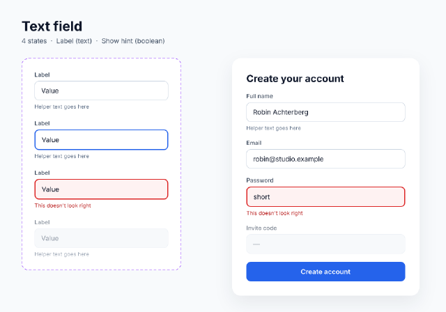

<!-- Generated by tools/gallery.mjs from showcase.yaml and build.json; do not edit. -->
# Text Field States

[Design](../README.md) › [Components & Variants](../README.md#components--variants) · `components` `variants` `component-properties` `forms` `design-system`

A text-field component set with Default, Focused, Error and Disabled variants, a text property for its label and a boolean for its hint, used in a sign-up form.



| | |
|---|---|
| Document | [text-field-states.kdesign](text-field-states.kdesign) (60 KB) |
| Contents | 1 page; 48 layers; 1000 × 700 design |
| Features | `design.component.manage`, `design.component.instances`, `design.component.button-instances`, `design.layout.auto`, `design.text.format`, `design.paint.fill-stroke` |
| Built by | `kition-design` @ `62939c71ba`: 57 commands in 15 ms |

## About

Four main components, `State=Default|Focused|Error|Disabled`, are combined into the "Text
Field" set. A text property "Label" is added on the first variant's label and bound in the other
three with `component.bindProperty`, and a boolean "Show hint" controls the hint line. The form
on the right is four instances: each sets its own Label and value, one is switched to the Error
state and one hides its hint — all through `instance.setProperties`.

## Checks

- `inspect.pages`: `{"count":1}`
- `results.props.properties`: `[{"name":"State","type":"variant","options":["Default","Focused","Error","Disabled"]},{"name":"Label","type":"text","default":"Label"},{"name":"Show hint","type":"boolean","default":true},{"name":"Value","type":"text","default":"Value"}]`
- `results.errorField.properties`: `[{"name":"State","value":"Error"},{"name":"Label","value":"Password"},{"name":"Show hint","value":true},{"name":"Value","value":"short"}]`
- `results.labelProp`: `{"name":"Label"}`
- `results.missing.families`: `{"count":0}`
- diagnostics: none (the kit's check finds nothing wrong)
- the saved document opens again; the thumbnail matches `thumb.png` within the `render` tolerance

## Steps

<details><summary>57 commands (from <a href="showcase.yaml">showcase.yaml</a>)</summary>

```yaml
- command: select.all
  params: {}
  as: initial
- command: node.set
  params:
    ids:
      - $initial.selection.0
    props:
      name: Text Field
      fill: "#F8FAFC"
- command: text.create
  params:
    text: Text field
    x: 48
    y: 40
    parent: $initial.selection.0
    props:
      fontFamily: Inter
      fontStyle: Bold
      fontSize: 30
      fills:
        - "#0F172A"
- command: text.create
  params:
    text: 4 states  ·  Label (text)  ·  Show hint (boolean)
    x: 48
    y: 82
    parent: $initial.selection.0
    props:
      fontFamily: Inter
      fontStyle: Regular
      fontSize: 15
      fills:
        - "#475569"
- command: node.create
  params:
    type: component
    parent: $initial.selection.0
    name: State=Default
    x: 60
    y: 600
    width: 300
    props:
      layout: vertical
      gap: 6
      fill: none
      sizingV: hug
  as: c0
- command: text.create
  params:
    text: Label
    x: 0
    y: 0
    parent: $c0.id
    props:
      fontFamily: Inter
      fontStyle: Medium
      fontSize: 13
      fills:
        - "#334155"
  as: lab0
- command: node.create
  params:
    type: frame
    parent: $c0.id
    name: Field
    props:
      layout: horizontal
      padding:
        - 12
        - 14
        - 12
        - 14
      cornerRadius: 10
      fill: "#FFFFFF"
      stroke: "#CBD5E1"
      strokeWeight: 1
      sizingH: fill
      sizingV: hug
  as: f0
- command: text.create
  params:
    text: Value
    x: 0
    y: 0
    parent: $f0.id
    props:
      fontFamily: Inter
      fontStyle: Regular
      fontSize: 15
      fills:
        - "#0F172A"
  as: val0
- command: text.create
  params:
    text: Helper text goes here
    x: 0
    y: 0
    parent: $c0.id
    props:
      fontFamily: Inter
      fontStyle: Regular
      fontSize: 12
      fills:
        - "#64748B"
  as: hint0
- command: node.create
  params:
    type: component
    parent: $initial.selection.0
    name: State=Focused
    x: 70
    y: 600
    width: 300
    props:
      layout: vertical
      gap: 6
      fill: none
      sizingV: hug
  as: c1
- command: text.create
  params:
    text: Label
    x: 0
    y: 0
    parent: $c1.id
    props:
      fontFamily: Inter
      fontStyle: Medium
      fontSize: 13
      fills:
        - "#334155"
  as: lab1
- command: node.create
  params:
    type: frame
    parent: $c1.id
    name: Field
    props:
      layout: horizontal
      padding:
        - 12
        - 14
        - 12
        - 14
      cornerRadius: 10
      fill: "#FFFFFF"
      stroke: "#2563EB"
      strokeWeight: 2
      sizingH: fill
      sizingV: hug
  as: f1
- command: text.create
  params:
    text: Value
    x: 0
    y: 0
    parent: $f1.id
    props:
      fontFamily: Inter
      fontStyle: Regular
      fontSize: 15
      fills:
        - "#0F172A"
  as: val1
- command: text.create
  params:
    text: Helper text goes here
    x: 0
    y: 0
    parent: $c1.id
    props:
      fontFamily: Inter
      fontStyle: Regular
      fontSize: 12
      fills:
        - "#64748B"
  as: hint1
- command: node.create
  params:
    type: component
    parent: $initial.selection.0
    name: State=Error
    x: 80
    y: 600
    width: 300
    props:
      layout: vertical
      gap: 6
      fill: none
      sizingV: hug
  as: c2
- command: text.create
  params:
    text: Label
    x: 0
    y: 0
    parent: $c2.id
    props:
      fontFamily: Inter
      fontStyle: Medium
      fontSize: 13
      fills:
        - "#334155"
  as: lab2
- command: node.create
  params:
    type: frame
    parent: $c2.id
    name: Field
    props:
      layout: horizontal
      padding:
        - 12
        - 14
        - 12
        - 14
      cornerRadius: 10
      fill: "#FEF2F2"
      stroke: "#DC2626"
      strokeWeight: 2
      sizingH: fill
      sizingV: hug
  as: f2
- command: text.create
  params:
    text: Value
    x: 0
    y: 0
    parent: $f2.id
    props:
      fontFamily: Inter
      fontStyle: Regular
      fontSize: 15
      fills:
        - "#0F172A"
  as: val2
- command: text.create
  params:
    text: This doesn't look right
    x: 0
    y: 0
    parent: $c2.id
    props:
      fontFamily: Inter
      fontStyle: Regular
      fontSize: 12
      fills:
        - "#B91C1C"
  as: hint2
- command: node.create
  params:
    type: component
    parent: $initial.selection.0
    name: State=Disabled
    x: 90
    y: 600
    width: 300
    props:
      layout: vertical
      gap: 6
      fill: none
      sizingV: hug
      opacity: 0.6
  as: c3
- command: text.create
  params:
    text: Label
    x: 0
    y: 0
    parent: $c3.id
    props:
      fontFamily: Inter
      fontStyle: Medium
      fontSize: 13
      fills:
        - "#334155"
  as: lab3
- command: node.create
  params:
    type: frame
    parent: $c3.id
    name: Field
    props:
      layout: horizontal
      padding:
        - 12
        - 14
        - 12
        - 14
      cornerRadius: 10
      fill: "#F1F5F9"
      stroke: "#E2E8F0"
      strokeWeight: 1
      sizingH: fill
      sizingV: hug
  as: f3
- command: text.create
  params:
    text: Value
    x: 0
    y: 0
    parent: $f3.id
    props:
      fontFamily: Inter
      fontStyle: Regular
      fontSize: 15
      fills:
        - "#475569"
  as: val3
- command: text.create
  params:
    text: Helper text goes here
    x: 0
    y: 0
    parent: $c3.id
    props:
      fontFamily: Inter
      fontStyle: Regular
      fontSize: 12
      fills:
        - "#64748B"
  as: hint3
- command: component.combineVariants
  params:
    ids:
      - $c0.id
      - $c1.id
      - $c2.id
      - $c3.id
  as: set
- command: node.set
  params:
    ids:
      - $set.id
    props:
      name: Text Field
      x: 48
      y: 130
      layout: vertical
      gap: 22
      padding: 28
      fill: "#FFFFFF"
      stroke: "#9747FF"
      strokeWeight: 1
      dashes:
        - 6
        - 4
      cornerRadius: 16
      sizingH: hug
      sizingV: hug
- command: component.addProperty
  params:
    id: $lab0.id
    name: Label
    type: text
  as: labelProp
- command: component.bindProperty
  params:
    layer: $lab1.id
    property: Label
    field: characters
- command: component.bindProperty
  params:
    layer: $lab2.id
    property: Label
    field: characters
- command: component.bindProperty
  params:
    layer: $lab3.id
    property: Label
    field: characters
- command: component.addProperty
  params:
    id: $hint0.id
    name: Show hint
    type: boolean
  as: hintProp
- command: component.bindProperty
  params:
    layer: $hint1.id
    property: Show hint
    field: visible
- command: component.bindProperty
  params:
    layer: $hint2.id
    property: Show hint
    field: visible
- command: component.bindProperty
  params:
    layer: $hint3.id
    property: Show hint
    field: visible
- command: component.addProperty
  params:
    id: $val0.id
    name: Value
    type: text
  as: valueProp
- command: component.bindProperty
  params:
    layer: $val1.id
    property: Value
    field: characters
- command: component.bindProperty
  params:
    layer: $val2.id
    property: Value
    field: characters
- command: component.bindProperty
  params:
    layer: $val3.id
    property: Value
    field: characters
- command: node.create
  params:
    type: frame
    parent: $initial.selection.0
    name: Sign-up Form
    x: 520
    y: 130
    width: 420
    props:
      layout: vertical
      gap: 18
      padding: 32
      cornerRadius: 20
      fill: "#FFFFFF"
      sizingV: hug
      effects:
        - type: dropShadow
          color: "#0F172A14"
          offset:
            - 0
            - 16
          radius: 40
  as: form
- command: text.create
  params:
    text: Create your account
    x: 0
    y: 0
    parent: $form.id
    props:
      fontFamily: Inter
      fontStyle: Bold
      fontSize: 22
      fills:
        - "#0F172A"
- command: instance.create
  params:
    component: $set.id
    parent: $form.id
  as: in0
- command: instance.setProperties
  params:
    ids:
      - $in0.id
    properties:
      Label: Full name
      Value: Robin Achterberg
      Show hint: true
- command: node.set
  params:
    ids:
      - $in0.id
    props:
      sizingH: fill
- command: instance.create
  params:
    component: $set.id
    parent: $form.id
  as: in1
- command: instance.setProperties
  params:
    ids:
      - $in1.id
    properties:
      Label: Email
      Value: robin@studio.example
      Show hint: false
- command: node.set
  params:
    ids:
      - $in1.id
    props:
      sizingH: fill
- command: instance.create
  params:
    component: $set.id
    parent: $form.id
  as: in2
- command: instance.setProperties
  params:
    ids:
      - $in2.id
    properties:
      Label: Password
      Value: short
      Show hint: true
      State: Error
- command: node.set
  params:
    ids:
      - $in2.id
    props:
      sizingH: fill
- command: instance.create
  params:
    component: $set.id
    parent: $form.id
  as: in3
- command: instance.setProperties
  params:
    ids:
      - $in3.id
    properties:
      Label: Invite code
      Value: —
      Show hint: false
      State: Disabled
- command: node.set
  params:
    ids:
      - $in3.id
    props:
      sizingH: fill
- command: node.create
  params:
    type: frame
    parent: $form.id
    name: Submit
    props:
      layout: horizontal
      mainAlign: center
      padding:
        - 13
        - 20
        - 13
        - 20
      cornerRadius: 10
      fill: "#2563EB"
      sizingH: fill
      sizingV: hug
  as: submit
- command: text.create
  params:
    text: Create account
    x: 0
    y: 0
    parent: $submit.id
    props:
      fontFamily: Inter
      fontStyle: Semi Bold
      fontSize: 15
      fills:
        - "#FFFFFF"
- command: component.properties
  params:
    id: $set.id
  as: props
- command: component.properties
  params:
    id: $in2.id
  as: errorField
- command: text.missingFonts
  params: {}
  as: missing
```

</details>
