<!-- Generated by tools/gallery.mjs from showcase.yaml and build.json; do not edit. -->
# Doc showcase

Word-processing documents: styles, lists, tables, headers and footers, sections, columns and fields. Saved as .docx. Every sample is built from `showcase.yaml` by the kit's own commands and drawn by its own engine (`kition-doc`).

**36 samples** · 6 categories · 20 features of `kition-doc/features.yaml` · [all kits](../README.md)

[Academic](#academic) (6) · [Contracts & Forms](#contracts--forms) (6) · [Letters & Memos](#letters--memos) (7) · [Newsletters & Layout](#newsletters--layout) (6) · [Reports & Proposals](#reports--proposals) (7) · [Resumes](#resumes) (4)

## Academic

<table>
<tr>
<td width="33%" valign="top">
<a href="algebra-worksheet/">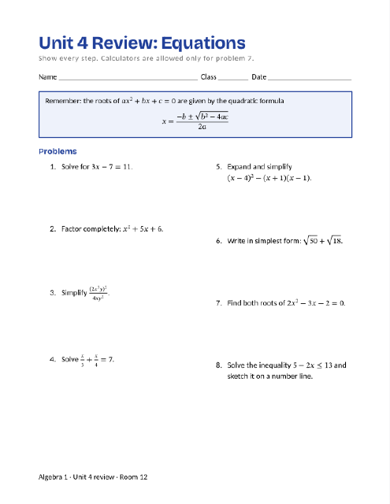</a> 
Doc 
<b><a href="algebra-worksheet/">Algebra Practice Worksheet</a></b> 
A printable algebra worksheet — name and date lines, a shaded formula box with the quadratic formula, and eight numbered problems in two columns with inline equations and room to work. 
<i>1 page; 65 words</i> 
<code>worksheet</code> <code>equations</code> <code>two-column</code> <code>numbering</code> <code>education</code>
</td>
<td width="33%" valign="top">
<a href="kelp-research-paper/">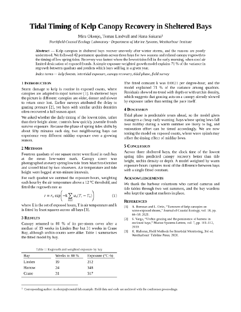</a> 
Doc 
<b><a href="kelp-research-paper/">Two-Column Research Paper</a></b> 
A conference paper with a full-width abstract over a two-column body, a numbered equation, a ruled results table, a footnote and a bracketed reference list. 
<i>1 page; 628 words</i> 
<code>research-paper</code> <code>two-column</code> <code>equations</code> <code>footnotes</code> <code>captions</code> <code>references</code>
</td>
<td width="33%" valign="top">
<a href="manuscript-line-numbers/">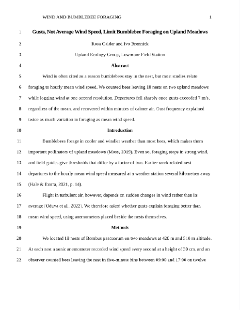</a> 
Doc 
<b><a href="manuscript-line-numbers/">Journal Manuscript for Review</a></b> 
A double-spaced journal submission with continuous line numbers for reviewers, a running head, APA citations from a source list and a generated reference list. 
<i>2 pages; 318 words</i> 
<code>manuscript</code> <code>line-numbers</code> <code>citations</code> <code>bibliography</code> <code>double-spacing</code>
</td>
</tr>
<tr>
<td width="33%" valign="top">
<a href="pendulum-lab-report/">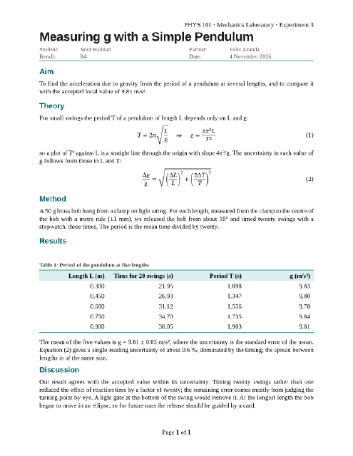</a> 
Doc 
<b><a href="pendulum-lab-report/">Physics Lab Report</a></b> 
A first-year physics lab report on measuring g with a pendulum — header block, numbered display equations, a captioned data table with a shaded header row and a "Page x of y" footer. 
<i>1 page; 319 words</i> 
<code>lab-report</code> <code>equations</code> <code>table</code> <code>captions</code> <code>page-numbers</code>
</td>
<td width="33%" valign="top">
<a href="phonics-poem-card/">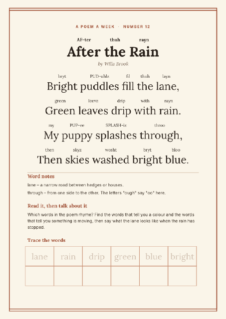</a> 
Doc 
<b><a href="phonics-poem-card/">Phonics Poem Card</a></b> 
An early-reader poem card with a sound-it-out guide set above every word by Phonetic Guide (EQ) fields, on a tinted page inside a double border. 
<i>1 page; 82 words</i> 
<code>education</code> <code>phonics</code> <code>ruby</code> <code>fields</code> <code>page-border</code> <code>page-color</code>
</td>
<td width="33%" valign="top">
<a href="thesis-front-matter/">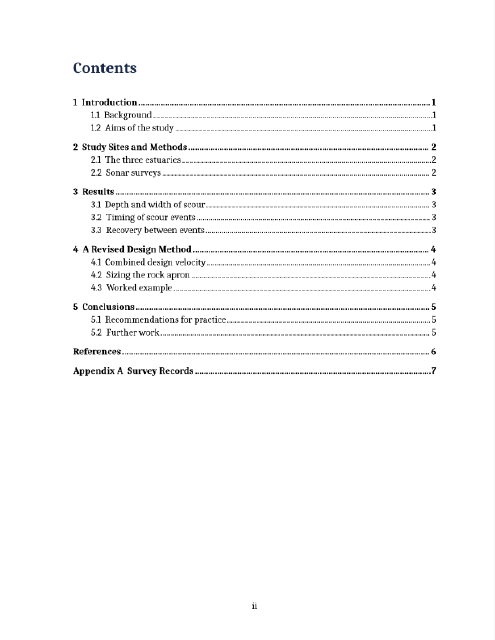</a> 
Doc 
<b><a href="thesis-front-matter/">Thesis Title Page and Contents</a></b> 
A master's thesis opening — a title page, front matter numbered i, ii, iii and chapters restarting at 1, with a generated table of contents. 
<i>10 pages; 612 words</i> 
<code>thesis</code> <code>table-of-contents</code> <code>sections</code> <code>page-numbers</code> <code>title-page</code>
</td>
</tr>
</table>

## Contracts & Forms

<table>
<tr>
<td width="33%" valign="top">
<a href="equipment-hire-agreement/">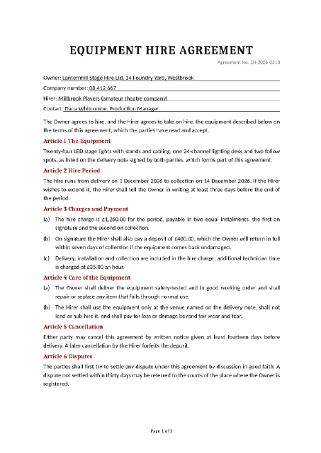</a> 
Doc 
<b><a href="equipment-hire-agreement/">Equipment Hire Agreement</a></b> 
A stage-equipment hire agreement whose Article 1, Article 2 … headings are numbered by a list linked to the article-heading style, with party lines, lettered sub-items and a borderless signature block. 
<i>2 pages; 381 words</i> 
<code>contract</code> <code>numbering</code> <code>a4</code> <code>signature-block</code> <code>tab-stops</code> <code>header-footer</code>
</td>
<td width="33%" valign="top">
<a href="mutual-nda/">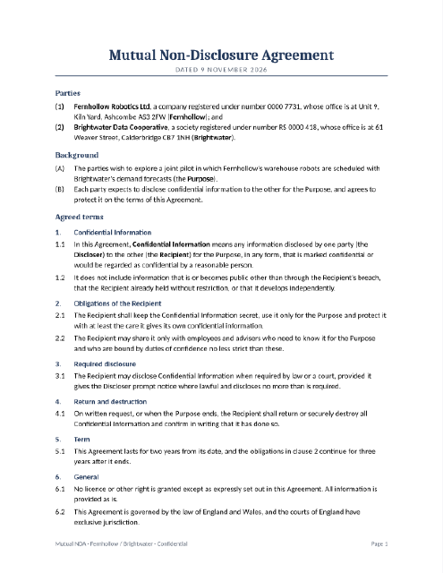</a> 
Doc 
<b><a href="mutual-nda/">Mutual NDA</a></b> 
A mutual non-disclosure agreement with numbered parties, lettered recitals, two-level clauses and side-by-side signature blocks. 
<i>2 pages; 395 words</i> 
<code>contract</code> <code>legal-numbering</code> <code>multilevel-list</code> <code>table</code> <code>tab-stops</code> <code>header-footer</code>
</td>
<td width="33%" valign="top">
<a href="registration-form/">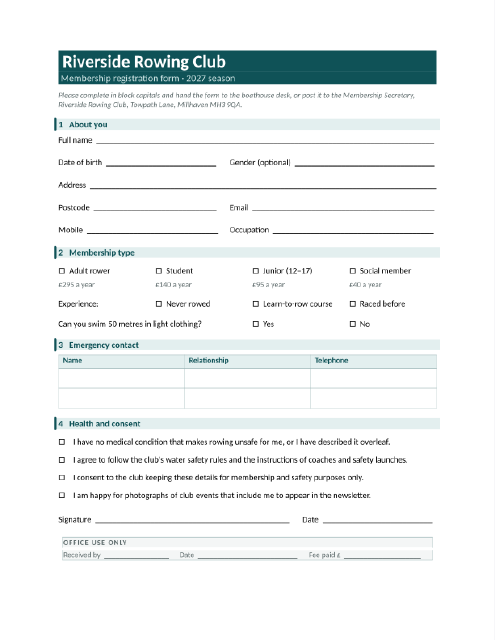</a> 
Doc 
<b><a href="registration-form/">Club Registration Form</a></b> 
A one-page membership form with shaded section bands, underscore tab-leader blanks, tick boxes and an emergency-contact table. 
<i>1 page; 174 words</i> 
<code>form</code> <code>tab-stops</code> <code>paragraph-shading</code> <code>borders</code> <code>table</code>
</td>
</tr>
<tr>
<td width="33%" valign="top">
<a href="residential-lease-agreement/">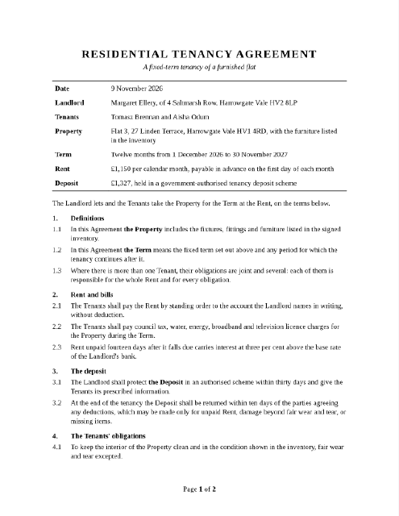</a> 
Doc 
<b><a href="residential-lease-agreement/">Residential Lease Agreement</a></b> 
A two-page tenancy agreement with a particulars table, two-level legal clause numbering, defined terms and signature lines. 
<i>2 pages; 616 words</i> 
<code>contract</code> <code>legal-numbering</code> <code>multilevel-list</code> <code>table</code> <code>tab-stops</code> <code>header-footer</code>
</td>
<td width="33%" valign="top">
<a href="service-invoice/">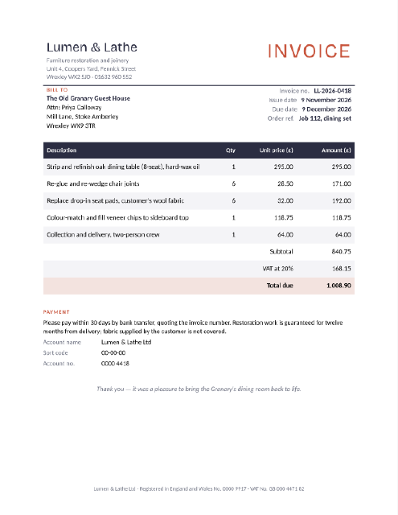</a> 
Doc 
<b><a href="service-invoice/">Service Invoice</a></b> 
A one-page invoice with a table letterhead, right-aligned billing details, a custom table style and a subtotal from a SUM(ABOVE) field. 
<i>1 page; 175 words</i> 
<code>invoice</code> <code>table</code> <code>table-style</code> <code>fields</code> <code>header-footer</code>
</td>
<td width="33%" valign="top">
<a href="site-inspection-checklist/">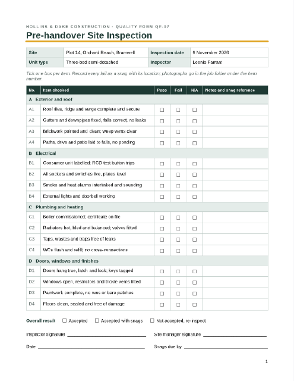</a> 
Doc 
<b><a href="site-inspection-checklist/">Site Inspection Checklist</a></b> 
A one-page pre-handover checklist with merged, shaded group rows, tick-box columns and a sign-off block. 
<i>1 page; 222 words</i> 
<code>form</code> <code>checklist</code> <code>table</code> <code>merge-cells</code> <code>tab-stops</code>
</td>
</tr>
</table>

## Letters & Memos

<table>
<tr>
<td width="33%" valign="top">
<a href="council-public-notice/">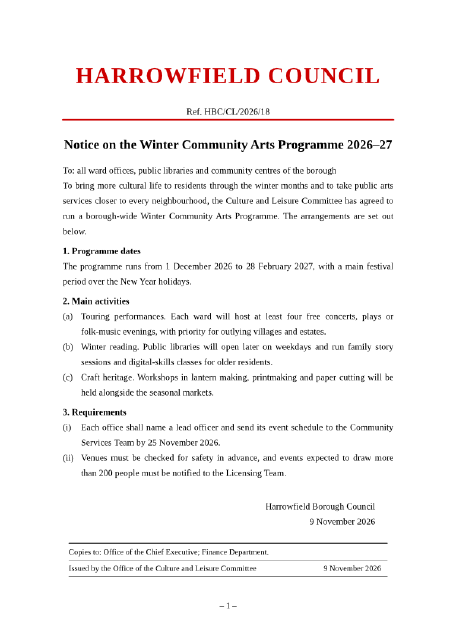</a> 
Doc 
<b><a href="council-public-notice/">Council Public Notice</a></b> 
A borough council's official notice — red masthead and rule, reference number, body on an A4 line grid and a 1. / (a) / (i) heading ladder, closed by a distribution record. 
<i>1 page; 232 words</i> 
<code>notice</code> <code>document-grid</code> <code>a4</code> <code>red-header</code> <code>page-numbers</code>
</td>
<td width="33%" valign="top">
<a href="event-invitation-letter/">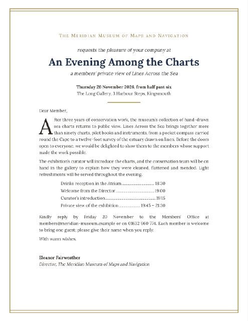</a> 
Doc 
<b><a href="event-invitation-letter/">Members' Evening Invitation</a></b> 
A centred invitation letter inside a double page border, with a drop cap, an evening programme on dotted tab leaders and an RSVP line. 
<i>1 page; 217 words</i> 
<code>invitation</code> <code>letter</code> <code>page-border</code> <code>drop-cap</code> <code>tab-stops</code>
</td>
<td width="33%" valign="top">
<a href="formal-business-letter/">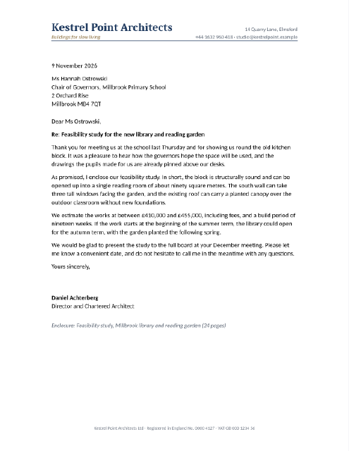</a> 
Doc 
<b><a href="formal-business-letter/">Formal Business Letter</a></b> 
A one-page letter on letterhead, with a ruled header, an address block, a subject line and a signature block. 
<i>1 page; 233 words</i> 
<code>letter</code> <code>header-footer</code> <code>letterhead</code> <code>tab-stops</code>
</td>
</tr>
<tr>
<td width="33%" valign="top">
<a href="job-cover-letter/">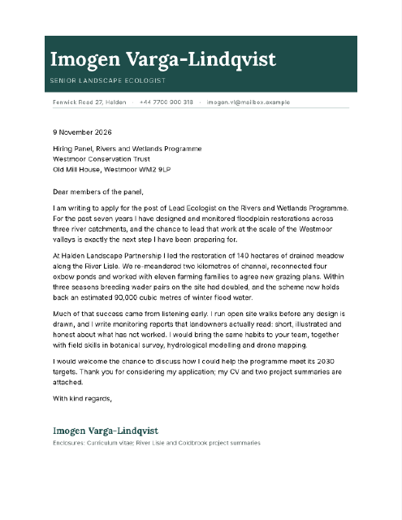</a> 
Doc 
<b><a href="job-cover-letter/">Job Cover Letter</a></b> 
A one-page application letter with a shaded name banner, a contact line and a short, well-spaced body. 
<i>1 page; 261 words</i> 
<code>letter</code> <code>cover-letter</code> <code>paragraph-shading</code> <code>careers</code>
</td>
<td width="33%" valign="top">
<a href="meeting-minutes/">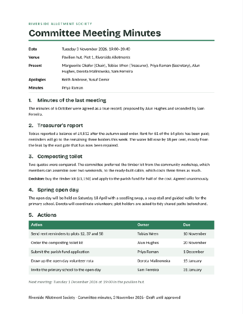</a> 
Doc 
<b><a href="meeting-minutes/">Committee Meeting Minutes</a></b> 
Minutes of a society's committee meeting, with a details table, numbered agenda headings and an action-item table. 
<i>1 page; 284 words</i> 
<code>minutes</code> <code>table</code> <code>numbered-headings</code> <code>table-style</code>
</td>
<td width="33%" valign="top">
<a href="press-release/">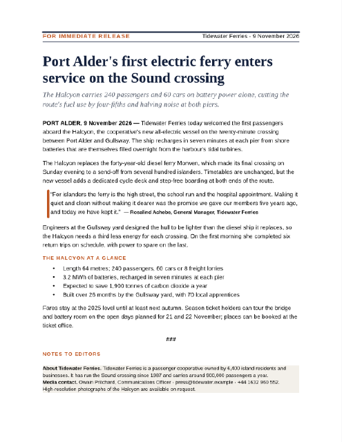</a> 
Doc 
<b><a href="press-release/">Press Release</a></b> 
A news release with an embargo line, headline and standfirst, a dateline, a pull quote, key facts, the end mark and a media contact. 
<i>1 page; 373 words</i> 
<code>press-release</code> <code>bullets</code> <code>paragraph-borders</code> <code>tab-stops</code>
</td>
</tr>
<tr>
<td width="33%" valign="top">
<a href="project-kickoff-memo/">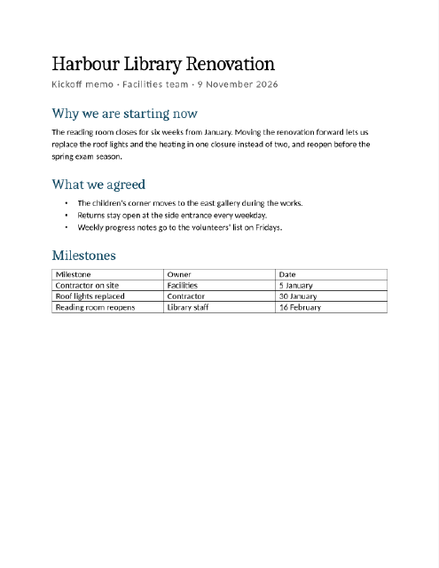</a> 
Doc 
<b><a href="project-kickoff-memo/">Project Kickoff Memo</a></b> 
A one-page internal memo with a title, built-in heading styles, a bulleted list and a milestone table. 
<i>1 page; 106 words</i> 
<code>heading-styles</code> <code>bullets</code> <code>table</code> <code>memo</code>
</td>
<td width="33%"></td>
<td width="33%"></td>
</tr>
</table>

## Newsletters & Layout

<table>
<tr>
<td width="33%" valign="top">
<a href="draft-watermark-policy/">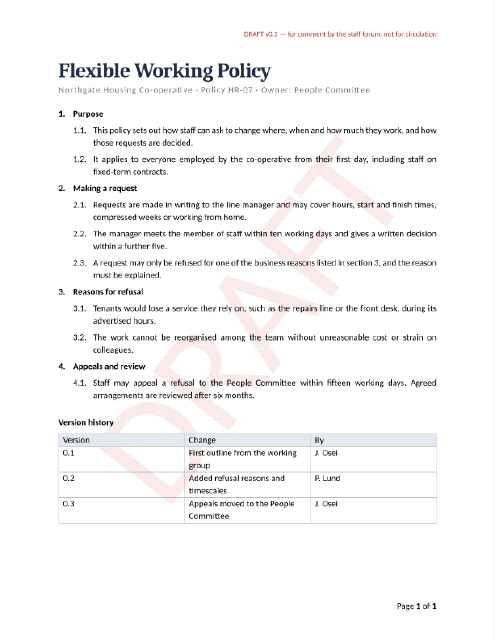</a> 
Doc 
<b><a href="draft-watermark-policy/">Draft Policy with Watermark</a></b> 
A policy draft stamped with a diagonal DRAFT watermark on every page, a status header, legal-style 1 / 1.1 / 1.2 section numbering and a version table. 
<i>1 page; 213 words</i> 
<code>watermark</code> <code>draft</code> <code>multilevel-list</code> <code>header</code> <code>table</code>
</td>
<td width="33%" valign="top">
<a href="magazine-feature/">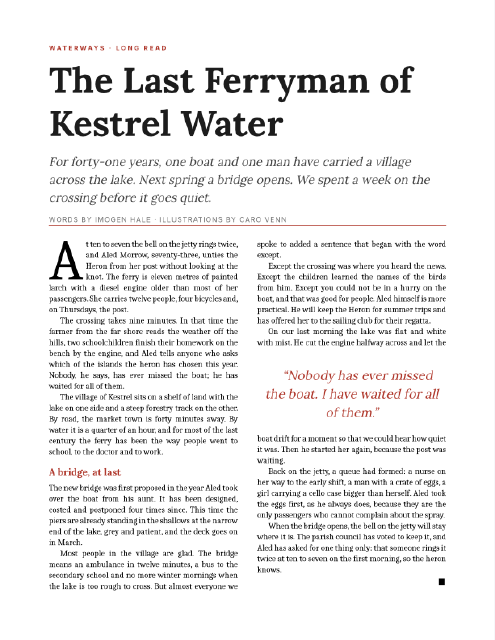</a> 
Doc 
<b><a href="magazine-feature/">Magazine Feature Spread</a></b> 
A magazine feature page — oversized serif headline, italic standfirst and byline, a four-line drop cap, two justified columns and a pull quote floating between them. 
<i>1 page; 557 words</i> 
<code>magazine</code> <code>drop-cap</code> <code>columns</code> <code>text-box</code> <code>typography</code>
</td>
<td width="33%" valign="top">
<a href="neighbourhood-newsletter/">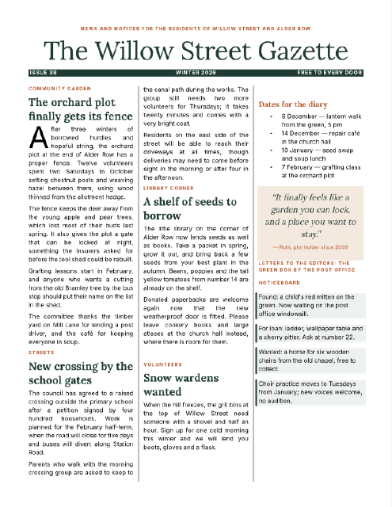</a> 
Doc 
<b><a href="neighbourhood-newsletter/">Neighbourhood Newsletter</a></b> 
A one-page community newsletter — a shaded masthead over three columns, a drop cap, a floating pull quote, an events list and a noticeboard. 
<i>1 page; 556 words</i> 
<code>newsletter</code> <code>columns</code> <code>drop-cap</code> <code>text-box</code> <code>section-break</code>
</td>
</tr>
<tr>
<td width="33%" valign="top">
<a href="poetry-chapbook-page/">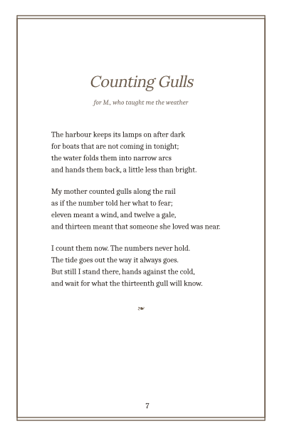</a> 
Doc 
<b><a href="poetry-chapbook-page/">Poetry Chapbook Page</a></b> 
A page from a small-format poetry chapbook — a 5½ × 8½ inch page inside a double border, centred italic title and epigraph, stanzas set with line breaks and a folio that starts at 7. 
<i>1 page; 109 words</i> 
<code>poetry</code> <code>page-border</code> <code>custom-page-size</code> <code>page-numbers</code> <code>typography</code>
</td>
<td width="33%" valign="top">
<a href="recipe-card/">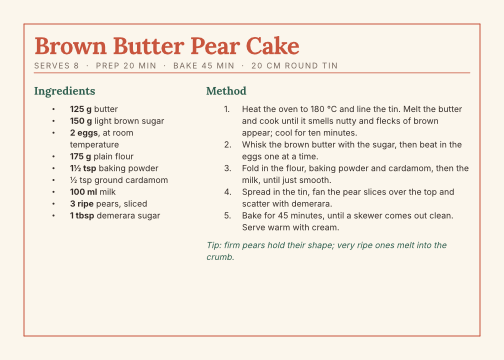</a> 
Doc 
<b><a href="recipe-card/">Recipe Card</a></b> 
A 7 × 5 inch recipe card — title and timing line over unequal columns, ingredients in a narrow column and numbered method steps in the wide one, on a tinted page. 
<i>1 page; 154 words</i> 
<code>recipe</code> <code>columns</code> <code>numbering</code> <code>custom-page-size</code> <code>page-color</code>
</td>
<td width="33%" valign="top">
<a href="trifold-travel-brochure/">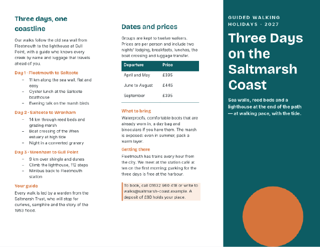</a> 
Doc 
<b><a href="trifold-travel-brochure/">Trifold Travel Brochure</a></b> 
A landscape tri-fold brochure — three panels set as three columns with column breaks, an itinerary, a price table, and a cover panel printed on a colour block behind the text. 
<i>1 page; 283 words; 1 shape</i> 
<code>brochure</code> <code>landscape</code> <code>columns</code> <code>shapes</code> <code>column-break</code>
</td>
</tr>
</table>

## Reports & Proposals

<table>
<tr>
<td width="33%" valign="top">
<a href="charity-impact-report/">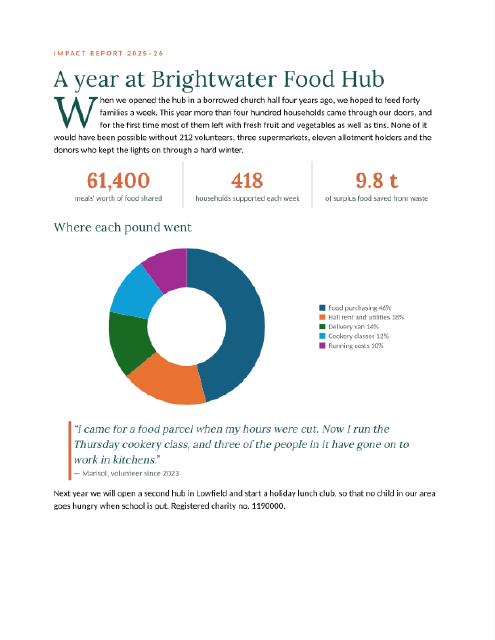</a> 
Doc 
<b><a href="charity-impact-report/">Charity Impact Report</a></b> 
A one-page annual impact summary with a drop-cap opening, a pull quote, headline figures and a doughnut chart of where each pound went. 
<i>1 page; 178 words</i> 
<code>report</code> <code>chart</code> <code>drop-cap</code> <code>pull-quote</code> <code>table</code>
</td>
<td width="33%" valign="top">
<a href="hybrid-working-policy/">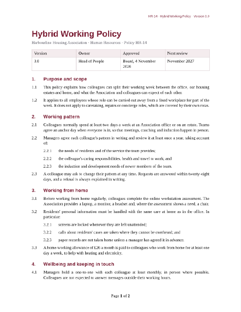</a> 
Doc 
<b><a href="hybrid-working-policy/">Hybrid Working Policy</a></b> 
A two-page staff policy whose sections and clauses are numbered 1, 1.1 and 1.1.1 by one multilevel list linked to paragraph styles. 
<i>2 pages; 405 words</i> 
<code>policy</code> <code>multilevel-list</code> <code>numbered-headings</code> <code>table</code> <code>page-numbers</code>
</td>
<td width="33%" valign="top">
<a href="incident-review-record/">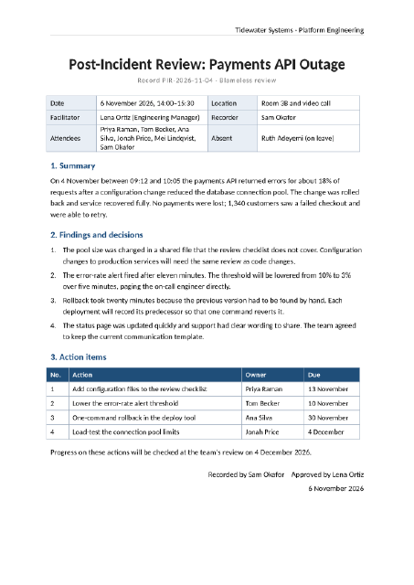</a> 
Doc 
<b><a href="incident-review-record/">Post-Incident Review Record</a></b> 
The written record of an engineering team's post-incident review on A4 — a shaded details grid, numbered findings and decisions, and an action-item table with owners and due dates. 
<i>1 page; 283 words</i> 
<code>minutes</code> <code>incident-review</code> <code>table</code> <code>a4</code> <code>header-footer</code>
</td>
</tr>
<tr>
<td width="33%" valign="top">
<a href="product-spec-sheet/">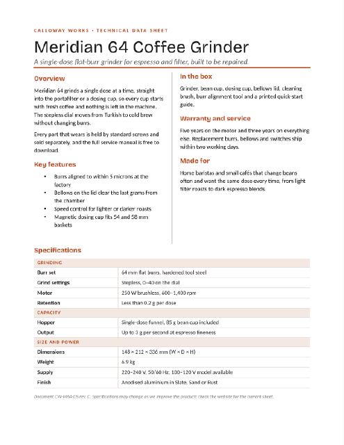</a> 
Doc 
<b><a href="product-spec-sheet/">Product Spec Sheet</a></b> 
A one-page technical data sheet with a two-column overview section and a specifications table grouped by merged, tinted rows. 
<i>1 page; 294 words</i> 
<code>spec-sheet</code> <code>columns</code> <code>table</code> <code>section-breaks</code> <code>bullets</code>
</td>
<td width="33%" valign="top">
<a href="programme-status-report/">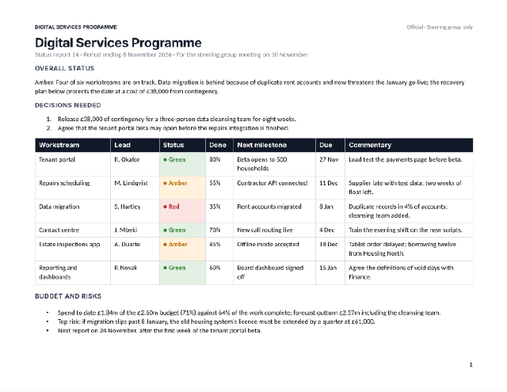</a> 
Doc 
<b><a href="programme-status-report/">Programme Status Report</a></b> 
A landscape status report whose wide table gives each workstream a red, amber or green status cell, with a summary and key decisions above it. 
<i>1 page; 277 words</i> 
<code>report</code> <code>landscape</code> <code>table</code> <code>status</code> <code>header-footer</code>
</td>
<td width="33%" valign="top">
<a href="project-proposal/">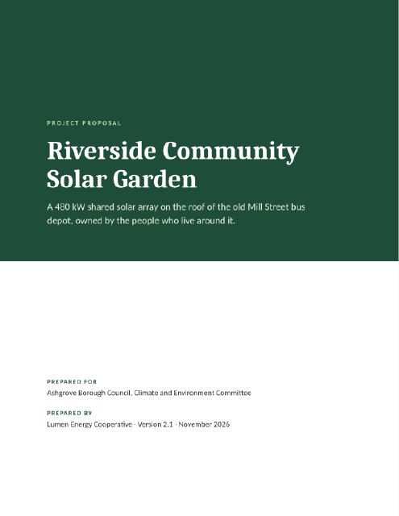</a> 
Doc 
<b><a href="project-proposal/">Community Solar Proposal</a></b> 
A four-page project proposal with a full-bleed cover, a table of contents, numbered headings and a budget table. 
<i>4 pages; 478 words</i> 
<code>proposal</code> <code>cover-page</code> <code>table-of-contents</code> <code>numbered-headings</code> <code>table</code> <code>page-numbers</code>
</td>
</tr>
<tr>
<td width="33%" valign="top">
<a href="quarterly-business-report/">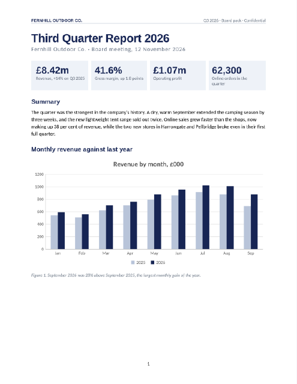</a> 
Doc 
<b><a href="quarterly-business-report/">Quarterly Business Report</a></b> 
A two-page board report with a KPI strip, a column chart of revenue against last year and a regional results table. 
<i>2 pages; 271 words</i> 
<code>report</code> <code>chart</code> <code>table</code> <code>kpi</code> <code>header-footer</code>
</td>
<td width="33%"></td>
<td width="33%"></td>
</tr>
</table>

## Resumes

<table>
<tr>
<td width="33%" valign="top">
<a href="academic-cv/">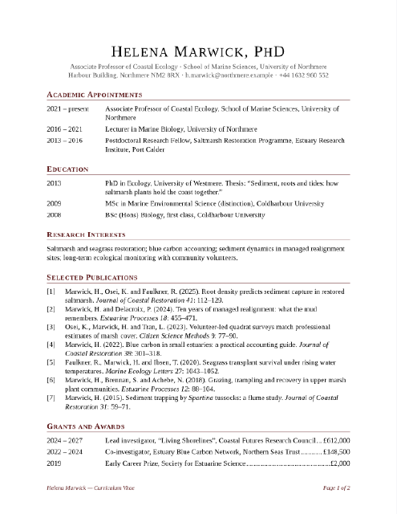</a> 
Doc 
<b><a href="academic-cv/">Academic CV</a></b> 
A two-page academic curriculum vitae in a serif face, with dated entries on hanging indents, a numbered publication list and page numbers. 
<i>2 pages; 485 words</i> 
<code>resume</code> <code>academic</code> <code>numbering</code> <code>tab-stops</code> <code>header-footer</code>
</td>
<td width="33%" valign="top">
<a href="conference-speaker-profile/">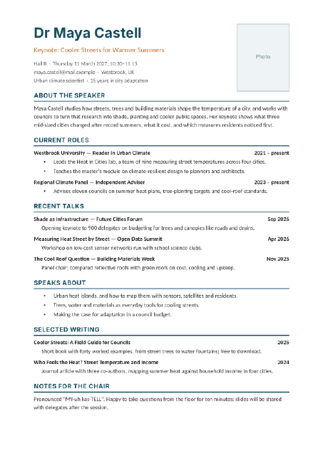</a> 
Doc 
<b><a href="conference-speaker-profile/">Conference Speaker Profile</a></b> 
A one-page speaker profile for a conference programme — name block beside a photo frame, ruled section headings, right-aligned dates on tab stops and a list of talk topics. 
<i>1 page; 312 words</i> 
<code>speaker-bio</code> <code>tab-stops</code> <code>a4</code> <code>text-box</code> <code>bullets</code>
</td>
<td width="33%" valign="top">
<a href="modern-resume/">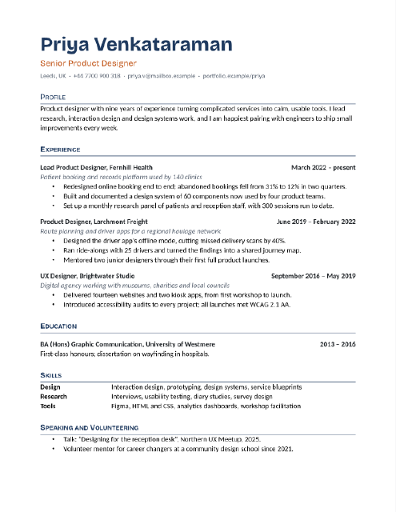</a> 
Doc 
<b><a href="modern-resume/">Modern Resume</a></b> 
A one-page resume with a bold name line, small-caps section headings over a thin rule, right-aligned dates and bulleted achievements. 
<i>1 page; 279 words</i> 
<code>resume</code> <code>heading-styles</code> <code>tab-stops</code> <code>bullets</code>
</td>
</tr>
<tr>
<td width="33%" valign="top">
<a href="two-column-resume/">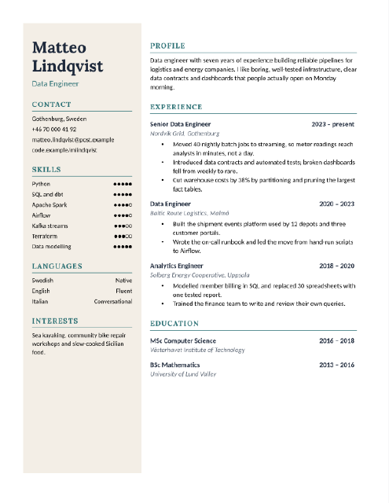</a> 
Doc 
<b><a href="two-column-resume/">Two-Column Resume</a></b> 
A one-page resume built on a borderless two-column table, with a shaded sidebar for contact details, skill ratings and languages. 
<i>1 page; 214 words</i> 
<code>resume</code> <code>table</code> <code>custom-styles</code> <code>tab-stops</code>
</td>
<td width="33%"></td>
<td width="33%"></td>
</tr>
</table>

## Tags

`a4` 4 · `academic` 1 · `bibliography` 1 · `borders` 1 · `brochure` 1 · `bullets` 5 · `captions` 2 · `careers` 1 · `chart` 2 · `checklist` 1 · `citations` 1 · `column-break` 1 · `columns` 5 · `contract` 3 · `cover-letter` 1 · `cover-page` 1 · `custom-page-size` 2 · `custom-styles` 1 · `document-grid` 1 · `double-spacing` 1 · `draft` 1 · `drop-cap` 4 · `education` 2 · `equations` 3 · `fields` 2 · `footnotes` 1 · `form` 2 · `header` 1 · `header-footer` 9 · `heading-styles` 2 · `incident-review` 1 · `invitation` 1 · `invoice` 1 · `kpi` 1 · `lab-report` 1 · `landscape` 2 · `legal-numbering` 2 · `letter` 3 · `letterhead` 1 · `line-numbers` 1 · `magazine` 1 · `manuscript` 1 · `memo` 1 · `merge-cells` 1 · `minutes` 2 · `multilevel-list` 4 · `newsletter` 1 · `notice` 1 · `numbered-headings` 3 · `numbering` 4 · `page-border` 3 · `page-color` 2 · `page-numbers` 6 · `paragraph-borders` 1 · `paragraph-shading` 2 · `phonics` 1 · `poetry` 1 · `policy` 1 · `press-release` 1 · `proposal` 1 · `pull-quote` 1 · `recipe` 1 · `red-header` 1 · `references` 1 · `report` 3 · `research-paper` 1 · `resume` 3 · `ruby` 1 · `section-break` 1 · `section-breaks` 1 · `sections` 1 · `shapes` 1 · `signature-block` 1 · `speaker-bio` 1 · `spec-sheet` 1 · `status` 1 · `tab-stops` 12 · `table` 17 · `table-of-contents` 2 · `table-style` 2 · `text-box` 3 · `thesis` 1 · `title-page` 1 · `two-column` 2 · `typography` 2 · `watermark` 1 · `worksheet` 1
