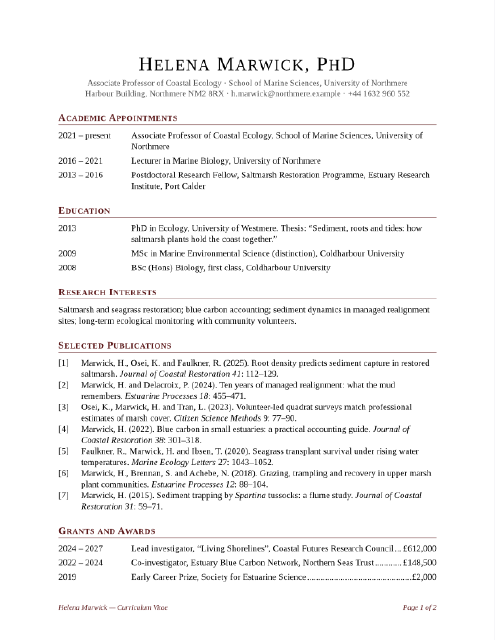

<!-- Generated by tools/gallery.mjs from showcase.yaml and build.json; do not edit. -->
# Academic CV

[Doc](../README.md) › [Resumes](../README.md#resumes) · `resume` `academic` `numbering` `tab-stops` `header-footer`

A two-page academic curriculum vitae in a serif face, with dated entries on hanging indents, a numbered publication list and page numbers.



| | |
|---|---|
| Document | [academic-cv.docx](academic-cv.docx) (10 KB) |
| Contents | 2 pages; 485 words |
| Features | `doc.text.typing`, `doc.styles.manage`, `doc.lists.bullets-numbering`, `doc.format.paragraph`, `doc.headers.footers` |
| Built by | `kition-doc` @ `e6d2eae5d0`: 161 commands in 71 ms |

## About

A paragraph style of our own, Dated Entry, hangs every appointment, degree and grant off a
90-point tab, so the years line up in a column and the text wraps clear of them. Grant amounts
sit on a right tab with a dot leader. Publications are a list defined with list.define as
bracketed numbers, journal titles in italics. The footer carries the name and "Page x of y".

## Checks

- `inspect.pages`: `{"count":2}`
- `inspect.words`: `{"min":450,"max":560}`
- `results.publications.levels.0`: `{"format":"decimal","text":"[%1]"}`
- `results.section.footers.default`: `{"exists":true}`
- `results.journals.count`: `4`
- `results.doc.parts`: `{"any":{"kind":"footer"}}`
- `results.doc.blocks`: `{"any":{"style":"DatedEntry"}}`
- diagnostics: none (the kit's check finds nothing wrong)
- the saved document opens again; the thumbnail matches `thumb.png` within the `render` tolerance

## Steps

<details><summary>161 commands (from <a href="showcase.yaml">showcase.yaml</a>)</summary>

```yaml
- command: review.proofing
- command: design.themeFonts
  params:
    heading: Tinos
    body: Tinos
- command: layout.margins
  params:
    top: 64
    bottom: 64
    left: 72
    right: 72
- command: styles.modify
  params:
    style: Normal
    chr:
      size: 11
    para:
      spaceAfter: 4
      lineSpacing:
        rule: multiple
        value: 1.08
- command: styles.modify
  params:
    style: Heading 1
    chr:
      size: 12
      bold: true
      smallCaps: true
      spacing: 0.5
      color:
        Rgb:
          - 92
          - 26
          - 27
    para:
      spaceBefore: 16
      spaceAfter: 6
      borders:
        bottom:
          style: single
          width: 0.5
          color:
            - 92
            - 26
            - 27
          space: 1
- command: styles.create
  params:
    name: Dated Entry
    basedOn: Normal
- command: styles.modify
  params:
    style: Dated Entry
    para:
      indentLeft: 90
      indentFirst: -90
      spaceAfter: 4
      tabs:
        - pos: 90
          align: left
          leader: none
- command: styles.create
  params:
    name: Grant Entry
    basedOn: Dated Entry
- command: styles.modify
  params:
    style: Grant Entry
    para:
      tabs:
        - pos: 90
          align: left
          leader: none
        - pos: 468
          align: right
          leader: dot
- command: styles.create
  params:
    name: CV Name
    basedOn: Normal
- command: styles.modify
  params:
    style: CV Name
    chr:
      size: 24
      bold: false
      smallCaps: true
      spacing: 1.5
    para:
      align: center
      spaceAfter: 2
- command: styles.create
  params:
    name: CV Address
    basedOn: Normal
- command: styles.modify
  params:
    style: CV Address
    chr:
      size: 10.5
      color:
        Rgb:
          - 80
          - 80
          - 80
    para:
      align: center
      spaceAfter: 0
- command: para.style
  params:
    style: CV Name
- command: text.insert
  params:
    text: Helena Marwick, PhD
- command: text.newParagraph
- command: para.style
  params:
    style: CV Address
- command: text.insert
  params:
    text: Associate Professor of Coastal Ecology · School of Marine Sciences, University of Northmere
- command: text.newParagraph
- command: text.insert
  params:
    text: Harbour Building, Northmere NM2 8RX · h.marwick@northmere.example · +44 1632 960 552
- command: text.newParagraph
- command: para.heading1
- command: text.insert
  params:
    text: Academic Appointments
- command: text.newParagraph
- command: para.style
  params:
    style: Dated Entry
- command: text.insert
  params:
    text: 2021 – present	Associate Professor of Coastal Ecology, School of Marine Sciences, University of Northmere
- command: text.newParagraph
- command: text.insert
  params:
    text: 2016 – 2021	Lecturer in Marine Biology, University of Northmere
- command: text.newParagraph
- command: text.insert
  params:
    text: 2013 – 2016	Postdoctoral Research Fellow, Saltmarsh Restoration Programme, Estuary Research Institute, Port Calder
- command: text.newParagraph
- command: para.heading1
- command: text.insert
  params:
    text: Education
- command: text.newParagraph
- command: para.style
  params:
    style: Dated Entry
- command: text.insert
  params:
    text: "2013\tPhD in Ecology, University of Westmere. Thesis: “Sediment, roots and tides: how saltmarsh plants hold the coast together.”"
- command: text.newParagraph
- command: text.insert
  params:
    text: 2009	MSc in Marine Environmental Science (distinction), Coldharbour University
- command: text.newParagraph
- command: text.insert
  params:
    text: 2008	BSc (Hons) Biology, first class, Coldharbour University
- command: text.newParagraph
- command: para.heading1
- command: text.insert
  params:
    text: Research Interests
- command: text.newParagraph
- command: para.style
  params:
    style: Normal
- command: text.insert
  params:
    text: Saltmarsh and seagrass restoration; blue carbon accounting; sediment dynamics in managed realignment sites; long-term ecological monitoring with community volunteers.
- command: text.newParagraph
- command: para.heading1
- command: text.insert
  params:
    text: Selected Publications
- command: text.newParagraph
- command: para.style
  params:
    style: Normal
- command: list.define
  params:
    name: Publications
    levels:
      - format: decimal
        text: "[%1]"
        alignedAt: 0
        indentAt: 28
        follow: tab
  as: publist
- command: text.insert
  params:
    text: "Marwick, H., Osei, K. and Faulkner, R. (2025). Root density predicts sediment capture in restored saltmarsh. Journal of Coastal Restoration 41: 112–129."
- command: text.newParagraph
- command: text.insert
  params:
    text: "Marwick, H. and Delacroix, P. (2024). Ten years of managed realignment: what the mud remembers. Estuarine Processes 18: 455–471."
- command: text.newParagraph
- command: text.insert
  params:
    text: "Osei, K., Marwick, H. and Tran, L. (2023). Volunteer-led quadrat surveys match professional estimates of marsh cover. Citizen Science Methods 9: 77–90."
- command: text.newParagraph
- command: text.insert
  params:
    text: "Marwick, H. (2022). Blue carbon in small estuaries: a practical accounting guide. Journal of Coastal Restoration 38: 301–318."
- command: text.newParagraph
- command: text.insert
  params:
    text: "Faulkner, R., Marwick, H. and Ibsen, T. (2020). Seagrass transplant survival under rising water temperatures. Marine Ecology Letters 27: 1043–1052."
- command: text.newParagraph
- command: text.insert
  params:
    text: "Marwick, H., Brennan, S. and Achebe, N. (2018). Grazing, trampling and recovery in upper marsh plant communities. Estuarine Processes 12: 88–104."
- command: text.newParagraph
- command: text.insert
  params:
    text: "Marwick, H. (2015). Sediment trapping by Spartina tussocks: a flume study. Journal of Coastal Restoration 31: 59–71."
- command: text.newParagraph
- command: para.numbering
  params:
    off: true
- command: para.heading1
- command: text.insert
  params:
    text: Grants and Awards
- command: text.newParagraph
- command: para.style
  params:
    style: Grant Entry
- command: text.insert
  params:
    text: 2024 – 2027	Lead investigator, “Living Shorelines”, Coastal Futures Research Council	£612,000
- command: text.newParagraph
- command: text.insert
  params:
    text: 2022 – 2024	Co-investigator, Estuary Blue Carbon Network, Northern Seas Trust	£148,500
- command: text.newParagraph
- command: text.insert
  params:
    text: 2019	Early Career Prize, Society for Estuarine Science	£2,000
- command: text.newParagraph
- command: text.insert
  params:
    text: 2017 – 2019	Seed grant, Saltmarsh volunteer monitoring, University of Northmere	£24,000
- command: text.newParagraph
- command: para.heading1
- command: text.insert
  params:
    text: Teaching
- command: text.newParagraph
- command: para.style
  params:
    style: Dated Entry
- command: text.insert
  params:
    text: Undergraduate	Coastal Ecosystems (Year 2, 180 students); Field Methods in Marine Biology (Year 3 residential field course)
- command: text.newParagraph
- command: text.insert
  params:
    text: Postgraduate	Restoration Ecology (MSc core module, module lead since 2019)
- command: text.newParagraph
- command: text.insert
  params:
    text: Supervision	Five PhD students supervised to completion; three current; eighteen MSc dissertations
- command: text.newParagraph
- command: para.heading1
- command: text.insert
  params:
    text: Invited Talks
- command: text.newParagraph
- command: para.style
  params:
    style: Dated Entry
- command: text.insert
  params:
    text: 2025	Keynote, North Sea Coastal Management Forum, Harlingen Bay
- command: text.newParagraph
- command: text.insert
  params:
    text: 2023	“What the mud remembers”, public lecture series, Port Calder Maritime Museum
- command: text.newParagraph
- command: text.insert
  params:
    text: 2021	Plenary, Annual Meeting of the Society for Estuarine Science
- command: text.newParagraph
- command: para.heading1
- command: text.insert
  params:
    text: Service
- command: text.newParagraph
- command: para.style
  params:
    style: Dated Entry
- command: text.insert
  params:
    text: 2022 – present	Associate Editor, Journal of Coastal Restoration
- command: text.newParagraph
- command: text.insert
  params:
    text: 2020 – present	Chair, School Equality and Inclusion Committee
- command: text.newParagraph
- command: text.insert
  params:
    text: 2018 – 2022	Trustee, Calder Estuary Wildlife Trust
- command: text.newParagraph
- command: text.insert
  params:
    text: 2017 – present	Reviewer for six journals and two national research councils
- command: text.newParagraph
- command: para.heading1
- command: text.insert
  params:
    text: Public Engagement
- command: text.newParagraph
- command: para.style
  params:
    style: Normal
- command: text.insert
  params:
    text: Founder of the Marsh Watch volunteer network, which has trained more than 400 residents to survey plant cover and sediment at eleven sites since 2017. Regular contributor to regional radio and to the museum’s family science days; adviser to two community groups preparing shoreline management plans.
- command: text.newParagraph
- command: para.heading1
- command: text.insert
  params:
    text: Professional Memberships
- command: text.newParagraph
- command: para.style
  params:
    style: Dated Entry
- command: text.insert
  params:
    text: Since 2010	Society for Estuarine Science (council member 2020 – 2023)
- command: text.newParagraph
- command: text.insert
  params:
    text: Since 2014	Coastal Restoration Practitioners’ Network
- command: text.newParagraph
- command: para.heading1
- command: text.insert
  params:
    text: Referees
- command: text.newParagraph
- command: para.style
  params:
    style: Normal
- command: text.insert
  params:
    text: Available on request.
- command: edit.advancedFind
  params:
    text: Journal of Coastal Restoration
    highlight: false
  as: journals
- command: select.text
  params:
    text: Journal of Coastal Restoration 41
- command: format.italic
  params:
    value: true
- command: select.text
  params:
    text: Estuarine Processes 18
- command: format.italic
  params:
    value: true
- command: select.text
  params:
    text: Citizen Science Methods
- command: format.italic
  params:
    value: true
- command: select.text
  params:
    text: Journal of Coastal Restoration 38
- command: format.italic
  params:
    value: true
- command: select.text
  params:
    text: Marine Ecology Letters
- command: format.italic
  params:
    value: true
- command: select.text
  params:
    text: Estuarine Processes 12
- command: format.italic
  params:
    value: true
- command: select.text
  params:
    text: Journal of Coastal Restoration 31
- command: format.italic
  params:
    value: true
- command: select.text
  params:
    text: Spartina
- command: format.italic
  params:
    value: true
- command: select.text
  params:
    text: Sediment trapping
- command: list.get
  as: publications
- command: caret.docEnd
- command: insert.editFooter
- command: para.tabs
  params:
    clear:
      - 234
      - 468
    set:
      - pos: 468
        align: right
- command: format.set
  params:
    props:
      font: Tinos
      size: 9
      bold: false
      italic: true
- command: format.color
  params:
    color: 5C1A1B
- command: text.insert
  params:
    text: "Helena Marwick — Curriculum Vitae\tPage "
- command: insert.field
  params:
    instr: PAGE
    result: "1"
- command: text.insert
  params:
    text: " of "
- command: insert.field
  params:
    instr: NUMPAGES
    result: "2"
- command: insert.closeHeader
- command: layout.section
  as: section
- command: document.inspect
  as: doc
```

</details>
