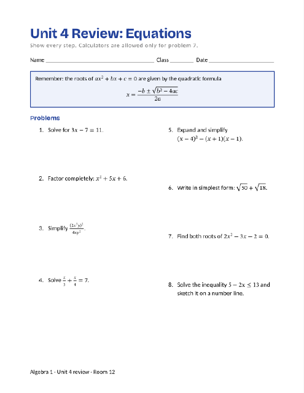

<!-- Generated by tools/gallery.mjs from showcase.yaml and build.json; do not edit. -->
# Algebra Practice Worksheet

[Doc](../README.md) › [Academic](../README.md#academic) · `worksheet` `equations` `two-column` `numbering` `education`

A printable algebra worksheet — name and date lines, a shaded formula box with the quadratic formula, and eight numbered problems in two columns with inline equations and room to work.



| | |
|---|---|
| Document | [algebra-worksheet.docx](algebra-worksheet.docx) (9 KB) |
| Contents | 1 page; 65 words |
| Features | `doc.equations.edit`, `doc.lists.bullets-numbering`, `doc.layout.page-setup`, `doc.format.paragraph`, `doc.headers.footers` |
| Built by | `kition-doc` @ `e6d2eae5d0`: 100 commands in 166 ms |

## About

Every expression is a real Office Math equation typed from LaTeX — fractions, powers, roots
and an inequality inline in numbered problems, and the quadratic formula as a centred display
equation in a shaded, ruled one-cell table that serves as a reference box. The problems sit in two columns between
continuous section breaks, with generous space after each for working. The student's name,
class and date lines are underlined tabs, and the footer carries the page number.

## Checks

- `inspect.pages`: `{"count":1}`
- `results.columns.columns.count`: `2`
- `results.formula.display`: `true`
- `results.first.display`: `false`
- `results.structure.blocks`: `{"any":{"style":"Problem","objects":{"any":{"type":"equation"}}}}`
- diagnostics: none (the kit's check finds nothing wrong)
- the saved document opens again; the thumbnail matches `thumb.png` within the `render` tolerance

## Steps

<details><summary>100 commands (from <a href="showcase.yaml">showcase.yaml</a>)</summary>

```yaml
- command: review.proofing
  as: proofing
- command: design.themeFonts
  params:
    heading: Bricolage Grotesque
    body: Carlito
- command: layout.margins
  params:
    top: 50
    bottom: 50
    left: 60
    right: 60
- command: styles.modify
  params:
    style: Normal
    chr:
      size: 12
    para:
      align: left
      spaceBefore: 0
      spaceAfter: 6
      lineSpacing:
        rule: multiple
        value: 1.15
- command: styles.modify
  params:
    style: Title
    chr:
      size: 28
      bold: true
      color:
        Rgb:
          - 33
          - 64
          - 154
    para:
      align: left
      spaceAfter: 0
- command: styles.modify
  params:
    style: Subtitle
    chr:
      size: 12
      color:
        Rgb:
          - 110
          - 110
          - 110
    para:
      align: left
      spaceAfter: 12
- command: styles.modify
  params:
    style: Heading 2
    chr:
      size: 13
      bold: true
      color:
        Rgb:
          - 33
          - 64
          - 154
    para:
      spaceBefore: 14
      spaceAfter: 6
- command: styles.create
  params:
    name: Student Line
    basedOn: Normal
- command: styles.modify
  params:
    style: Student Line
    para:
      spaceAfter: 14
      tabs:
        - pos: 250
          align: left
        - pos: 330
          align: left
        - pos: 430
          align: left
        - pos: 492
          align: left
- command: styles.create
  params:
    name: Problem
    basedOn: Normal
- command: styles.modify
  params:
    style: Problem
    chr:
      size: 12.5
    para:
      spaceAfter: 80
- command: insert.footer
  params:
    text: Algebra 1 · Unit 4 review · Room 12
  as: footer
- command: format.size
  params:
    size: 9
- command: insert.closeHeader
- command: para.style
  params:
    style: Title
- command: text.insert
  params:
    text: "Unit 4 Review: Equations"
- command: text.newParagraph
- command: para.style
  params:
    style: Subtitle
- command: text.insert
  params:
    text: Show every step. Calculators are allowed only for problem 7.
- command: text.newParagraph
- command: para.style
  params:
    style: Student Line
- command: text.insert
  params:
    text: "Name "
- command: format.set
  params:
    props:
      underline: single
- command: text.tab
- command: format.set
  params:
    props:
      underline: none
- command: text.insert
  params:
    text: "  Class "
- command: format.set
  params:
    props:
      underline: single
- command: text.tab
- command: format.set
  params:
    props:
      underline: none
- command: text.insert
  params:
    text: "  Date "
- command: format.set
  params:
    props:
      underline: single
- command: text.tab
- command: text.tab
- command: text.newParagraph
- command: para.style
  params:
    style: Normal
- command: format.set
  params:
    props:
      underline: none
- command: insert.table
  params:
    rows: 1
    cols: 1
  as: box
- command: table.selectTable
- command: table.shading
  params:
    color: EEF2FB
- command: table.borders
  params:
    kind: all
    width: 1.25
    color: 21409A
- command: table.cellMargins
  params:
    top: 6
    bottom: 2
    left: 10
    right: 10
- command: select.collapse
- command: text.insert
  params:
    text: "Remember: the roots of "
- command: insert.equation
  params:
    linear: ax^2+bx+c=0
- command: equation.exit
- command: text.insert
  params:
    text: " are given by the quadratic formula"
- command: text.newParagraph
- command: insert.equation
  params:
    builtin: quadratic
    display: true
  as: formula
- command: equation.exit
- command: caret.docEnd
- command: para.style
  params:
    style: Heading 2
- command: text.insert
  params:
    text: Problems
- command: text.newParagraph
- command: layout.break
  params:
    kind: continuous
- command: layout.columns
  params:
    count: 2
    space: 30
  as: columns
- command: para.style
  params:
    style: Problem
- command: para.numbering
  params:
    kind: numbered
  as: list
- command: text.insert
  params:
    text: "Solve for "
- command: insert.equation
  params:
    latex: 3x - 7 = 11
  as: first
- command: equation.exit
- command: text.insert
  params:
    text: .
- command: text.newParagraph
- command: text.insert
  params:
    text: "Factor completely: "
- command: insert.equation
  params:
    latex: x^2 + 5x + 6
- command: equation.exit
- command: text.insert
  params:
    text: .
- command: text.newParagraph
- command: text.insert
  params:
    text: "Simplify "
- command: insert.equation
  params:
    latex: \frac{(2x^3 y)^2}{4xy^2}
- command: equation.exit
- command: text.insert
  params:
    text: .
- command: text.newParagraph
- command: text.insert
  params:
    text: "Solve "
- command: insert.equation
  params:
    latex: \frac{x}{3} + \frac{x}{4} = 7
- command: equation.exit
- command: text.insert
  params:
    text: .
- command: text.newParagraph
- command: text.insert
  params:
    text: "Expand and simplify "
- command: insert.equation
  params:
    latex: (x - 4)^2 - (x + 1)(x - 1)
- command: equation.exit
- command: text.insert
  params:
    text: .
- command: text.newParagraph
- command: text.insert
  params:
    text: "Write in simplest form: "
- command: insert.equation
  params:
    latex: \sqrt{50} + \sqrt{18}
- command: equation.exit
- command: text.insert
  params:
    text: .
- command: text.newParagraph
- command: text.insert
  params:
    text: "Find both roots of "
- command: insert.equation
  params:
    latex: 2x^2 - 3x - 2 = 0
- command: equation.exit
- command: text.insert
  params:
    text: .
- command: text.newParagraph
- command: text.insert
  params:
    text: "Solve the inequality "
- command: insert.equation
  params:
    latex: 5 - 2x \le 13
- command: equation.exit
- command: text.insert
  params:
    text: " and sketch it on a number line."
- command: text.newParagraph
- command: para.numbering
  params:
    off: true
- command: layout.break
  params:
    kind: continuous
- command: document.inspect
  as: structure
```

</details>
