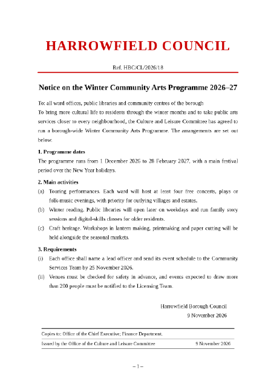

<!-- Generated by tools/gallery.mjs from showcase.yaml and build.json; do not edit. -->
# Council Public Notice

[Doc](../README.md) › [Letters & Memos](../README.md#letters--memos) · `notice` `document-grid` `a4` `red-header` `page-numbers`

A borough council's official notice — red masthead and rule, reference number, body on an A4 line grid and a 1. / (a) / (i) heading ladder, closed by a distribution record.



| | |
|---|---|
| Document | [council-public-notice.docx](council-public-notice.docx) (8 KB) |
| Contents | 1 page; 232 words |
| Features | `doc.layout.document-grid`, `doc.format.paragraph`, `doc.headers.footers`, `doc.layout.page-setup` |
| Built by | `kition-doc` @ `1b00044864`: 89 commands in 122 ms |

## About

The page is set up like a formal public-sector circular: A4 with a line grid of 20-point
pitch that every paragraph snaps to, a red masthead with the issuing council's name over the
reference number and a red rule, a centred title, and a body whose sections step 1. → (a) →
(i). The issuing office and date sit at the right, the footer carries the page number as
"– 1 –", and the distribution record closes the notice between two rules. Set in Tinos,
loaded with the sample.

## Checks

- `inspect.pages`: `{"count":1}`
- `inspect.pages.0.area`: `{"width":{"approx":595.3,"tol":0.5},"height":{"approx":841.9,"tol":0.5}}`
- `results.grid.grid`: `{"kind":"lines","linePitch":400}`
- `results.page.marginTop`: `{"approx":78,"tol":0.1}`
- `results.page.pageW`: `{"approx":595.3,"tol":0.5}`
- `results.count.words`: `{"min":220}`
- `results.footer.story`: `{"exists":true}`
- diagnostics: none (the kit's check finds nothing wrong)
- the saved document opens again; the thumbnail matches `thumb.png` within the `render` tolerance

## Steps

<details><summary>89 commands (from <a href="showcase.yaml">showcase.yaml</a>)</summary>

```yaml
- command: review.proofing
  as: proofing
- command: layout.pageSetup
  params:
    section:
      grid:
        kind: lines
        linePitch: 400
  as: grid
- command: layout.size
  params:
    name: A4
- command: layout.margins
  params:
    top: 78
    bottom: 72
    left: 82
    right: 78
  as: page
- command: design.themeFonts
  params:
    heading: Tinos
    body: Tinos
- command: styles.modify
  params:
    style: Normal
    chr:
      size: 12
    para:
      align: justify
      spaceBefore: 0
      spaceAfter: 0
      lineSpacing:
        rule: multiple
        value: 1
- command: styles.create
  params:
    name: Masthead
    basedOn: Normal
- command: styles.modify
  params:
    style: Masthead
    chr:
      size: 30
      bold: true
      spacing: 1
      color:
        Rgb:
          - 204
          - 0
          - 0
    para:
      align: center
      spaceBefore: 0
      spaceAfter: 18
- command: styles.create
  params:
    name: Reference
    basedOn: Normal
- command: styles.modify
  params:
    style: Reference
    para:
      align: center
      spaceAfter: 6
- command: styles.create
  params:
    name: Notice Title
    basedOn: Normal
- command: styles.modify
  params:
    style: Notice Title
    chr:
      size: 17
      bold: true
    para:
      align: center
      spaceBefore: 20
      spaceAfter: 14
- command: styles.create
  params:
    name: Notice Body
    basedOn: Normal
- command: styles.modify
  params:
    style: Notice Body
    para:
      spaceAfter: 0
- command: styles.create
  params:
    name: Section Heading
    basedOn: Notice Body
- command: styles.modify
  params:
    style: Section Heading
    chr:
      bold: true
    para:
      spaceBefore: 6
      keepNext: true
- command: styles.create
  params:
    name: Sub Item
    basedOn: Notice Body
- command: styles.modify
  params:
    style: Sub Item
    para:
      indentLeft: 24
      indentFirst: -24
      tabs:
        - pos: 24
          align: left
- command: insert.footer
  params:
    text: ""
  as: footer
- command: para.alignCenter
- command: format.size
  params:
    size: 11
- command: text.insert
  params:
    text: "– "
- command: insert.pageNumber
  params:
    position: current
- command: text.insert
  params:
    text: " –"
- command: insert.closeHeader
- command: para.style
  params:
    style: Masthead
- command: text.insert
  params:
    text: HARROWFIELD COUNCIL
- command: text.newParagraph
- command: para.style
  params:
    style: Reference
- command: text.insert
  params:
    text: Ref. HBC/CL/2026/18
- command: para.borders
  params:
    kind: bottom
    width: 2.25
    color: CC0000
- command: text.newParagraph
- command: para.style
  params:
    style: Notice Title
- command: para.borders
  params:
    kind: none
- command: text.insert
  params:
    text: Notice on the Winter Community Arts Programme 2026–27
- command: text.newParagraph
- command: para.style
  params:
    style: Notice Body
- command: text.insert
  params:
    text: "To: all ward offices, public libraries and community centres of the borough"
- command: text.newParagraph
- command: text.insert
  params:
    text: To bring more cultural life to residents through the winter months and to take public arts services closer to every neighbourhood, the Culture and Leisure Committee has agreed to run a borough-wide Winter Community Arts Programme. The arrangements are set out below.
- command: text.newParagraph
- command: para.style
  params:
    style: Section Heading
- command: text.insert
  params:
    text: 1. Programme dates
- command: text.newParagraph
- command: para.style
  params:
    style: Notice Body
- command: text.insert
  params:
    text: The programme runs from 1 December 2026 to 28 February 2027, with a main festival period over the New Year holidays.
- command: text.newParagraph
- command: para.style
  params:
    style: Section Heading
- command: text.insert
  params:
    text: 2. Main activities
- command: text.newParagraph
- command: para.style
  params:
    style: Sub Item
- command: text.insert
  params:
    text: (a)	Touring performances. Each ward will host at least four free concerts, plays or folk-music evenings, with priority for outlying villages and estates.
- command: text.newParagraph
- command: text.insert
  params:
    text: (b)	Winter reading. Public libraries will open later on weekdays and run family story sessions and digital-skills classes for older residents.
- command: text.newParagraph
- command: text.insert
  params:
    text: (c)	Craft heritage. Workshops in lantern making, printmaking and paper cutting will be held alongside the seasonal markets.
- command: text.newParagraph
- command: para.style
  params:
    style: Section Heading
- command: text.insert
  params:
    text: 3. Requirements
- command: text.newParagraph
- command: para.style
  params:
    style: Sub Item
- command: text.insert
  params:
    text: (i)	Each office shall name a lead officer and send its event schedule to the Community Services Team by 25 November 2026.
- command: text.newParagraph
- command: text.insert
  params:
    text: (ii)	Venues must be checked for safety in advance, and events expected to draw more than 200 people must be notified to the Licensing Team.
- command: text.newParagraph
- command: para.style
  params:
    style: Reference
- command: para.alignRight
- command: para.indents
  params:
    right: 24
- command: para.spacing
  params:
    before: 24
    after: 0
- command: text.insert
  params:
    text: Harrowfield Borough Council
- command: text.newParagraph
- command: para.spacing
  params:
    before: 0
    after: 0
- command: text.insert
  params:
    text: 9 November 2026
- command: text.newParagraph
- command: para.style
  params:
    style: Notice Body
- command: para.alignLeft
- command: para.indents
  params:
    left: 8
    right: 8
    firstLine: 0
- command: para.spacing
  params:
    before: 18
    after: 0
- command: format.size
  params:
    size: 10.5
- command: text.insert
  params:
    text: "Copies to: Office of the Chief Executive; Finance Department."
- command: para.borders
  params:
    sides:
      top:
        style: single
        width: 1
        color: "000000"
      bottom:
        style: single
        width: 0.5
        color: "000000"
- command: text.newParagraph
- command: para.spacing
  params:
    before: 0
- command: para.tabs
  params:
    tabs:
      - pos: 419
        align: right
- command: text.insert
  params:
    text: Issued by the Office of the Culture and Leisure Committee
- command: text.tab
- command: text.insert
  params:
    text: 9 November 2026
- command: para.borders
  params:
    sides:
      bottom:
        style: single
        width: 1
        color: "000000"
- command: review.wordCount
  as: count
```

</details>
