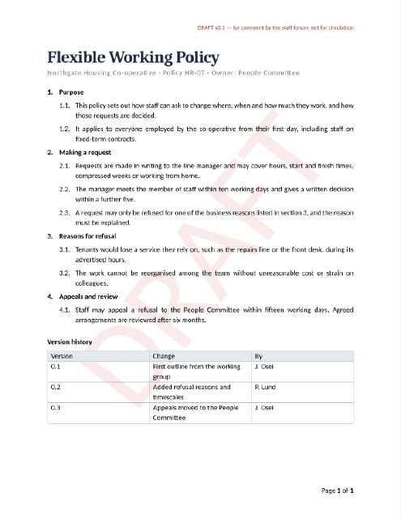

<!-- Generated by tools/gallery.mjs from showcase.yaml and build.json; do not edit. -->
# Draft Policy with Watermark

[Doc](../README.md) › [Newsletters & Layout](../README.md#newsletters--layout) · `watermark` `draft` `multilevel-list` `header` `table`

A policy draft stamped with a diagonal DRAFT watermark on every page, a status header, legal-style 1 / 1.1 / 1.2 section numbering and a version table.



| | |
|---|---|
| Document | [draft-watermark-policy.docx](draft-watermark-policy.docx) (9 KB) |
| Contents | 1 page; 213 words |
| Features | `doc.design.page`, `doc.lists.bullets-numbering`, `doc.headers.footers`, `doc.tables.edit`, `doc.styles.manage` |
| Built by | `kition-doc` @ `e6d2eae5d0`: 104 commands in 48 ms |

## About

The watermark is the document's own text watermark (drawn diagonally behind every page), so
removing it for the final version is one command. The header carries the status line, the
sections are numbered by a legal multilevel list (1, 1.1, 1.2, 2 …) whose second level is set
with the list level, and a small version table records who changed what.

## Checks

- `inspect.pages`: `{"count":1}`
- `inspect.words`: `{"min":200}`
- `results.header.story`: `{"exists":true}`
- `results.structure.blocks`: `{"any":{"list":{"level":1}}}`
- diagnostics: none (the kit's check finds nothing wrong)
- the saved document opens again; the thumbnail matches `thumb.png` within the `render` tolerance

## Steps

<details><summary>104 commands (from <a href="showcase.yaml">showcase.yaml</a>)</summary>

```yaml
- command: review.proofing
  as: proofing
- command: design.themeFonts
  params:
    heading: Caladea
    body: Carlito
- command: design.watermark
  params:
    text: DRAFT
    diagonal: true
    color: F2C4C4
  as: watermark
- command: styles.modify
  params:
    style: Normal
    chr:
      size: 11
    para:
      align: justify
      spaceBefore: 0
      spaceAfter: 6
      lineSpacing:
        rule: multiple
        value: 1.15
- command: styles.modify
  params:
    style: Title
    chr:
      size: 26
      bold: true
      color:
        Rgb:
          - 32
          - 45
          - 68
    para:
      align: left
      spaceAfter: 2
- command: styles.modify
  params:
    style: Subtitle
    chr:
      size: 11
      color:
        Rgb:
          - 120
          - 120
          - 120
    para:
      align: left
      spaceAfter: 14
- command: styles.create
  params:
    name: Clause
    basedOn: Normal
- command: styles.modify
  params:
    style: Clause
    para:
      spaceAfter: 5
- command: insert.header
  params:
    text: DRAFT v0.3 — for comment by the staff forum, not for circulation
  as: header
- command: select.paragraph
- command: format.size
  params:
    size: 9
- command: format.color
  params:
    color: B03030
- command: para.alignRight
- command: insert.closeHeader
- command: insert.pageNumber
  params:
    position: bottom
    align: right
    format: x of y
  as: footer
- command: insert.closeHeader
- command: para.style
  params:
    style: Title
- command: text.insert
  params:
    text: Flexible Working Policy
- command: text.newParagraph
- command: para.style
  params:
    style: Subtitle
- command: text.insert
  params:
    text: "Northgate Housing Co-operative · Policy HR-07 · Owner: People Committee"
- command: text.newParagraph
- command: para.style
  params:
    style: Clause
- command: para.multilevel
  params:
    kind: legal
  as: list
- command: format.bold
  params:
    value: true
- command: text.insert
  params:
    text: Purpose
- command: text.newParagraph
- command: format.bold
  params:
    value: false
- command: para.listLevel
  params:
    level: 1
- command: text.insert
  params:
    text: This policy sets out how staff can ask to change where, when and how much they work, and how those requests are decided.
- command: text.newParagraph
- command: text.insert
  params:
    text: It applies to everyone employed by the co-operative from their first day, including staff on fixed-term contracts.
- command: text.newParagraph
- command: para.listLevel
  params:
    level: 0
- command: format.bold
  params:
    value: true
- command: text.insert
  params:
    text: Making a request
- command: text.newParagraph
- command: format.bold
  params:
    value: false
- command: para.listLevel
  params:
    level: 1
- command: text.insert
  params:
    text: Requests are made in writing to the line manager and may cover hours, start and finish times, compressed weeks or working from home.
- command: text.newParagraph
- command: text.insert
  params:
    text: The manager meets the member of staff within ten working days and gives a written decision within a further five.
- command: text.newParagraph
- command: text.insert
  params:
    text: A request may only be refused for one of the business reasons listed in section 3, and the reason must be explained.
- command: text.newParagraph
- command: para.listLevel
  params:
    level: 0
- command: format.bold
  params:
    value: true
- command: text.insert
  params:
    text: Reasons for refusal
- command: text.newParagraph
- command: format.bold
  params:
    value: false
- command: para.listLevel
  params:
    level: 1
- command: text.insert
  params:
    text: Tenants would lose a service they rely on, such as the repairs line or the front desk, during its advertised hours.
- command: text.newParagraph
- command: text.insert
  params:
    text: The work cannot be reorganised among the team without unreasonable cost or strain on colleagues.
- command: text.newParagraph
- command: para.listLevel
  params:
    level: 0
- command: format.bold
  params:
    value: true
- command: text.insert
  params:
    text: Appeals and review
- command: text.newParagraph
- command: format.bold
  params:
    value: false
- command: para.listLevel
  params:
    level: 1
- command: text.insert
  params:
    text: Staff may appeal a refusal to the People Committee within fifteen working days. Agreed arrangements are reviewed after six months.
- command: text.newParagraph
- command: para.numbering
  params:
    off: true
- command: para.normal
- command: para.spacing
  params:
    before: 18
- command: format.bold
  params:
    value: true
- command: text.insert
  params:
    text: Version history
- command: text.newParagraph
- command: format.bold
  params:
    value: false
- command: para.spacing
  params:
    before: 0
- command: insert.table
  params:
    rows: 4
    cols: 3
  as: versions
- command: table.selectRow
- command: table.shading
  params:
    color: E4E8EF
- command: select.collapse
- command: text.insert
  params:
    text: Version
- command: text.tab
- command: text.insert
  params:
    text: Change
- command: text.tab
- command: text.insert
  params:
    text: By
- command: text.tab
- command: text.insert
  params:
    text: "0.1"
- command: text.tab
- command: text.insert
  params:
    text: First outline from the working group
- command: text.tab
- command: text.insert
  params:
    text: J. Osei
- command: text.tab
- command: text.insert
  params:
    text: "0.2"
- command: text.tab
- command: text.insert
  params:
    text: Added refusal reasons and timescales
- command: text.tab
- command: text.insert
  params:
    text: P. Lund
- command: text.tab
- command: text.insert
  params:
    text: "0.3"
- command: text.tab
- command: text.insert
  params:
    text: Appeals moved to the People Committee
- command: text.tab
- command: text.insert
  params:
    text: J. Osei
- command: table.selectTable
- command: table.borders
  params:
    kind: all
    width: 0.5
    color: A0A8B8
- command: para.spacing
  params:
    after: 0
- command: para.alignLeft
- command: caret.docEnd
- command: document.inspect
  as: structure
```

</details>
