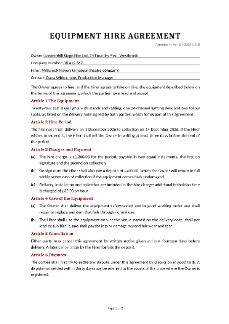

<!-- Generated by tools/gallery.mjs from showcase.yaml and build.json; do not edit. -->
# Equipment Hire Agreement

[Doc](../README.md) › [Contracts & Forms](../README.md#contracts--forms) · `contract` `numbering` `a4` `signature-block` `tab-stops` `header-footer`

A stage-equipment hire agreement whose Article 1, Article 2 … headings are numbered by a list linked to the article-heading style, with party lines, lettered sub-items and a borderless signature block.



| | |
|---|---|
| Document | [equipment-hire-agreement.docx](equipment-hire-agreement.docx) (10 KB) |
| Contents | 2 pages; 381 words |
| Features | `doc.lists.bullets-numbering`, `doc.styles.manage`, `doc.tables.edit`, `doc.headers.footers`, `doc.format.character` |
| Built by | `kition-doc` @ `1b00044864`: 136 commands in 141 ms |

## About

Every article heading uses one paragraph style, Article Heading, and a list whose level text
is "Article %1" is linked to that style — so the articles number themselves Article 1,
Article 2, Article 3 … and renumber if one is added. The parties are filled in on underlined
tab stops, as on a printed form, sub-items are lettered (a), (b), (c), the footer counts
"Page 1 of 2" with PAGE and NUMPAGES fields, and the signatures sit in a two-column table
without borders. Set in Caladea and Carlito, loaded with the sample.

## Checks

- `inspect.pages`: `{"count":2}`
- `results.articles.num`: `{"exists":true}`
- `results.count.words`: `{"min":350}`
- `results.footer.story`: `{"exists":true}`
- diagnostics: none (the kit's check finds nothing wrong)
- the saved document opens again; the thumbnail matches `thumb.png` within the `render` tolerance

## Steps

<details><summary>136 commands (from <a href="showcase.yaml">showcase.yaml</a>)</summary>

```yaml
- command: review.proofing
  as: proofing
- command: layout.size
  params:
    name: A4
- command: layout.margins
  params:
    top: 72
    bottom: 68
    left: 80
    right: 76
- command: design.themeFonts
  params:
    heading: Caladea
    body: Carlito
- command: styles.modify
  params:
    style: Normal
    chr:
      size: 11
    para:
      align: justify
      spaceBefore: 0
      spaceAfter: 4
      lineSpacing:
        rule: multiple
        value: 1.2
- command: styles.modify
  params:
    style: Title
    chr:
      font: Caladea
      size: 22
      bold: true
      spacing: 1.5
      color:
        Rgb:
          - 20
          - 20
          - 20
    para:
      align: center
      spaceBefore: 8
      spaceAfter: 4
- command: styles.create
  params:
    name: Agreement Number
    basedOn: Normal
- command: styles.modify
  params:
    style: Agreement Number
    chr:
      size: 9.5
      color:
        Rgb:
          - 100
          - 100
          - 100
    para:
      align: right
      spaceAfter: 14
- command: styles.create
  params:
    name: Party
    basedOn: Normal
- command: styles.modify
  params:
    style: Party
    para:
      spaceAfter: 3
      tabs:
        - pos: 439
          align: left
- command: styles.create
  params:
    name: Article Heading
    basedOn: Normal
- command: styles.modify
  params:
    style: Article Heading
    chr:
      font: Caladea
      size: 11.5
      bold: true
      color:
        Rgb:
          - 140
          - 20
          - 20
    para:
      align: left
      spaceBefore: 9
      spaceAfter: 3
      keepNext: true
- command: styles.create
  params:
    name: Article Text
    basedOn: Normal
- command: styles.modify
  params:
    style: Article Text
    para:
      indentLeft: 0
- command: styles.create
  params:
    name: Article Item
    basedOn: Normal
- command: styles.modify
  params:
    style: Article Item
    para:
      indentLeft: 22
      indentFirst: -22
      tabs:
        - pos: 22
          align: left
- command: list.define
  params:
    name: Agreement Articles
    apply: false
    levels:
      - format: decimal
        text: Article %1
        follow: space
        alignedAt: 0
        indentAt: 0
        style: Article Heading
  as: articles
- command: insert.footer
  params:
    text: ""
  as: footer
- command: para.alignCenter
- command: format.size
  params:
    size: 9
- command: text.insert
  params:
    text: "Page "
- command: insert.field
  params:
    instr: PAGE
    result: "1"
- command: text.insert
  params:
    text: " of "
- command: insert.field
  params:
    instr: NUMPAGES
    result: "2"
- command: insert.closeHeader
- command: para.style
  params:
    style: Title
- command: text.insert
  params:
    text: EQUIPMENT HIRE AGREEMENT
- command: text.newParagraph
- command: para.style
  params:
    style: Agreement Number
- command: text.insert
  params:
    text: Agreement No. EH-2026-0318
- command: text.newParagraph
- command: para.style
  params:
    style: Party
- command: text.insert
  params:
    text: "Owner:"
- command: text.insert
  params:
    text: " Lanternhill Stage Hire Ltd, 14 Foundry Yard, Westbrook"
- command: text.tab
- command: text.newParagraph
- command: text.insert
  params:
    text: "Company number:"
- command: text.insert
  params:
    text: " 08 412 667"
- command: text.tab
- command: text.newParagraph
- command: text.insert
  params:
    text: "Hirer:"
- command: text.insert
  params:
    text: " Millbrook Players (amateur theatre company)"
- command: text.tab
- command: text.newParagraph
- command: text.insert
  params:
    text: "Contact:"
- command: text.insert
  params:
    text: " Dana Whitcombe, Production Manager"
- command: text.tab
- command: text.newParagraph
- command: para.style
  params:
    style: Article Text
- command: para.spacing
  params:
    before: 8
- command: text.insert
  params:
    text: The Owner agrees to hire, and the Hirer agrees to take on hire, the equipment described below on the terms of this agreement, which the parties have read and accept.
- command: text.newParagraph
- command: para.spacing
  params:
    before: 0
- command: para.style
  params:
    style: Article Heading
- command: text.insert
  params:
    text: The Equipment
- command: text.newParagraph
- command: para.style
  params:
    style: Article Text
- command: text.insert
  params:
    text: Twenty-four LED stage lights with stands and cabling, one 24-channel lighting desk and two follow spots, as listed on the delivery note signed by both parties, which forms part of this agreement.
- command: text.newParagraph
- command: para.style
  params:
    style: Article Heading
- command: text.insert
  params:
    text: Hire Period
- command: text.newParagraph
- command: para.style
  params:
    style: Article Text
- command: text.insert
  params:
    text: The hire runs from delivery on 1 December 2026 to collection on 14 December 2026. If the Hirer wishes to extend it, the Hirer shall tell the Owner in writing at least three days before the end of the period.
- command: text.newParagraph
- command: para.style
  params:
    style: Article Heading
- command: text.insert
  params:
    text: Charges and Payment
- command: text.newParagraph
- command: para.style
  params:
    style: Article Item
- command: text.insert
  params:
    text: (a)	The hire charge is £1,260.00 for the period, payable in two equal instalments, the first on signature and the second on collection.
- command: text.newParagraph
- command: text.insert
  params:
    text: (b)	On signature the Hirer shall also pay a deposit of £400.00, which the Owner will return in full within seven days of collection if the equipment comes back undamaged.
- command: text.newParagraph
- command: text.insert
  params:
    text: (c)	Delivery, installation and collection are included in the hire charge; additional technician time is charged at £35.00 an hour.
- command: text.newParagraph
- command: para.style
  params:
    style: Article Heading
- command: text.insert
  params:
    text: Care of the Equipment
- command: text.newParagraph
- command: para.style
  params:
    style: Article Item
- command: text.insert
  params:
    text: (a)	The Owner shall deliver the equipment safety-tested and in good working order and shall repair or replace any item that fails through normal use.
- command: text.newParagraph
- command: text.insert
  params:
    text: (b)	The Hirer shall use the equipment only at the venue named on the delivery note, shall not lend or sub-hire it, and shall pay for loss or damage beyond fair wear and tear.
- command: text.newParagraph
- command: para.style
  params:
    style: Article Heading
- command: text.insert
  params:
    text: Cancellation
- command: text.newParagraph
- command: para.style
  params:
    style: Article Text
- command: text.insert
  params:
    text: Either party may cancel this agreement by written notice given at least fourteen days before delivery. A later cancellation by the Hirer forfeits the deposit.
- command: text.newParagraph
- command: para.style
  params:
    style: Article Heading
- command: text.insert
  params:
    text: Disputes
- command: text.newParagraph
- command: para.style
  params:
    style: Article Text
- command: text.insert
  params:
    text: The parties shall first try to settle any dispute under this agreement by discussion in good faith. A dispute not settled within thirty days may be referred to the courts of the place where the Owner is registered.
- command: text.newParagraph
- command: para.style
  params:
    style: Article Heading
- command: text.insert
  params:
    text: General
- command: text.newParagraph
- command: para.style
  params:
    style: Article Text
- command: text.insert
  params:
    text: This agreement is made in two copies, one for each party, and takes effect on the date it is signed by both parties.
- command: para.spacing
  params:
    after: 30
- command: text.newParagraph
- command: para.normal
- command: para.spacing
  params:
    before: 0
    after: 0
- command: insert.table
  params:
    rows: 4
    cols: 2
    style: Normal Table
  as: signatures
- command: text.insert
  params:
    text: For the Owner
- command: text.tab
- command: text.insert
  params:
    text: For the Hirer
- command: text.tab
- command: text.insert
  params:
    text: "Signature: ____________________________"
- command: text.tab
- command: text.insert
  params:
    text: "Signature: ____________________________"
- command: text.tab
- command: text.insert
  params:
    text: "Name and title: ________________________"
- command: text.tab
- command: text.insert
  params:
    text: "Name and title: ________________________"
- command: text.tab
- command: text.insert
  params:
    text: "Date: ________________________________"
- command: text.tab
- command: text.insert
  params:
    text: "Date: ________________________________"
- command: table.selectTable
- command: table.rowHeight
  params:
    height: 34
    rule: atLeast
- command: select.text
  params:
    text: For the Owner
- command: format.bold
  params:
    value: true
- command: select.text
  params:
    text: For the Hirer
- command: format.bold
  params:
    value: true
- command: select.text
  params:
    text: " Lanternhill Stage Hire Ltd, 14 Foundry Yard, Westbrook\t"
- command: format.set
  params:
    props:
      underline: single
- command: select.text
  params:
    text: " 08 412 667\t"
- command: format.set
  params:
    props:
      underline: single
- command: select.text
  params:
    text: " Millbrook Players (amateur theatre company)\t"
- command: format.set
  params:
    props:
      underline: single
- command: select.text
  params:
    text: " Dana Whitcombe, Production Manager\t"
- command: format.set
  params:
    props:
      underline: single
- command: caret.docEnd
- command: review.wordCount
  as: count
```

</details>
