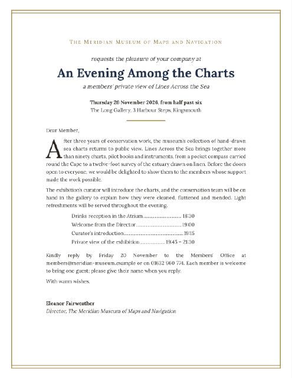

<!-- Generated by tools/gallery.mjs from showcase.yaml and build.json; do not edit. -->
# Members' Evening Invitation

[Doc](../README.md) › [Letters & Memos](../README.md#letters--memos) · `invitation` `letter` `page-border` `drop-cap` `tab-stops`

A centred invitation letter inside a double page border, with a drop cap, an evening programme on dotted tab leaders and an RSVP line.



| | |
|---|---|
| Document | [event-invitation-letter.docx](event-invitation-letter.docx) (7 KB) |
| Contents | 1 page; 217 words |
| Features | `doc.text.typing`, `doc.format.character`, `doc.format.paragraph`, `doc.design.page`, `doc.insert.objects`, `doc.layout.page-setup` |
| Built by | `kition-doc` @ `e6d2eae5d0`: 98 commands in 38 ms |

## About

An invitation set in Lora: small spaced capitals for the museum's name, a large title, a
double page border in muted gold and a justified letter that opens with a three-line drop cap.
The programme is a block of paragraphs indented from both sides with a right tab stop and a
dot leader, so the times line up however long each item is.

## Checks

- `inspect.pages`: `{"count":1}`
- `inspect.words`: `{"min":190,"max":260}`
- `results.section.pageBorders`: `{"exists":true}`
- `results.structure.blocks`: `{"any":{"props":{"dropCap":3}}}`
- diagnostics: none (the kit's check finds nothing wrong)
- the saved document opens again; the thumbnail matches `thumb.png` within the `render` tolerance

## Steps

<details><summary>98 commands (from <a href="showcase.yaml">showcase.yaml</a>)</summary>

```yaml
- command: review.proofing
- command: design.themeFonts
  params:
    heading: Lora
    body: Lora
- command: styles.modify
  params:
    style: Normal
    chr:
      size: 10.5
      color:
        Rgb:
          - 43
          - 38
          - 33
    para:
      spaceAfter: 6
      lineSpacing:
        rule: multiple
        value: 1.2
- command: layout.margins
  params:
    top: 80
    bottom: 64
    left: 96
    right: 96
- command: design.pageBorders
  params:
    kind: box
    style: double
    width: 3
    color: A88B4A
- command: para.alignCenter
- command: para.spacing
  params:
    after: 18
- command: text.insert
  params:
    text: The Meridian Museum of Maps and Navigation
- command: select.paragraph
- command: format.set
  params:
    props:
      smallCaps: true
      size: 11
      spacing: 2
- command: format.color
  params:
    color: 8A6D2F
- command: caret.docEnd
- command: text.newParagraph
- command: para.spacing
  params:
    after: 2
- command: styles.inspectorClear
  params:
    level: characterFormatting
- command: text.insert
  params:
    text: requests the pleasure of your company at
- command: select.paragraph
- command: format.set
  params:
    props:
      italic: true
      size: 12
- command: caret.docEnd
- command: text.newParagraph
- command: styles.inspectorClear
  params:
    level: characterFormatting
- command: para.spacing
  params:
    after: 4
- command: para.lineSpacing
  params:
    value: 1
- command: text.insert
  params:
    text: An Evening Among the Charts
- command: select.paragraph
- command: format.set
  params:
    props:
      size: 26
      bold: true
- command: format.color
  params:
    color: 1F2F4A
- command: caret.docEnd
- command: text.newParagraph
- command: styles.inspectorClear
  params:
    level: characterFormatting
- command: para.lineSpacing
  params:
    value: 1.2
- command: para.spacing
  params:
    after: 16
- command: text.insert
  params:
    text: a members’ private view of Lines Across the Sea
- command: select.paragraph
- command: format.set
  params:
    props:
      italic: true
      size: 12
- command: caret.docEnd
- command: text.newParagraph
- command: styles.inspectorClear
  params:
    level: characterFormatting
- command: para.spacing
  params:
    after: 0
- command: text.insert
  params:
    text: Thursday 26 November 2026, from half past six
- command: select.paragraph
- command: format.bold
  params:
    value: true
- command: caret.docEnd
- command: text.newParagraph
- command: styles.inspectorClear
  params:
    level: characterFormatting
- command: para.spacing
  params:
    after: 6
- command: text.insert
  params:
    text: The Long Gallery, 3 Harbour Steps, Kingsmouth
- command: text.newParagraph
- command: para.indents
  params:
    left: 170
    right: 170
- command: para.lineSpacing
  params:
    exactly: 6
- command: para.borders
  params:
    kind: bottom
    width: 1.5
    color: A88B4A
- command: text.newParagraph
- command: styles.inspectorClear
  params:
    level: paragraphFormatting
- command: para.spacing
  params:
    before: 12
- command: text.insert
  params:
    text: Dear Member,
- command: text.newParagraph
- command: para.spacing
  params:
    before: 0
- command: para.justify
- command: text.insert
  params:
    text: After three years of conservation work, the museum’s collection of hand-drawn sea charts returns to public view. Lines Across the Sea brings together more than ninety charts, pilot books and instruments, from a pocket compass carried round the Cape to a twelve-foot survey of the estuary drawn on linen. Before the doors open to everyone, we would be delighted to show them to the members whose support made the work possible.
- command: insert.dropCap
  params:
    lines: 3
- command: text.newParagraph
- command: insert.dropCap
  params:
    lines: 0
- command: text.insert
  params:
    text: The exhibition’s curator will introduce the charts, and the conservation team will be on hand in the gallery to explain how they were cleaned, flattened and mended. Light refreshments will be served throughout the evening.
- command: text.newParagraph
- command: para.alignLeft
- command: para.indents
  params:
    left: 54
    right: 54
- command: para.tabs
  params:
    set:
      - pos: 312
        align: right
        leader: dot
- command: para.spacing
  params:
    before: 6
    after: 2
- command: text.insert
  params:
    text: Drinks reception in the Atrium	18:30
- command: text.newParagraph
- command: para.spacing
  params:
    before: 0
    after: 2
- command: text.insert
  params:
    text: Welcome from the Director	19:00
- command: text.newParagraph
- command: text.insert
  params:
    text: Curator’s introduction	19:15
- command: text.newParagraph
- command: para.spacing
  params:
    before: 0
    after: 12
- command: text.insert
  params:
    text: Private view of the exhibition	19:45 – 21:30
- command: text.newParagraph
- command: styles.inspectorClear
  params:
    level: paragraphFormatting
- command: para.justify
- command: text.insert
  params:
    text: Kindly reply by Friday 20 November to the Members’ Office at members@meridian-museum.example or on 01632 960 774. Each member is welcome to bring one guest; please give their name when you reply.
- command: text.newParagraph
- command: para.alignLeft
- command: para.spacing
  params:
    before: 6
    after: 30
- command: text.insert
  params:
    text: With warm wishes,
- command: text.newParagraph
- command: para.spacing
  params:
    before: 0
    after: 0
- command: text.insert
  params:
    text: Eleanor Fairweather
- command: select.paragraph
- command: format.bold
  params:
    value: true
- command: caret.docEnd
- command: text.newParagraph
- command: styles.inspectorClear
  params:
    level: characterFormatting
- command: text.insert
  params:
    text: Director, The Meridian Museum of Maps and Navigation
- command: select.paragraph
- command: format.italic
  params:
    value: true
- command: layout.section
  as: section
- command: document.inspect
  as: structure
```

</details>
