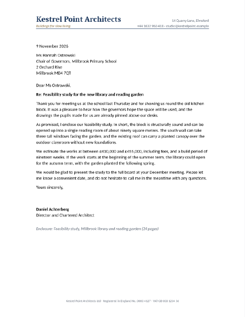

<!-- Generated by tools/gallery.mjs from showcase.yaml and build.json; do not edit. -->
# Formal Business Letter

[Doc](../README.md) › [Letters & Memos](../README.md#letters--memos) · `letter` `header-footer` `letterhead` `tab-stops`

A one-page letter on letterhead, with a ruled header, an address block, a subject line and a signature block.



| | |
|---|---|
| Document | [formal-business-letter.docx](formal-business-letter.docx) (9 KB) |
| Contents | 1 page; 233 words |
| Features | `doc.text.typing`, `doc.format.character`, `doc.format.paragraph`, `doc.headers.footers` |
| Built by | `kition-doc` @ `e6d2eae5d0`: 71 commands in 32 ms |

## About

The letterhead lives in the page header: the practice's name on the left and its address pushed
to the right margin by a right-aligned tab stop, over a thin rule drawn as a paragraph border.
The footer carries the registration line in small grey type. The body is plain Normal text with
block spacing, a bold subject line and room for a handwritten signature.

## Checks

- `inspect.pages`: `{"count":1}`
- `inspect.words`: `{"min":200,"max":300}`
- `results.section.headers.default`: `{"exists":true}`
- diagnostics: none (the kit's check finds nothing wrong)
- the saved document opens again; the thumbnail matches `thumb.png` within the `render` tolerance

## Steps

<details><summary>71 commands (from <a href="showcase.yaml">showcase.yaml</a>)</summary>

```yaml
- command: review.proofing
- command: design.themeFonts
  params:
    heading: Caladea
    body: Carlito
- command: styles.modify
  params:
    style: Normal
    chr:
      size: 11
    para:
      spaceAfter: 8
      lineSpacing:
        rule: multiple
        value: 1.1
- command: layout.margins
  params:
    top: 108
    bottom: 72
    left: 90
    right: 90
- command: text.insert
  params:
    text: 9 November 2026
- command: text.newParagraph
- command: para.spacing
  params:
    after: 0
- command: text.insert
  params:
    text: Ms Hannah Ostrowski
- command: text.newParagraph
- command: text.insert
  params:
    text: Chair of Governors, Millbrook Primary School
- command: text.newParagraph
- command: text.insert
  params:
    text: 2 Orchard Rise
- command: text.newParagraph
- command: para.spacing
  params:
    after: 16
- command: text.insert
  params:
    text: Millbrook MB4 7QT
- command: text.newParagraph
- command: para.spacing
  params:
    after: 8
- command: text.insert
  params:
    text: Dear Ms Ostrowski,
- command: text.newParagraph
- command: format.bold
  params:
    value: true
- command: text.insert
  params:
    text: "Re: Feasibility study for the new library and reading garden"
- command: format.bold
  params:
    value: false
- command: text.newParagraph
- command: text.insert
  params:
    text: Thank you for meeting us at the school last Thursday and for showing us round the old kitchen block. It was a pleasure to hear how the governors hope the space will be used, and the drawings the pupils made for us are already pinned above our desks.
- command: text.newParagraph
- command: text.insert
  params:
    text: As promised, I enclose our feasibility study. In short, the block is structurally sound and can be opened up into a single reading room of about ninety square metres. The south wall can take three tall windows facing the garden, and the existing roof can carry a planted canopy over the outdoor classroom without new foundations.
- command: text.newParagraph
- command: text.insert
  params:
    text: We estimate the works at between £410,000 and £455,000, including fees, and a build period of nineteen weeks. If the work starts at the beginning of the summer term, the library could open for the autumn term, with the garden planted the following spring.
- command: text.newParagraph
- command: text.insert
  params:
    text: We would be glad to present the study to the full board at your December meeting. Please let me know a convenient date, and do not hesitate to call me in the meantime with any questions.
- command: text.newParagraph
- command: para.spacing
  params:
    after: 40
- command: text.insert
  params:
    text: Yours sincerely,
- command: text.newParagraph
- command: para.spacing
  params:
    after: 0
- command: format.bold
  params:
    value: true
- command: text.insert
  params:
    text: Daniel Achterberg
- command: format.bold
  params:
    value: false
- command: text.newParagraph
- command: para.spacing
  params:
    after: 20
- command: text.insert
  params:
    text: Director and Chartered Architect
- command: text.newParagraph
- command: format.set
  params:
    props:
      italic: true
      size: 10
- command: format.color
  params:
    color: 5A6472
- command: text.insert
  params:
    text: "Enclosure: Feasibility study, Millbrook library and reading garden (24 pages)"
- command: insert.editHeader
- command: para.tabs
  params:
    clear:
      - 234
      - 468
    set:
      - pos: 432
        align: right
- command: format.set
  params:
    props:
      font: Caladea
      size: 20
      bold: true
      italic: false
- command: format.color
  params:
    color: 1F3A5F
- command: text.insert
  params:
    text: Kestrel Point Architects
- command: format.set
  params:
    props:
      font: Carlito
      size: 9
      bold: false
- command: format.color
  params:
    color: 5A6472
- command: text.insert
  params:
    text: "\t14 Quarry Lane, Elmsford"
- command: text.newParagraph
- command: para.tabs
  params:
    clear:
      - 234
      - 468
    set:
      - pos: 432
        align: right
- command: format.set
  params:
    props:
      font: Carlito
      size: 9
      bold: false
      italic: true
- command: format.color
  params:
    color: 8A6D3B
- command: text.insert
  params:
    text: Buildings for slow living
- command: format.set
  params:
    props:
      italic: false
- command: format.color
  params:
    color: 5A6472
- command: text.insert
  params:
    text: "\t+44 1632 960 418 · studio@kestrelpoint.example"
- command: para.borders
  params:
    kind: bottom
    width: 1
    color: 1F3A5F
- command: para.spacing
  params:
    after: 0
- command: insert.closeHeader
- command: insert.editFooter
- command: para.alignCenter
- command: format.set
  params:
    props:
      font: Carlito
      size: 8
      bold: false
      italic: false
- command: format.color
  params:
    color: 6B7380
- command: text.insert
  params:
    text: Kestrel Point Architects Ltd · Registered in England No. 0000 4127 · VAT GB 000 1234 56
- command: insert.closeHeader
- command: layout.section
  as: section
```

</details>
