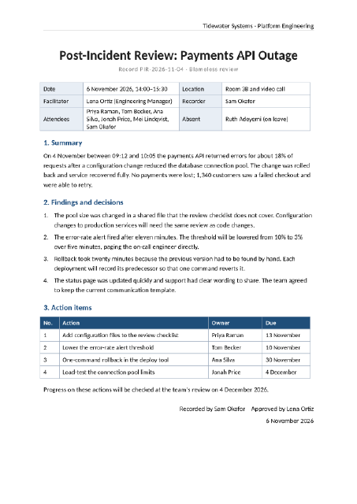

<!-- Generated by tools/gallery.mjs from showcase.yaml and build.json; do not edit. -->
# Post-Incident Review Record

[Doc](../README.md) › [Reports & Proposals](../README.md#reports--proposals) · `minutes` `incident-review` `table` `a4` `header-footer`

The written record of an engineering team's post-incident review on A4 — a shaded details grid, numbered findings and decisions, and an action-item table with owners and due dates.



| | |
|---|---|
| Document | [incident-review-record.docx](incident-review-record.docx) (9 KB) |
| Contents | 1 page; 283 words |
| Features | `doc.tables.edit`, `doc.format.paragraph`, `doc.styles.manage`, `doc.headers.footers` |
| Built by | `kition-doc` @ `1b00044864`: 163 commands in 149 ms |

## About

A platform team writes up the review meeting held after a service outage: a centred title
and record number, a four-column details grid whose label cells are shaded, a short summary,
numbered findings and decisions on hanging indents, and an action table with a navy header
row. A running header carries the team's name over a hairline rule. Set in Carlito, loaded
with the sample.

## Checks

- `inspect.pages`: `{"count":1}`
- `results.count.words`: `{"min":260}`
- `results.header.story`: `{"exists":true}`
- diagnostics: none (the kit's check finds nothing wrong)
- the saved document opens again; the thumbnail matches `thumb.png` within the `render` tolerance

## Steps

<details><summary>163 commands (from <a href="showcase.yaml">showcase.yaml</a>)</summary>

```yaml
- command: review.proofing
  as: proofing
- command: layout.size
  params:
    name: A4
- command: layout.margins
  params:
    top: 72
    bottom: 64
    left: 72
    right: 72
- command: design.themeFonts
  params:
    heading: Carlito
    body: Carlito
- command: styles.modify
  params:
    style: Normal
    chr:
      size: 11
    para:
      align: left
      spaceBefore: 0
      spaceAfter: 4
      lineSpacing:
        rule: multiple
        value: 1.2
- command: styles.modify
  params:
    style: Title
    chr:
      size: 22
      bold: true
      spacing: 0
      color:
        Rgb:
          - 30
          - 30
          - 30
    para:
      align: center
      spaceBefore: 6
      spaceAfter: 4
- command: styles.modify
  params:
    style: Subtitle
    chr:
      size: 10
      color:
        Rgb:
          - 110
          - 110
          - 110
    para:
      align: center
      spaceAfter: 14
- command: styles.modify
  params:
    style: Heading 1
    chr:
      size: 13
      bold: true
      color:
        Rgb:
          - 20
          - 70
          - 120
    para:
      align: left
      spaceBefore: 12
      spaceAfter: 4
- command: styles.create
  params:
    name: Numbered Point
    basedOn: Normal
- command: styles.modify
  params:
    style: Numbered Point
    para:
      indentLeft: 18
      indentFirst: -18
      tabs:
        - pos: 18
          align: left
- command: styles.create
  params:
    name: Table Text
    basedOn: Normal
- command: styles.modify
  params:
    style: Table Text
    chr:
      size: 10.5
    para:
      spaceAfter: 0
      lineSpacing:
        rule: multiple
        value: 1
- command: insert.header
  params:
    text: Tidewater Systems · Platform Engineering
  as: header
- command: para.alignRight
- command: para.borders
  params:
    kind: bottom
    width: 0.5
    color: "999999"
- command: insert.closeHeader
- command: para.style
  params:
    style: Title
- command: text.insert
  params:
    text: "Post-Incident Review: Payments API Outage"
- command: text.newParagraph
- command: para.style
  params:
    style: Subtitle
- command: text.insert
  params:
    text: Record PIR-2026-11-04 · Blameless review
- command: text.newParagraph
- command: para.style
  params:
    style: Table Text
- command: insert.table
  params:
    rows: 3
    cols: 4
  as: details
- command: table.columnWidth
  params:
    width: 72
- command: text.insert
  params:
    text: Date
- command: table.selectCell
- command: table.shading
  params:
    color: E8EEF5
- command: select.collapse
- command: text.tab
- command: table.columnWidth
  params:
    width: 160
- command: text.insert
  params:
    text: 6 November 2026, 14:00–15:30
- command: text.tab
- command: table.columnWidth
  params:
    width: 72
- command: text.insert
  params:
    text: Location
- command: table.selectCell
- command: table.shading
  params:
    color: E8EEF5
- command: select.collapse
- command: text.tab
- command: table.columnWidth
  params:
    width: 147
- command: text.insert
  params:
    text: Room 3B and video call
- command: text.tab
- command: text.insert
  params:
    text: Facilitator
- command: table.selectCell
- command: table.shading
  params:
    color: E8EEF5
- command: select.collapse
- command: text.tab
- command: text.insert
  params:
    text: Lena Ortiz (Engineering Manager)
- command: text.tab
- command: text.insert
  params:
    text: Recorder
- command: table.selectCell
- command: table.shading
  params:
    color: E8EEF5
- command: select.collapse
- command: text.tab
- command: text.insert
  params:
    text: Sam Okafor
- command: text.tab
- command: text.insert
  params:
    text: Attendees
- command: table.selectCell
- command: table.shading
  params:
    color: E8EEF5
- command: select.collapse
- command: text.tab
- command: text.insert
  params:
    text: Priya Raman, Tom Becker, Ana Silva, Jonah Price, Mei Lindqvist, Sam Okafor
- command: text.tab
- command: text.insert
  params:
    text: Absent
- command: table.selectCell
- command: table.shading
  params:
    color: E8EEF5
- command: select.collapse
- command: text.tab
- command: text.insert
  params:
    text: Ruth Adeyemi (on leave)
- command: table.selectTable
- command: table.borders
  params:
    kind: all
    width: 0.5
    color: 9AA9BC
- command: para.style
  params:
    style: Table Text
- command: table.cellAlign
  params:
    value: centerLeft
- command: table.rowHeight
  params:
    height: 20
    rule: atLeast
- command: caret.docEnd
- command: para.heading1
- command: text.insert
  params:
    text: 1. Summary
- command: text.newParagraph
- command: para.normal
- command: text.insert
  params:
    text: On 4 November between 09:12 and 10:05 the payments API returned errors for about 18% of requests after a configuration change reduced the database connection pool. The change was rolled back and service recovered fully. No payments were lost; 1,340 customers saw a failed checkout and were able to retry.
- command: text.newParagraph
- command: para.heading1
- command: text.insert
  params:
    text: 2. Findings and decisions
- command: text.newParagraph
- command: para.style
  params:
    style: Numbered Point
- command: text.insert
  params:
    text: 1.	The pool size was changed in a shared file that the review checklist does not cover. Configuration changes to production services will need the same review as code changes.
- command: text.newParagraph
- command: text.insert
  params:
    text: 2.	The error-rate alert fired after eleven minutes. The threshold will be lowered from 10% to 3% over five minutes, paging the on-call engineer directly.
- command: text.newParagraph
- command: text.insert
  params:
    text: 3.	Rollback took twenty minutes because the previous version had to be found by hand. Each deployment will record its predecessor so that one command reverts it.
- command: text.newParagraph
- command: text.insert
  params:
    text: 4.	The status page was updated quickly and support had clear wording to share. The team agreed to keep the current communication template.
- command: text.newParagraph
- command: para.heading1
- command: text.insert
  params:
    text: 3. Action items
- command: text.newParagraph
- command: para.style
  params:
    style: Table Text
- command: insert.table
  params:
    rows: 5
    cols: 4
  as: actions
- command: table.selectRow
- command: table.shading
  params:
    color: 1F4E79
- command: format.color
  params:
    color: FFFFFF
- command: format.bold
  params:
    value: true
- command: select.collapse
- command: table.columnWidth
  params:
    width: 32
- command: text.insert
  params:
    text: No.
- command: text.tab
- command: table.columnWidth
  params:
    width: 249
- command: text.insert
  params:
    text: Action
- command: text.tab
- command: table.columnWidth
  params:
    width: 90
- command: text.insert
  params:
    text: Owner
- command: text.tab
- command: table.columnWidth
  params:
    width: 80
- command: text.insert
  params:
    text: Due
- command: text.tab
- command: text.insert
  params:
    text: "1"
- command: text.tab
- command: text.insert
  params:
    text: Add configuration files to the review checklist
- command: text.tab
- command: text.insert
  params:
    text: Priya Raman
- command: text.tab
- command: text.insert
  params:
    text: 13 November
- command: text.tab
- command: text.insert
  params:
    text: "2"
- command: text.tab
- command: text.insert
  params:
    text: Lower the error-rate alert threshold
- command: text.tab
- command: text.insert
  params:
    text: Tom Becker
- command: text.tab
- command: text.insert
  params:
    text: 10 November
- command: text.tab
- command: text.insert
  params:
    text: "3"
- command: text.tab
- command: text.insert
  params:
    text: One-command rollback in the deploy tool
- command: text.tab
- command: text.insert
  params:
    text: Ana Silva
- command: text.tab
- command: text.insert
  params:
    text: 30 November
- command: text.tab
- command: text.insert
  params:
    text: "4"
- command: text.tab
- command: text.insert
  params:
    text: Load-test the connection pool limits
- command: text.tab
- command: text.insert
  params:
    text: Jonah Price
- command: text.tab
- command: text.insert
  params:
    text: 4 December
- command: table.selectTable
- command: table.borders
  params:
    kind: all
    width: 0.5
    color: 9AA9BC
- command: para.style
  params:
    style: Table Text
- command: table.cellAlign
  params:
    value: centerLeft
- command: table.rowHeight
  params:
    height: 20
    rule: atLeast
- command: caret.docEnd
- command: para.normal
- command: para.spacing
  params:
    before: 12
- command: text.insert
  params:
    text: Progress on these actions will be checked at the team's review on 4 December 2026.
- command: text.newParagraph
- command: para.alignRight
- command: para.spacing
  params:
    before: 16
- command: text.insert
  params:
    text: Recorded by Sam Okafor    Approved by Lena Ortiz
- command: text.newParagraph
- command: para.spacing
  params:
    before: 0
- command: text.insert
  params:
    text: 6 November 2026
- command: review.wordCount
  as: count
```

</details>
