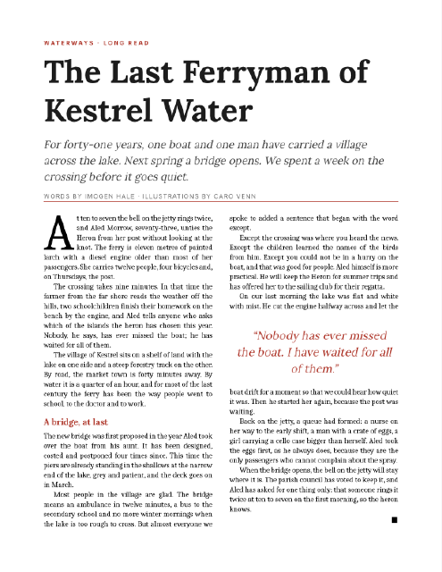

<!-- Generated by tools/gallery.mjs from showcase.yaml and build.json; do not edit. -->
# Magazine Feature Spread

[Doc](../README.md) › [Newsletters & Layout](../README.md#newsletters--layout) · `magazine` `drop-cap` `columns` `text-box` `typography`

A magazine feature page — oversized serif headline, italic standfirst and byline, a four-line drop cap, two justified columns and a pull quote floating between them.



| | |
|---|---|
| Document | [magazine-feature.docx](magazine-feature.docx) (9 KB) |
| Contents | 1 page; 557 words |
| Features | `doc.format.paragraph`, `doc.layout.page-setup`, `doc.drawing.objects`, `doc.layout.float-position`, `doc.styles.manage` |
| Built by | `kition-doc` @ `e6d2eae5d0`: 68 commands in 69 ms |

## About

The headline, standfirst and byline run across the page; a continuous section break turns the
story into two justified, hyphenated columns. The first paragraph opens with a four-line drop
cap, a crosshead breaks the story halfway, and the pull quote is a floating text box set
in the second column with top-and-bottom wrapping, so the column breaks above it and resumes below.

## Checks

- `inspect.pages`: `{"count":1}`
- `inspect.words`: `{"min":540}`
- `results.columns.columns.count`: `2`
- `results.drawings.objects`: `{"count":1,"all":{"kind":"textBox"}}`
- diagnostics: none (the kit's check finds nothing wrong)
- the saved document opens again; the thumbnail matches `thumb.png` within the `render` tolerance

## Steps

<details><summary>68 commands (from <a href="showcase.yaml">showcase.yaml</a>)</summary>

```yaml
- command: review.proofing
  as: proofing
- command: design.themeFonts
  params:
    heading: Lora
    body: Caladea
- command: layout.margins
  params:
    top: 54
    bottom: 54
    left: 60
    right: 60
- command: layout.hyphenation
  as: hyphenation
- command: styles.modify
  params:
    style: Normal
    chr:
      size: 10.5
    para:
      align: justify
      spaceBefore: 0
      spaceAfter: 0
      indentFirst: 14
      lineSpacing:
        rule: multiple
        value: 1.12
- command: styles.create
  params:
    name: Section Tag
    basedOn: Normal
- command: styles.modify
  params:
    style: Section Tag
    chr:
      font: Inter
      size: 8
      bold: true
      caps: true
      spacing: 2
      color:
        Rgb:
          - 176
          - 58
          - 46
    para:
      align: left
      indentFirst: 0
      spaceAfter: 8
- command: styles.create
  params:
    name: Headline
    basedOn: Normal
- command: styles.modify
  params:
    style: Headline
    chr:
      font: Lora
      size: 44
      bold: true
      color:
        Rgb:
          - 28
          - 28
          - 28
    para:
      align: left
      indentFirst: 0
      spaceAfter: 10
      lineSpacing:
        rule: multiple
        value: 0.95
- command: styles.create
  params:
    name: Standfirst
    basedOn: Normal
- command: styles.modify
  params:
    style: Standfirst
    chr:
      font: Lora
      size: 15
      italic: true
      color:
        Rgb:
          - 70
          - 70
          - 70
    para:
      align: left
      indentFirst: 0
      spaceAfter: 10
      lineSpacing:
        rule: multiple
        value: 1.15
- command: styles.create
  params:
    name: Byline
    basedOn: Normal
- command: styles.modify
  params:
    style: Byline
    chr:
      font: Inter
      size: 8.5
      caps: true
      spacing: 1
      color:
        Rgb:
          - 110
          - 110
          - 110
    para:
      align: left
      indentFirst: 0
      spaceAfter: 16
- command: styles.create
  params:
    name: Crosshead
    basedOn: Normal
- command: styles.modify
  params:
    style: Crosshead
    chr:
      font: Lora
      size: 12
      bold: true
      color:
        Rgb:
          - 176
          - 58
          - 46
    para:
      align: left
      indentFirst: 0
      spaceBefore: 10
      spaceAfter: 4
      keepNext: true
- command: styles.create
  params:
    name: First Paragraph
    basedOn: Normal
- command: styles.modify
  params:
    style: First Paragraph
    para:
      indentFirst: 0
- command: para.style
  params:
    style: Section Tag
- command: text.insert
  params:
    text: Waterways · Long read
- command: text.newParagraph
- command: para.style
  params:
    style: Headline
- command: text.insert
  params:
    text: The Last Ferryman of Kestrel Water
- command: text.newParagraph
- command: para.style
  params:
    style: Standfirst
- command: text.insert
  params:
    text: For forty-one years, one boat and one man have carried a village across the lake. Next spring a bridge opens. We spent a week on the crossing before it goes quiet.
- command: text.newParagraph
- command: para.style
  params:
    style: Byline
- command: para.borders
  params:
    kind: bottom
    width: 0.75
    color: B03A2E
- command: text.insert
  params:
    text: Words by Imogen Hale · Illustrations by Caro Venn
- command: text.newParagraph
- command: para.borders
  params:
    kind: none
- command: layout.break
  params:
    kind: continuous
- command: layout.columns
  params:
    count: 2
    space: 24
  as: columns
- command: para.style
  params:
    style: First Paragraph
- command: text.insert
  params:
    text: At ten to seven the bell on the jetty rings twice, and Aled Morrow, seventy-three, unties the Heron from her post without looking at the knot. The ferry is eleven metres of painted larch with a diesel engine older than most of her passengers. She carries twelve people, four bicycles and, on Thursdays, the post.
- command: text.newParagraph
- command: para.normal
- command: text.insert
  params:
    text: The crossing takes nine minutes. In that time the farmer from the far shore reads the weather off the hills, two schoolchildren finish their homework on the bench by the engine, and Aled tells anyone who asks which of the islands the heron has chosen this year. Nobody, he says, has ever missed the boat; he has waited for all of them.
- command: text.newParagraph
- command: text.insert
  params:
    text: The village of Kestrel sits on a shelf of land with the lake on one side and a steep forestry track on the other. By road, the market town is forty minutes away. By water it is a quarter of an hour, and for most of the last century the ferry has been the way people went to school, to the doctor and to work.
- command: text.newParagraph
- command: para.style
  params:
    style: Crosshead
- command: text.insert
  params:
    text: A bridge, at last
- command: text.newParagraph
- command: para.style
  params:
    style: First Paragraph
- command: text.insert
  params:
    text: The new bridge was first proposed in the year Aled took over the boat from his aunt. It has been designed, costed and postponed four times since. This time the piers are already standing in the shallows at the narrow end of the lake, grey and patient, and the deck goes on in March.
- command: text.newParagraph
- command: para.normal
- command: text.insert
  params:
    text: Most people in the village are glad. The bridge means an ambulance in twelve minutes, a bus to the secondary school and no more winter mornings when the lake is too rough to cross. But almost everyone we spoke to added a sentence that began with the word except.
- command: text.newParagraph
- command: text.insert
  params:
    text: Except the crossing was where you heard the news. Except the children learned the names of the birds from him. Except you could not be in a hurry on the boat, and that was good for people. Aled himself is more practical. He will keep the Heron for summer trips and has offered her to the sailing club for their regatta.
- command: text.newParagraph
- command: text.insert
  params:
    text: On our last morning the lake was flat and white with mist. He cut the engine halfway across and let the boat drift for a moment so that we could hear how quiet it was. Then he started her again, because the post was waiting.
- command: text.newParagraph
- command: text.insert
  params:
    text: "Back on the jetty, a queue had formed: a nurse on her way to the early shift, a man with a crate of eggs, a girl carrying a cello case bigger than herself. Aled took the eggs first, as he always does, because they are the only passengers who cannot complain about the spray."
- command: text.newParagraph
- command: text.insert
  params:
    text: "When the bridge opens, the bell on the jetty will stay where it is. The parish council has voted to keep it, and Aled has asked for one thing only: that someone rings it twice at ten to seven on the first morning, so the heron knows."
- command: text.newParagraph
- command: para.alignRight
- command: text.insert
  params:
    text: ■
- command: drawing.insert
  params:
    kind: textBox
    frame:
      x: 318
      y: 440
      w: 234
      h: 96
    placement:
      page: 0
    fill: "#FFFFFF"
    stroke:
      none: true
    paragraphs:
      - align: center
        runs:
          - text: “Nobody has ever missed the boat. I have waited for all of them.”
            italic: true
            size: 16
            font: Lora
            color: "#B03A2E"
    body:
      anchor: middle
      insets:
        - 8
        - 10
        - 8
        - 10
  as: quote
- command: insert.closeHeader
- command: select.objects
  params:
    index: 0
- command: arrange.wrap
  params:
    wrap: topAndBottom
  as: wrapped
- command: select.text
  params:
    text: At ten to seven
- command: select.collapse
- command: insert.dropCap
  params:
    lines: 4
  as: dropcap
- command: drawing.describe
  as: drawings
```

</details>
