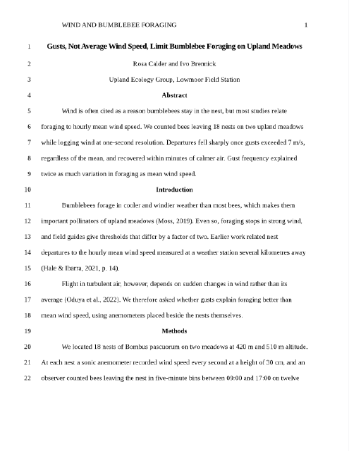

<!-- Generated by tools/gallery.mjs from showcase.yaml and build.json; do not edit. -->
# Journal Manuscript for Review

[Doc](../README.md) › [Academic](../README.md#academic) · `manuscript` `line-numbers` `citations` `bibliography` `double-spacing`

A double-spaced journal submission with continuous line numbers for reviewers, a running head, APA citations from a source list and a generated reference list.



| | |
|---|---|
| Document | [manuscript-line-numbers.docx](manuscript-line-numbers.docx) (8 KB) |
| Contents | 2 pages; 318 words |
| Features | `doc.layout.line-numbers`, `doc.references.citations-index`, `doc.headers.footers`, `doc.styles.manage`, `doc.layout.page-setup` |
| Built by | `kition-doc` @ `e6d2eae5d0`: 52 commands in 27 ms |

## About

Set up the way journals ask for review copies: double spacing, line numbers running through
the whole manuscript so reviewers can point at "line 23", and a running head with the page
number on the right. The in-text citations are CITATION fields built from sources added to the
document's source list in APA style, and the reference list at the end is the BIBLIOGRAPHY
they generate, with hanging indents.

## Checks

- `inspect.pages`: `{"count":2}`
- `results.lines.lineNumbers`: `{"restart":"continuous","countBy":1}`
- `results.style.style`: `"APA"`
- `results.first.tag`: `"Moss19"`
- `results.sources`: `{"count":3}`
- diagnostics: none (the kit's check finds nothing wrong)
- the saved document opens again; the thumbnail matches `thumb.png` within the `render` tolerance

## Steps

<details><summary>52 commands (from <a href="showcase.yaml">showcase.yaml</a>)</summary>

```yaml
- command: review.proofing
  as: proofing
- command: design.themeFonts
  params:
    heading: Tinos
    body: Tinos
- command: layout.lineNumbers
  params:
    value: continuous
  as: lines
- command: references.citationStyle
  params:
    style: APA
  as: style
- command: styles.modify
  params:
    style: Normal
    chr:
      size: 12
    para:
      align: left
      spaceBefore: 0
      spaceAfter: 0
      indentFirst: 36
      lineSpacing:
        rule: multiple
        value: 2
- command: styles.modify
  params:
    style: Title
    chr:
      size: 14
      bold: true
      color:
        Rgb:
          - 0
          - 0
          - 0
    para:
      align: center
      indentFirst: 0
      spaceAfter: 0
      lineSpacing:
        rule: multiple
        value: 2
- command: styles.modify
  params:
    style: Heading 1
    chr:
      size: 12
      bold: true
      color:
        Rgb:
          - 0
          - 0
          - 0
    para:
      align: center
      indentFirst: 0
      spaceBefore: 0
      spaceAfter: 0
      lineSpacing:
        rule: multiple
        value: 2
- command: styles.create
  params:
    name: Centered Line
    basedOn: Normal
- command: styles.modify
  params:
    style: Centered Line
    para:
      align: center
      indentFirst: 0
- command: insert.header
  params:
    text: WIND AND BUMBLEBEE FORAGING
  as: header
- command: format.size
  params:
    size: 10
- command: para.tabs
  params:
    tabs:
      - pos: 468
        align: right
- command: caret.docEnd
- command: text.tab
- command: insert.field
  params:
    instr: PAGE
    result: "1"
- command: insert.closeHeader
- command: para.style
  params:
    style: Title
- command: text.insert
  params:
    text: Gusts, Not Average Wind Speed, Limit Bumblebee Foraging on Upland Meadows
- command: text.newParagraph
- command: para.style
  params:
    style: Centered Line
- command: text.insert
  params:
    text: Rosa Calder and Ivo Brennick
- command: text.newParagraph
- command: text.insert
  params:
    text: Upland Ecology Group, Lowmoor Field Station
- command: text.newParagraph
- command: para.heading1
- command: text.insert
  params:
    text: Abstract
- command: text.newParagraph
- command: para.normal
- command: text.insert
  params:
    text: Wind is often cited as a reason bumblebees stay in the nest, but most studies relate foraging to hourly mean wind speed. We counted bees leaving 18 nests on two upland meadows while logging wind at one-second resolution. Departures fell sharply once gusts exceeded 7 m/s, regardless of the mean, and recovered within minutes of calmer air. Gust frequency explained twice as much variation in foraging as mean wind speed.
- command: text.newParagraph
- command: para.heading1
- command: text.insert
  params:
    text: Introduction
- command: text.newParagraph
- command: para.normal
- command: text.insert
  params:
    text: "Bumblebees forage in cooler and windier weather than most bees, which makes them important pollinators of upland meadows "
- command: references.citation
  params:
    source:
      tag: Moss19
      kind: Book
      author: Moss, Adair
      title: "Meadows in motion: Pollinators of the high pastures"
      publisher: Fieldfare Press
      city: Lowmoor
      year: "2019"
  as: first
- command: text.insert
  params:
    text: ". Even so, foraging stops in strong wind, and field guides give thresholds that differ by a factor of two. Earlier work related nest departures to the hourly mean wind speed measured at a weather station several kilometres away "
- command: references.citation
  params:
    source:
      tag: Hale21
      kind: JournalArticle
      author: Hale, Rosa; Ibarra, Tomas
      title: Wind speed and bumblebee foraging in coastal grassland
      journal: Journal of Pollination Ecology
      year: "2021"
      volume: "29"
    pages: "14"
- command: text.insert
  params:
    text: .
- command: text.newParagraph
- command: text.insert
  params:
    text: "Flight in turbulent air, however, depends on sudden changes in wind rather than its average "
- command: references.citation
  params:
    source:
      tag: Oduya22
      kind: JournalArticle
      author: Oduya, Kemi; Lind, Sofia; Prescott, Hal
      title: Flight stability of bumblebees in gusty air
      journal: Insect Flight Mechanics
      year: "2022"
      volume: "11"
- command: text.insert
  params:
    text: . We therefore asked whether gusts explain foraging better than mean wind speed, using anemometers placed beside the nests themselves.
- command: text.newParagraph
- command: para.heading1
- command: text.insert
  params:
    text: Methods
- command: text.newParagraph
- command: para.normal
- command: text.insert
  params:
    text: We located 18 nests of Bombus pascuorum on two meadows at 420 m and 510 m altitude. At each nest a sonic anemometer recorded wind speed every second at a height of 30 cm, and an observer counted bees leaving the nest in five-minute bins between 09:00 and 17:00 on twelve days in July. A gust was defined as a two-second wind speed more than 3 m/s above the preceding ten-minute mean.
- command: text.newParagraph
- command: references.bibliography
  params:
    title: References
  as: bibliography
- command: references.sources
  as: sources
```

</details>
