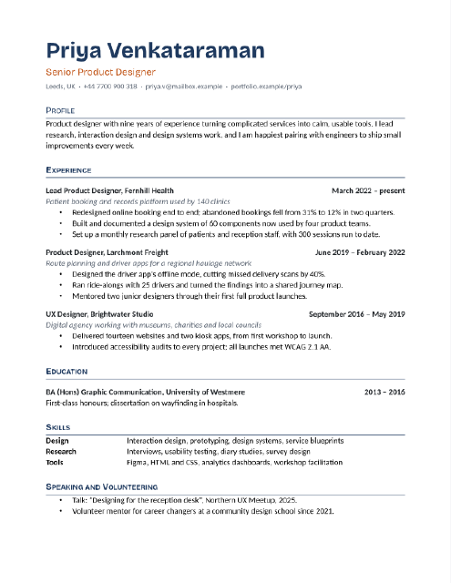

<!-- Generated by tools/gallery.mjs from showcase.yaml and build.json; do not edit. -->
# Modern Resume

[Doc](../README.md) › [Resumes](../README.md#resumes) · `resume` `heading-styles` `tab-stops` `bullets`

A one-page resume with a bold name line, small-caps section headings over a thin rule, right-aligned dates and bulleted achievements.



| | |
|---|---|
| Document | [modern-resume.docx](modern-resume.docx) (9 KB) |
| Contents | 1 page; 279 words |
| Features | `doc.text.typing`, `doc.styles.manage`, `doc.format.paragraph`, `doc.lists.bullets-numbering` |
| Built by | `kition-doc` @ `e6d2eae5d0`: 120 commands in 70 ms |

## About

Every section heading is the built-in Heading 1, restyled once with styles.modify: small
capitals in navy, a hairline bottom border and generous space above. Each role puts the job
title on the left and the dates on the right margin with a right-aligned tab stop, then lists
achievements as a tight bulleted list.

## Checks

- `inspect.pages`: `{"count":1}`
- `inspect.words`: `{"min":260,"max":340}`
- `results.styles`: `{"any":{"id":"Heading1","inGallery":true}}`
- `results.doc.blocks`: `{"any":{"style":"Heading1","text":"Experience"}}`
- `results.doc.blocks.3`: `{"style":"Heading1","text":"Profile"}`
- `results.doc.blocks.27`: `{"style":"Heading1","text":"Speaking and Volunteering"}`
- diagnostics: none (the kit's check finds nothing wrong)
- the saved document opens again; the thumbnail matches `thumb.png` within the `render` tolerance

## Steps

<details><summary>120 commands (from <a href="showcase.yaml">showcase.yaml</a>)</summary>

```yaml
- command: review.proofing
- command: design.themeFonts
  params:
    heading: Bricolage Grotesque
    body: Carlito
- command: layout.margins
  params:
    top: 50
    bottom: 50
    left: 62
    right: 62
- command: styles.modify
  params:
    style: Normal
    chr:
      size: 11
    para:
      spaceAfter: 3
      lineSpacing:
        rule: multiple
        value: 1.1
- command: styles.modify
  params:
    style: Heading 1
    chr:
      size: 12
      bold: true
      smallCaps: true
      color:
        Rgb:
          - 31
          - 58
          - 95
    para:
      spaceBefore: 18
      spaceAfter: 6
      borders:
        bottom:
          style: single
          width: 0.75
          color:
            - 31
            - 58
            - 95
          space: 2
- command: styles.modify
  params:
    style: Heading 2
    chr:
      font: Carlito
      size: 11
      bold: true
      color:
        Rgb:
          - 33
          - 37
          - 41
    para:
      spaceBefore: 10
      spaceAfter: 1
      tabs:
        - pos: 488
          align: right
          leader: none
- command: format.set
  params:
    props:
      font: Bricolage Grotesque
      size: 30
      bold: true
- command: format.color
  params:
    color: 1F3A5F
- command: text.insert
  params:
    text: Priya Venkataraman
- command: para.spacing
  params:
    after: 0
- command: text.newParagraph
- command: format.set
  params:
    props:
      font: Bricolage Grotesque
      size: 13
      bold: false
- command: format.color
  params:
    color: C2571A
- command: text.insert
  params:
    text: Senior Product Designer
- command: para.spacing
  params:
    after: 4
- command: text.newParagraph
- command: format.set
  params:
    props:
      font: Carlito
      size: 10
      bold: false
- command: format.color
  params:
    color: 5A6472
- command: text.insert
  params:
    text: Leeds, UK  ·  +44 7700 900 318  ·  priya.v@mailbox.example  ·  portfolio.example/priya
- command: para.spacing
  params:
    after: 0
- command: text.newParagraph
- command: format.color
  params:
    color: auto
- command: para.heading1
- command: text.insert
  params:
    text: Profile
- command: text.newParagraph
- command: text.insert
  params:
    text: Product designer with nine years of experience turning complicated services into calm, usable tools. I lead research, interaction design and design systems work, and I am happiest pairing with engineers to ship small improvements every week.
- command: text.newParagraph
- command: para.heading1
- command: text.insert
  params:
    text: Experience
- command: text.newParagraph
- command: para.heading2
- command: text.insert
  params:
    text: Lead Product Designer, Fernhill Health	March 2022 – present
- command: text.newParagraph
- command: format.italic
  params:
    value: true
- command: format.color
  params:
    color: 5A6472
- command: text.insert
  params:
    text: Patient booking and records platform used by 140 clinics
- command: format.italic
  params:
    value: false
- command: format.color
  params:
    color: auto
- command: text.newParagraph
- command: para.bullets
- command: text.insert
  params:
    text: Redesigned online booking end to end; abandoned bookings fell from 31% to 12% in two quarters.
- command: text.newParagraph
- command: text.insert
  params:
    text: Built and documented a design system of 60 components now used by four product teams.
- command: text.newParagraph
- command: text.insert
  params:
    text: Set up a monthly research panel of patients and reception staff, with 300 sessions run to date.
- command: text.newParagraph
- command: para.bullets
  params:
    off: true
- command: para.heading2
- command: text.insert
  params:
    text: Product Designer, Larchmont Freight	June 2019 – February 2022
- command: text.newParagraph
- command: format.italic
  params:
    value: true
- command: format.color
  params:
    color: 5A6472
- command: text.insert
  params:
    text: Route planning and driver apps for a regional haulage network
- command: format.italic
  params:
    value: false
- command: format.color
  params:
    color: auto
- command: text.newParagraph
- command: para.bullets
- command: text.insert
  params:
    text: Designed the driver app's offline mode, cutting missed delivery scans by 40%.
- command: text.newParagraph
- command: text.insert
  params:
    text: Ran ride-alongs with 25 drivers and turned the findings into a shared journey map.
- command: text.newParagraph
- command: text.insert
  params:
    text: Mentored two junior designers through their first full product launches.
- command: text.newParagraph
- command: para.bullets
  params:
    off: true
- command: para.heading2
- command: text.insert
  params:
    text: UX Designer, Brightwater Studio	September 2016 – May 2019
- command: text.newParagraph
- command: format.italic
  params:
    value: true
- command: format.color
  params:
    color: 5A6472
- command: text.insert
  params:
    text: Digital agency working with museums, charities and local councils
- command: format.italic
  params:
    value: false
- command: format.color
  params:
    color: auto
- command: text.newParagraph
- command: para.bullets
- command: text.insert
  params:
    text: Delivered fourteen websites and two kiosk apps, from first workshop to launch.
- command: text.newParagraph
- command: text.insert
  params:
    text: Introduced accessibility audits to every project; all launches met WCAG 2.1 AA.
- command: text.newParagraph
- command: para.bullets
  params:
    off: true
- command: para.heading1
- command: text.insert
  params:
    text: Education
- command: text.newParagraph
- command: para.heading2
- command: text.insert
  params:
    text: BA (Hons) Graphic Communication, University of Westmere	2013 – 2016
- command: text.newParagraph
- command: text.insert
  params:
    text: First-class honours; dissertation on wayfinding in hospitals.
- command: text.newParagraph
- command: para.heading1
- command: text.insert
  params:
    text: Skills
- command: text.newParagraph
- command: para.tabs
  params:
    tabs:
      - pos: 110
- command: text.insert
  params:
    text: Design	Interaction design, prototyping, design systems, service blueprints
- command: caret.home
- command: caret.wordRight
  params:
    extend: true
- command: format.bold
  params:
    value: true
- command: caret.end
- command: text.newParagraph
- command: text.insert
  params:
    text: Research	Interviews, usability testing, diary studies, survey design
- command: caret.home
- command: caret.wordRight
  params:
    extend: true
- command: format.bold
  params:
    value: true
- command: caret.end
- command: text.newParagraph
- command: text.insert
  params:
    text: Tools	Figma, HTML and CSS, analytics dashboards, workshop facilitation
- command: caret.home
- command: caret.wordRight
  params:
    extend: true
- command: format.bold
  params:
    value: true
- command: caret.end
- command: text.newParagraph
- command: para.tabs
  params:
    clearAll: true
- command: para.heading1
- command: text.insert
  params:
    text: Speaking and Volunteering
- command: text.newParagraph
- command: para.bullets
- command: text.insert
  params:
    text: "Talk: “Designing for the reception desk”, Northern UX Meetup, 2025."
- command: text.newParagraph
- command: text.insert
  params:
    text: Volunteer mentor for career changers at a community design school since 2021.
- command: caret.docStart
- command: styles.manage
  as: styles
- command: document.inspect
  as: doc
```

</details>
