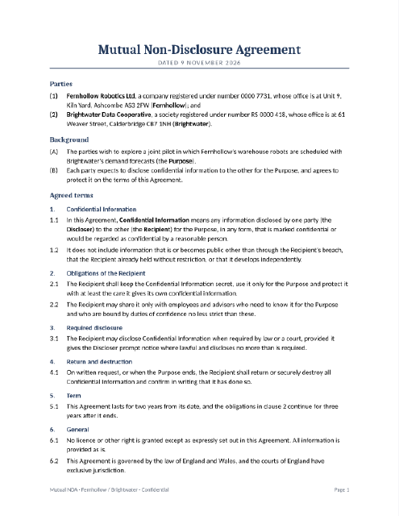

<!-- Generated by tools/gallery.mjs from showcase.yaml and build.json; do not edit. -->
# Mutual NDA

[Doc](../README.md) › [Contracts & Forms](../README.md#contracts--forms) · `contract` `legal-numbering` `multilevel-list` `table` `tab-stops` `header-footer`

A mutual non-disclosure agreement with numbered parties, lettered recitals, two-level clauses and side-by-side signature blocks.



| | |
|---|---|
| Document | [mutual-nda.docx](mutual-nda.docx) (10 KB) |
| Contents | 2 pages; 395 words |
| Features | `doc.text.typing`, `doc.format.character`, `doc.format.paragraph`, `doc.lists.bullets-numbering`, `doc.tables.edit`, `doc.headers.footers` |
| Built by | `kition-doc` @ `e6d2eae5d0`: 269 commands in 90 ms |

## About

Three lists made with `list.define`: the parties numbered (1), (2), the recitals lettered (A),
(B), and the operative clauses with navy bold clause numbers over 1.1-style sub-clauses. Each
clause heading is kept with its first sub-clause. The signature blocks sit in a two-column table
with every border removed, with signature and date lines drawn by underscore tab leaders, and
the footer carries a confidentiality line with a PAGE field at a right tab.

## Checks

- `inspect.pages`: `{"count":2}`
- `inspect.words`: `{"min":360,"max":430}`
- `results.parties.num`: `{"min":1}`
- `results.list.levels.0`: `{"text":"%1.","bold":true,"color":"23395B"}`
- `results.list.levels.1`: `{"text":"%1.%2","indentAt":26}`
- `results.sigtable.borders.inside_v.style`: `"none"`
- `results.sigtable.borders.left.style`: `"none"`
- diagnostics: none (the kit's check finds nothing wrong)
- the saved document opens again; the thumbnail matches `thumb.png` within the `render` tolerance

## Steps

<details><summary>269 commands (from <a href="showcase.yaml">showcase.yaml</a>)</summary>

```yaml
- command: review.proofing
- command: design.themeFonts
  params:
    heading: Caladea
    body: Carlito
- command: styles.modify
  params:
    style: Normal
    chr:
      size: 10.5
    para:
      spaceAfter: 5
      lineSpacing:
        rule: multiple
        value: 1.12
- command: layout.margins
  params:
    top: 64
    bottom: 64
    left: 76
    right: 76
- command: para.alignCenter
- command: para.spacing
  params:
    after: 0
- command: format.set
  params:
    props:
      font: Caladea
      size: 20
      bold: true
- command: format.color
  params:
    color: 23395B
- command: text.insert
  params:
    text: Mutual Non-Disclosure Agreement
- command: text.newParagraph
- command: para.spacing
  params:
    after: 16
- command: para.borders
  params:
    kind: bottom
    width: 1.5
    color: 23395B
- command: format.set
  params:
    props:
      font: Carlito
      size: 10
      bold: false
- command: format.color
  params:
    color: 5B6575
- command: format.spacing
  params:
    points: 1
- command: text.insert
  params:
    text: DATED 9 NOVEMBER 2026
- command: text.newParagraph
- command: para.borders
  params:
    kind: none
- command: para.alignLeft
- command: para.spacing
  params:
    before: 6
    after: 5
- command: format.set
  params:
    props:
      size: 10.5
- command: format.color
  params:
    color: auto
- command: format.spacing
  params:
    points: 0
- command: para.spacing
  params:
    before: 10
    after: 4
- command: para.set
  params:
    props:
      keepNext: true
- command: format.set
  params:
    props:
      font: Caladea
      bold: true
      size: 11
- command: format.color
  params:
    color: 23395B
- command: text.insert
  params:
    text: Parties
- command: text.newParagraph
- command: para.set
  params:
    props:
      keepNext: false
- command: para.spacing
  params:
    before: 0
    after: 5
- command: format.set
  params:
    props:
      font: Carlito
      bold: false
      size: 10.5
- command: format.color
  params:
    color: auto
- command: list.define
  params:
    levels:
      - format: decimal
        text: (%1)
        alignedAt: 0
        indentAt: 26
  as: parties
- command: format.bold
  params:
    value: true
- command: text.insert
  params:
    text: Fernhollow Robotics Ltd
- command: format.bold
  params:
    value: false
- command: text.insert
  params:
    text: ", a company registered under number 0000 7731, whose office is at Unit 9, Kiln Yard, Ashcombe AS3 2FW ("
- command: format.bold
  params:
    value: true
- command: text.insert
  params:
    text: Fernhollow
- command: format.bold
  params:
    value: false
- command: text.insert
  params:
    text: ); and
- command: text.newParagraph
- command: format.bold
  params:
    value: true
- command: text.insert
  params:
    text: Brightwater Data Cooperative
- command: format.bold
  params:
    value: false
- command: text.insert
  params:
    text: ", a society registered under number RS 0000 418, whose office is at 61 Weaver Street, Calderbridge CB7 1NH ("
- command: format.bold
  params:
    value: true
- command: text.insert
  params:
    text: Brightwater
- command: format.bold
  params:
    value: false
- command: text.insert
  params:
    text: ).
- command: text.newParagraph
- command: para.numbering
  params:
    off: true
- command: para.spacing
  params:
    before: 10
    after: 4
- command: para.set
  params:
    props:
      keepNext: true
- command: format.set
  params:
    props:
      font: Caladea
      bold: true
      size: 11
- command: format.color
  params:
    color: 23395B
- command: text.insert
  params:
    text: Background
- command: text.newParagraph
- command: para.set
  params:
    props:
      keepNext: false
- command: para.spacing
  params:
    before: 0
    after: 5
- command: format.set
  params:
    props:
      font: Carlito
      bold: false
      size: 10.5
- command: format.color
  params:
    color: auto
- command: list.define
  params:
    levels:
      - format: upperLetter
        text: (%1)
        alignedAt: 0
        indentAt: 26
  as: recitals
- command: text.insert
  params:
    text: "The parties wish to explore a joint pilot in which Fernhollow's warehouse robots are scheduled with Brightwater's demand forecasts (the "
- command: format.bold
  params:
    value: true
- command: text.insert
  params:
    text: Purpose
- command: format.bold
  params:
    value: false
- command: text.insert
  params:
    text: ).
- command: text.newParagraph
- command: text.insert
  params:
    text: Each party expects to disclose confidential information to the other for the Purpose, and agrees to protect it on the terms of this Agreement.
- command: text.newParagraph
- command: para.numbering
  params:
    off: true
- command: para.spacing
  params:
    before: 10
    after: 4
- command: para.set
  params:
    props:
      keepNext: true
- command: format.set
  params:
    props:
      font: Caladea
      bold: true
      size: 11
- command: format.color
  params:
    color: 23395B
- command: text.insert
  params:
    text: Agreed terms
- command: text.newParagraph
- command: para.set
  params:
    props:
      keepNext: false
- command: para.spacing
  params:
    before: 0
    after: 5
- command: format.set
  params:
    props:
      font: Carlito
      bold: false
      size: 10.5
- command: format.color
  params:
    color: auto
- command: list.define
  params:
    levels:
      - format: decimal
        text: "%1."
        alignedAt: 0
        indentAt: 26
        bold: true
        color: 23395B
      - format: decimal
        text: "%1.%2"
        alignedAt: 0
        indentAt: 26
  as: clauses
- command: para.listLevel
  params:
    level: 0
- command: para.set
  params:
    props:
      keepNext: true
      contextualSpacing: false
- command: para.spacing
  params:
    before: 7
    after: 2
- command: format.bold
  params:
    value: true
- command: format.color
  params:
    color: 23395B
- command: text.insert
  params:
    text: Confidential Information
- command: format.bold
  params:
    value: false
- command: format.color
  params:
    color: auto
- command: text.newParagraph
- command: select.paragraph
- command: format.bold
  params:
    value: false
- command: format.color
  params:
    color: auto
- command: para.set
  params:
    props:
      keepNext: false
      contextualSpacing: false
- command: para.listLevel
  params:
    level: 1
- command: para.spacing
  params:
    before: 0
    after: 3
- command: text.insert
  params:
    text: "In this Agreement, "
- command: format.bold
  params:
    value: true
- command: text.insert
  params:
    text: Confidential Information
- command: format.bold
  params:
    value: false
- command: text.insert
  params:
    text: " means any information disclosed by one party (the "
- command: format.bold
  params:
    value: true
- command: text.insert
  params:
    text: Discloser
- command: format.bold
  params:
    value: false
- command: text.insert
  params:
    text: ") to the other (the "
- command: format.bold
  params:
    value: true
- command: text.insert
  params:
    text: Recipient
- command: format.bold
  params:
    value: false
- command: text.insert
  params:
    text: ) for the Purpose, in any form, that is marked confidential or would be regarded as confidential by a reasonable person.
- command: text.newParagraph
- command: text.insert
  params:
    text: It does not include information that is or becomes public other than through the Recipient's breach, that the Recipient already held without restriction, or that it develops independently.
- command: text.newParagraph
- command: para.listLevel
  params:
    level: 0
- command: para.set
  params:
    props:
      keepNext: true
      contextualSpacing: false
- command: para.spacing
  params:
    before: 7
    after: 2
- command: format.bold
  params:
    value: true
- command: format.color
  params:
    color: 23395B
- command: text.insert
  params:
    text: Obligations of the Recipient
- command: format.bold
  params:
    value: false
- command: format.color
  params:
    color: auto
- command: text.newParagraph
- command: select.paragraph
- command: format.bold
  params:
    value: false
- command: format.color
  params:
    color: auto
- command: para.set
  params:
    props:
      keepNext: false
      contextualSpacing: false
- command: para.listLevel
  params:
    level: 1
- command: para.spacing
  params:
    before: 0
    after: 3
- command: text.insert
  params:
    text: The Recipient shall keep the Confidential Information secret, use it only for the Purpose and protect it with at least the care it gives its own confidential information.
- command: text.newParagraph
- command: text.insert
  params:
    text: The Recipient may share it only with employees and advisers who need to know it for the Purpose and who are bound by duties of confidence no less strict than these.
- command: text.newParagraph
- command: para.listLevel
  params:
    level: 0
- command: para.set
  params:
    props:
      keepNext: true
      contextualSpacing: false
- command: para.spacing
  params:
    before: 7
    after: 2
- command: format.bold
  params:
    value: true
- command: format.color
  params:
    color: 23395B
- command: text.insert
  params:
    text: Required disclosure
- command: format.bold
  params:
    value: false
- command: format.color
  params:
    color: auto
- command: text.newParagraph
- command: select.paragraph
- command: format.bold
  params:
    value: false
- command: format.color
  params:
    color: auto
- command: para.set
  params:
    props:
      keepNext: false
      contextualSpacing: false
- command: para.listLevel
  params:
    level: 1
- command: para.spacing
  params:
    before: 0
    after: 3
- command: text.insert
  params:
    text: The Recipient may disclose Confidential Information when required by law or a court, provided it gives the Discloser prompt notice where lawful and discloses no more than is required.
- command: text.newParagraph
- command: para.listLevel
  params:
    level: 0
- command: para.set
  params:
    props:
      keepNext: true
      contextualSpacing: false
- command: para.spacing
  params:
    before: 7
    after: 2
- command: format.bold
  params:
    value: true
- command: format.color
  params:
    color: 23395B
- command: text.insert
  params:
    text: Return and destruction
- command: format.bold
  params:
    value: false
- command: format.color
  params:
    color: auto
- command: text.newParagraph
- command: select.paragraph
- command: format.bold
  params:
    value: false
- command: format.color
  params:
    color: auto
- command: para.set
  params:
    props:
      keepNext: false
      contextualSpacing: false
- command: para.listLevel
  params:
    level: 1
- command: para.spacing
  params:
    before: 0
    after: 3
- command: text.insert
  params:
    text: On written request, or when the Purpose ends, the Recipient shall return or securely destroy all Confidential Information and confirm in writing that it has done so.
- command: text.newParagraph
- command: para.listLevel
  params:
    level: 0
- command: para.set
  params:
    props:
      keepNext: true
      contextualSpacing: false
- command: para.spacing
  params:
    before: 7
    after: 2
- command: format.bold
  params:
    value: true
- command: format.color
  params:
    color: 23395B
- command: text.insert
  params:
    text: Term
- command: format.bold
  params:
    value: false
- command: format.color
  params:
    color: auto
- command: text.newParagraph
- command: select.paragraph
- command: format.bold
  params:
    value: false
- command: format.color
  params:
    color: auto
- command: para.set
  params:
    props:
      keepNext: false
      contextualSpacing: false
- command: para.listLevel
  params:
    level: 1
- command: para.spacing
  params:
    before: 0
    after: 3
- command: text.insert
  params:
    text: This Agreement lasts for two years from its date, and the obligations in clause 2 continue for three years after it ends.
- command: text.newParagraph
- command: para.listLevel
  params:
    level: 0
- command: para.set
  params:
    props:
      keepNext: true
      contextualSpacing: false
- command: para.spacing
  params:
    before: 7
    after: 2
- command: format.bold
  params:
    value: true
- command: format.color
  params:
    color: 23395B
- command: text.insert
  params:
    text: General
- command: format.bold
  params:
    value: false
- command: format.color
  params:
    color: auto
- command: text.newParagraph
- command: select.paragraph
- command: format.bold
  params:
    value: false
- command: format.color
  params:
    color: auto
- command: para.set
  params:
    props:
      keepNext: false
      contextualSpacing: false
- command: para.listLevel
  params:
    level: 1
- command: para.spacing
  params:
    before: 0
    after: 3
- command: text.insert
  params:
    text: No licence or other right is granted except as expressly set out in this Agreement. All information is provided as is.
- command: text.newParagraph
- command: text.insert
  params:
    text: This Agreement is governed by the law of England and Wales, and the courts of England have exclusive jurisdiction.
- command: text.newParagraph
- command: list.get
  params:
    num: $clauses.num
  as: list
- command: para.numbering
  params:
    off: true
- command: para.spacing
  params:
    before: 10
    after: 10
- command: para.set
  params:
    props:
      keepNext: true
- command: text.insert
  params:
    text: Signed by the authorised representatives of the parties on the date above.
- command: text.newParagraph
- command: insert.table
  params:
    rows: 5
    cols: 2
  as: sig
- command: table.selectTable
- command: table.borders
  params:
    kind: none
- command: para.spacing
  params:
    before: 0
    after: 0
- command: para.tabs
  params:
    tabs:
      - pos: 205
        align: right
        leader: underscore
- command: select.collapse
- command: format.bold
  params:
    value: true
- command: format.color
  params:
    color: 23395B
- command: text.insert
  params:
    text: For Fernhollow Robotics Ltd
- command: text.tab
- command: text.insert
  params:
    text: For Brightwater Data Cooperative
- command: format.bold
  params:
    value: false
- command: format.color
  params:
    color: auto
- command: text.tab
- command: para.spacing
  params:
    before: 14
    after: 0
- command: text.insert
  params:
    text: "Signature  \t"
- command: text.tab
- command: para.spacing
  params:
    before: 14
    after: 0
- command: text.insert
  params:
    text: "Signature  \t"
- command: text.tab
- command: para.spacing
  params:
    before: 6
    after: 0
- command: format.color
  params:
    color: 5B6575
- command: text.insert
  params:
    text: "Name   "
- command: format.color
  params:
    color: auto
- command: text.insert
  params:
    text: Ines Valcourt
- command: text.tab
- command: para.spacing
  params:
    before: 6
    after: 0
- command: format.color
  params:
    color: 5B6575
- command: text.insert
  params:
    text: "Name   "
- command: format.color
  params:
    color: auto
- command: text.insert
  params:
    text: Rahul Menon-Ash
- command: text.tab
- command: para.spacing
  params:
    before: 6
    after: 0
- command: format.color
  params:
    color: 5B6575
- command: text.insert
  params:
    text: "Title   "
- command: format.color
  params:
    color: auto
- command: text.insert
  params:
    text: Chief Operating Officer
- command: text.tab
- command: para.spacing
  params:
    before: 6
    after: 0
- command: format.color
  params:
    color: 5B6575
- command: text.insert
  params:
    text: "Title   "
- command: format.color
  params:
    color: auto
- command: text.insert
  params:
    text: Data Steward
- command: text.tab
- command: para.spacing
  params:
    before: 14
    after: 0
- command: text.insert
  params:
    text: "Date  \t"
- command: text.tab
- command: para.spacing
  params:
    before: 14
    after: 0
- command: text.insert
  params:
    text: "Date  \t"
- command: table.properties
  as: sigtable
- command: caret.docEnd
- command: insert.footer
  params:
    text: ""
- command: insert.editFooter
- command: para.tabs
  params:
    clear:
      - 234
      - 468
    set:
      - pos: 460
        align: right
- command: format.set
  params:
    props:
      font: Carlito
      size: 8.5
      bold: false
      italic: false
- command: format.color
  params:
    color: 5B6575
- command: text.insert
  params:
    text: "Mutual NDA · Fernhollow / Brightwater · Confidential\tPage "
- command: insert.field
  params:
    instr: PAGE
    result: "1"
- command: insert.closeHeader
```

</details>
