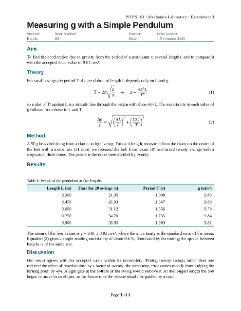

<!-- Generated by tools/gallery.mjs from showcase.yaml and build.json; do not edit. -->
# Physics Lab Report

[Doc](../README.md) › [Academic](../README.md#academic) · `lab-report` `equations` `table` `captions` `page-numbers`

A first-year physics lab report on measuring g with a pendulum — header block, numbered display equations, a captioned data table with a shaded header row and a "Page x of y" footer.



| | |
|---|---|
| Document | [pendulum-lab-report.docx](pendulum-lab-report.docx) (9 KB) |
| Contents | 1 page; 319 words |
| Features | `doc.equations.edit`, `doc.tables.edit`, `doc.references.notes-toc`, `doc.headers.footers`, `doc.styles.manage` |
| Built by | `kition-doc` @ `e6d2eae5d0`: 140 commands in 53 ms |

## About

The report follows the usual lab-book order: aim, method, results and analysis, discussion.
The model and the error propagation are numbered display equations typed in LaTeX; the
measurements sit in a table with a shaded header row, right-aligned numbers and a numbered
"Table 1" caption above it. A course line runs in the header and the footer counts pages as
"Page 1 of 1".

## Checks

- `inspect.pages`: `{"count":1}`
- `inspect.words`: `{"min":300}`
- `results.model.display`: `true`
- `results.error.display`: `true`
- `results.header.story`: `{"exists":true}`
- diagnostics: none (the kit's check finds nothing wrong)
- the saved document opens again; the thumbnail matches `thumb.png` within the `render` tolerance

## Steps

<details><summary>140 commands (from <a href="showcase.yaml">showcase.yaml</a>)</summary>

```yaml
- command: review.proofing
  as: proofing
- command: design.themeFonts
  params:
    heading: Arimo
    body: Tinos
- command: layout.margins
  params:
    top: 50
    bottom: 50
    left: 68
    right: 68
- command: styles.modify
  params:
    style: Normal
    chr:
      size: 11
    para:
      align: justify
      spaceBefore: 0
      spaceAfter: 5
      lineSpacing:
        rule: multiple
        value: 1.08
- command: styles.modify
  params:
    style: Title
    chr:
      size: 22
      bold: true
      color:
        Rgb:
          - 24
          - 24
          - 24
    para:
      align: left
      spaceAfter: 4
- command: styles.modify
  params:
    style: Heading 1
    chr:
      size: 13
      bold: true
      color:
        Rgb:
          - 0
          - 94
          - 104
    para:
      align: left
      spaceBefore: 10
      spaceAfter: 3
      keepNext: true
- command: styles.modify
  params:
    style: Caption
    chr:
      size: 9.5
      italic: false
      bold: true
      color:
        Rgb:
          - 60
          - 60
          - 60
    para:
      align: left
      spaceBefore: 8
      spaceAfter: 4
- command: styles.create
  params:
    name: Report Details
    basedOn: Normal
- command: styles.modify
  params:
    style: Report Details
    chr:
      size: 10
      color:
        Rgb:
          - 80
          - 80
          - 80
    para:
      align: left
      spaceAfter: 0
      tabs:
        - pos: 70
          align: left
        - pos: 260
          align: left
        - pos: 330
          align: left
- command: insert.header
  params:
    text: PHYS 101 · Mechanics Laboratory · Experiment 3
  as: header
- command: para.alignRight
- command: format.size
  params:
    size: 9
- command: format.color
  params:
    color: "777777"
- command: insert.closeHeader
- command: insert.pageNumber
  params:
    position: bottom
    align: center
    format: x of y
  as: footer
- command: insert.closeHeader
- command: para.style
  params:
    style: Title
- command: text.insert
  params:
    text: Measuring g with a Simple Pendulum
- command: text.newParagraph
- command: para.style
  params:
    style: Report Details
- command: text.insert
  params:
    text: "Student:"
- command: text.tab
- command: text.insert
  params:
    text: Noor Haddad
- command: text.tab
- command: text.insert
  params:
    text: "Partner:"
- command: text.tab
- command: text.insert
  params:
    text: Felix Aranda
- command: text.newParagraph
- command: text.insert
  params:
    text: "Bench:"
- command: text.tab
- command: text.insert
  params:
    text: B4
- command: text.tab
- command: text.insert
  params:
    text: "Date:"
- command: text.tab
- command: text.insert
  params:
    text: 4 November 2026
- command: para.borders
  params:
    kind: bottom
    width: 0.75
    color: "005E68"
- command: para.spacing
  params:
    after: 6
- command: text.newParagraph
- command: para.borders
  params:
    kind: none
- command: para.spacing
  params:
    after: 6
- command: para.heading1
- command: text.insert
  params:
    text: Aim
- command: text.newParagraph
- command: text.insert
  params:
    text: To find the acceleration due to gravity from the period of a pendulum at several lengths, and to compare it with the accepted local value of 9.81 m/s².
- command: text.newParagraph
- command: para.heading1
- command: text.insert
  params:
    text: Theory
- command: text.newParagraph
- command: text.insert
  params:
    text: "For small swings the period T of a pendulum of length L depends only on L and g:"
- command: text.newParagraph
- command: insert.equation
  params:
    latex: T = 2\pi \sqrt{\frac{L}{g}} \quad \Rightarrow \quad g = \frac{4\pi^2 L}{T^2}
    display: true
  as: model
- command: equation.number
  params:
    value: true
- command: equation.exit
- command: text.newParagraph
- command: text.insert
  params:
    text: "so a plot of T² against L is a straight line through the origin with slope 4π²/g. The uncertainty in each value of g follows from those in L and T:"
- command: text.newParagraph
- command: insert.equation
  params:
    latex: \frac{\Delta g}{g} = \sqrt{\left(\frac{\Delta L}{L}\right)^2 + \left(\frac{2\Delta T}{T}\right)^2}
    display: true
  as: error
- command: equation.number
  params:
    value: true
- command: equation.exit
- command: text.newParagraph
- command: para.heading1
- command: text.insert
  params:
    text: Method
- command: text.newParagraph
- command: text.insert
  params:
    text: A 50 g brass bob hung from a clamp on light string. For each length, measured from the clamp to the centre of the bob with a metre rule (±1 mm), we released the bob from about 10° and timed twenty swings with a stopwatch, three times. The period is the mean time divided by twenty.
- command: text.newParagraph
- command: para.heading1
- command: text.insert
  params:
    text: Results
- command: text.newParagraph
- command: references.caption
  params:
    label: Table
    text: Period of the pendulum at five lengths
  as: caption
- command: text.newParagraph
- command: para.normal
- command: insert.table
  params:
    rows: 6
    cols: 4
    style: Normal Table
- command: table.selectRow
- command: table.shading
  params:
    color: DCEFF0
- command: format.bold
  params:
    value: true
- command: select.collapse
- command: text.insert
  params:
    text: Length L (m)
- command: text.tab
- command: text.insert
  params:
    text: Time for 20 swings (s)
- command: text.tab
- command: text.insert
  params:
    text: Period T (s)
- command: text.tab
- command: text.insert
  params:
    text: g (m/s²)
- command: text.tab
- command: text.insert
  params:
    text: "0.300"
- command: text.tab
- command: text.insert
  params:
    text: "21.95"
- command: text.tab
- command: text.insert
  params:
    text: "1.098"
- command: text.tab
- command: text.insert
  params:
    text: "9.83"
- command: text.tab
- command: text.insert
  params:
    text: "0.450"
- command: text.tab
- command: text.insert
  params:
    text: "26.93"
- command: text.tab
- command: text.insert
  params:
    text: "1.347"
- command: text.tab
- command: text.insert
  params:
    text: "9.80"
- command: text.tab
- command: text.insert
  params:
    text: "0.600"
- command: text.tab
- command: text.insert
  params:
    text: "31.12"
- command: text.tab
- command: text.insert
  params:
    text: "1.556"
- command: text.tab
- command: text.insert
  params:
    text: "9.78"
- command: text.tab
- command: text.insert
  params:
    text: "0.750"
- command: text.tab
- command: text.insert
  params:
    text: "34.70"
- command: text.tab
- command: text.insert
  params:
    text: "1.735"
- command: text.tab
- command: text.insert
  params:
    text: "9.84"
- command: text.tab
- command: text.insert
  params:
    text: "0.900"
- command: text.tab
- command: text.insert
  params:
    text: "38.05"
- command: text.tab
- command: text.insert
  params:
    text: "1.903"
- command: text.tab
- command: text.insert
  params:
    text: "9.81"
- command: table.selectTable
- command: table.borders
  params:
    kind: top
    width: 1
    color: "005E68"
- command: table.borders
  params:
    kind: bottom
    width: 1
    color: "005E68"
- command: table.cellMargins
  params:
    top: 2
    bottom: 2
    left: 6
    right: 6
- command: para.spacing
  params:
    after: 0
- command: para.alignRight
- command: caret.docEnd
- command: para.alignLeft
- command: para.justify
- command: para.spacing
  params:
    before: 10
    after: 6
- command: text.insert
  params:
    text: The mean of the five values is g = 9.81 ± 0.03 m/s², where the uncertainty is the standard error of the mean. Equation (2) gives a single-reading uncertainty of about 0.6 %, dominated by the timing; the spread between lengths is of the same size.
- command: text.newParagraph
- command: para.spacing
  params:
    before: 0
    after: 6
- command: para.heading1
- command: text.insert
  params:
    text: Discussion
- command: text.newParagraph
- command: text.insert
  params:
    text: Our result agrees with the accepted value within its uncertainty. Timing twenty swings rather than one reduced the effect of reaction time by a factor of twenty; the remaining error comes mostly from judging the turning point by eye. A light gate at the bottom of the swing would remove it. At the longest length the bob began to move in an ellipse, so for future runs the release should be guided by a card.
```

</details>
