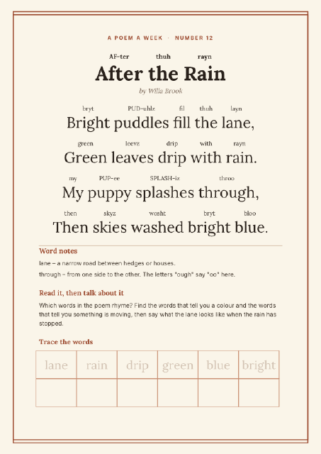

<!-- Generated by tools/gallery.mjs from showcase.yaml and build.json; do not edit. -->
# Phonics Poem Card

[Doc](../README.md) › [Academic](../README.md#academic) · `education` `phonics` `ruby` `fields` `page-border` `page-color`

An early-reader poem card with a sound-it-out guide set above every word by Phonetic Guide (EQ) fields, on a tinted page inside a double border.



| | |
|---|---|
| Document | [phonics-poem-card.docx](phonics-poem-card.docx) (8 KB) |
| Contents | 1 page; 82 words |
| Features | `doc.layout.eq-field`, `doc.design.page`, `doc.styles.manage`, `doc.format.paragraph` |
| Built by | `kition-doc` @ `1b00044864`: 127 commands in 68 ms |

## About

Each word of the title and the four lines is an EQ field — Word's Phonetic Guide — that
stacks a simple pronunciation respelling above it, the stressed syllable in capitals
(`EQ \* jc2 \* hps22 \o\ad(\s\up 32(PUD-uhlz),puddles)`), so the guide stays attached to its
word and is drawn by the kit's own EQ layout. The card has a cream page colour and a double
page border, and closes with word notes, two questions to talk about and a row of words to
trace. The poem is original. Set in Lora and Inter, loaded with the sample.

## Checks

- `inspect.pages`: `{"count":1}`
- `results.paper`: `{"exists":true}`
- `results.border`: `{"exists":true}`
- `results.structure.blocks.1.objects`: `{"count":3,"all":{"type":"field","instr":{"matches":"^EQ "}}}`
- `results.structure.blocks.3.objects`: `{"count":5,"all":{"type":"field","instr":{"matches":"\\\\o\\\\ad\\("}}}`
- diagnostics: none (the kit's check finds nothing wrong)
- the saved document opens again; the thumbnail matches `thumb.png` within the `render` tolerance

## Steps

<details><summary>127 commands (from <a href="showcase.yaml">showcase.yaml</a>)</summary>

```yaml
- command: review.proofing
  as: proofing
- command: layout.size
  params:
    name: A4
- command: layout.margins
  params:
    top: 64
    bottom: 60
    left: 72
    right: 72
- command: design.themeFonts
  params:
    heading: Lora
    body: Inter
- command: design.pageColor
  params:
    color: FAF5E9
  as: paper
- command: design.pageBorders
  params:
    kind: box
    width: 3
    color: 9C4A2F
    style: double
  as: border
- command: styles.modify
  params:
    style: Normal
    chr:
      size: 11
      color:
        Rgb:
          - 60
          - 50
          - 40
    para:
      align: left
      spaceBefore: 0
      spaceAfter: 4
      lineSpacing:
        rule: multiple
        value: 1.25
- command: styles.create
  params:
    name: Series
    basedOn: Normal
- command: styles.modify
  params:
    style: Series
    chr:
      size: 9.5
      bold: true
      spacing: 2
      color:
        Rgb:
          - 156
          - 74
          - 47
    para:
      align: center
      spaceAfter: 18
- command: styles.create
  params:
    name: Poem Title
    basedOn: Normal
- command: styles.modify
  params:
    style: Poem Title
    chr:
      font: Lora
      size: 36
      bold: true
      color:
        Rgb:
          - 40
          - 32
          - 26
    para:
      align: center
      spaceBefore: 6
      spaceAfter: 2
      lineSpacing:
        rule: multiple
        value: 1
- command: styles.create
  params:
    name: Poet
    basedOn: Normal
- command: styles.modify
  params:
    style: Poet
    chr:
      font: Lora
      size: 12
      italic: true
      color:
        Rgb:
          - 120
          - 100
          - 85
    para:
      align: center
      spaceAfter: 10
- command: styles.create
  params:
    name: Poem Line
    basedOn: Normal
- command: styles.modify
  params:
    style: Poem Line
    chr:
      font: Lora
      size: 28
      color:
        Rgb:
          - 40
          - 32
          - 26
    para:
      align: center
      spaceBefore: 14
      spaceAfter: 4
      lineSpacing:
        rule: multiple
        value: 1
- command: styles.create
  params:
    name: Card Heading
    basedOn: Normal
- command: styles.modify
  params:
    style: Card Heading
    chr:
      font: Lora
      size: 13
      bold: true
      color:
        Rgb:
          - 156
          - 74
          - 47
    para:
      spaceBefore: 16
      spaceAfter: 4
- command: styles.create
  params:
    name: Trace Word
    basedOn: Normal
- command: styles.modify
  params:
    style: Trace Word
    chr:
      font: Lora
      size: 22
    para:
      align: center
      spaceBefore: 0
      spaceAfter: 0
      lineSpacing:
        rule: multiple
        value: 1
- command: para.style
  params:
    style: Series
- command: text.insert
  params:
    text: A POEM A WEEK  ·  NUMBER 12
- command: text.newParagraph
- command: para.style
  params:
    style: Poem Title
- command: insert.field
  params:
    instr: EQ \* jc2 \* hps24 \o\ad(\s\up 40(AF-ter),After)
- command: text.insert
  params:
    text: " "
- command: insert.field
  params:
    instr: EQ \* jc2 \* hps24 \o\ad(\s\up 40(thuh),the)
- command: text.insert
  params:
    text: " "
- command: insert.field
  params:
    instr: EQ \* jc2 \* hps24 \o\ad(\s\up 40(rayn),Rain)
- command: text.newParagraph
- command: para.style
  params:
    style: Poet
- command: text.insert
  params:
    text: by Willa Brook
- command: text.newParagraph
- command: para.style
  params:
    style: Poem Line
- command: insert.field
  params:
    instr: EQ \* jc2 \* hps22 \o\ad(\s\up 32(bryt),Bright)
- command: text.insert
  params:
    text: " "
- command: insert.field
  params:
    instr: EQ \* jc2 \* hps22 \o\ad(\s\up 32(PUD-uhlz),puddles)
- command: text.insert
  params:
    text: " "
- command: insert.field
  params:
    instr: EQ \* jc2 \* hps22 \o\ad(\s\up 32(fil),fill)
- command: text.insert
  params:
    text: " "
- command: insert.field
  params:
    instr: EQ \* jc2 \* hps22 \o\ad(\s\up 32(thuh),the)
- command: text.insert
  params:
    text: " "
- command: insert.field
  params:
    instr: EQ \* jc2 \* hps22 \o\ad(\s\up 32(layn),lane)
- command: text.insert
  params:
    text: ","
- command: text.newParagraph
- command: para.style
  params:
    style: Poem Line
- command: insert.field
  params:
    instr: EQ \* jc2 \* hps22 \o\ad(\s\up 32(green),Green)
- command: text.insert
  params:
    text: " "
- command: insert.field
  params:
    instr: EQ \* jc2 \* hps22 \o\ad(\s\up 32(leevz),leaves)
- command: text.insert
  params:
    text: " "
- command: insert.field
  params:
    instr: EQ \* jc2 \* hps22 \o\ad(\s\up 32(drip),drip)
- command: text.insert
  params:
    text: " "
- command: insert.field
  params:
    instr: EQ \* jc2 \* hps22 \o\ad(\s\up 32(with),with)
- command: text.insert
  params:
    text: " "
- command: insert.field
  params:
    instr: EQ \* jc2 \* hps22 \o\ad(\s\up 32(rayn),rain)
- command: text.insert
  params:
    text: .
- command: text.newParagraph
- command: para.style
  params:
    style: Poem Line
- command: insert.field
  params:
    instr: EQ \* jc2 \* hps22 \o\ad(\s\up 32(my),My)
- command: text.insert
  params:
    text: " "
- command: insert.field
  params:
    instr: EQ \* jc2 \* hps22 \o\ad(\s\up 32(PUP-ee),puppy)
- command: text.insert
  params:
    text: " "
- command: insert.field
  params:
    instr: EQ \* jc2 \* hps22 \o\ad(\s\up 32(SPLASH-iz),splashes)
- command: text.insert
  params:
    text: " "
- command: insert.field
  params:
    instr: EQ \* jc2 \* hps22 \o\ad(\s\up 32(throo),through)
- command: text.insert
  params:
    text: ","
- command: text.newParagraph
- command: para.style
  params:
    style: Poem Line
- command: insert.field
  params:
    instr: EQ \* jc2 \* hps22 \o\ad(\s\up 32(then),Then)
- command: text.insert
  params:
    text: " "
- command: insert.field
  params:
    instr: EQ \* jc2 \* hps22 \o\ad(\s\up 32(skyz),skies)
- command: text.insert
  params:
    text: " "
- command: insert.field
  params:
    instr: EQ \* jc2 \* hps22 \o\ad(\s\up 32(wosht),washed)
- command: text.insert
  params:
    text: " "
- command: insert.field
  params:
    instr: EQ \* jc2 \* hps22 \o\ad(\s\up 32(bryt),bright)
- command: text.insert
  params:
    text: " "
- command: insert.field
  params:
    instr: EQ \* jc2 \* hps22 \o\ad(\s\up 32(bloo),blue)
- command: text.insert
  params:
    text: .
- command: text.newParagraph
- command: para.style
  params:
    style: Card Heading
- command: para.borders
  params:
    kind: top
    width: 0.75
    color: C9A98F
- command: text.insert
  params:
    text: Word notes
- command: text.newParagraph
- command: para.normal
- command: para.borders
  params:
    kind: none
- command: text.insert
  params:
    text: lane – a narrow road between hedges or houses.
- command: text.newParagraph
- command: text.insert
  params:
    text: through – from one side to the other. The letters "ough" say "oo" here.
- command: text.newParagraph
- command: para.style
  params:
    style: Card Heading
- command: text.insert
  params:
    text: Read it, then talk about it
- command: text.newParagraph
- command: para.normal
- command: text.insert
  params:
    text: Which words in the poem rhyme? Find the words that tell you a colour and the words that tell you something is moving, then say what the lane looks like when the rain has stopped.
- command: text.newParagraph
- command: para.style
  params:
    style: Card Heading
- command: text.insert
  params:
    text: Trace the words
- command: text.newParagraph
- command: para.style
  params:
    style: Trace Word
- command: insert.table
  params:
    rows: 2
    cols: 6
  as: practice
- command: text.insert
  params:
    text: lane
- command: text.tab
- command: text.insert
  params:
    text: rain
- command: text.tab
- command: text.insert
  params:
    text: drip
- command: text.tab
- command: text.insert
  params:
    text: green
- command: text.tab
- command: text.insert
  params:
    text: blue
- command: text.tab
- command: text.insert
  params:
    text: bright
- command: table.selectTable
- command: table.borders
  params:
    kind: all
    width: 1
    color: C98F72
- command: para.style
  params:
    style: Trace Word
- command: table.cellAlign
  params:
    value: center
- command: select.collapse
- command: table.rowHeight
  params:
    height: 52
    rule: exact
- command: table.selectRow
- command: format.color
  params:
    color: D2C2B2
- command: select.collapse
- command: caret.down
- command: table.rowHeight
  params:
    height: 52
    rule: exact
- command: caret.docEnd
- command: para.normal
- command: para.spacing
  params:
    before: 0
    after: 0
- command: para.lineSpacing
  params:
    exactly: 1
- command: review.wordCount
  as: count
- command: document.inspect
  as: structure
```

</details>
