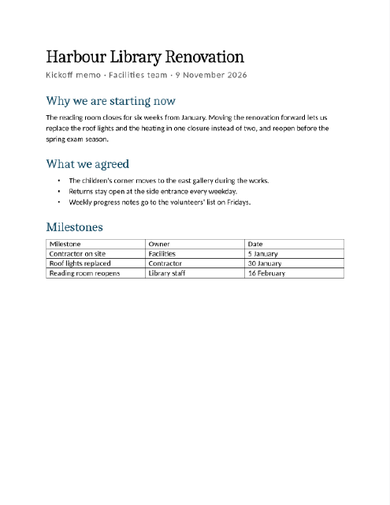

<!-- Generated by tools/gallery.mjs from showcase.yaml and build.json; do not edit. -->
# Project Kickoff Memo

[Doc](../README.md) › [Letters & Memos](../README.md#letters--memos) · `heading-styles` `bullets` `table` `memo`

A one-page internal memo with a title, built-in heading styles, a bulleted list and a milestone table.



| | |
|---|---|
| Document | [project-kickoff-memo.docx](project-kickoff-memo.docx) (8 KB) |
| Contents | 1 page; 106 words |
| Features | `doc.text.typing`, `doc.format.paragraph`, `doc.lists.bullets-numbering`, `doc.tables.edit` |
| Built by | `kition-doc` @ `e6d2eae5d0`: 53 commands in 23 ms |

## Checks

- `inspect.pages`: `{"count":1}`
- `inspect.words`: `{"min":100}`
- diagnostics: none (the kit's check finds nothing wrong)
- the saved document opens again; the thumbnail matches `thumb.png` within the `render` tolerance

## Steps

<details><summary>53 commands (from <a href="showcase.yaml">showcase.yaml</a>)</summary>

```yaml
- command: design.themeFonts
  params:
    heading: Caladea
    body: Carlito
- command: para.style
  params:
    style: Title
- command: text.insert
  params:
    text: Harbour Library Renovation
- command: text.newParagraph
- command: para.style
  params:
    style: Subtitle
- command: text.insert
  params:
    text: Kickoff memo · Facilities team · 9 November 2026
- command: text.newParagraph
- command: para.heading1
- command: text.insert
  params:
    text: Why we are starting now
- command: text.newParagraph
- command: para.normal
- command: text.insert
  params:
    text: The reading room closes for six weeks from January. Moving the renovation forward lets us replace the roof lights and the heating in one closure instead of two, and reopen before the spring exam season.
- command: text.newParagraph
- command: para.heading1
- command: text.insert
  params:
    text: What we agreed
- command: text.newParagraph
- command: para.normal
- command: para.bullets
- command: text.insert
  params:
    text: The children's corner moves to the east gallery during the works.
- command: text.newParagraph
- command: text.insert
  params:
    text: Returns stay open at the side entrance every weekday.
- command: text.newParagraph
- command: text.insert
  params:
    text: Weekly progress notes go to the volunteers' list on Fridays.
- command: text.newParagraph
- command: para.bullets
  params:
    off: true
- command: para.heading1
- command: text.insert
  params:
    text: Milestones
- command: text.newParagraph
- command: para.normal
- command: insert.table
  params:
    rows: 4
    cols: 3
- command: text.insert
  params:
    text: Milestone
- command: text.tab
- command: text.insert
  params:
    text: Owner
- command: text.tab
- command: text.insert
  params:
    text: Date
- command: text.tab
- command: text.insert
  params:
    text: Contractor on site
- command: text.tab
- command: text.insert
  params:
    text: Facilities
- command: text.tab
- command: text.insert
  params:
    text: 5 January
- command: text.tab
- command: text.insert
  params:
    text: Roof lights replaced
- command: text.tab
- command: text.insert
  params:
    text: Contractor
- command: text.tab
- command: text.insert
  params:
    text: 30 January
- command: text.tab
- command: text.insert
  params:
    text: Reading room reopens
- command: text.tab
- command: text.insert
  params:
    text: Library staff
- command: text.tab
- command: text.insert
  params:
    text: 16 February
```

</details>
