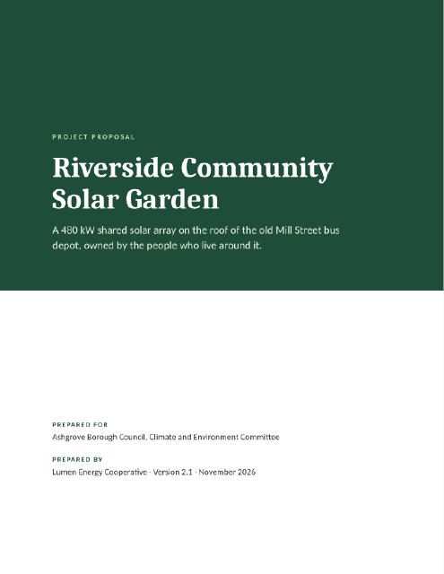

<!-- Generated by tools/gallery.mjs from showcase.yaml and build.json; do not edit. -->
# Community Solar Proposal

[Doc](../README.md) › [Reports & Proposals](../README.md#reports--proposals) · `proposal` `cover-page` `table-of-contents` `numbered-headings` `table` `page-numbers`

A four-page project proposal with a full-bleed cover, a table of contents, numbered headings and a budget table.



| | |
|---|---|
| Document | [project-proposal.docx](project-proposal.docx) (11 KB) |
| Contents | 4 pages; 478 words |
| Features | `doc.styles.manage`, `doc.lists.bullets-numbering`, `doc.references.notes-toc`, `doc.tables.edit`, `doc.headers.footers`, `doc.drawing.objects` |
| Built by | `kition-doc` @ `e6d2eae5d0`: 149 commands in 74 ms |

## About

The cover is a dark green band drawn as a floating rectangle behind the text, with the title set
in white over it. The headings are numbered by a multilevel list linked to Heading 1 and Heading 2
(1, 1.1, 2 …), so the table of contents on page two picks the numbers up, and it is updated last
so its page numbers are right. The footer shows the page number on every page except the cover.

## Checks

- `inspect.pages`: `{"count":4}`
- `inspect.words`: `{"min":420,"max":520}`
- `results.headings.num`: `{"min":1}`
- `results.budget.style`: `"ProposalTable"`
- `results.budget.look.totalRow`: `true`
- `results.section.titlePage`: `true`
- `results.section.footers.default`: `{"exists":true}`
- diagnostics: none (the kit's check finds nothing wrong)
- the saved document opens again; the thumbnail matches `thumb.png` within the `render` tolerance

## Steps

<details><summary>149 commands (from <a href="showcase.yaml">showcase.yaml</a>)</summary>

```yaml
- command: review.proofing
- command: design.themeFonts
  params:
    heading: Caladea
    body: Carlito
- command: styles.modify
  params:
    style: Normal
    chr:
      size: 11
    para:
      spaceAfter: 8
      lineSpacing:
        rule: multiple
        value: 1.15
- command: styles.modify
  params:
    style: Heading 1
    chr:
      size: 20
      color:
        Rgb:
          - 30
          - 77
          - 58
    para:
      spaceBefore: 24
      spaceAfter: 8
- command: styles.modify
  params:
    style: Heading 2
    chr:
      size: 14
      color:
        Rgb:
          - 46
          - 110
          - 84
    para:
      spaceBefore: 14
      spaceAfter: 4
- command: styles.create
  params:
    name: Cover Kicker
    basedOn: Normal
- command: styles.modify
  params:
    style: Cover Kicker
    chr:
      size: 10
      bold: true
      spacing: 2
      color:
        Rgb:
          - 185
          - 216
          - 167
    para:
      spaceBefore: 110
      spaceAfter: 14
- command: styles.create
  params:
    name: Cover Title
    basedOn: Normal
- command: styles.modify
  params:
    style: Cover Title
    chr:
      font: Caladea
      size: 40
      bold: true
      color:
        Rgb:
          - 255
          - 255
          - 255
    para:
      spaceAfter: 10
      lineSpacing:
        rule: multiple
        value: 0.95
- command: styles.create
  params:
    name: Cover Subtitle
    basedOn: Normal
- command: styles.modify
  params:
    style: Cover Subtitle
    chr:
      size: 15
      color:
        Rgb:
          - 227
          - 239
          - 220
    para:
      spaceAfter: 0
      indentRight: 60
- command: styles.create
  params:
    name: Cover Label
    basedOn: Normal
- command: styles.modify
  params:
    style: Cover Label
    chr:
      size: 9.5
      bold: true
      spacing: 1.5
      color:
        Rgb:
          - 30
          - 77
          - 58
    para:
      spaceAfter: 2
      keepNext: true
- command: styles.create
  params:
    name: Cover Value
    basedOn: Normal
- command: styles.modify
  params:
    style: Cover Value
    chr:
      size: 12
      color:
        Rgb:
          - 51
          - 51
          - 51
    para:
      spaceAfter: 16
- command: styles.modify
  params:
    style: TOC Heading
    para:
      pageBreakBefore: true
      numbering:
        num: 0
        level: 0
- command: para.style
  params:
    style: Cover Kicker
- command: drawing.insert
  params:
    kind: shape
    geometry:
      preset: rect
    frame:
      x: 0
      y: 0
      w: 612
      h: 400
    fill: "#1E4D3A"
    stroke:
      none: true
- command: arrange.wrap
  params:
    wrap: behindText
- command: select.collapse
- command: caret.docEnd
- command: text.insert
  params:
    text: PROJECT PROPOSAL
- command: text.newParagraph
- command: para.style
  params:
    style: Cover Title
- command: text.insert
  params:
    text: Riverside Community Solar Garden
- command: text.newParagraph
- command: para.style
  params:
    style: Cover Subtitle
- command: text.insert
  params:
    text: A 480 kW shared solar array on the roof of the old Mill Street bus depot, owned by the people who live around it.
- command: text.newParagraph
- command: para.style
  params:
    style: Cover Label
- command: para.spacing
  params:
    before: 230
- command: text.insert
  params:
    text: PREPARED FOR
- command: text.newParagraph
- command: para.style
  params:
    style: Cover Value
- command: para.spacing
  params:
    before: 0
- command: text.insert
  params:
    text: Ashgrove Borough Council, Climate and Environment Committee
- command: text.newParagraph
- command: para.style
  params:
    style: Cover Label
- command: text.insert
  params:
    text: PREPARED BY
- command: text.newParagraph
- command: para.style
  params:
    style: Cover Value
- command: text.insert
  params:
    text: Lumen Energy Cooperative · Version 2.1 · November 2026
- command: text.newParagraph
- command: para.style
  params:
    style: Normal
- command: references.toc
  params:
    levels: 2
    title: Contents
- command: caret.docEnd
- command: para.heading1
- command: para.pageBreakBefore
- command: list.define
  params:
    name: Proposal headings
    levels:
      - format: decimal
        text: "%1"
        style: Heading 1
        alignedAt: 0
        indentAt: 28
      - format: decimal
        text: "%1.%2"
        style: Heading 2
        alignedAt: 0
        indentAt: 36
  as: headings
- command: text.insert
  params:
    text: Executive summary
- command: text.newParagraph
- command: para.pageBreakBefore
- command: text.insert
  params:
    text: Lumen Energy Cooperative proposes to lease the roof of the disused Mill Street bus depot for twenty-five years and to install a 480 kW solar array on it, financed by a community share offer. The array would generate about 430 MWh a year, enough for some 160 homes, and sell the power to the council's leisure centre next door under a fixed-price agreement.
- command: text.newParagraph
- command: text.insert
  params:
    text: Members would receive a modest return on their shares, and a community fund of around £18,000 a year would go to energy-saving work in the surrounding streets. We ask the committee to approve the lease in principle so that a full planning application can be made in January.
- command: text.newParagraph
- command: para.heading1
- command: text.insert
  params:
    text: Background
- command: text.newParagraph
- command: para.heading2
- command: text.insert
  params:
    text: The site
- command: text.newParagraph
- command: text.insert
  params:
    text: The depot closed in 2019 and has stood empty since. Its roof is a single south-facing pitch of 3,100 square metres, recently re-covered, with no shading from the surrounding buildings. A structural survey carried out in September confirms that it can carry the panels and their frames without strengthening.
- command: text.newParagraph
- command: para.heading2
- command: text.insert
  params:
    text: Community demand
- command: text.newParagraph
- command: text.insert
  params:
    text: Two open evenings in the summer drew over three hundred residents, and 412 households have registered an interest in buying shares. Most asked for a minimum investment low enough for families on modest incomes; the share offer is designed around a £50 minimum.
- command: text.newParagraph
- command: para.heading1
- command: text.insert
  params:
    text: Proposed solution
- command: text.newParagraph
- command: para.heading2
- command: text.insert
  params:
    text: Array design
- command: text.newParagraph
- command: text.insert
  params:
    text: The array comprises 1,120 panels in twelve rows, feeding four string inverters in the former engineering store. A new connection to the leisure centre's switch room runs along the existing cable duct, so no road works are needed. Monitoring data will be published live on the cooperative's website.
- command: text.newParagraph
- command: para.heading2
- command: text.insert
  params:
    text: Membership model
- command: text.newParagraph
- command: text.insert
  params:
    text: Shares are offered first to residents of the four surrounding wards, then to the wider borough. Each member has one vote regardless of the size of their holding. Interest is capped at four per cent a year, and any surplus beyond that goes to the community fund.
- command: text.newParagraph
- command: para.heading1
- command: para.pageBreakBefore
- command: text.insert
  params:
    text: Budget
- command: text.newParagraph
- command: para.pageBreakBefore
- command: text.insert
  params:
    text: The capital cost is estimated at £612,000. The table below sets out the main items; a detailed cost plan is available on request.
- command: text.newParagraph
- command: insert.table
  params:
    rows: 6
    cols: 2
- command: table.newStyle
  params:
    name: Proposal Table
    wholeTable:
      borders: false
      size: 10.5
    para:
      spaceAfter: 0
      lineSpacing:
        rule: multiple
        value: 1
    headerRow:
      fill: 1E4D3A
      color: FFFFFF
      bold: true
    bandedRows:
      fill: EEF4EA
    lastRow:
      bold: true
      fill: D5E6CC
    apply: true
- command: table.look
  params:
    headerRow: true
    bandedRows: true
    totalRow: true
    firstColumn: false
- command: table.cellMargins
  params:
    top: 4
    bottom: 4
    left: 8
    right: 8
- command: text.insert
  params:
    text: Item
- command: text.tab
- command: text.insert
  params:
    text: Cost
- command: para.alignRight
- command: text.tab
- command: text.insert
  params:
    text: Panels, frames and inverters
- command: text.tab
- command: text.insert
  params:
    text: £418,000
- command: para.alignRight
- command: text.tab
- command: text.insert
  params:
    text: Installation and scaffolding
- command: text.tab
- command: text.insert
  params:
    text: £96,000
- command: para.alignRight
- command: text.tab
- command: text.insert
  params:
    text: Grid connection and metering
- command: text.tab
- command: text.insert
  params:
    text: £54,000
- command: para.alignRight
- command: text.tab
- command: text.insert
  params:
    text: Legal, share offer and contingency
- command: text.tab
- command: text.insert
  params:
    text: £44,000
- command: para.alignRight
- command: text.tab
- command: text.insert
  params:
    text: Total capital cost
- command: text.tab
- command: text.insert
  params:
    text: £612,000
- command: para.alignRight
- command: para.spacing
  params:
    before: 0
    after: 0
- command: para.lineSpacing
  params:
    value: 1
- command: table.selectTable
- command: para.spacing
  params:
    before: 0
    after: 0
- command: para.lineSpacing
  params:
    value: 1
- command: table.rowHeight
  params:
    height: 22
    rule: atLeast
- command: select.collapse
- command: table.properties
  as: budget
- command: caret.docEnd
- command: para.heading1
- command: text.insert
  params:
    text: Next steps
- command: text.newParagraph
- command: para.numbering
  params:
    kind: numbered
- command: text.insert
  params:
    text: Committee approves the roof lease in principle (December 2026).
- command: text.newParagraph
- command: text.insert
  params:
    text: Planning application submitted (January 2027).
- command: text.newParagraph
- command: text.insert
  params:
    text: Share offer opens to the four wards (March 2027).
- command: text.newParagraph
- command: text.insert
  params:
    text: Installation over the summer; first power by September 2027.
- command: caret.docStart
- command: layout.differentFirstPage
- command: insert.footer
  params:
    preset: pageNumber
- command: insert.closeHeader
- command: references.updateToc
- command: layout.section
  as: section
- command: document.inspect
  as: doc
```

</details>
