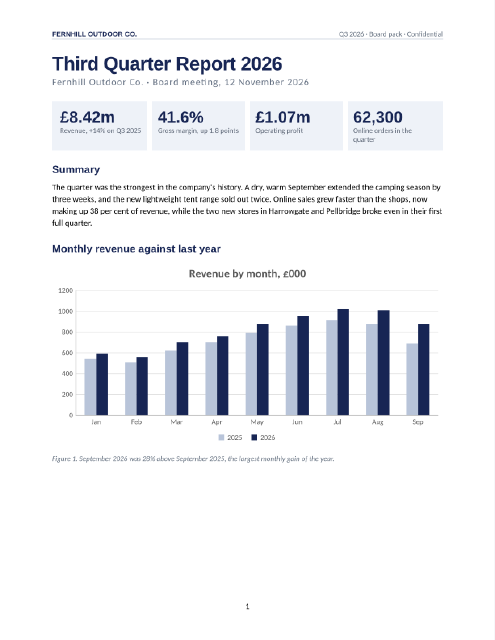

<!-- Generated by tools/gallery.mjs from showcase.yaml and build.json; do not edit. -->
# Quarterly Business Report

[Doc](../README.md) › [Reports & Proposals](../README.md#reports--proposals) · `report` `chart` `table` `kpi` `header-footer`

A two-page board report with a KPI strip, a column chart of revenue against last year and a regional results table.



| | |
|---|---|
| Document | [quarterly-business-report.docx](quarterly-business-report.docx) (14 KB) |
| Contents | 2 pages; 271 words |
| Features | `doc.drawing.objects`, `doc.tables.edit`, `doc.styles.manage`, `doc.headers.footers`, `doc.format.paragraph` |
| Built by | `kition-doc` @ `e6d2eae5d0`: 174 commands in 69 ms |

## About

The four headline numbers sit in a borderless one-row table with tinted cells. The chart is a
native Word chart (a column chart with two series, a title and a bottom legend) set up with
`drawing.chart`, so it opens as an editable chart in Word. The results table uses a custom table
style with a dark header row, banded rows and a bold total row. Charts cannot carry alternative
text yet, so the check names `doc.missing-alt-text`.

## Checks

- `inspect.pages`: `{"count":2}`
- `inspect.words`: `{"min":240,"max":330}`
- `results.chart.id`: `{"exists":true}`
- `results.results.style`: `"Results"`
- `results.results.look.totalRow`: `true`
- `results.section.headers.default`: `{"exists":true}`
- `results.section.footers.default`: `{"exists":true}`
- diagnostics: `doc.missing-alt-text`
- the saved document opens again; the thumbnail matches `thumb.png` within the `render` tolerance

## Steps

<details><summary>174 commands (from <a href="showcase.yaml">showcase.yaml</a>)</summary>

```yaml
- command: review.proofing
- command: design.themeFonts
  params:
    heading: Arimo
    body: Carlito
- command: styles.modify
  params:
    style: Normal
    chr:
      size: 10.5
    para:
      spaceAfter: 6
      lineSpacing:
        rule: multiple
        value: 1.15
- command: styles.modify
  params:
    style: Title
    chr:
      font: Arimo
      size: 24
      bold: true
      spacing: -0.5
      color:
        Rgb:
          - 23
          - 37
          - 84
    para:
      spaceAfter: 2
- command: styles.modify
  params:
    style: Subtitle
    chr:
      size: 12
      color:
        Rgb:
          - 100
          - 112
          - 130
    para:
      spaceAfter: 14
- command: styles.modify
  params:
    style: Heading 1
    chr:
      font: Arimo
      size: 13
      bold: true
      color:
        Rgb:
          - 23
          - 37
          - 84
    para:
      spaceBefore: 16
      spaceAfter: 6
- command: styles.create
  params:
    name: KPI Value
    basedOn: Normal
- command: styles.modify
  params:
    style: KPI Value
    chr:
      font: Arimo
      size: 20
      bold: true
      color:
        Rgb:
          - 23
          - 37
          - 84
    para:
      spaceAfter: 0
      lineSpacing:
        rule: multiple
        value: 1
- command: styles.create
  params:
    name: KPI Label
    basedOn: Normal
- command: styles.modify
  params:
    style: KPI Label
    chr:
      size: 9
      color:
        Rgb:
          - 90
          - 100
          - 116
    para:
      spaceAfter: 0
      lineSpacing:
        rule: multiple
        value: 1
- command: layout.margins
  params:
    top: 64
    bottom: 64
    left: 64
    right: 64
- command: para.style
  params:
    style: Title
- command: text.insert
  params:
    text: Third Quarter Report 2026
- command: text.newParagraph
- command: para.style
  params:
    style: Subtitle
- command: text.insert
  params:
    text: Fernhill Outdoor Co. · Board meeting, 12 November 2026
- command: text.newParagraph
- command: insert.table
  params:
    rows: 1
    cols: 4
- command: table.selectTable
- command: table.borders
  params:
    kind: none
- command: table.borders
  params:
    kind: inside
    width: 6
    color: FFFFFF
- command: table.shading
  params:
    color: EEF2F8
- command: select.collapse
- command: table.cellMargins
  params:
    top: 8
    bottom: 8
    left: 10
    right: 10
- command: para.style
  params:
    style: KPI Value
- command: text.insert
  params:
    text: £8.42m
- command: text.newParagraph
- command: para.style
  params:
    style: KPI Label
- command: text.insert
  params:
    text: Revenue, +14% on Q3 2025
- command: text.tab
- command: para.style
  params:
    style: KPI Value
- command: text.insert
  params:
    text: 41.6%
- command: text.newParagraph
- command: para.style
  params:
    style: KPI Label
- command: text.insert
  params:
    text: Gross margin, up 1.8 points
- command: text.tab
- command: para.style
  params:
    style: KPI Value
- command: text.insert
  params:
    text: £1.07m
- command: text.newParagraph
- command: para.style
  params:
    style: KPI Label
- command: text.insert
  params:
    text: Operating profit
- command: text.tab
- command: para.style
  params:
    style: KPI Value
- command: text.insert
  params:
    text: 62,300
- command: text.newParagraph
- command: para.style
  params:
    style: KPI Label
- command: text.insert
  params:
    text: Online orders in the quarter
- command: caret.docEnd
- command: para.style
  params:
    style: Heading 1
- command: text.insert
  params:
    text: Summary
- command: text.newParagraph
- command: text.insert
  params:
    text: The quarter was the strongest in the company's history. A dry, warm September extended the camping season by three weeks, and the new lightweight tent range sold out twice. Online sales grew faster than the shops, now making up 38 per cent of revenue, while the two new stores in Harrowgate and Pellbridge broke even in their first full quarter.
- command: text.newParagraph
- command: para.style
  params:
    style: Heading 1
- command: text.insert
  params:
    text: Monthly revenue against last year
- command: text.newParagraph
- command: drawing.insert
  params:
    kind: chart
    frame:
      w: 484
      h: 230
    chart:
      kind: column
      title: Revenue by month, £000
      categories:
        - Jan
        - Feb
        - Mar
        - Apr
        - May
        - Jun
        - Jul
        - Aug
        - Sep
      series:
        - name: "2025"
          values:
            - 540
            - 510
            - 620
            - 700
            - 790
            - 860
            - 910
            - 880
            - 690
          color: B8C4D9
        - name: "2026"
          values:
            - 590
            - 560
            - 700
            - 760
            - 880
            - 950
            - 1020
            - 1010
            - 880
          color: "172554"
      legend: bottom
      gridlines: true
  as: chart
- command: caret.end
- command: text.newParagraph
- command: format.set
  params:
    props:
      size: 9
      italic: true
- command: format.color
  params:
    color: 64707F
- command: text.insert
  params:
    text: Figure 1. September 2026 was 28% above September 2025, the largest monthly gain of the year.
- command: text.newParagraph
- command: format.set
  params:
    props:
      size: 10.5
      italic: false
- command: format.color
  params:
    color: auto
- command: para.style
  params:
    style: Heading 1
- command: para.pageBreakBefore
- command: text.insert
  params:
    text: Results by region
- command: text.newParagraph
- command: para.pageBreakBefore
- command: insert.table
  params:
    rows: 6
    cols: 4
- command: table.newStyle
  params:
    name: Results
    wholeTable:
      borders: false
      size: 10
    headerRow:
      fill: "172554"
      color: FFFFFF
      bold: true
    bandedRows:
      fill: F1F4F9
    lastRow:
      bold: true
      fill: DCE3EE
    apply: true
- command: table.look
  params:
    headerRow: true
    bandedRows: true
    totalRow: true
    firstColumn: false
- command: table.cellMargins
  params:
    top: 4
    bottom: 4
    left: 8
    right: 8
- command: text.insert
  params:
    text: Region
- command: text.tab
- command: text.insert
  params:
    text: Revenue (£000)
- command: para.alignRight
- command: text.tab
- command: text.insert
  params:
    text: Change
- command: para.alignRight
- command: text.tab
- command: text.insert
  params:
    text: Margin
- command: para.alignRight
- command: text.tab
- command: text.insert
  params:
    text: North
- command: text.tab
- command: text.insert
  params:
    text: 2,310
- command: para.alignRight
- command: text.tab
- command: text.insert
  params:
    text: +11%
- command: para.alignRight
- command: text.tab
- command: text.insert
  params:
    text: 40.2%
- command: para.alignRight
- command: text.tab
- command: text.insert
  params:
    text: Midlands
- command: text.tab
- command: text.insert
  params:
    text: 1,840
- command: para.alignRight
- command: text.tab
- command: text.insert
  params:
    text: +9%
- command: para.alignRight
- command: text.tab
- command: text.insert
  params:
    text: 39.5%
- command: para.alignRight
- command: text.tab
- command: text.insert
  params:
    text: South and West
- command: text.tab
- command: text.insert
  params:
    text: 1,050
- command: para.alignRight
- command: text.tab
- command: text.insert
  params:
    text: +6%
- command: para.alignRight
- command: text.tab
- command: text.insert
  params:
    text: 38.8%
- command: para.alignRight
- command: text.tab
- command: text.insert
  params:
    text: Online
- command: text.tab
- command: text.insert
  params:
    text: 3,220
- command: para.alignRight
- command: text.tab
- command: text.insert
  params:
    text: +24%
- command: para.alignRight
- command: text.tab
- command: text.insert
  params:
    text: 44.9%
- command: para.alignRight
- command: text.tab
- command: text.insert
  params:
    text: Total
- command: text.tab
- command: text.insert
  params:
    text: 8,420
- command: para.alignRight
- command: text.tab
- command: text.insert
  params:
    text: +14%
- command: para.alignRight
- command: text.tab
- command: text.insert
  params:
    text: 41.6%
- command: para.alignRight
- command: para.spacing
  params:
    before: 0
    after: 0
- command: table.selectTable
- command: para.spacing
  params:
    before: 0
    after: 0
- command: select.collapse
- command: table.properties
  as: results
- command: caret.docEnd
- command: para.style
  params:
    style: Heading 1
- command: text.insert
  params:
    text: Cash and stock
- command: text.newParagraph
- command: text.insert
  params:
    text: Cash at the end of September stood at £2.9m, after paying £0.6m for the new stores' fit-out. Stock rose to £3.4m ahead of the winter season, which is in line with plan; slow-moving lines are below 4 per cent of the total, the lowest level for three years.
- command: text.newParagraph
- command: para.style
  params:
    style: Heading 1
- command: text.insert
  params:
    text: Outlook for the fourth quarter
- command: text.newParagraph
- command: para.bullets
- command: text.insert
  params:
    text: Christmas trading is planned at £3.1m, with the winter clothing range arriving in stores on 1 November.
- command: text.newParagraph
- command: text.insert
  params:
    text: The new warehouse management system goes live in January, after the peak, to keep the risk low.
- command: text.newParagraph
- command: text.insert
  params:
    text: Freight costs have eased by about 6 per cent since the summer; we expect a further small margin gain.
- command: text.newParagraph
- command: text.insert
  params:
    text: The board is asked to approve a third new store, in Castlewick, for opening in spring 2027.
- command: insert.editHeader
- command: para.tabs
  params:
    clear:
      - 234
      - 468
    set:
      - pos: 484
        align: right
- command: format.set
  params:
    props:
      font: Arimo
      size: 8.5
      bold: true
      italic: false
- command: format.color
  params:
    color: "172554"
- command: text.insert
  params:
    text: FERNHILL OUTDOOR CO.
- command: format.set
  params:
    props:
      font: Carlito
      size: 9
      bold: false
- command: format.color
  params:
    color: 64707F
- command: text.insert
  params:
    text: "\tQ3 2026 · Board pack · Confidential"
- command: para.borders
  params:
    kind: bottom
    width: 0.75
    color: C8D0DC
- command: insert.closeHeader
- command: insert.footer
  params:
    preset: pageNumber
- command: insert.closeHeader
- command: layout.section
  as: section
```

</details>
