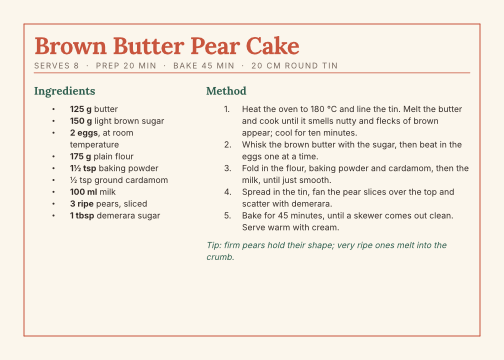

<!-- Generated by tools/gallery.mjs from showcase.yaml and build.json; do not edit. -->
# Recipe Card

[Doc](../README.md) › [Newsletters & Layout](../README.md#newsletters--layout) · `recipe` `columns` `numbering` `custom-page-size` `page-color`

A 7 × 5 inch recipe card — title and timing line over unequal columns, ingredients in a narrow column and numbered method steps in the wide one, on a tinted page.



| | |
|---|---|
| Document | [recipe-card.docx](recipe-card.docx) (8 KB) |
| Contents | 1 page; 154 words |
| Features | `doc.layout.page-setup`, `doc.lists.bullets-numbering`, `doc.design.page`, `doc.styles.manage`, `doc.format.paragraph` |
| Built by | `kition-doc` @ `e6d2eae5d0`: 88 commands in 34 ms |

## About

The page is a custom 7 × 5 inch card. The title block runs full width; a continuous section
break then sets two columns of unequal width (a narrow ingredients column and a wide method
column) with a column break between them. Ingredients are a bulleted list with quantities in
bold, the method is a numbered list, and the card has a cream page colour and a thin border.

## Checks

- `inspect.pages`: `{"count":1}`
- `inspect.pages.0.area`: `{"width":504,"height":360}`
- `results.card.pageW`: `504`
- `results.card.pageH`: `360`
- `results.columns.columns.count`: `2`
- diagnostics: none (the kit's check finds nothing wrong)
- the saved document opens again; the thumbnail matches `thumb.png` within the `render` tolerance

## Steps

<details><summary>88 commands (from <a href="showcase.yaml">showcase.yaml</a>)</summary>

```yaml
- command: review.proofing
  as: proofing
- command: layout.size
  params:
    width: 360
    height: 504
- command: layout.orientation
  params:
    value: landscape
  as: card
- command: layout.margins
  params:
    top: 30
    bottom: 26
    left: 34
    right: 34
- command: design.themeFonts
  params:
    heading: Lora
    body: Inter
- command: design.pageColor
  params:
    color: FBF6EC
- command: design.pageBorders
  params:
    kind: box
    width: 1
    color: C8553D
    style: single
- command: styles.modify
  params:
    style: Normal
    chr:
      size: 8.5
      color:
        Rgb:
          - 52
          - 44
          - 40
    para:
      align: left
      spaceBefore: 0
      spaceAfter: 3
      lineSpacing:
        rule: multiple
        value: 1.15
- command: styles.modify
  params:
    style: Title
    chr:
      size: 24
      bold: true
      color:
        Rgb:
          - 200
          - 85
          - 61
    para:
      align: left
      spaceAfter: 0
- command: styles.create
  params:
    name: Recipe Meta
    basedOn: Normal
- command: styles.modify
  params:
    style: Recipe Meta
    chr:
      size: 8
      caps: true
      spacing: 1
      color:
        Rgb:
          - 120
          - 105
          - 95
    para:
      spaceAfter: 10
- command: styles.create
  params:
    name: Card Heading
    basedOn: Normal
- command: styles.modify
  params:
    style: Card Heading
    chr:
      font: Lora
      size: 11
      bold: true
      color:
        Rgb:
          - 46
          - 94
          - 78
    para:
      spaceAfter: 4
- command: para.style
  params:
    style: Title
- command: text.insert
  params:
    text: Brown Butter Pear Cake
- command: text.newParagraph
- command: para.style
  params:
    style: Recipe Meta
- command: para.borders
  params:
    kind: bottom
    width: 0.75
    color: C8553D
- command: text.insert
  params:
    text: Serves 8  ·  Prep 20 min  ·  Bake 45 min  ·  20 cm round tin
- command: text.newParagraph
- command: para.borders
  params:
    kind: none
- command: layout.break
  params:
    kind: continuous
- command: layout.columns
  params:
    widths:
      - - 150
        - 22
      - - 264
        - 0
  as: columns
- command: para.style
  params:
    style: Card Heading
- command: text.insert
  params:
    text: Ingredients
- command: text.newParagraph
- command: para.normal
- command: para.bullets
  params:
    kind: •
- command: text.insert
  params:
    text: 125 g butter
- command: text.newParagraph
- command: text.insert
  params:
    text: 150 g light brown sugar
- command: text.newParagraph
- command: text.insert
  params:
    text: 2 eggs, at room temperature
- command: text.newParagraph
- command: text.insert
  params:
    text: 175 g plain flour
- command: text.newParagraph
- command: text.insert
  params:
    text: 1½ tsp baking powder
- command: text.newParagraph
- command: text.insert
  params:
    text: ½ tsp ground cardamom
- command: text.newParagraph
- command: text.insert
  params:
    text: 100 ml milk
- command: text.newParagraph
- command: text.insert
  params:
    text: 3 ripe pears, sliced
- command: text.newParagraph
- command: text.insert
  params:
    text: 1 tbsp demerara sugar
- command: text.newParagraph
- command: para.bullets
  params:
    off: true
- command: para.style
  params:
    style: Card Heading
- command: text.columnBreak
- command: text.insert
  params:
    text: Method
- command: text.newParagraph
- command: para.normal
- command: para.numbering
  params:
    kind: numbered
  as: steps
- command: text.insert
  params:
    text: Heat the oven to 180 °C and line the tin. Melt the butter and cook until it smells nutty and flecks of brown appear; cool for ten minutes.
- command: text.newParagraph
- command: text.insert
  params:
    text: Whisk the brown butter with the sugar, then beat in the eggs one at a time.
- command: text.newParagraph
- command: text.insert
  params:
    text: Fold in the flour, baking powder and cardamom, then the milk, until just smooth.
- command: text.newParagraph
- command: text.insert
  params:
    text: Spread in the tin, fan the pear slices over the top and scatter with demerara.
- command: text.newParagraph
- command: text.insert
  params:
    text: Bake for 45 minutes, until a skewer comes out clean. Serve warm with cream.
- command: text.newParagraph
- command: para.numbering
  params:
    off: true
- command: para.spacing
  params:
    before: 6
- command: text.insert
  params:
    text: "Tip: firm pears hold their shape; very ripe ones melt into the crumb."
- command: select.paragraph
- command: format.italic
  params:
    value: true
- command: format.color
  params:
    color: 2E5E4E
- command: select.text
  params:
    text: 125 g
- command: format.bold
  params:
    value: true
- command: select.text
  params:
    text: 150 g
- command: format.bold
  params:
    value: true
- command: select.text
  params:
    text: 2 eggs
- command: format.bold
  params:
    value: true
- command: select.text
  params:
    text: 175 g
- command: format.bold
  params:
    value: true
- command: select.text
  params:
    text: 1½ tsp
- command: format.bold
  params:
    value: true
- command: select.text
  params:
    text: ½ tsp
- command: format.bold
  params:
    value: true
- command: select.text
  params:
    text: 100 ml
- command: format.bold
  params:
    value: true
- command: select.text
  params:
    text: 3 ripe
- command: format.bold
  params:
    value: true
- command: select.text
  params:
    text: 1 tbsp
- command: format.bold
  params:
    value: true
- command: select.collapse
```

</details>
