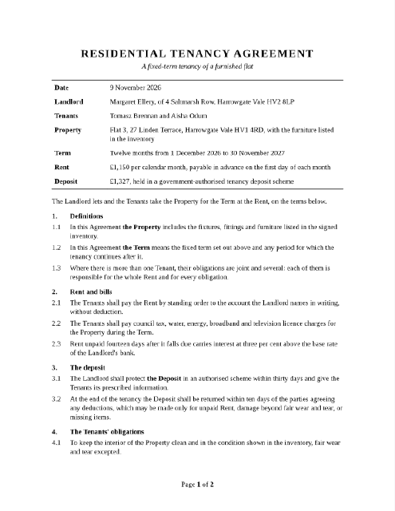

<!-- Generated by tools/gallery.mjs from showcase.yaml and build.json; do not edit. -->
# Residential Lease Agreement

[Doc](../README.md) › [Contracts & Forms](../README.md#contracts--forms) · `contract` `legal-numbering` `multilevel-list` `table` `tab-stops` `header-footer`

A two-page tenancy agreement with a particulars table, two-level legal clause numbering, defined terms and signature lines.



| | |
|---|---|
| Document | [residential-lease-agreement.docx](residential-lease-agreement.docx) (10 KB) |
| Contents | 2 pages; 616 words |
| Features | `doc.text.typing`, `doc.format.character`, `doc.format.paragraph`, `doc.lists.bullets-numbering`, `doc.tables.edit`, `doc.headers.footers` |
| Built by | `kition-doc` @ `e6d2eae5d0`: 276 commands in 91 ms |

## About

A fixed-term tenancy set in Tinos. The particulars sit in a table with only top and bottom
rules; the clauses are one list defined with `list.define`, so clause numbers (1.) and
sub-clause numbers (1.1) hang at the same indent, with bold headings kept with their first
sub-clause. Defined terms are set in bold where they are introduced. The signature block uses
underscore tab leaders for the signature and date lines, and the footer shows "Page x of y".

## Checks

- `inspect.pages`: `{"count":2}`
- `inspect.words`: `{"min":580,"max":660}`
- `results.list.levels.0`: `{"format":"decimal","text":"%1.","bold":true,"indentAt":28}`
- `results.list.levels.1`: `{"format":"decimal","text":"%1.%2","indentAt":28}`
- `results.section.footers.default`: `{"exists":true}`
- `results.section.marginLeft`: `80`
- diagnostics: none (the kit's check finds nothing wrong)
- the saved document opens again; the thumbnail matches `thumb.png` within the `render` tolerance

## Steps

<details><summary>276 commands (from <a href="showcase.yaml">showcase.yaml</a>)</summary>

```yaml
- command: review.proofing
- command: design.themeFonts
  params:
    heading: Tinos
    body: Tinos
- command: styles.modify
  params:
    style: Normal
    chr:
      size: 11
    para:
      spaceAfter: 6
      lineSpacing:
        rule: multiple
        value: 1.1
- command: layout.margins
  params:
    top: 72
    bottom: 72
    left: 80
    right: 80
- command: para.alignCenter
- command: para.spacing
  params:
    after: 2
- command: format.set
  params:
    props:
      size: 17
      bold: true
- command: format.spacing
  params:
    points: 1.5
- command: text.insert
  params:
    text: RESIDENTIAL TENANCY AGREEMENT
- command: text.newParagraph
- command: para.spacing
  params:
    after: 14
- command: format.set
  params:
    props:
      size: 11
      bold: false
      italic: true
- command: format.spacing
  params:
    points: 0
- command: text.insert
  params:
    text: A fixed-term tenancy of a furnished flat
- command: text.newParagraph
- command: format.set
  params:
    props:
      italic: false
- command: para.alignLeft
- command: para.spacing
  params:
    after: 6
- command: insert.table
  params:
    rows: 7
    cols: 2
- command: table.borders
  params:
    kind: none
- command: format.bold
  params:
    value: true
- command: text.insert
  params:
    text: Date
- command: format.bold
  params:
    value: false
- command: text.tab
- command: text.insert
  params:
    text: 9 November 2026
- command: text.tab
- command: format.bold
  params:
    value: true
- command: text.insert
  params:
    text: Landlord
- command: format.bold
  params:
    value: false
- command: text.tab
- command: text.insert
  params:
    text: Margaret Ellery, of 4 Saltmarsh Row, Harrowgate Vale HV2 8LP
- command: text.tab
- command: format.bold
  params:
    value: true
- command: text.insert
  params:
    text: Tenants
- command: format.bold
  params:
    value: false
- command: text.tab
- command: text.insert
  params:
    text: Tomasz Brennan and Aisha Odum
- command: text.tab
- command: format.bold
  params:
    value: true
- command: text.insert
  params:
    text: Property
- command: format.bold
  params:
    value: false
- command: text.tab
- command: text.insert
  params:
    text: Flat 3, 27 Linden Terrace, Harrowgate Vale HV1 4RD, with the furniture listed in the inventory
- command: text.tab
- command: format.bold
  params:
    value: true
- command: text.insert
  params:
    text: Term
- command: format.bold
  params:
    value: false
- command: text.tab
- command: text.insert
  params:
    text: Twelve months from 1 December 2026 to 30 November 2027
- command: text.tab
- command: format.bold
  params:
    value: true
- command: text.insert
  params:
    text: Rent
- command: format.bold
  params:
    value: false
- command: text.tab
- command: text.insert
  params:
    text: £1,150 per calendar month, payable in advance on the first day of each month
- command: text.tab
- command: format.bold
  params:
    value: true
- command: text.insert
  params:
    text: Deposit
- command: format.bold
  params:
    value: false
- command: text.tab
- command: text.insert
  params:
    text: £1,327, held in a government-authorised tenancy deposit scheme
- command: table.selectTable
- command: table.borders
  params:
    kind: top
    width: 1
    color: "404040"
- command: table.borders
  params:
    kind: bottom
    width: 1
    color: "404040"
- command: para.spacing
  params:
    before: 0
    after: 0
- command: table.cellMargins
  params:
    top: 4
    bottom: 4
    left: 4
    right: 4
- command: caret.docStart
- command: caret.paraDown
- command: caret.paraDown
- command: table.columnWidth
  params:
    width: 86
- command: text.tab
- command: table.columnWidth
  params:
    width: 366
- command: caret.docEnd
- command: para.spacing
  params:
    before: 12
    after: 8
- command: text.insert
  params:
    text: The Landlord lets and the Tenants take the Property for the Term at the Rent, on the terms below.
- command: text.newParagraph
- command: para.spacing
  params:
    before: 0
    after: 4
- command: list.define
  params:
    levels:
      - format: decimal
        text: "%1."
        alignedAt: 0
        indentAt: 28
        bold: true
      - format: decimal
        text: "%1.%2"
        alignedAt: 0
        indentAt: 28
  as: clauses
- command: para.listLevel
  params:
    level: 0
- command: para.set
  params:
    props:
      keepNext: true
      contextualSpacing: false
- command: para.spacing
  params:
    before: 9
    after: 3
- command: format.bold
  params:
    value: true
- command: text.insert
  params:
    text: Definitions
- command: format.bold
  params:
    value: false
- command: text.newParagraph
- command: select.paragraph
- command: format.bold
  params:
    value: false
- command: para.set
  params:
    props:
      keepNext: false
- command: para.listLevel
  params:
    level: 1
- command: para.spacing
  params:
    before: 0
    after: 4
- command: text.insert
  params:
    text: "In this Agreement "
- command: format.bold
  params:
    value: true
- command: text.insert
  params:
    text: the Property
- command: format.bold
  params:
    value: false
- command: text.insert
  params:
    text: " includes the fixtures, fittings and furniture listed in the signed inventory."
- command: text.newParagraph
- command: text.insert
  params:
    text: "In this Agreement "
- command: format.bold
  params:
    value: true
- command: text.insert
  params:
    text: the Term
- command: format.bold
  params:
    value: false
- command: text.insert
  params:
    text: " means the fixed term set out above and any period for which the tenancy continues after it."
- command: text.newParagraph
- command: text.insert
  params:
    text: "Where there is more than one Tenant, their obligations are joint and several: each of them is responsible for the whole Rent and for every obligation."
- command: text.newParagraph
- command: para.listLevel
  params:
    level: 0
- command: para.set
  params:
    props:
      keepNext: true
      contextualSpacing: false
- command: para.spacing
  params:
    before: 9
    after: 3
- command: format.bold
  params:
    value: true
- command: text.insert
  params:
    text: Rent and bills
- command: format.bold
  params:
    value: false
- command: text.newParagraph
- command: select.paragraph
- command: format.bold
  params:
    value: false
- command: para.set
  params:
    props:
      keepNext: false
- command: para.listLevel
  params:
    level: 1
- command: para.spacing
  params:
    before: 0
    after: 4
- command: text.insert
  params:
    text: The Tenants shall pay the Rent by standing order to the account the Landlord names in writing, without deduction.
- command: text.newParagraph
- command: text.insert
  params:
    text: The Tenants shall pay council tax, water, energy, broadband and television licence charges for the Property during the Term.
- command: text.newParagraph
- command: text.insert
  params:
    text: Rent unpaid fourteen days after it falls due carries interest at three per cent above the base rate of the Landlord's bank.
- command: text.newParagraph
- command: para.listLevel
  params:
    level: 0
- command: para.set
  params:
    props:
      keepNext: true
      contextualSpacing: false
- command: para.spacing
  params:
    before: 9
    after: 3
- command: format.bold
  params:
    value: true
- command: text.insert
  params:
    text: The deposit
- command: format.bold
  params:
    value: false
- command: text.newParagraph
- command: select.paragraph
- command: format.bold
  params:
    value: false
- command: para.set
  params:
    props:
      keepNext: false
- command: para.listLevel
  params:
    level: 1
- command: para.spacing
  params:
    before: 0
    after: 4
- command: text.insert
  params:
    text: "The Landlord shall protect "
- command: format.bold
  params:
    value: true
- command: text.insert
  params:
    text: the Deposit
- command: format.bold
  params:
    value: false
- command: text.insert
  params:
    text: " in an authorised scheme within thirty days and give the Tenants its prescribed information."
- command: text.newParagraph
- command: text.insert
  params:
    text: At the end of the tenancy the Deposit shall be returned within ten days of the parties agreeing any deductions, which may be made only for unpaid Rent, damage beyond fair wear and tear, or missing items.
- command: text.newParagraph
- command: para.listLevel
  params:
    level: 0
- command: para.set
  params:
    props:
      keepNext: true
      contextualSpacing: false
- command: para.spacing
  params:
    before: 9
    after: 3
- command: format.bold
  params:
    value: true
- command: text.insert
  params:
    text: The Tenants' obligations
- command: format.bold
  params:
    value: false
- command: text.newParagraph
- command: select.paragraph
- command: format.bold
  params:
    value: false
- command: para.set
  params:
    props:
      keepNext: false
- command: para.listLevel
  params:
    level: 1
- command: para.spacing
  params:
    before: 0
    after: 4
- command: text.insert
  params:
    text: To keep the interior of the Property clean and in the condition shown in the inventory, fair wear and tear excepted.
- command: text.newParagraph
- command: text.insert
  params:
    text: Not to keep pets, smoke indoors or sublet any part of the Property without the Landlord's written consent, which shall not be withheld unreasonably.
- command: text.newParagraph
- command: text.insert
  params:
    text: To report promptly any repair the Landlord is responsible for, and any damp, leak or fault in the gas or electrical installations.
- command: text.newParagraph
- command: text.insert
  params:
    text: To allow the Landlord or her contractors access at reasonable times on at least twenty-four hours' written notice, except in an emergency.
- command: text.newParagraph
- command: para.listLevel
  params:
    level: 0
- command: para.set
  params:
    props:
      keepNext: true
      contextualSpacing: false
- command: para.spacing
  params:
    before: 9
    after: 3
- command: format.bold
  params:
    value: true
- command: text.insert
  params:
    text: The Landlord's obligations
- command: format.bold
  params:
    value: false
- command: text.newParagraph
- command: select.paragraph
- command: format.bold
  params:
    value: false
- command: para.set
  params:
    props:
      keepNext: false
- command: para.listLevel
  params:
    level: 1
- command: para.spacing
  params:
    before: 0
    after: 4
- command: text.insert
  params:
    text: To keep in repair the structure and exterior of the Property and the installations for water, gas, electricity, sanitation and heating.
- command: text.newParagraph
- command: text.insert
  params:
    text: To have the gas appliances checked every year and the electrical installation every five years, and to give the Tenants copies of the certificates.
- command: text.newParagraph
- command: text.insert
  params:
    text: To allow the Tenants quiet enjoyment of the Property without interruption by the Landlord or anyone acting for her.
- command: text.newParagraph
- command: para.listLevel
  params:
    level: 0
- command: para.set
  params:
    props:
      keepNext: true
      contextualSpacing: false
- command: para.spacing
  params:
    before: 9
    after: 3
- command: format.bold
  params:
    value: true
- command: text.insert
  params:
    text: Ending the tenancy
- command: format.bold
  params:
    value: false
- command: text.newParagraph
- command: select.paragraph
- command: format.bold
  params:
    value: false
- command: para.set
  params:
    props:
      keepNext: false
- command: para.listLevel
  params:
    level: 1
- command: para.spacing
  params:
    before: 0
    after: 4
- command: text.insert
  params:
    text: The Tenants may end the tenancy at the end of the Term by giving at least one month's written notice.
- command: text.newParagraph
- command: text.insert
  params:
    text: On leaving, the Tenants shall return all keys, remove their belongings and leave the Property in the condition required by clause 4.1.
- command: text.newParagraph
- command: text.insert
  params:
    text: If the Tenants remain after the Term, the tenancy continues from month to month on the same terms until either party ends it by proper notice.
- command: text.newParagraph
- command: para.listLevel
  params:
    level: 0
- command: para.set
  params:
    props:
      keepNext: true
      contextualSpacing: false
- command: para.spacing
  params:
    before: 9
    after: 3
- command: format.bold
  params:
    value: true
- command: text.insert
  params:
    text: General
- command: format.bold
  params:
    value: false
- command: text.newParagraph
- command: select.paragraph
- command: format.bold
  params:
    value: false
- command: para.set
  params:
    props:
      keepNext: false
- command: para.listLevel
  params:
    level: 1
- command: para.spacing
  params:
    before: 0
    after: 4
- command: text.insert
  params:
    text: This Agreement is the whole agreement between the parties about the letting, and may be changed only in writing signed by all of them.
- command: text.newParagraph
- command: text.insert
  params:
    text: If any part of this Agreement is found to be unenforceable, the rest of it remains in force.
- command: text.newParagraph
- command: list.get
  as: list
- command: para.listLevel
  params:
    level: 0
- command: para.set
  params:
    props:
      keepNext: true
      contextualSpacing: false
- command: para.spacing
  params:
    before: 9
    after: 3
- command: format.bold
  params:
    value: true
- command: text.insert
  params:
    text: Notices
- command: format.bold
  params:
    value: false
- command: text.newParagraph
- command: select.paragraph
- command: format.bold
  params:
    value: false
- command: para.set
  params:
    props:
      keepNext: false
- command: para.listLevel
  params:
    level: 1
- command: para.spacing
  params:
    before: 0
    after: 4
- command: text.insert
  params:
    text: Notices under this Agreement must be in writing and may be delivered by hand or sent by email to the addresses the parties give each other.
- command: text.newParagraph
- command: para.numbering
  params:
    off: true
- command: para.spacing
  params:
    before: 14
    after: 18
- command: para.set
  params:
    props:
      keepNext: true
      contextualSpacing: false
- command: text.insert
  params:
    text: Signed by the parties as a deed on the dates written below.
- command: text.newParagraph
- command: para.spacing
  params:
    before: 0
    after: 4
- command: para.tabs
  params:
    tabs:
      - pos: 300
        align: left
        leader: underscore
      - pos: 330
        align: left
      - pos: 452
        align: right
        leader: underscore
- command: para.spacing
  params:
    before: 18
    after: 2
- command: text.insert
  params:
    text: "Signed\t\tDate\t"
- command: text.newParagraph
- command: para.tabs
  params:
    clearAll: true
- command: para.spacing
  params:
    before: 0
    after: 0
- command: format.smallCaps
- command: text.insert
  params:
    text: Margaret Ellery
- command: format.smallCaps
- command: format.italic
  params:
    value: true
- command: text.insert
  params:
    text: ", Landlord"
- command: format.italic
  params:
    value: false
- command: text.newParagraph
- command: para.tabs
  params:
    tabs:
      - pos: 300
        align: left
        leader: underscore
      - pos: 330
        align: left
      - pos: 452
        align: right
        leader: underscore
- command: para.spacing
  params:
    before: 18
    after: 2
- command: text.insert
  params:
    text: "Signed\t\tDate\t"
- command: text.newParagraph
- command: para.tabs
  params:
    clearAll: true
- command: para.spacing
  params:
    before: 0
    after: 0
- command: format.smallCaps
- command: text.insert
  params:
    text: Tomasz Brennan
- command: format.smallCaps
- command: format.italic
  params:
    value: true
- command: text.insert
  params:
    text: ", Tenant"
- command: format.italic
  params:
    value: false
- command: text.newParagraph
- command: para.tabs
  params:
    tabs:
      - pos: 300
        align: left
        leader: underscore
      - pos: 330
        align: left
      - pos: 452
        align: right
        leader: underscore
- command: para.spacing
  params:
    before: 18
    after: 2
- command: text.insert
  params:
    text: "Signed\t\tDate\t"
- command: text.newParagraph
- command: para.tabs
  params:
    clearAll: true
- command: para.spacing
  params:
    before: 0
    after: 0
- command: format.smallCaps
- command: text.insert
  params:
    text: Aisha Odum
- command: format.smallCaps
- command: format.italic
  params:
    value: true
- command: text.insert
  params:
    text: ", Tenant"
- command: format.italic
  params:
    value: false
- command: insert.pageNumber
  params:
    position: bottom
    align: center
    format: x of y
- command: insert.closeHeader
- command: layout.section
  as: section
```

</details>
