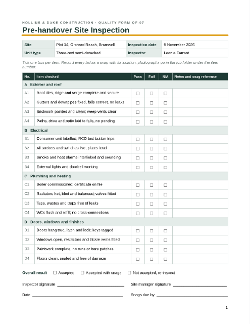

<!-- Generated by tools/gallery.mjs from showcase.yaml and build.json; do not edit. -->
# Site Inspection Checklist

[Doc](../README.md) › [Contracts & Forms](../README.md#contracts--forms) · `form` `checklist` `table` `merge-cells` `tab-stops`

A one-page pre-handover checklist with merged, shaded group rows, tick-box columns and a sign-off block.



| | |
|---|---|
| Document | [site-inspection-checklist.docx](site-inspection-checklist.docx) (9 KB) |
| Contents | 1 page; 222 words |
| Features | `doc.text.typing`, `doc.format.character`, `doc.format.paragraph`, `doc.tables.edit`, `doc.headers.footers` |
| Built by | `kition-doc` @ `e6d2eae5d0`: 544 commands in 230 ms |

## About

A builder's quality form set in Arimo. A ruled 2 × 4 table holds the project details with
shaded label cells; the checklist table has fixed column widths, a dark header row, and one row
per group merged across all six columns with `table.selectRow` and `table.merge`, then shaded.
The Pass, Fail and N/A columns carry centred □ boxes, and the sign-off lines are underscore tab
leaders ending exactly at the right margin.

## Checks

- `inspect.pages`: `{"count":1}`
- `inspect.words`: `{"min":200,"max":245}`
- `results.doc.blocks.5`: `{"type":"table","rows":21,"cols":6}`
- `results.doc.blocks.5.cells.1`: `["A   Exterior and roof"]`
- `results.doc.blocks.5.cells.2`: `{"count":6}`
- `results.doc.blocks.5.cells.16`: `["D   Doors, windows and finishes"]`
- `results.checkTable.cellMargins`: `[4,5,4,5]`
- diagnostics: none (the kit's check finds nothing wrong)
- the saved document opens again; the thumbnail matches `thumb.png` within the `render` tolerance

## Steps

<details><summary>544 commands (from <a href="showcase.yaml">showcase.yaml</a>)</summary>

```yaml
- command: review.proofing
- command: design.themeFonts
  params:
    heading: Arimo
    body: Arimo
- command: styles.modify
  params:
    style: Normal
    chr:
      size: 9.5
    para:
      spaceAfter: 0
      lineSpacing:
        rule: multiple
        value: 1.05
- command: layout.margins
  params:
    top: 50
    bottom: 50
    left: 54
    right: 54
- command: format.set
  params:
    props:
      size: 8
      bold: true
- command: format.color
  params:
    color: 5F6B68
- command: format.spacing
  params:
    points: 1.5
- command: text.insert
  params:
    text: HOLLINS & DAKE CONSTRUCTION · QUALITY FORM QF-07
- command: text.newParagraph
- command: format.set
  params:
    props:
      size: 19
      bold: true
- command: format.color
  params:
    color: 1E3A34
- command: format.spacing
  params:
    points: 0
- command: para.borders
  params:
    kind: bottom
    width: 3
    color: E0A526
- command: para.spacing
  params:
    before: 2
    after: 10
- command: text.insert
  params:
    text: Pre-handover Site Inspection
- command: text.newParagraph
- command: para.borders
  params:
    kind: none
- command: para.spacing
  params:
    before: 0
    after: 8
- command: format.set
  params:
    props:
      size: 9.5
      bold: false
- command: format.color
  params:
    color: auto
- command: insert.table
  params:
    rows: 2
    cols: 4
  as: details
- command: table.borders
  params:
    kind: all
    width: 0.5
    color: B9C7C2
- command: table.columnWidth
  params:
    width: 78
- command: text.tab
- command: table.columnWidth
  params:
    width: 176
- command: text.tab
- command: table.columnWidth
  params:
    width: 88
- command: text.tab
- command: table.columnWidth
  params:
    width: 162
- command: text.backTab
- command: text.backTab
- command: text.backTab
- command: table.shading
  params:
    color: E4ECE9
- command: format.bold
  params:
    value: true
- command: format.color
  params:
    color: 1E3A34
- command: text.insert
  params:
    text: Site
- command: format.bold
  params:
    value: false
- command: format.color
  params:
    color: auto
- command: text.tab
- command: text.insert
  params:
    text: Plot 14, Orchard Reach, Bramwell
- command: text.tab
- command: table.shading
  params:
    color: E4ECE9
- command: format.bold
  params:
    value: true
- command: format.color
  params:
    color: 1E3A34
- command: text.insert
  params:
    text: Inspection date
- command: format.bold
  params:
    value: false
- command: format.color
  params:
    color: auto
- command: text.tab
- command: text.insert
  params:
    text: 9 November 2026
- command: text.tab
- command: table.shading
  params:
    color: E4ECE9
- command: format.bold
  params:
    value: true
- command: format.color
  params:
    color: 1E3A34
- command: text.insert
  params:
    text: Unit type
- command: format.bold
  params:
    value: false
- command: format.color
  params:
    color: auto
- command: text.tab
- command: text.insert
  params:
    text: Three-bed semi-detached
- command: text.tab
- command: table.shading
  params:
    color: E4ECE9
- command: format.bold
  params:
    value: true
- command: format.color
  params:
    color: 1E3A34
- command: text.insert
  params:
    text: Inspector
- command: format.bold
  params:
    value: false
- command: format.color
  params:
    color: auto
- command: text.tab
- command: text.insert
  params:
    text: Leonie Farrant
- command: table.cellMargins
  params:
    top: 4
    bottom: 4
    left: 5
    right: 5
- command: caret.docEnd
- command: para.spacing
  params:
    before: 0
    after: 0
- command: format.size
  params:
    size: 6
- command: text.newParagraph
- command: format.size
  params:
    size: 9.5
- command: para.spacing
  params:
    before: 0
    after: 8
- command: format.color
  params:
    color: 5F6B68
- command: format.italic
  params:
    value: true
- command: text.insert
  params:
    text: Tick one box per item. Record every fail as a snag with its location; photographs go in the job folder under the item number.
- command: format.italic
  params:
    value: false
- command: format.color
  params:
    color: auto
- command: text.newParagraph
- command: insert.table
  params:
    rows: 21
    cols: 6
  as: checklist
- command: table.borders
  params:
    kind: all
    width: 0.5
    color: B9C7C2
- command: table.columnWidth
  params:
    width: 30
- command: text.tab
- command: table.columnWidth
  params:
    width: 236
- command: text.tab
- command: table.columnWidth
  params:
    width: 34
- command: text.tab
- command: table.columnWidth
  params:
    width: 34
- command: text.tab
- command: table.columnWidth
  params:
    width: 34
- command: text.tab
- command: table.columnWidth
  params:
    width: 136
- command: text.backTab
- command: text.backTab
- command: text.backTab
- command: text.backTab
- command: text.backTab
- command: table.selectRow
- command: table.shading
  params:
    color: 1E3A34
- command: select.collapse
- command: format.set
  params:
    props:
      bold: true
      size: 8.5
- command: format.color
  params:
    color: FFFFFF
- command: text.insert
  params:
    text: No.
- command: text.tab
- command: text.insert
  params:
    text: Item checked
- command: text.tab
- command: para.alignCenter
- command: text.insert
  params:
    text: Pass
- command: text.tab
- command: para.alignCenter
- command: text.insert
  params:
    text: Fail
- command: text.tab
- command: para.alignCenter
- command: text.insert
  params:
    text: N/A
- command: text.tab
- command: text.insert
  params:
    text: Notes and snag reference
- command: format.set
  params:
    props:
      bold: false
      size: 9.5
- command: format.color
  params:
    color: auto
- command: text.tab
- command: table.selectRow
- command: table.merge
- command: table.shading
  params:
    color: E4ECE9
- command: format.set
  params:
    props:
      bold: true
- command: format.color
  params:
    color: 1E3A34
- command: text.insert
  params:
    text: A   Exterior and roof
- command: format.set
  params:
    props:
      bold: false
- command: format.color
  params:
    color: auto
- command: text.tab
- command: format.color
  params:
    color: 5F6B68
- command: text.insert
  params:
    text: A1
- command: format.color
  params:
    color: auto
- command: text.tab
- command: text.insert
  params:
    text: Roof tiles, ridge and verge complete and secure
- command: text.tab
- command: para.alignCenter
- command: format.size
  params:
    size: 12
- command: text.insert
  params:
    text: □
- command: format.size
  params:
    size: 9.5
- command: text.tab
- command: para.alignCenter
- command: format.size
  params:
    size: 12
- command: text.insert
  params:
    text: □
- command: format.size
  params:
    size: 9.5
- command: text.tab
- command: para.alignCenter
- command: format.size
  params:
    size: 12
- command: text.insert
  params:
    text: □
- command: format.size
  params:
    size: 9.5
- command: text.tab
- command: text.tab
- command: format.color
  params:
    color: 5F6B68
- command: text.insert
  params:
    text: A2
- command: format.color
  params:
    color: auto
- command: text.tab
- command: text.insert
  params:
    text: Gutters and downpipes fixed, falls correct, no leaks
- command: text.tab
- command: para.alignCenter
- command: format.size
  params:
    size: 12
- command: text.insert
  params:
    text: □
- command: format.size
  params:
    size: 9.5
- command: text.tab
- command: para.alignCenter
- command: format.size
  params:
    size: 12
- command: text.insert
  params:
    text: □
- command: format.size
  params:
    size: 9.5
- command: text.tab
- command: para.alignCenter
- command: format.size
  params:
    size: 12
- command: text.insert
  params:
    text: □
- command: format.size
  params:
    size: 9.5
- command: text.tab
- command: text.tab
- command: format.color
  params:
    color: 5F6B68
- command: text.insert
  params:
    text: A3
- command: format.color
  params:
    color: auto
- command: text.tab
- command: text.insert
  params:
    text: Brickwork pointed and clean; weep vents clear
- command: text.tab
- command: para.alignCenter
- command: format.size
  params:
    size: 12
- command: text.insert
  params:
    text: □
- command: format.size
  params:
    size: 9.5
- command: text.tab
- command: para.alignCenter
- command: format.size
  params:
    size: 12
- command: text.insert
  params:
    text: □
- command: format.size
  params:
    size: 9.5
- command: text.tab
- command: para.alignCenter
- command: format.size
  params:
    size: 12
- command: text.insert
  params:
    text: □
- command: format.size
  params:
    size: 9.5
- command: text.tab
- command: text.tab
- command: format.color
  params:
    color: 5F6B68
- command: text.insert
  params:
    text: A4
- command: format.color
  params:
    color: auto
- command: text.tab
- command: text.insert
  params:
    text: Paths, drive and patio laid to falls, no ponding
- command: text.tab
- command: para.alignCenter
- command: format.size
  params:
    size: 12
- command: text.insert
  params:
    text: □
- command: format.size
  params:
    size: 9.5
- command: text.tab
- command: para.alignCenter
- command: format.size
  params:
    size: 12
- command: text.insert
  params:
    text: □
- command: format.size
  params:
    size: 9.5
- command: text.tab
- command: para.alignCenter
- command: format.size
  params:
    size: 12
- command: text.insert
  params:
    text: □
- command: format.size
  params:
    size: 9.5
- command: text.tab
- command: text.tab
- command: table.selectRow
- command: table.merge
- command: table.shading
  params:
    color: E4ECE9
- command: format.set
  params:
    props:
      bold: true
- command: format.color
  params:
    color: 1E3A34
- command: text.insert
  params:
    text: B   Electrical
- command: format.set
  params:
    props:
      bold: false
- command: format.color
  params:
    color: auto
- command: text.tab
- command: format.color
  params:
    color: 5F6B68
- command: text.insert
  params:
    text: B1
- command: format.color
  params:
    color: auto
- command: text.tab
- command: text.insert
  params:
    text: Consumer unit labelled; RCD test button trips
- command: text.tab
- command: para.alignCenter
- command: format.size
  params:
    size: 12
- command: text.insert
  params:
    text: □
- command: format.size
  params:
    size: 9.5
- command: text.tab
- command: para.alignCenter
- command: format.size
  params:
    size: 12
- command: text.insert
  params:
    text: □
- command: format.size
  params:
    size: 9.5
- command: text.tab
- command: para.alignCenter
- command: format.size
  params:
    size: 12
- command: text.insert
  params:
    text: □
- command: format.size
  params:
    size: 9.5
- command: text.tab
- command: text.tab
- command: format.color
  params:
    color: 5F6B68
- command: text.insert
  params:
    text: B2
- command: format.color
  params:
    color: auto
- command: text.tab
- command: text.insert
  params:
    text: All sockets and switches live, plates level
- command: text.tab
- command: para.alignCenter
- command: format.size
  params:
    size: 12
- command: text.insert
  params:
    text: □
- command: format.size
  params:
    size: 9.5
- command: text.tab
- command: para.alignCenter
- command: format.size
  params:
    size: 12
- command: text.insert
  params:
    text: □
- command: format.size
  params:
    size: 9.5
- command: text.tab
- command: para.alignCenter
- command: format.size
  params:
    size: 12
- command: text.insert
  params:
    text: □
- command: format.size
  params:
    size: 9.5
- command: text.tab
- command: text.tab
- command: format.color
  params:
    color: 5F6B68
- command: text.insert
  params:
    text: B3
- command: format.color
  params:
    color: auto
- command: text.tab
- command: text.insert
  params:
    text: Smoke and heat alarms interlinked and sounding
- command: text.tab
- command: para.alignCenter
- command: format.size
  params:
    size: 12
- command: text.insert
  params:
    text: □
- command: format.size
  params:
    size: 9.5
- command: text.tab
- command: para.alignCenter
- command: format.size
  params:
    size: 12
- command: text.insert
  params:
    text: □
- command: format.size
  params:
    size: 9.5
- command: text.tab
- command: para.alignCenter
- command: format.size
  params:
    size: 12
- command: text.insert
  params:
    text: □
- command: format.size
  params:
    size: 9.5
- command: text.tab
- command: text.tab
- command: format.color
  params:
    color: 5F6B68
- command: text.insert
  params:
    text: B4
- command: format.color
  params:
    color: auto
- command: text.tab
- command: text.insert
  params:
    text: External lights and doorbell working
- command: text.tab
- command: para.alignCenter
- command: format.size
  params:
    size: 12
- command: text.insert
  params:
    text: □
- command: format.size
  params:
    size: 9.5
- command: text.tab
- command: para.alignCenter
- command: format.size
  params:
    size: 12
- command: text.insert
  params:
    text: □
- command: format.size
  params:
    size: 9.5
- command: text.tab
- command: para.alignCenter
- command: format.size
  params:
    size: 12
- command: text.insert
  params:
    text: □
- command: format.size
  params:
    size: 9.5
- command: text.tab
- command: text.tab
- command: table.selectRow
- command: table.merge
- command: table.shading
  params:
    color: E4ECE9
- command: format.set
  params:
    props:
      bold: true
- command: format.color
  params:
    color: 1E3A34
- command: text.insert
  params:
    text: C   Plumbing and heating
- command: format.set
  params:
    props:
      bold: false
- command: format.color
  params:
    color: auto
- command: text.tab
- command: format.color
  params:
    color: 5F6B68
- command: text.insert
  params:
    text: C1
- command: format.color
  params:
    color: auto
- command: text.tab
- command: text.insert
  params:
    text: Boiler commissioned; certificate on file
- command: text.tab
- command: para.alignCenter
- command: format.size
  params:
    size: 12
- command: text.insert
  params:
    text: □
- command: format.size
  params:
    size: 9.5
- command: text.tab
- command: para.alignCenter
- command: format.size
  params:
    size: 12
- command: text.insert
  params:
    text: □
- command: format.size
  params:
    size: 9.5
- command: text.tab
- command: para.alignCenter
- command: format.size
  params:
    size: 12
- command: text.insert
  params:
    text: □
- command: format.size
  params:
    size: 9.5
- command: text.tab
- command: text.tab
- command: format.color
  params:
    color: 5F6B68
- command: text.insert
  params:
    text: C2
- command: format.color
  params:
    color: auto
- command: text.tab
- command: text.insert
  params:
    text: Radiators hot, bled and balanced; valves fitted
- command: text.tab
- command: para.alignCenter
- command: format.size
  params:
    size: 12
- command: text.insert
  params:
    text: □
- command: format.size
  params:
    size: 9.5
- command: text.tab
- command: para.alignCenter
- command: format.size
  params:
    size: 12
- command: text.insert
  params:
    text: □
- command: format.size
  params:
    size: 9.5
- command: text.tab
- command: para.alignCenter
- command: format.size
  params:
    size: 12
- command: text.insert
  params:
    text: □
- command: format.size
  params:
    size: 9.5
- command: text.tab
- command: text.tab
- command: format.color
  params:
    color: 5F6B68
- command: text.insert
  params:
    text: C3
- command: format.color
  params:
    color: auto
- command: text.tab
- command: text.insert
  params:
    text: Taps, wastes and traps free of leaks
- command: text.tab
- command: para.alignCenter
- command: format.size
  params:
    size: 12
- command: text.insert
  params:
    text: □
- command: format.size
  params:
    size: 9.5
- command: text.tab
- command: para.alignCenter
- command: format.size
  params:
    size: 12
- command: text.insert
  params:
    text: □
- command: format.size
  params:
    size: 9.5
- command: text.tab
- command: para.alignCenter
- command: format.size
  params:
    size: 12
- command: text.insert
  params:
    text: □
- command: format.size
  params:
    size: 9.5
- command: text.tab
- command: text.tab
- command: format.color
  params:
    color: 5F6B68
- command: text.insert
  params:
    text: C4
- command: format.color
  params:
    color: auto
- command: text.tab
- command: text.insert
  params:
    text: WCs flush and refill; no cross-connections
- command: text.tab
- command: para.alignCenter
- command: format.size
  params:
    size: 12
- command: text.insert
  params:
    text: □
- command: format.size
  params:
    size: 9.5
- command: text.tab
- command: para.alignCenter
- command: format.size
  params:
    size: 12
- command: text.insert
  params:
    text: □
- command: format.size
  params:
    size: 9.5
- command: text.tab
- command: para.alignCenter
- command: format.size
  params:
    size: 12
- command: text.insert
  params:
    text: □
- command: format.size
  params:
    size: 9.5
- command: text.tab
- command: text.tab
- command: table.selectRow
- command: table.merge
- command: table.shading
  params:
    color: E4ECE9
- command: format.set
  params:
    props:
      bold: true
- command: format.color
  params:
    color: 1E3A34
- command: text.insert
  params:
    text: D   Doors, windows and finishes
- command: format.set
  params:
    props:
      bold: false
- command: format.color
  params:
    color: auto
- command: text.tab
- command: format.color
  params:
    color: 5F6B68
- command: text.insert
  params:
    text: D1
- command: format.color
  params:
    color: auto
- command: text.tab
- command: text.insert
  params:
    text: Doors hang true, latch and lock; keys tagged
- command: text.tab
- command: para.alignCenter
- command: format.size
  params:
    size: 12
- command: text.insert
  params:
    text: □
- command: format.size
  params:
    size: 9.5
- command: text.tab
- command: para.alignCenter
- command: format.size
  params:
    size: 12
- command: text.insert
  params:
    text: □
- command: format.size
  params:
    size: 9.5
- command: text.tab
- command: para.alignCenter
- command: format.size
  params:
    size: 12
- command: text.insert
  params:
    text: □
- command: format.size
  params:
    size: 9.5
- command: text.tab
- command: text.tab
- command: format.color
  params:
    color: 5F6B68
- command: text.insert
  params:
    text: D2
- command: format.color
  params:
    color: auto
- command: text.tab
- command: text.insert
  params:
    text: Windows open, restrictors and trickle vents fitted
- command: text.tab
- command: para.alignCenter
- command: format.size
  params:
    size: 12
- command: text.insert
  params:
    text: □
- command: format.size
  params:
    size: 9.5
- command: text.tab
- command: para.alignCenter
- command: format.size
  params:
    size: 12
- command: text.insert
  params:
    text: □
- command: format.size
  params:
    size: 9.5
- command: text.tab
- command: para.alignCenter
- command: format.size
  params:
    size: 12
- command: text.insert
  params:
    text: □
- command: format.size
  params:
    size: 9.5
- command: text.tab
- command: text.tab
- command: format.color
  params:
    color: 5F6B68
- command: text.insert
  params:
    text: D3
- command: format.color
  params:
    color: auto
- command: text.tab
- command: text.insert
  params:
    text: Paintwork complete, no runs or bare patches
- command: text.tab
- command: para.alignCenter
- command: format.size
  params:
    size: 12
- command: text.insert
  params:
    text: □
- command: format.size
  params:
    size: 9.5
- command: text.tab
- command: para.alignCenter
- command: format.size
  params:
    size: 12
- command: text.insert
  params:
    text: □
- command: format.size
  params:
    size: 9.5
- command: text.tab
- command: para.alignCenter
- command: format.size
  params:
    size: 12
- command: text.insert
  params:
    text: □
- command: format.size
  params:
    size: 9.5
- command: text.tab
- command: text.tab
- command: format.color
  params:
    color: 5F6B68
- command: text.insert
  params:
    text: D4
- command: format.color
  params:
    color: auto
- command: text.tab
- command: text.insert
  params:
    text: Floors clean, sealed and free of damage
- command: text.tab
- command: para.alignCenter
- command: format.size
  params:
    size: 12
- command: text.insert
  params:
    text: □
- command: format.size
  params:
    size: 9.5
- command: text.tab
- command: para.alignCenter
- command: format.size
  params:
    size: 12
- command: text.insert
  params:
    text: □
- command: format.size
  params:
    size: 9.5
- command: text.tab
- command: para.alignCenter
- command: format.size
  params:
    size: 12
- command: text.insert
  params:
    text: □
- command: format.size
  params:
    size: 9.5
- command: text.tab
- command: table.cellMargins
  params:
    top: 4
    bottom: 4
    left: 5
    right: 5
- command: table.properties
  as: checkTable
- command: caret.docEnd
- command: format.set
  params:
    props:
      italic: false
      size: 9.5
- command: format.color
  params:
    color: auto
- command: para.spacing
  params:
    before: 14
    after: 8
- command: format.bold
  params:
    value: true
- command: format.color
  params:
    color: 1E3A34
- command: text.insert
  params:
    text: Overall result
- command: format.bold
  params:
    value: false
- command: format.color
  params:
    color: auto
- command: text.insert
  params:
    text: "      "
- command: format.size
  params:
    size: 12
- command: text.insert
  params:
    text: □
- command: format.size
  params:
    size: 9.5
- command: text.insert
  params:
    text: "  Accepted"
- command: text.insert
  params:
    text: "      "
- command: format.size
  params:
    size: 12
- command: text.insert
  params:
    text: □
- command: format.size
  params:
    size: 9.5
- command: text.insert
  params:
    text: "  Accepted with snags"
- command: text.insert
  params:
    text: "      "
- command: format.size
  params:
    size: 12
- command: text.insert
  params:
    text: □
- command: format.size
  params:
    size: 9.5
- command: text.insert
  params:
    text: "  Not accepted, re-inspect"
- command: text.newParagraph
- command: para.spacing
  params:
    before: 16
    after: 0
- command: para.tabs
  params:
    tabs:
      - pos: 250
        align: right
        leader: underscore
      - pos: 266
      - pos: 504
        align: right
        leader: underscore
- command: text.insert
  params:
    text: "Inspector signature \t\tSite manager signature \t"
- command: text.newParagraph
- command: para.spacing
  params:
    before: 14
    after: 0
- command: para.tabs
  params:
    tabs:
      - pos: 250
        align: right
        leader: underscore
      - pos: 266
      - pos: 504
        align: right
        leader: underscore
- command: text.insert
  params:
    text: "Date \t\tSnags due by \t"
- command: insert.pageNumber
  params:
    position: bottom
    align: right
- command: insert.closeHeader
- command: document.inspect
  as: doc
```

</details>
