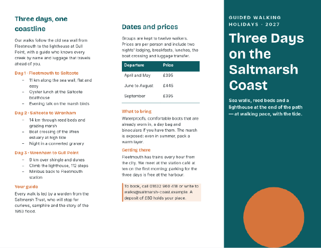

<!-- Generated by tools/gallery.mjs from showcase.yaml and build.json; do not edit. -->
# Trifold Travel Brochure

[Doc](../README.md) › [Newsletters & Layout](../README.md#newsletters--layout) · `brochure` `landscape` `columns` `shapes` `column-break`

A landscape tri-fold brochure — three panels set as three columns with column breaks, an itinerary, a price table, and a cover panel printed on a colour block behind the text.



| | |
|---|---|
| Document | [trifold-travel-brochure.docx](trifold-travel-brochure.docx) (9 KB) |
| Contents | 1 page; 283 words; 1 shape |
| Features | `doc.layout.page-setup`, `doc.drawing.objects`, `doc.arrange.objects`, `doc.tables.edit`, `doc.styles.manage`, `doc.lists.bullets-numbering` |
| Built by | `kition-doc` @ `e6d2eae5d0`: 129 commands in 60 ms |

## About

A Letter page turned landscape and split into three equal columns with wide gutters, so each
column is one panel of the fold. Column breaks end each panel; the itinerary uses styled day
headings and bullets, the middle panel holds a small price table and a shaded booking note,
and the cover panel's colour is a full-height rectangle placed behind the text.

## Checks

- `inspect.pages`: `{"count":1}`
- `inspect.pages.0.area`: `{"width":792,"height":612}`
- `results.landscape.landscape`: `true`
- `results.panels.columns`: `{"count":3,"space":72}`
- `results.drawings.objects`: `{"count":2,"all":{"placement":{"wrap":"behindText"}}}`
- diagnostics: none (the kit's check finds nothing wrong)
- the saved document opens again; the thumbnail matches `thumb.png` within the `render` tolerance

## Steps

<details><summary>129 commands (from <a href="showcase.yaml">showcase.yaml</a>)</summary>

```yaml
- command: review.proofing
  as: proofing
- command: layout.orientation
  params:
    value: landscape
  as: landscape
- command: layout.margins
  params:
    top: 36
    bottom: 36
    left: 36
    right: 36
- command: layout.columns
  params:
    count: 3
    space: 72
  as: panels
- command: design.themeFonts
  params:
    heading: Bricolage Grotesque
    body: Inter
- command: styles.modify
  params:
    style: Normal
    chr:
      size: 10
      color:
        Rgb:
          - 40
          - 48
          - 52
    para:
      align: left
      spaceBefore: 0
      spaceAfter: 5
      lineSpacing:
        rule: multiple
        value: 1.2
- command: styles.modify
  params:
    style: Heading 1
    chr:
      size: 17
      bold: true
      color:
        Rgb:
          - 13
          - 92
          - 99
    para:
      spaceBefore: 0
      spaceAfter: 8
      keepLines: false
- command: styles.modify
  params:
    style: Heading 2
    chr:
      size: 11
      bold: true
      color:
        Rgb:
          - 214
          - 116
          - 59
    para:
      spaceBefore: 8
      spaceAfter: 2
- command: styles.create
  params:
    name: Cover Title
    basedOn: Normal
- command: styles.modify
  params:
    style: Cover Title
    chr:
      size: 34
      bold: true
      color:
        Rgb:
          - 255
          - 255
          - 255
    para:
      spaceBefore: 150
      spaceAfter: 10
      lineSpacing:
        rule: multiple
        value: 0.95
- command: styles.create
  params:
    name: Cover Text
    basedOn: Normal
- command: styles.modify
  params:
    style: Cover Text
    chr:
      size: 11.5
      color:
        Rgb:
          - 224
          - 244
          - 242
    para:
      spaceAfter: 6
- command: para.heading1
- command: text.insert
  params:
    text: Three days, one coastline
- command: text.newParagraph
- command: text.insert
  params:
    text: Our walks follow the old sea wall from Fleetmouth to the lighthouse at Gull Point, with a guide who knows every creek by name and luggage that travels ahead of you.
- command: text.newParagraph
- command: para.heading2
- command: text.insert
  params:
    text: Day 1 · Fleetmouth to Saltcote
- command: text.newParagraph
- command: para.bullets
  params:
    kind: –
- command: text.insert
  params:
    text: 11 km along the sea wall, flat and easy
- command: text.newParagraph
- command: text.insert
  params:
    text: Oyster lunch at the Saltcote boathouse
- command: text.newParagraph
- command: text.insert
  params:
    text: Evening talk on the marsh birds
- command: text.newParagraph
- command: para.bullets
  params:
    off: true
- command: para.heading2
- command: text.insert
  params:
    text: Day 2 · Saltcote to Wrenham
- command: text.newParagraph
- command: para.bullets
  params:
    kind: –
- command: text.insert
  params:
    text: 14 km through reed beds and grazing marsh
- command: text.newParagraph
- command: text.insert
  params:
    text: Boat crossing of the Wren estuary at high tide
- command: text.newParagraph
- command: text.insert
  params:
    text: Night in a converted granary
- command: text.newParagraph
- command: para.bullets
  params:
    off: true
- command: para.heading2
- command: text.insert
  params:
    text: Day 3 · Wrenham to Gull Point
- command: text.newParagraph
- command: para.bullets
  params:
    kind: –
- command: text.insert
  params:
    text: 9 km over shingle and dunes
- command: text.newParagraph
- command: text.insert
  params:
    text: Climb the lighthouse, 112 steps
- command: text.newParagraph
- command: text.insert
  params:
    text: Minibus back to Fleetmouth station
- command: text.newParagraph
- command: para.bullets
  params:
    off: true
- command: para.heading2
- command: text.insert
  params:
    text: Your guide
- command: text.newParagraph
- command: text.insert
  params:
    text: Every walk is led by a warden from the Saltmarsh Trust, who will stop for curlews, samphire and the story of the 1953 flood.
- command: text.columnBreak
- command: text.newParagraph
- command: para.heading1
- command: text.insert
  params:
    text: Dates and prices
- command: text.newParagraph
- command: text.insert
  params:
    text: Groups are kept to twelve walkers. Prices are per person and include two nights' lodging, breakfasts, lunches, the boat crossing and luggage transfer.
- command: text.newParagraph
- command: insert.table
  params:
    rows: 4
    cols: 2
    style: Normal Table
  as: prices
- command: table.selectRow
- command: table.shading
  params:
    color: 0D5C63
- command: format.color
  params:
    color: FFFFFF
- command: format.bold
  params:
    value: true
- command: select.collapse
- command: text.insert
  params:
    text: Departure
- command: text.tab
- command: text.insert
  params:
    text: Price
- command: text.tab
- command: text.insert
  params:
    text: April and May
- command: text.tab
- command: text.insert
  params:
    text: £395
- command: text.tab
- command: text.insert
  params:
    text: June to August
- command: text.tab
- command: text.insert
  params:
    text: £445
- command: text.tab
- command: text.insert
  params:
    text: September
- command: text.tab
- command: text.insert
  params:
    text: £395
- command: table.selectTable
- command: table.borders
  params:
    kind: bottom
    width: 1
    color: 0D5C63
- command: table.cellMargins
  params:
    top: 3
    bottom: 3
    left: 6
    right: 6
- command: caret.docEnd
- command: para.heading2
- command: para.spacing
  params:
    before: 14
- command: text.insert
  params:
    text: What to bring
- command: text.newParagraph
- command: para.spacing
  params:
    before: 0
- command: text.insert
  params:
    text: "Waterproofs, comfortable boots that are already worn in, a day bag and binoculars if you have them. The marsh is exposed: even in summer, pack a warm layer."
- command: text.newParagraph
- command: para.heading2
- command: text.insert
  params:
    text: Getting there
- command: text.newParagraph
- command: text.insert
  params:
    text: Fleetmouth has trains every hour from the city. We meet at the station café at ten on the first morning; parking for the three days is free at the harbour.
- command: text.newParagraph
- command: para.shading
  params:
    color: FBEDE3
- command: para.borders
  params:
    sides:
      left:
        style: single
        width: 3
        color: D6743B
- command: para.indents
  params:
    left: 6
- command: para.spacing
  params:
    before: 14
- command: text.insert
  params:
    text: To book, call 01632 960 418 or write to walks@saltmarsh-coast.example. A deposit of £80 holds your place.
- command: text.newParagraph
- command: para.shading
  params:
    color: null
- command: para.borders
  params:
    kind: none
- command: para.indents
  params:
    left: 0
- command: para.spacing
  params:
    before: 0
- command: para.style
  params:
    style: Cover Text
- command: text.columnBreak
- command: format.set
  params:
    props:
      bold: true
      caps: true
      spacing: 2
- command: text.insert
  params:
    text: Guided walking holidays · 2027
- command: text.newParagraph
- command: format.set
  params:
    props:
      bold: false
      caps: false
      spacing: 0
- command: para.style
  params:
    style: Cover Title
- command: format.set
  params:
    props:
      font: Bricolage Grotesque
      bold: true
- command: text.insert
  params:
    text: Three Days on the Saltmarsh Coast
- command: text.newParagraph
- command: para.style
  params:
    style: Cover Text
- command: text.insert
  params:
    text: Sea walls, reed beds and a lighthouse at the end of the path — at walking pace, with the tide.
- command: caret.docStart
- command: drawing.insert
  params:
    kind: shape
    geometry:
      preset: rect
    frame:
      x: 552
      y: 0
      w: 240
      h: 612
    placement:
      page: 0
    fill: "#0D5C63"
    stroke:
      none: true
  as: coverBlock
- command: drawing.insert
  params:
    kind: shape
    geometry:
      preset: ellipse
    frame:
      x: 600
      y: 470
      w: 150
      h: 150
    placement:
      page: 0
    fill: "#D6743B"
    stroke:
      none: true
  as: sun
- command: select.objects
  params:
    index: 0
- command: arrange.wrap
  params:
    wrap: behindText
- command: select.objects
  params:
    index: 1
- command: arrange.wrap
  params:
    wrap: behindText
- command: arrange.bounds
  params:
    x: 600
    y: 470
    page: 0
  as: moved
- command: drawing.describe
  params:
    ids:
      - 1
      - 2
  as: drawings
```

</details>
