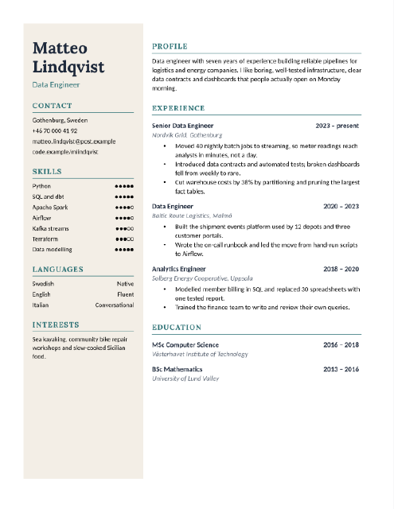

<!-- Generated by tools/gallery.mjs from showcase.yaml and build.json; do not edit. -->
# Two-Column Resume

[Doc](../README.md) › [Resumes](../README.md#resumes) · `resume` `table` `custom-styles` `tab-stops`

A one-page resume built on a borderless two-column table, with a shaded sidebar for contact details, skill ratings and languages.



| | |
|---|---|
| Document | [two-column-resume.docx](two-column-resume.docx) (9 KB) |
| Contents | 1 page; 214 words |
| Features | `doc.tables.edit`, `doc.styles.manage`, `doc.format.paragraph`, `doc.lists.bullets-numbering` |
| Built by | `kition-doc` @ `e6d2eae5d0`: 141 commands in 82 ms |

## About

The page is one table row of two cells with every border removed: the narrow left cell is
shaded sand and holds the name, contact lines, skills rated with filled and open dots on a
right-aligned tab stop, and languages. The wide right cell carries the profile, experience and
education. All text is set by paragraph styles (two created with styles.create), so the cells
hold almost no direct formatting.

## Checks

- `inspect.pages`: `{"count":1}`
- `inspect.words`: `{"min":190,"max":260}`
- `results.main.borders.left.style`: `"none"`
- `results.main.columnWidth`: `354`
- `results.main.row.height`: `684`
- `results.styles`: `{"any":{"name":"Organisation","type":"paragraph","builtIn":false}}`
- `results.doc.blocks`: `{"count":2,"any":{"type":"table","rows":1,"cols":2}}`
- diagnostics: none (the kit's check finds nothing wrong)
- the saved document opens again; the thumbnail matches `thumb.png` within the `render` tolerance

## Steps

<details><summary>141 commands (from <a href="showcase.yaml">showcase.yaml</a>)</summary>

```yaml
- command: review.proofing
- command: design.themeFonts
  params:
    heading: Lora
    body: Carlito
- command: layout.margins
  params:
    top: 36
    bottom: 30
    left: 36
    right: 36
- command: styles.modify
  params:
    style: Normal
    chr:
      size: 10.5
    para:
      spaceAfter: 2
      lineSpacing:
        rule: multiple
        value: 1.1
- command: styles.modify
  params:
    style: Heading 1
    chr:
      size: 11.5
      bold: true
      caps: true
      spacing: 1
      color:
        Rgb:
          - 42
          - 111
          - 115
    para:
      spaceBefore: 16
      spaceAfter: 5
      borders:
        bottom:
          style: single
          width: 0.75
          color:
            - 42
            - 111
            - 115
          space: 2
- command: styles.modify
  params:
    style: Heading 2
    chr:
      font: Carlito
      size: 11
      bold: true
      color:
        Rgb:
          - 30
          - 41
          - 59
    para:
      spaceBefore: 9
      spaceAfter: 0
      tabs:
        - pos: 322
          align: right
          leader: none
- command: styles.create
  params:
    name: Organisation
    basedOn: Normal
- command: styles.modify
  params:
    style: Organisation
    chr:
      italic: true
      color:
        Rgb:
          - 90
          - 100
          - 114
    para:
      spaceAfter: 3
- command: styles.create
  params:
    name: Sidebar
    basedOn: Normal
- command: styles.modify
  params:
    style: Sidebar
    chr:
      size: 10
    para:
      spaceAfter: 3
      tabs:
        - pos: 158
          align: right
          leader: none
- command: styles.create
  params:
    name: Resume Name
    basedOn: Normal
- command: styles.modify
  params:
    style: Resume Name
    chr:
      font: Lora
      size: 25
      bold: true
      color:
        Rgb:
          - 30
          - 41
          - 59
    para:
      spaceBefore: 12
      spaceAfter: 4
      lineSpacing:
        rule: multiple
        value: 0.92
- command: styles.create
  params:
    name: Resume Role
    basedOn: Normal
- command: styles.modify
  params:
    style: Resume Role
    chr:
      size: 13
      color:
        Rgb:
          - 42
          - 111
          - 115
    para:
      spaceAfter: 0
- command: insert.table
  params:
    rows: 1
    cols: 2
- command: table.selectTable
- command: table.borders
  params:
    kind: none
- command: select.collapse
- command: table.cellMargins
  params:
    top: 12
    left: 14
    right: 14
    bottom: 12
- command: table.rowHeight
  params:
    height: 684
    rule: atLeast
- command: table.columnWidth
  params:
    width: 186
- command: table.shading
  params:
    color: F3EEE6
- command: para.style
  params:
    style: Resume Name
- command: text.insert
  params:
    text: Matteo Lindqvist
- command: text.newParagraph
- command: para.style
  params:
    style: Resume Role
- command: text.insert
  params:
    text: Data Engineer
- command: text.newParagraph
- command: para.heading1
- command: text.insert
  params:
    text: Contact
- command: text.newParagraph
- command: para.style
  params:
    style: Sidebar
- command: text.insert
  params:
    text: Gothenburg, Sweden
- command: text.newParagraph
- command: text.insert
  params:
    text: +46 70 000 41 92
- command: text.newParagraph
- command: text.insert
  params:
    text: matteo.lindqvist@post.example
- command: text.newParagraph
- command: text.insert
  params:
    text: code.example/mlindqvist
- command: text.newParagraph
- command: para.heading1
- command: text.insert
  params:
    text: Skills
- command: text.newParagraph
- command: para.style
  params:
    style: Sidebar
- command: text.insert
  params:
    text: Python	●●●●●
- command: text.newParagraph
- command: text.insert
  params:
    text: SQL and dbt	●●●●●
- command: text.newParagraph
- command: text.insert
  params:
    text: Apache Spark	●●●●○
- command: text.newParagraph
- command: text.insert
  params:
    text: Airflow	●●●●○
- command: text.newParagraph
- command: text.insert
  params:
    text: Kafka streams	●●●○○
- command: text.newParagraph
- command: text.insert
  params:
    text: Terraform	●●●○○
- command: text.newParagraph
- command: text.insert
  params:
    text: Data modelling	●●●●●
- command: text.newParagraph
- command: para.heading1
- command: text.insert
  params:
    text: Languages
- command: text.newParagraph
- command: para.style
  params:
    style: Sidebar
- command: text.insert
  params:
    text: Swedish	Native
- command: text.newParagraph
- command: text.insert
  params:
    text: English	Fluent
- command: text.newParagraph
- command: text.insert
  params:
    text: Italian	Conversational
- command: text.newParagraph
- command: para.heading1
- command: text.insert
  params:
    text: Interests
- command: text.newParagraph
- command: para.style
  params:
    style: Sidebar
- command: text.insert
  params:
    text: Sea kayaking, community bike repair workshops and slow-cooked Sicilian food.
- command: text.tab
- command: table.columnWidth
  params:
    width: 354
- command: para.heading1
- command: text.insert
  params:
    text: Profile
- command: text.newParagraph
- command: text.insert
  params:
    text: Data engineer with seven years of experience building reliable pipelines for logistics and energy companies. I like boring, well-tested infrastructure, clear data contracts and dashboards that people actually open on Monday morning.
- command: text.newParagraph
- command: para.heading1
- command: text.insert
  params:
    text: Experience
- command: text.newParagraph
- command: para.heading2
- command: text.insert
  params:
    text: Senior Data Engineer	2023 – present
- command: text.newParagraph
- command: para.style
  params:
    style: Organisation
- command: text.insert
  params:
    text: Nordvik Grid, Gothenburg
- command: text.newParagraph
- command: para.style
  params:
    style: Normal
- command: para.bullets
- command: text.insert
  params:
    text: Moved 40 nightly batch jobs to streaming, so meter readings reach analysts in minutes, not a day.
- command: text.newParagraph
- command: text.insert
  params:
    text: Introduced data contracts and automated tests; broken dashboards fell from weekly to rare.
- command: text.newParagraph
- command: text.insert
  params:
    text: Cut warehouse costs by 38% by partitioning and pruning the largest fact tables.
- command: text.newParagraph
- command: para.bullets
  params:
    off: true
- command: para.heading2
- command: text.insert
  params:
    text: Data Engineer	2020 – 2023
- command: text.newParagraph
- command: para.style
  params:
    style: Organisation
- command: text.insert
  params:
    text: Baltic Route Logistics, Malmö
- command: text.newParagraph
- command: para.style
  params:
    style: Normal
- command: para.bullets
- command: text.insert
  params:
    text: Built the shipment events platform used by 12 depots and three customer portals.
- command: text.newParagraph
- command: text.insert
  params:
    text: Wrote the on-call runbook and led the move from hand-run scripts to Airflow.
- command: text.newParagraph
- command: para.bullets
  params:
    off: true
- command: para.heading2
- command: text.insert
  params:
    text: Analytics Engineer	2018 – 2020
- command: text.newParagraph
- command: para.style
  params:
    style: Organisation
- command: text.insert
  params:
    text: Solberg Energy Cooperative, Uppsala
- command: text.newParagraph
- command: para.style
  params:
    style: Normal
- command: para.bullets
- command: text.insert
  params:
    text: Modelled member billing in SQL and replaced 30 spreadsheets with one tested report.
- command: text.newParagraph
- command: text.insert
  params:
    text: Trained the finance team to write and review their own queries.
- command: text.newParagraph
- command: para.bullets
  params:
    off: true
- command: para.heading1
- command: text.insert
  params:
    text: Education
- command: text.newParagraph
- command: para.heading2
- command: text.insert
  params:
    text: MSc Computer Science	2016 – 2018
- command: text.newParagraph
- command: para.style
  params:
    style: Organisation
- command: text.insert
  params:
    text: Västerhavet Institute of Technology
- command: text.newParagraph
- command: para.heading2
- command: text.insert
  params:
    text: BSc Mathematics	2013 – 2016
- command: text.newParagraph
- command: para.style
  params:
    style: Organisation
- command: text.insert
  params:
    text: University of Lund Valley
- command: table.properties
  as: main
- command: styles.manage
  as: styles
- command: document.inspect
  as: doc
```

</details>
