<!-- Generated by tools/gallery.mjs from showcase.yaml and build.json; do not edit. -->
# Film showcase

Video edits: synthetic footage, titles, shapes, effects, keyframes, transitions and audio. Saved as .kfilm. Every sample is built from `showcase.yaml` by the kit's own commands and drawn by its own engine (`kition-film`).

**63 samples** · 8 categories · 19 features of `kition-film/features.yaml` · [all kits](../README.md)

[Audio](#audio) (6) · [Editing & Timeline](#editing--timeline) (9) · [Effects & Color](#effects--color) (11) · [Formats & Social](#formats--social) (5) · [Keyframes & Motion](#keyframes--motion) (5) · [Markers & Captions](#markers--captions) (4) · [Titles & Graphics](#titles--graphics) (16) · [Transitions](#transitions) (7)

## Audio

<table>
<tr>
<td width="33%" valign="top">
<a href="bars-and-tone-lineup/">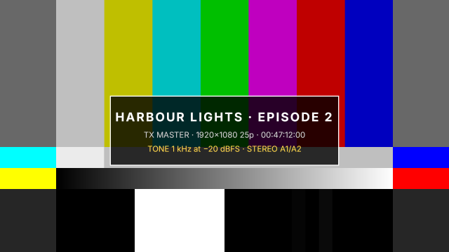</a> 
Film 
<b><a href="bars-and-tone-lineup/">Bars and Tone Line-Up</a></b> 
A delivery master's head build of colour bars with a 1 kHz reference tone at −20 dBFS, an ident box and a counting leader. 
<i>1920 × 1080 @ 25 fps; 15.0 s; 3 video clips; 2 audio clips; 4 effects</i> 
<code>audio</code> <code>bars-and-tone</code> <code>leader</code> <code>delivery</code> <code>broadcast</code>
</td>
<td width="33%" valign="top">
<a href="constant-power-ambience-crossfade/">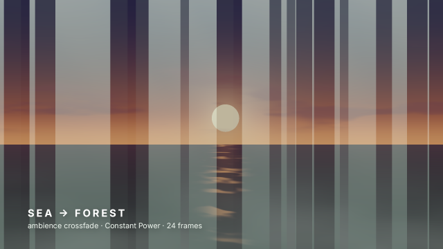</a> 
Film · ▶ animated 
<b><a href="constant-power-ambience-crossfade/">Constant Power Ambience Crossfade</a></b> 
Sea ambience hands over to forest ambience with a one-second Constant Power crossfade, under a matching cross dissolve. 
<i>1920 × 1080 @ 24 fps; 12.0 s; 3 video clips; 2 audio clips; 2 effects; 2 transitions</i> 
<code>audio</code> <code>crossfade</code> <code>transitions</code> <code>ambience</code> <code>demo-footage</code>
</td>
<td width="33%" valign="top">
<a href="field-interview-voice-cleanup/">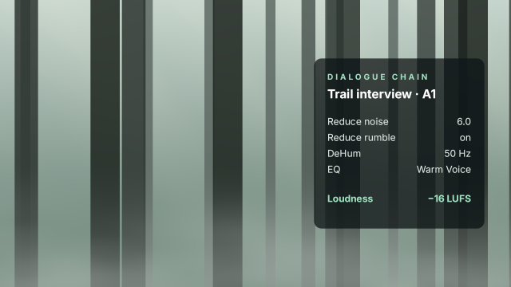</a> 
Film 
<b><a href="field-interview-voice-cleanup/">Field Interview Voice Cleanup</a></b> 
An outdoor interview's sound tagged as Dialogue and cleaned with Essential Sound repair, clarity EQ and a −16 LUFS loudness match. 
<i>1920 × 1080 @ 24 fps; 12.0 s; 2 video clips; 1 audio clip; 13 effects</i> 
<code>audio</code> <code>essential-sound</code> <code>dialogue</code> <code>loudness</code> <code>noise-reduction</code> <code>demo-footage</code>
</td>
</tr>
<tr>
<td width="33%" valign="top">
<a href="music-ducking-under-dialogue/">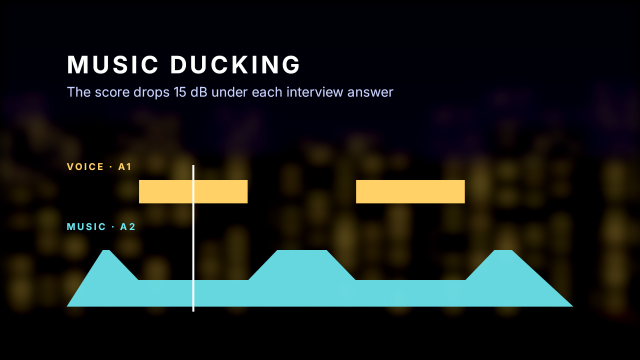</a> 
Film · ▶ animated 
<b><a href="music-ducking-under-dialogue/">Music Ducking Under Dialogue</a></b> 
A music bed that dips 15 dB whenever an interview answer plays, written by Essential Sound auto-ducking, with a diagram of the mix. 
<i>1920 × 1080 @ 24 fps; 14.0 s; 3 video clips; 3 audio clips; 10 effects; 2 animated effects; 2 transitions</i> 
<code>audio</code> <code>ducking</code> <code>essential-sound</code> <code>music</code> <code>keyframes</code> <code>demo-footage</code>
</td>
<td width="33%" valign="top">
<a href="radio-theme-volume-fades/">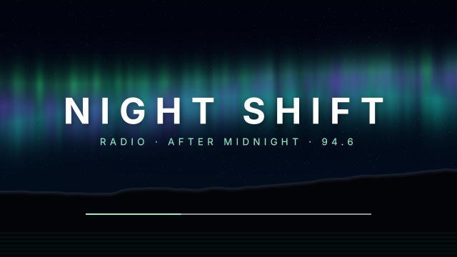</a> 
Film · ▶ animated 
<b><a href="radio-theme-volume-fades/">Radio Theme Volume Fades</a></b> 
A late-night radio show's theme rises in over two seconds and sinks out over three, drawn with eased Volume keyframes on the music clip. 
<i>1920 × 1080 @ 24 fps; 12.0 s; 4 video clips; 1 audio clip; 5 effects; 3 animated effects</i> 
<code>audio</code> <code>music</code> <code>fades</code> <code>keyframes</code> <code>demo-footage</code>
</td>
<td width="33%" valign="top">
<a href="two-host-podcast-mixer/">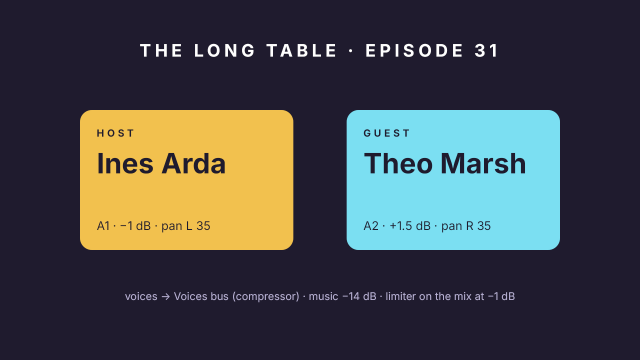</a> 
Film 
<b><a href="two-host-podcast-mixer/">Two-Host Podcast Mixer</a></b> 
A video podcast's audio mix set in the track mixer, with the two hosts panned apart, a voices submix with compression and a limiter on the master. 
<i>1920 × 1080 @ 30 fps; 10.0 s; 2 video clips; 3 audio clips; 10 effects</i> 
<code>audio</code> <code>mixer</code> <code>submix</code> <code>panning</code> <code>podcast</code>
</td>
</tr>
</table>

## Editing & Timeline

<table>
<tr>
<td width="33%" valign="top">
<a href="four-camera-angle-cut/">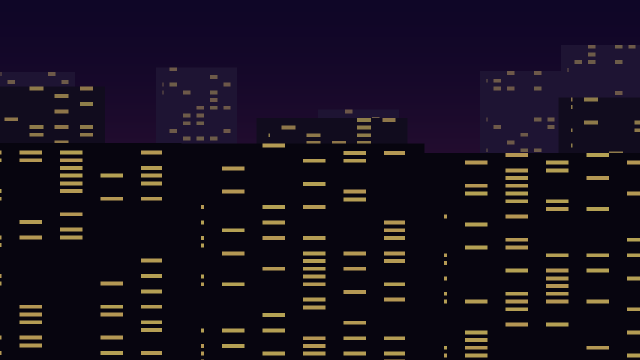</a> 
Film · ▶ animated 
<b><a href="four-camera-angle-cut/">Four Camera Angle Cut</a></b> 
A festival recap groups four synced cameras into one multicam clip and live-cuts between the angles every two seconds. 
<i>1280 × 720 @ 24 fps; 10.0 s; 5 video clips; 1 audio clip</i> 
<code>multicam</code> <code>live-cut</code> <code>demo-footage</code>
</td>
<td width="33%" valign="top">
<a href="freeze-frame-day-one/">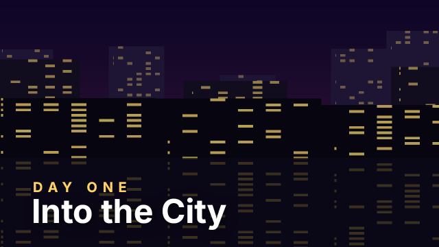</a> 
Film · ▶ animated 
<b><a href="freeze-frame-day-one/">Freeze Frame Day One</a></b> 
A travel vlog freezes the city drive for two seconds and stamps the day's title on the held frame. 
<i>1280 × 720 @ 24 fps; 8.0 s; 4 video clips; 2 audio clips; 3 effects</i> 
<code>freeze-frame</code> <code>frame-hold</code> <code>titles</code> <code>demo-footage</code>
</td>
<td width="33%" valign="top">
<a href="nested-flashback-look/">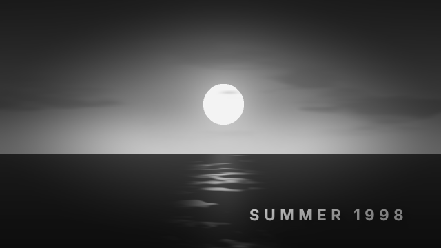</a> 
Film · ▶ animated 
<b><a href="nested-flashback-look/">Nested Flashback Look</a></b> 
A short film nests its three-shot flashback and its date card into one clip, then grades the whole memory black and white in one place. 
<i>1280 × 720 @ 24 fps; 12.0 s; 3 video clips; 3 audio clips; 2 effects</i> 
<code>nesting</code> <code>black-white</code> <code>vignette</code> <code>titles</code> <code>demo-footage</code>
</td>
</tr>
<tr>
<td width="33%" valign="top">
<a href="night-drive-speed-ramp/">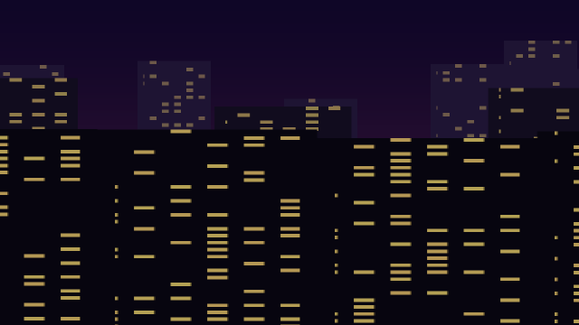</a> 
Film · ▶ animated 
<b><a href="night-drive-speed-ramp/">Night Drive Speed Ramp</a></b> 
A car-culture reel cuts one long night drive into three pieces and runs them at normal speed, triple speed and half-speed slow motion. 
<i>1280 × 720 @ 24 fps; 10.0 s; 3 video clips; 3 audio clips</i> 
<code>speed</code> <code>slow-motion</code> <code>razor</code> <code>time-interpolation</code> <code>demo-footage</code>
</td>
<td width="33%" valign="top">
<a href="ripple-out-the-bars/">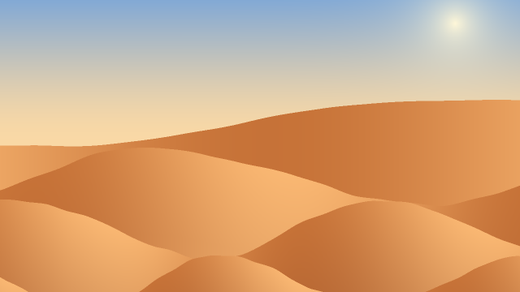</a> 
Film · ▶ animated 
<b><a href="ripple-out-the-bars/">Ripple Out the Bars</a></b> 
A cleanup pass ripple-deletes a stray bars-and-tone clip and closes a one-second gap, pulling the rest of the cut together. 
<i>1280 × 720 @ 24 fps; 12.0 s; 3 video clips; 3 audio clips</i> 
<code>ripple-delete</code> <code>close-gap</code> <code>cleanup</code> <code>demo-footage</code>
</td>
<td width="33%" valign="top">
<a href="rough-cut-with-a-hole/">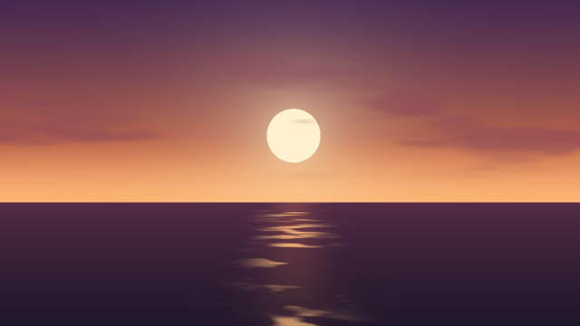</a> 
Film · ▶ animated 
<b><a href="rough-cut-with-a-hole/">Rough Cut With a Hole</a></b> 
A rough cut handed over mid-edit, with a hole waiting for a pickup shot, a disabled alternate take and a locked, muted guide track. 
<i>1280 × 720 @ 24 fps; 14.0 s; 4 video clips; 4 audio clips; 2 markers</i> 
<code>rough-cut</code> <code>gap</code> <code>disabled-clip</code> <code>track-states</code> <code>markers</code> <code>demo-footage</code>
</td>
</tr>
<tr>
<td width="33%" valign="top">
 
Film · ▶ animated 
<b><a href="six-places-beat-montage/">Six Places Beat Montage</a></b> 
A summer travel recap cuts six scenes on the bar lines of its music, marked first and then edited to the markers. 
<i>1280 × 720 @ 24 fps; 12.0 s; 7 video clips; 1 audio clip; 2 effects; 7 markers</i> 
<code>montage</code> <code>markers</code> <code>razor</code> <code>music</code> <code>titles</code> <code>demo-footage</code>
</td>
<td width="33%" valign="top">
<a href="teaser-insert-and-overwrite/">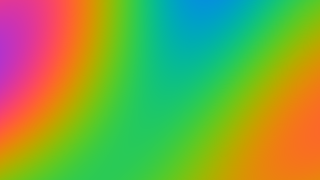</a> 
Film · ▶ animated 
<b><a href="teaser-insert-and-overwrite/">Teaser Insert and Overwrite</a></b> 
A teaser recut takes two shots from the source monitor, one inserted to push the cut later and one overwritten on top of it. 
<i>1280 × 720 @ 24 fps; 14.0 s; 5 video clips; 5 audio clips</i> 
<code>insert-edit</code> <code>overwrite-edit</code> <code>three-point-edit</code> <code>source-monitor</code> <code>demo-footage</code>
</td>
<td width="33%" valign="top">
<a href="waves-first-j-and-l-cuts/">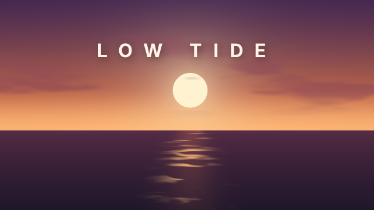</a> 
Film · ▶ animated 
<b><a href="waves-first-j-and-l-cuts/">Waves First J and L Cuts</a></b> 
A coastal short lets the sound of the sea arrive a second before its picture and linger a second after it. 
<i>1280 × 720 @ 24 fps; 15.0 s; 4 video clips; 3 audio clips; 1 effect</i> 
<code>j-cut</code> <code>l-cut</code> <code>linked-clips</code> <code>roll</code> <code>demo-footage</code>
</td>
</tr>
</table>

## Effects & Color

<table>
<tr>
<td width="33%" valign="top">
<a href="adjustment-layer-film-print/">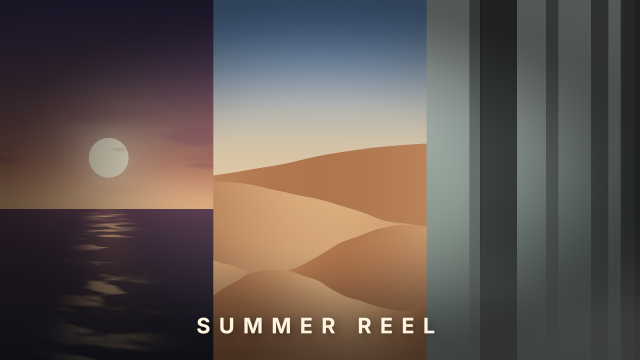</a> 
Film · ▶ animated 
<b><a href="adjustment-layer-film-print/">Adjustment Layer Film Print</a></b> 
One adjustment layer gives three different shots the same faded film-print grade and vignette in a triptych. 
<i>1920 × 1080 @ 24 fps; 10.0 s; 5 video clips; 6 effects</i> 
<code>color</code> <code>lumetri</code> <code>adjustment-layer</code> <code>grading</code> <code>split-screen</code> <code>demo-footage</code>
</td>
<td width="33%" valign="top">
<a href="before-after-grade-split/">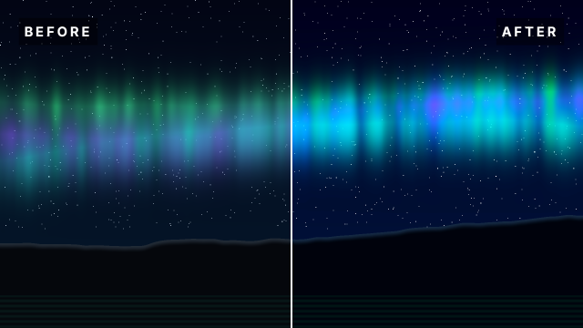</a> 
Film · ▶ animated 
<b><a href="before-after-grade-split/">Before &amp; After Grade Split</a></b> 
A split-screen comparison of an aurora shot, ungraded on the left and colour-graded on the right, with a divider and labels. 
<i>1920 × 1080 @ 24 fps; 16.0 s; 3 video clips; 5 effects</i> 
<code>color</code> <code>lumetri</code> <code>grading</code> <code>split-screen</code> <code>crop</code> <code>demo-footage</code>
</td>
<td width="33%" valign="top">
<a href="black-white-film-look/">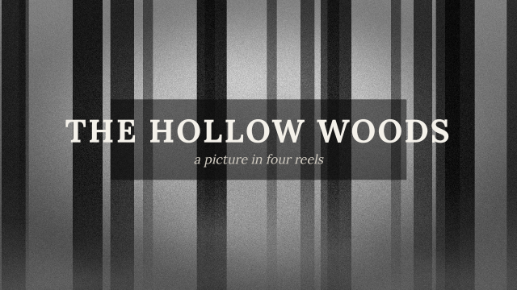</a> 
Film · ▶ animated 
<b><a href="black-white-film-look/">Black &amp; White Film Look</a></b> 
A misty forest turned into a grainy black-and-white film frame with extra contrast and a soft vignette, under a serif title. 
<i>1920 × 1080 @ 24 fps; 12.0 s; 2 video clips; 7 effects</i> 
<code>color</code> <code>black-white</code> <code>film-grain</code> <code>vignette</code> <code>demo-footage</code>
</td>
</tr>
<tr>
<td width="33%" valign="top">
<a href="creative-look-lut-grid/">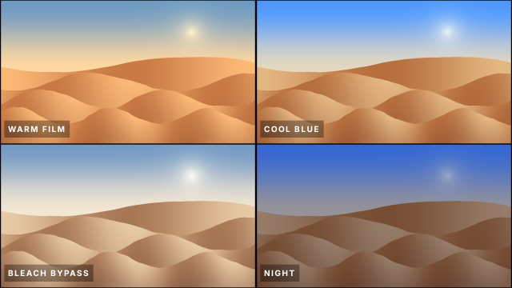</a> 
Film 
<b><a href="creative-look-lut-grid/">Creative Look LUT Grid</a></b> 
The same desert shot four times in a 2×2 grid, each with a different built-in creative look LUT, to pick a grade. 
<i>1920 × 1080 @ 24 fps; 10.0 s; 5 video clips; 8 effects</i> 
<code>color</code> <code>lumetri</code> <code>lut</code> <code>split-screen</code> <code>demo-footage</code>
</td>
<td width="33%" valign="top">
<a href="double-exposure-screen-blend/">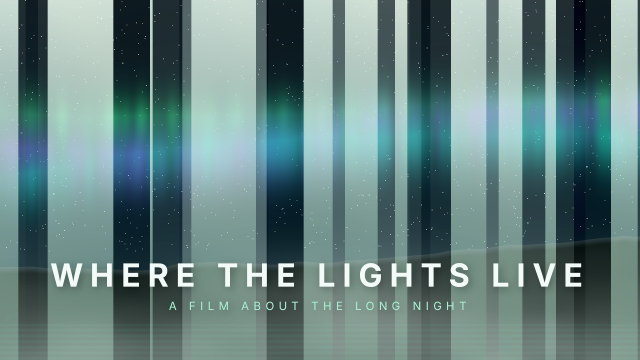</a> 
Film · ▶ animated 
<b><a href="double-exposure-screen-blend/">Double Exposure Screen Blend</a></b> 
An aurora laid over a misty forest with the Screen blend mode, making an in-camera style double exposure for a documentary title. 
<i>1920 × 1080 @ 24 fps; 12.0 s; 3 video clips; 3 effects</i> 
<code>blend-modes</code> <code>opacity</code> <code>double-exposure</code> <code>titles</code> <code>demo-footage</code>
</td>
<td width="33%" valign="top">
<a href="neon-glitch-stream-intro/">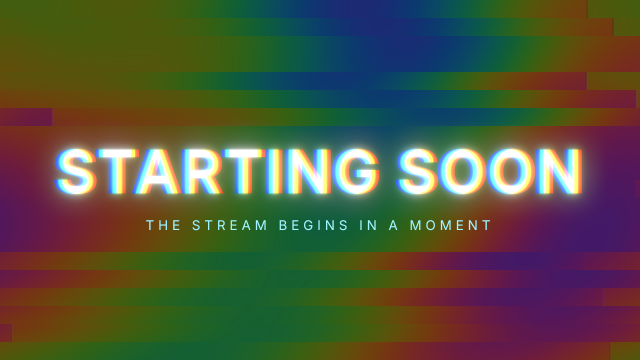</a> 
Film · ▶ animated 
<b><a href="neon-glitch-stream-intro/">Neon Glitch Stream Intro</a></b> 
A starting-soon screen for a live stream, with neon footage torn by a digital glitch, under a chromatic-split glowing title. 
<i>1920 × 1080 @ 30 fps; 10.0 s; 3 video clips; 6 effects; 1 animated effect</i> 
<code>glitch</code> <code>glow</code> <code>neon</code> <code>titles</code> <code>demo-footage</code>
</td>
</tr>
<tr>
<td width="33%" valign="top">
<a href="picture-in-picture-inset/">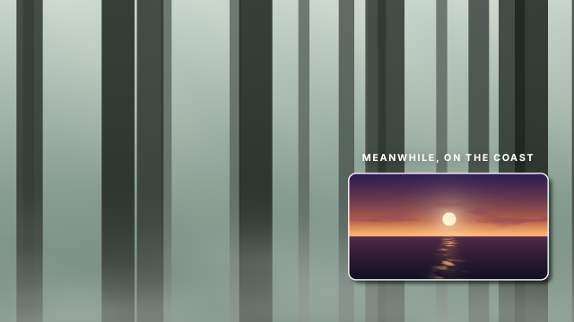</a> 
Film · ▶ animated 
<b><a href="picture-in-picture-inset/">Picture-in-Picture Inset</a></b> 
A second shot slides into the corner as a rounded, bordered inset with a soft drop shadow over the main picture. 
<i>1920 × 1080 @ 24 fps; 12.0 s; 3 video clips; 3 effects; 1 animated effect</i> 
<code>picture-in-picture</code> <code>drop-shadow</code> <code>crop</code> <code>motion</code> <code>keyframes</code> <code>demo-footage</code>
</td>
<td width="33%" valign="top">
<a href="privacy-mosaic-redaction/">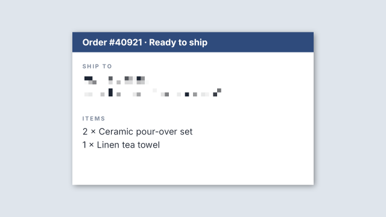</a> 
Film 
<b><a href="privacy-mosaic-redaction/">Privacy Mosaic Redaction</a></b> 
A screen-recording style order card with the customer's name and address pixelated by a masked Mosaic on an adjustment layer. 
<i>1920 × 1080 @ 30 fps; 8.0 s; 3 video clips; 10 effects</i> 
<code>masks</code> <code>mosaic</code> <code>privacy</code> <code>adjustment-layer</code> <code>graphics</code>
</td>
<td width="33%" valign="top">
<a href="spotlight-mask-callout/">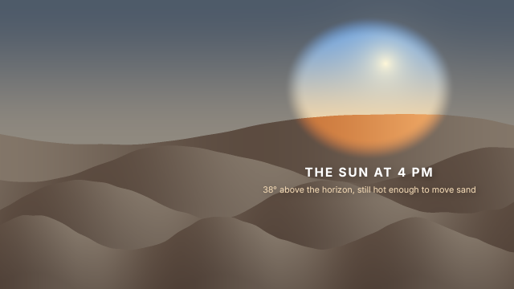</a> 
Film · ▶ animated 
<b><a href="spotlight-mask-callout/">Spotlight Mask Callout</a></b> 
A documentary explainer dims and desaturates the frame and keeps one feathered circle at full colour to point at the sun. 
<i>1920 × 1080 @ 24 fps; 15.0 s; 3 video clips; 3 effects</i> 
<code>masks</code> <code>spotlight</code> <code>lumetri</code> <code>callout</code> <code>demo-footage</code>
</td>
</tr>
<tr>
<td width="33%" valign="top">
<a href="teal-orange-sunset-grade/">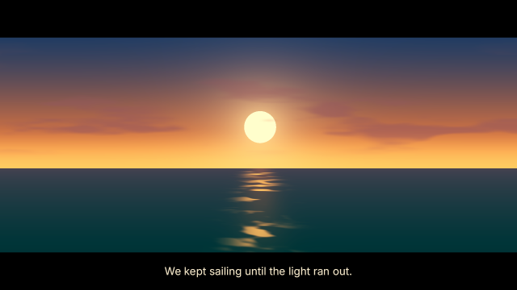</a> 
Film · ▶ animated 
<b><a href="teal-orange-sunset-grade/">Teal &amp; Orange Sunset Grade</a></b> 
A sunset at sea graded with Lumetri Color into a cinematic teal-and-orange look, framed in a 2.39:1 letterbox. 
<i>1920 × 1080 @ 24 fps; 18.0 s; 3 video clips; 4 effects</i> 
<code>color</code> <code>lumetri</code> <code>grading</code> <code>letterbox</code> <code>demo-footage</code>
</td>
<td width="33%" valign="top">
<a href="vertical-blur-backdrop/">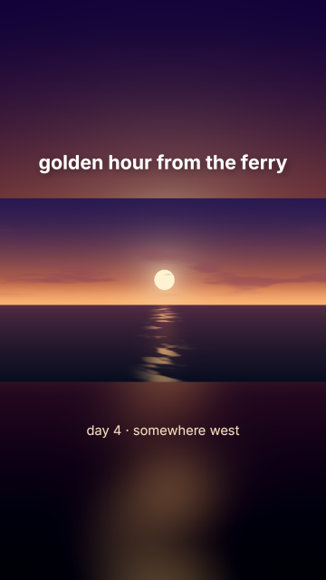</a> 
Film · ▶ animated 
<b><a href="vertical-blur-backdrop/">Vertical Blur Backdrop</a></b> 
A landscape clip fitted into a 9:16 vertical frame over a blurred, enlarged copy of itself instead of black bars. 
<i>1080 × 1920 @ 30 fps; 18.0 s; 3 video clips; 4 effects</i> 
<code>blur</code> <code>vertical</code> <code>social</code> <code>motion</code> <code>demo-footage</code>
</td>
<td width="33%"></td>
</tr>
</table>

## Formats & Social

<table>
<tr>
<td width="33%" valign="top">
<a href="cinematic-letterbox-title/">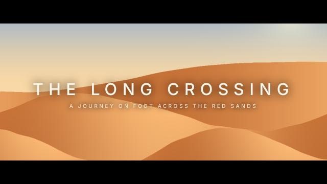</a> 
Film · ▶ animated 
<b><a href="cinematic-letterbox-title/">Cinematic Letterbox Title</a></b> 
Black bars crop a 16:9 frame to 2.39:1 for a widescreen film title over the dunes. 
<i>1280 × 720 @ 24 fps; 15.0 s; 3 video clips; 4 effects; 4 animated effects</i> 
<code>letterbox</code> <code>widescreen</code> <code>titles</code> <code>keyframes</code> <code>demo-footage</code>
</td>
<td width="33%" valign="top">
<a href="portrait-recipe-feed/">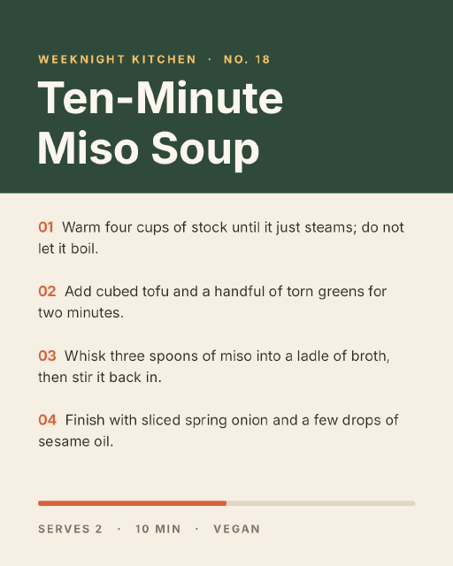</a> 
Film · ▶ animated 
<b><a href="portrait-recipe-feed/">Portrait Recipe Feed Video</a></b> 
A 4:5 feed video for a quick recipe, with wrapped paragraph steps and a filling progress bar. 
<i>1080 × 1350 @ 30 fps; 8.0 s; 2 video clips; 7 effects; 1 animated effect</i> 
<code>portrait</code> <code>social</code> <code>titles</code> <code>shapes</code> <code>keyframes</code>
</td>
<td width="33%" valign="top">
<a href="square-travel-post/">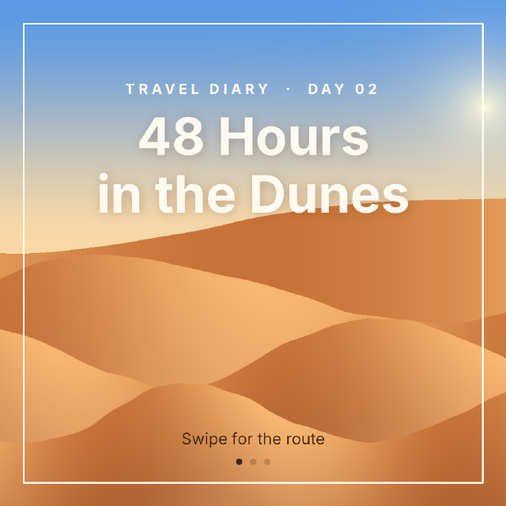</a> 
Film · ▶ animated 
<b><a href="square-travel-post/">Square Travel Post</a></b> 
A 1:1 feed video for a desert travel diary, with an inset frame, title and carousel dots. 
<i>1080 × 1080 @ 30 fps; 15.0 s; 2 video clips; 7 effects; 2 animated effects</i> 
<code>square</code> <code>social</code> <code>titles</code> <code>shapes</code> <code>demo-footage</code>
</td>
</tr>
<tr>
<td width="33%" valign="top">
<a href="story-launch-countdown/">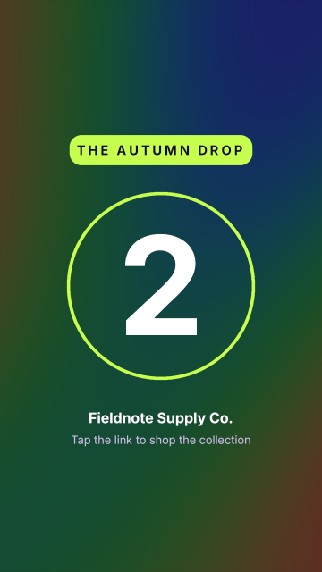</a> 
Film · ▶ animated 
<b><a href="story-launch-countdown/">Story Launch Countdown</a></b> 
A 9:16 story counts down three, two, one with Source Text keyframes before a product drop goes live. 
<i>1080 × 1920 @ 30 fps; 10.0 s; 2 video clips; 7 effects; 3 animated effects</i> 
<code>vertical</code> <code>social</code> <code>countdown</code> <code>keyframes</code> <code>demo-footage</code>
</td>
<td width="33%" valign="top">
 
Film · ▶ animated 
<b><a href="vertical-reels-promo/">Vertical Reels Promo</a></b> 
A 9:16 night-market promo for short-video feeds, with footage filled to the tall frame. 
<i>1080 × 1920 @ 30 fps; 14.0 s; 3 video clips; 7 effects; 2 animated effects</i> 
<code>vertical</code> <code>social</code> <code>titles</code> <code>shapes</code> <code>demo-footage</code>
</td>
<td width="33%"></td>
</tr>
</table>

## Keyframes & Motion

<table>
<tr>
<td width="33%" valign="top">
<a href="four-up-video-wall/">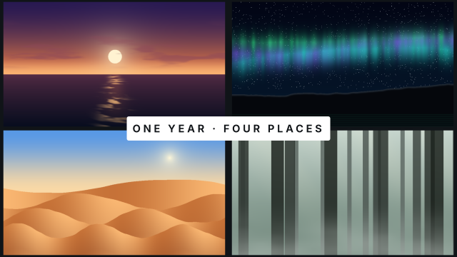</a> 
Film · ▶ animated 
<b><a href="four-up-video-wall/">Four-Up Video Wall</a></b> 
Four shots pop into a 2×2 grid one after another, each scaling up from nothing with an ease-out, before a title lands in the middle. 
<i>1920 × 1080 @ 24 fps; 10.0 s; 6 video clips; 1 effect; 5 animated effects</i> 
<code>keyframes</code> <code>motion</code> <code>easing</code> <code>split-screen</code> <code>demo-footage</code>
</td>
<td width="33%" valign="top">
<a href="iris-out-ending/">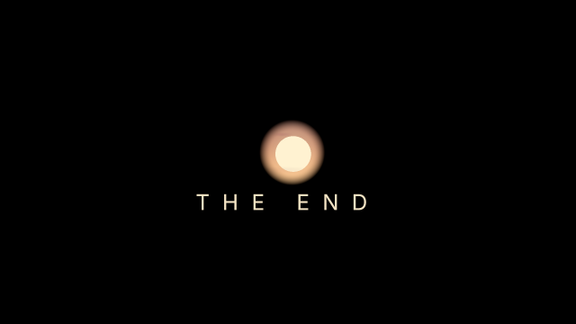</a> 
Film · ▶ animated 
<b><a href="iris-out-ending/">Iris-Out Ending</a></b> 
The closing shot shrinks into a feathered circle around the setting sun, an animated mask expansion, before THE END fades up. 
<i>1920 × 1080 @ 24 fps; 6.0 s; 2 video clips; 1 effect; 1 animated effect</i> 
<code>keyframes</code> <code>masks</code> <code>iris</code> <code>easing</code> <code>titles</code> <code>demo-footage</code>
</td>
<td width="33%" valign="top">
<a href="ken-burns-sunset-push/">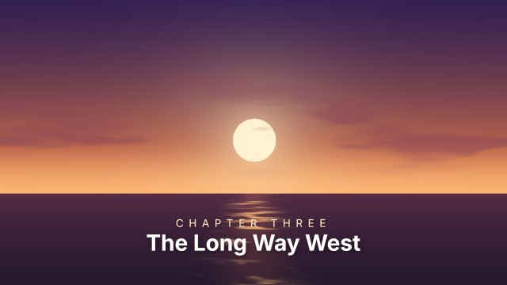</a> 
Film · ▶ animated 
<b><a href="ken-burns-sunset-push/">Ken Burns Sunset Push-In</a></b> 
A slow eased push-in that drifts the sun to the centre of frame, the Ken Burns move on Motion scale and position keyframes. 
<i>1920 × 1080 @ 24 fps; 18.0 s; 2 video clips; 2 effects; 2 animated effects</i> 
<code>keyframes</code> <code>motion</code> <code>easing</code> <code>ken-burns</code> <code>demo-footage</code>
</td>
</tr>
<tr>
<td width="33%" valign="top">
<a href="road-trip-hold-keyframes/">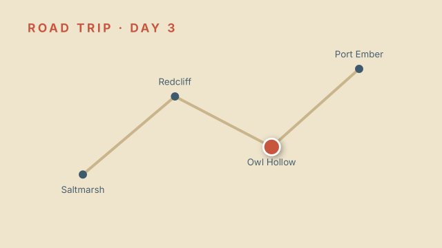</a> 
Film · ▶ animated 
<b><a href="road-trip-hold-keyframes/">Road Trip Hold Keyframes</a></b> 
A travel-map graphic where a marker jumps from town to town on hold keyframes instead of sliding between them. 
<i>1920 × 1080 @ 24 fps; 6.0 s; 3 video clips; 11 effects; 1 animated effect</i> 
<code>keyframes</code> <code>motion</code> <code>hold</code> <code>shapes</code> <code>graphics</code>
</td>
<td width="33%" valign="top">
<a href="spinning-badge-promo/">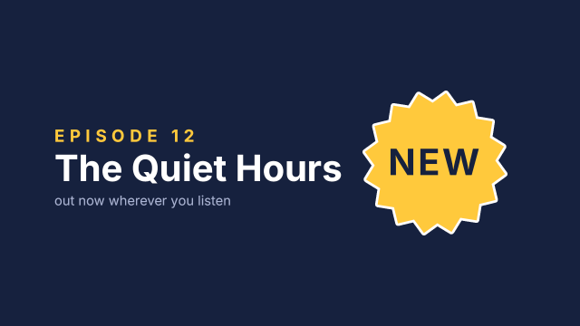</a> 
Film · ▶ animated 
<b><a href="spinning-badge-promo/">Spinning Badge Promo</a></b> 
A podcast promo where a starburst badge pops in with an overshoot and keeps turning beside the episode title. 
<i>1920 × 1080 @ 30 fps; 8.0 s; 4 video clips; 5 effects; 2 animated effects</i> 
<code>keyframes</code> <code>motion</code> <code>shapes</code> <code>easing</code> <code>graphics</code>
</td>
<td width="33%"></td>
</tr>
</table>

## Markers & Captions

<table>
<tr>
<td width="33%" valign="top">
<a href="desert-narration-subtitles/">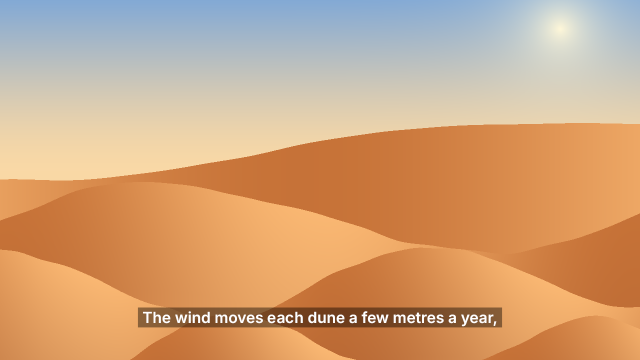</a> 
Film · ▶ animated 
<b><a href="desert-narration-subtitles/">Desert Narration Subtitles</a></b> 
A nature documentary's narration is subtitled line by line on an English caption track with a boxed, broadcast-style look. 
<i>1280 × 720 @ 24 fps; 12.0 s; 1 video clip; 1 audio clip</i> 
<code>captions</code> <code>subtitles</code> <code>narration</code> <code>demo-footage</code>
</td>
<td width="33%" valign="top">
<a href="documentary-chapter-markers/">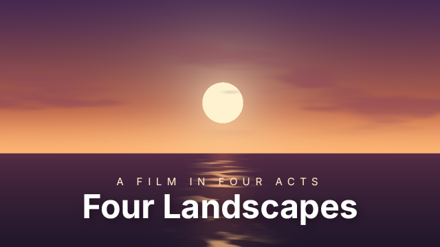</a> 
Film · ▶ animated 
<b><a href="documentary-chapter-markers/">Documentary Chapter Markers</a></b> 
A landscape documentary's review cut carries chapter markers for each act, colour-coded notes, a range marker and In/Out points for export. 
<i>1280 × 720 @ 24 fps; 16.0 s; 5 video clips; 4 audio clips; 2 effects; 8 markers</i> 
<code>markers</code> <code>chapters</code> <code>in-out</code> <code>review</code> <code>titles</code> <code>demo-footage</code>
</td>
<td width="33%" valign="top">
<a href="misty-forest-dual-subtitles/">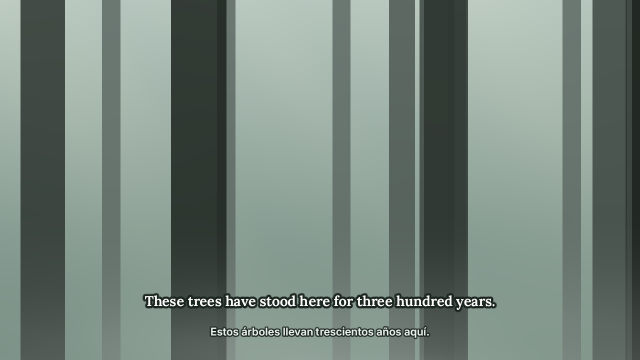</a> 
Film · ▶ animated 
<b><a href="misty-forest-dual-subtitles/">Misty Forest Dual Subtitles</a></b> 
A forest travelogue carries English subtitles with a Spanish translation underneath, on two caption tracks styled to stack. 
<i>1280 × 720 @ 24 fps; 10.0 s; 1 video clip; 1 audio clip</i> 
<code>captions</code> <code>subtitles</code> <code>demo-footage</code>
</td>
</tr>
<tr>
<td width="33%" valign="top">
<a href="sunset-singalong-karaoke/">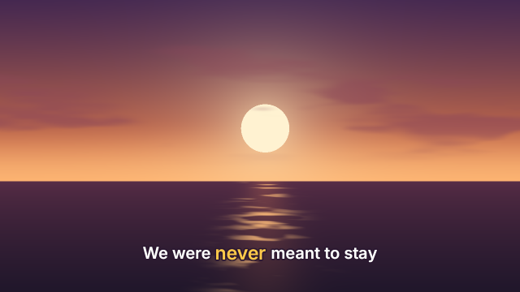</a> 
Film · ▶ animated 
<b><a href="sunset-singalong-karaoke/">Sunset Singalong Karaoke</a></b> 
A lyric video lights up each word of the chorus in gold as it is sung, over the sea at sunset. 
<i>1280 × 720 @ 24 fps; 8.0 s; 1 video clip; 1 audio clip</i> 
<code>captions</code> <code>karaoke</code> <code>lyrics</code> <code>music</code> <code>demo-footage</code>
</td>
<td width="33%"></td>
<td width="33%"></td>
</tr>
</table>

## Titles & Graphics

<table>
<tr>
<td width="33%" valign="top">
<a href="aurora-title-card/">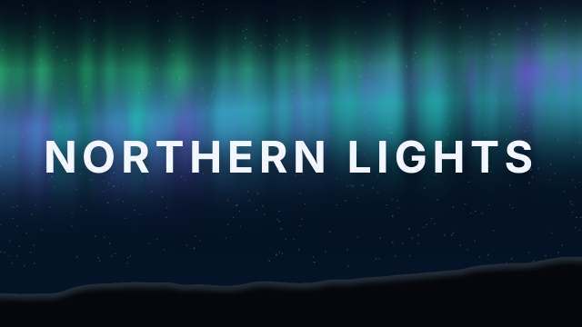</a> 
Film · ▶ animated 
<b><a href="aurora-title-card/">Aurora Title Card</a></b> 
An opening title fades in over a moving aurora, with a slow push-in on the footage. 
<i>1280 × 720 @ 24 fps; 16.0 s; 2 video clips; 1 effect; 2 animated effects</i> 
<code>titles</code> <code>keyframes</code> <code>opacity</code> <code>motion</code> <code>demo-footage</code>
</td>
<td width="33%" valign="top">
<a href="channel-intro-logo-sting/">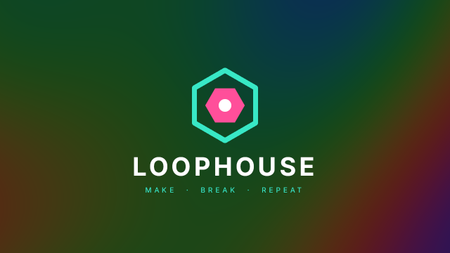</a> 
Film · ▶ animated 
<b><a href="channel-intro-logo-sting/">Channel Intro Logo Sting</a></b> 
A hexagon mark spins into place and a wordmark tightens its tracking for a channel intro. 
<i>1280 × 720 @ 30 fps; 10.0 s; 2 video clips; 6 effects; 5 animated effects</i> 
<code>titles</code> <code>logo</code> <code>shapes</code> <code>keyframes</code> <code>demo-footage</code>
</td>
<td width="33%" valign="top">
<a href="countdown-leader-intro/">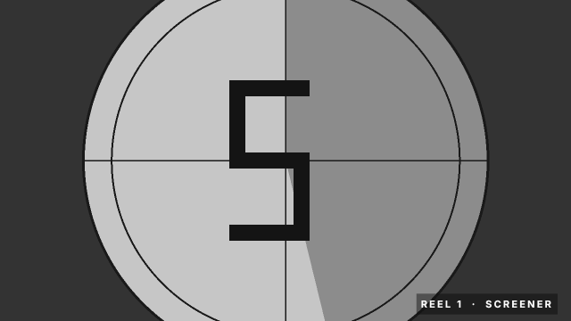</a> 
Film · ▶ animated 
<b><a href="countdown-leader-intro/">Countdown Leader Intro</a></b> 
A universal counting leader runs down to the first frame of a short film's opening title. 
<i>1280 × 720 @ 24 fps; 24.0 s; 4 video clips; 1 audio clip; 2 effects; 1 animated effect</i> 
<code>titles</code> <code>leader</code> <code>countdown</code> <code>demo-footage</code>
</td>
</tr>
<tr>
<td width="33%" valign="top">
<a href="documentary-chapter-cards/">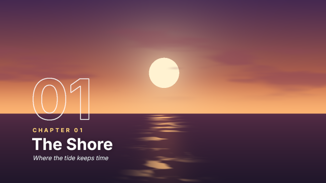</a> 
Film · ▶ animated 
<b><a href="documentary-chapter-cards/">Documentary Chapter Cards</a></b> 
Three chapters of a travel documentary, each opening with a numbered chapter card. 
<i>1280 × 720 @ 24 fps; 12.0 s; 6 video clips; 12 effects; 3 animated effects</i> 
<code>titles</code> <code>chapters</code> <code>typography</code> <code>demo-footage</code>
</td>
<td width="33%" valign="top">
<a href="end-screen-call-to-action/">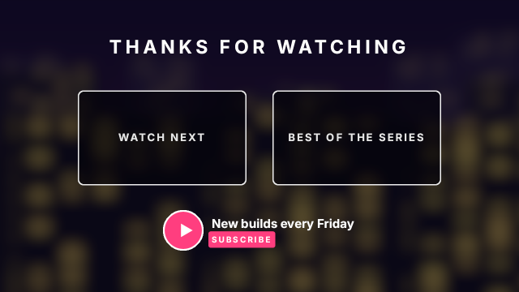</a> 
Film · ▶ animated 
<b><a href="end-screen-call-to-action/">End Screen Call to Action</a></b> 
A channel end screen with two watch-next slots, a round channel badge and a subscribe prompt. 
<i>1280 × 720 @ 30 fps; 14.0 s; 2 video clips; 11 effects; 1 animated effect</i> 
<code>titles</code> <code>end-card</code> <code>shapes</code> <code>effects</code> <code>demo-footage</code>
</td>
<td width="33%" valign="top">
<a href="forest-poem-title-card/">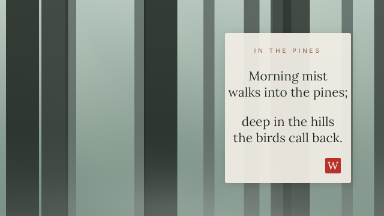</a> 
Film · ▶ animated 
<b><a href="forest-poem-title-card/">Forest Poem Title Card</a></b> 
A short poem in two stanzas, a tracked heading and a red seal sit on a paper card over a misty forest. 
<i>1280 × 720 @ 24 fps; 12.0 s; 2 video clips; 6 effects; 1 animated effect</i> 
<code>titles</code> <code>typography</code> <code>demo-footage</code>
</td>
</tr>
<tr>
<td width="33%" valign="top">
<a href="interview-lower-third/">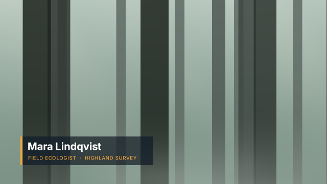</a> 
Film · ▶ animated 
<b><a href="interview-lower-third/">Interview Lower Third</a></b> 
A name and role lower third with an accent bar slides in over documentary footage. 
<i>1280 × 720 @ 24 fps; 12.0 s; 2 video clips; 4 effects; 3 animated effects</i> 
<code>titles</code> <code>lower-third</code> <code>shapes</code> <code>keyframes</code> <code>demo-footage</code>
</td>
<td width="33%" valign="top">
<a href="kinetic-typography-quote/">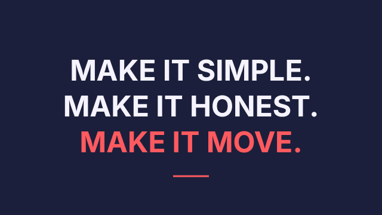</a> 
Film · ▶ animated 
<b><a href="kinetic-typography-quote/">Kinetic Typography Quote</a></b> 
Three short lines punch in one after another, each scaling down into place on a bold matte. 
<i>1280 × 720 @ 24 fps; 6.0 s; 2 video clips; 4 effects; 4 animated effects</i> 
<code>titles</code> <code>kinetic-type</code> <code>keyframes</code> <code>typography</code>
</td>
<td width="33%" valign="top">
<a href="matchday-versus-split/">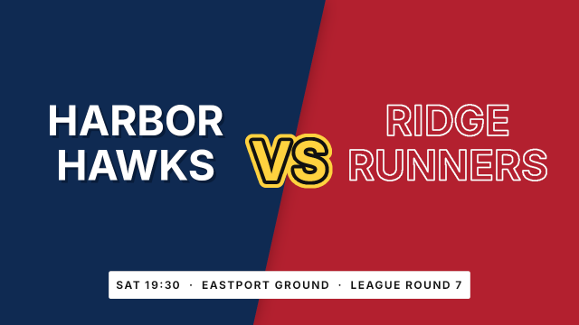</a> 
Film · ▶ animated 
<b><a href="matchday-versus-split/">Matchday Versus Split</a></b> 
A diagonal split-screen versus card for a local match, with outlined type and a fixture bar. 
<i>1280 × 720 @ 25 fps; 6.0 s; 1 video clip; 6 effects; 5 animated effects</i> 
<code>titles</code> <code>sports</code> <code>shapes</code> <code>typography</code>
</td>
</tr>
<tr>
<td width="33%" valign="top">
<a href="news-ticker-crawl/">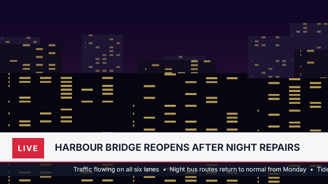</a> 
Film · ▶ animated 
<b><a href="news-ticker-crawl/">News Ticker Crawl</a></b> 
A city-desk news bar with a red label and a headline crawl moving right to left. 
<i>1280 × 720 @ 24 fps; 14.0 s; 3 video clips; 6 effects</i> 
<code>titles</code> <code>crawl</code> <code>lower-third</code> <code>shapes</code> <code>demo-footage</code>
</td>
<td width="33%" valign="top">
<a href="podcast-episode-card/">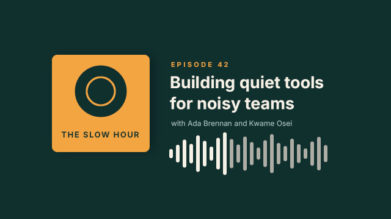</a> 
Film · ▶ animated 
<b><a href="podcast-episode-card/">Podcast Episode Card</a></b> 
A video podcast card with cover art, episode title and an animated waveform over the episode's music. 
<i>1280 × 720 @ 30 fps; 8.0 s; 2 video clips; 1 audio clip; 31 effects; 24 animated effects</i> 
<code>titles</code> <code>podcast</code> <code>shapes</code> <code>keyframes</code> <code>audio</code> <code>demo-footage</code>
</td>
<td width="33%" valign="top">
<a href="product-launch-title/">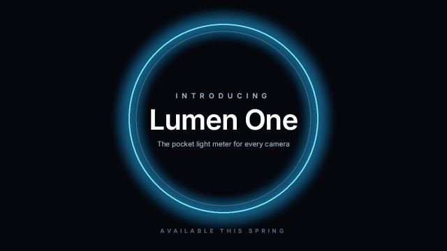</a> 
Film · ▶ animated 
<b><a href="product-launch-title/">Product Launch Title</a></b> 
A glowing ring and a crisp product name reveal for a keynote-style launch video. 
<i>1280 × 720 @ 30 fps; 6.0 s; 2 video clips; 6 effects; 6 animated effects</i> 
<code>titles</code> <code>product</code> <code>shapes</code> <code>keyframes</code>
</td>
</tr>
<tr>
<td width="33%" valign="top">
 
Film · ▶ animated 
<b><a href="rolling-end-credits/">Rolling End Credits</a></b> 
Centered end credits roll up over a dark matte, starting and ending off screen. 
<i>1280 × 720 @ 24 fps; 12.0 s; 2 video clips; 1 effect</i> 
<code>titles</code> <code>credits</code> <code>roll</code>
</td>
<td width="33%" valign="top">
 
Film · ▶ animated 
<b><a href="seaside-documentary-title/">Seaside Documentary Title</a></b> 
A two-line documentary title, a serif name over a tracked credit line, sits over a calm sunset at sea. 
<i>1280 × 720 @ 24 fps; 18.0 s; 2 video clips; 3 effects; 1 animated effect</i> 
<code>titles</code> <code>typography</code> <code>demo-footage</code>
</td>
<td width="33%" valign="top">
 
Film · ▶ animated 
<b><a href="technical-slate/">Technical Slate</a></b> 
Bars and tone with a label strip, then a delivery slate card listing the master's specs. 
<i>1280 × 720 @ 25 fps; 10.0 s; 4 video clips; 1 audio clip; 6 effects</i> 
<code>titles</code> <code>slate</code> <code>bars-and-tone</code> <code>typography</code>
</td>
</tr>
<tr>
<td width="33%" valign="top">
 
Film · ▶ animated 
<b><a href="testimonial-quote-card/">Testimonial Quote Card</a></b> 
A customer quote in a serif face on a floating card with a shadow, over a warm matte. 
<i>1280 × 720 @ 24 fps; 6.0 s; 2 video clips; 6 effects; 2 animated effects</i> 
<code>titles</code> <code>quote</code> <code>typography</code> <code>shapes</code>
</td>
<td width="33%"></td>
<td width="33%"></td>
</tr>
</table>

## Transitions

<table>
<tr>
<td width="33%" valign="top">
 
Film · ▶ animated 
<b><a href="chapter-break-dip-to-black/">Chapter Break Dip to Black</a></b> 
A documentary leaves the city at night through a two-second dip to black and comes up on the dunes under its chapter title. 
<i>1280 × 720 @ 24 fps; 12.0 s; 3 video clips; 2 audio clips; 2 effects; 1 animated effect; 1 transition</i> 
<code>transitions</code> <code>dip-to-black</code> <code>titles</code> <code>opacity</code> <code>demo-footage</code>
</td>
<td width="33%" valign="top">
 
Film · ▶ animated 
<b><a href="city-escape-iris-reveal/">City Escape Iris Reveal</a></b> 
A weekend-getaway promo opens a round iris in the middle of the night traffic to reveal the sea at sunset. 
<i>1280 × 720 @ 24 fps; 8.0 s; 2 video clips; 2 audio clips; 1 transition</i> 
<code>transitions</code> <code>iris</code> <code>wipe</code> <code>demo-footage</code>
</td>
<td width="33%" valign="top">
 
Film · ▶ animated 
<b><a href="dunes-to-coast-push/">Dunes to Coast Push</a></b> 
A travel vlog pushes the desert out of frame to the left as the coastline slides in behind it. 
<i>1280 × 720 @ 24 fps; 8.0 s; 2 video clips; 2 audio clips; 1 transition</i> 
<code>transitions</code> <code>push</code> <code>slide</code> <code>demo-footage</code>
</td>
</tr>
<tr>
<td width="33%" valign="top">
 
Film · ▶ animated 
<b><a href="dusk-clock-wipe/">Dusk Clock Wipe</a></b> 
A time-lapse sweeps from the afternoon dunes to the aurora night with a clock wipe that turns like a dial. 
<i>1280 × 720 @ 24 fps; 8.0 s; 2 video clips; 2 audio clips; 1 transition</i> 
<code>transitions</code> <code>wipe</code> <code>clock-wipe</code> <code>demo-footage</code>
</td>
<td width="33%" valign="top">
 
Film · ▶ animated 
<b><a href="meditation-score-crossfade/">Meditation Score Crossfade</a></b> 
A guided-meditation video hands its first music bed to the second with a two-second constant-power crossfade. 
<i>1280 × 720 @ 24 fps; 12.0 s; 2 video clips; 2 audio clips; 2 effects; 1 animated effect; 1 transition</i> 
<code>transitions</code> <code>audio</code> <code>crossfade</code> <code>music</code> <code>titles</code> <code>demo-footage</code>
</td>
<td width="33%" valign="top">
 
Film · ▶ animated 
<b><a href="night-to-day-dip-to-white/">Night to Day Dip to White</a></b> 
A road-trip film jumps from the aurora night to the next morning in the dunes through a flash of white. 
<i>1280 × 720 @ 24 fps; 8.0 s; 2 video clips; 2 audio clips; 1 transition</i> 
<code>transitions</code> <code>dip-to-white</code> <code>demo-footage</code>
</td>
</tr>
<tr>
<td width="33%" valign="top">
 
Film · ▶ animated 
<b><a href="sunset-to-aurora-dissolve/">Sunset to Aurora Dissolve</a></b> 
A travel film lets the last light over the ocean melt into the night sky with a 1.5 second cross dissolve. 
<i>1280 × 720 @ 24 fps; 10.0 s; 2 video clips; 2 audio clips; 1 transition</i> 
<code>transitions</code> <code>cross-dissolve</code> <code>demo-footage</code>
</td>
<td width="33%"></td>
<td width="33%"></td>
</tr>
</table>

## Tags

`adjustment-layer` 2 · `ambience` 1 · `audio` 8 · `bars-and-tone` 2 · `black-white` 2 · `blend-modes` 1 · `blur` 1 · `broadcast` 1 · `callout` 1 · `captions` 3 · `chapters` 2 · `cleanup` 1 · `clock-wipe` 1 · `close-gap` 1 · `color` 5 · `countdown` 2 · `crawl` 1 · `credits` 1 · `crop` 2 · `cross-dissolve` 1 · `crossfade` 2 · `delivery` 1 · `demo-footage` 51 · `dialogue` 1 · `dip-to-black` 1 · `dip-to-white` 1 · `disabled-clip` 1 · `double-exposure` 1 · `drop-shadow` 1 · `ducking` 1 · `easing` 4 · `effects` 1 · `end-card` 1 · `essential-sound` 2 · `fades` 1 · `film-grain` 1 · `frame-hold` 1 · `freeze-frame` 1 · `gap` 1 · `glitch` 1 · `glow` 1 · `grading` 3 · `graphics` 3 · `hold` 1 · `in-out` 1 · `insert-edit` 1 · `iris` 2 · `j-cut` 1 · `karaoke` 1 · `ken-burns` 1 · `keyframes` 17 · `kinetic-type` 1 · `l-cut` 1 · `leader` 2 · `letterbox` 2 · `linked-clips` 1 · `live-cut` 1 · `logo` 1 · `loudness` 1 · `lower-third` 2 · `lumetri` 5 · `lut` 1 · `lyrics` 1 · `markers` 3 · `masks` 3 · `mixer` 1 · `montage` 1 · `mosaic` 1 · `motion` 7 · `multicam` 1 · `music` 5 · `narration` 1 · `neon` 1 · `nesting` 1 · `noise-reduction` 1 · `opacity` 3 · `overwrite-edit` 1 · `panning` 1 · `picture-in-picture` 1 · `podcast` 2 · `portrait` 1 · `privacy` 1 · `product` 1 · `push` 1 · `quote` 1 · `razor` 2 · `review` 1 · `ripple-delete` 1 · `roll` 2 · `rough-cut` 1 · `shapes` 13 · `slate` 1 · `slide` 1 · `slow-motion` 1 · `social` 5 · `source-monitor` 1 · `speed` 1 · `split-screen` 4 · `sports` 1 · `spotlight` 1 · `square` 1 · `submix` 1 · `subtitles` 2 · `three-point-edit` 1 · `time-interpolation` 1 · `titles` 29 · `track-states` 1 · `transitions` 8 · `typography` 7 · `vertical` 3 · `vignette` 2 · `widescreen` 1 · `wipe` 2
