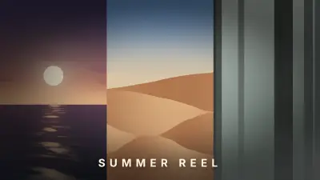

<!-- Generated by tools/gallery.mjs from showcase.yaml and build.json; do not edit. -->
# Adjustment Layer Film Print

[Film](../README.md) › [Effects & Color](../README.md#effects--color) · `color` `lumetri` `adjustment-layer` `grading` `split-screen` `demo-footage`

One adjustment layer gives three different shots the same faded film-print grade and vignette in a triptych.



<sub>Animated preview: 0–3 s, 24 frames rendered by Kition Film. Still: [thumb.png](thumb.png)</sub>

| | |
|---|---|
| Document | [adjustment-layer-film-print.kfilm](adjustment-layer-film-print.kfilm) (20 KB) |
| Contents | 1920 × 1080 @ 24 fps; 10.0 s; 5 video clips; 6 effects |
| Features | `film.color.lumetri`, `film.effects.basics`, `film.file.new-items`, `film.graphics.text-basics` |
| Built by | `kition-film` @ `27c94b23fd`: 22 commands in 17 ms |

## About

Three shots (sea, dunes, forest) are cropped to their middle thirds and set side by side on
V1–V3 with Motion position. Above them an
Adjustment Layer item on V4 carries the grade: the Lumetri preset Faded Print plus a Vignette.
Because effects on an adjustment layer apply to every track below it, the three clips share
one look and one place to change it; the title on V5 sits above the layer and stays clean.

## Checks

- `inspect.sequence.video.0.items.0.effects.0`: `{"effect":"crop","params":{"left":{"value":33.33},"right":{"value":33.33}}}`
- `inspect.sequence.video.0.items.0.effects.1.params.position.value`: `[320,540]`
- `inspect.sequence.video.1.items.0.effects.0`: `{"effect":"crop","params":{"left":{"value":33.33},"right":{"value":33.33}}}`
- `inspect.sequence.video.2.items.0.effects.0`: `{"effect":"crop","params":{"left":{"value":33.33},"right":{"value":33.33}}}`
- `inspect.sequence.video.2.items.0.effects.1.params.position.value`: `[1600,540]`
- `inspect.sequence.video.3.items`: `{"count":1}`
- `inspect.sequence.video.3.items.0.effects.0.effect`: `"lumetri"`
- `inspect.sequence.video.3.items.0.effects.1`: `{"effect":"vignette","params":{"amount":{"value":-55}}}`
- `inspect.sequence.video.0.items.0.effects`: `{"none":{"effect":"lumetri"}}`
- diagnostics: none (the kit's check finds nothing wrong)
- the saved document opens again; the thumbnail matches `thumb.png` within the `render` tolerance

## Steps

<details><summary>22 commands (from <a href="showcase.yaml">showcase.yaml</a>, after the <code>demo-footage</code> prelude)</summary>

```yaml
- command: file.newSequence
  params:
    name: Summer Reel
    width: 1920
    height: 1080
    fps: 24
    video: 5
    audio: 1
- command: timeline.place
  params:
    item: 5
    track: V1
    seconds: 0
    duration: 2540160000000
    audio: false
  as: sea
- command: effects.apply
  params:
    clips:
      - $sea.clips.0
    effect: crop
- command: effects.setParam
  params:
    clip: $sea.clips.0
    effect: crop
    param: left
    value: 33.33
- command: effects.setParam
  params:
    clip: $sea.clips.0
    effect: crop
    param: right
    value: 33.33
- command: effects.setParam
  params:
    clip: $sea.clips.0
    effect: motion
    param: position
    value:
      - 320
      - 540
- command: timeline.place
  params:
    item: 8
    track: V2
    seconds: 0
    duration: 2540160000000
    audio: false
  as: dunes
- command: effects.apply
  params:
    clips:
      - $dunes.clips.0
    effect: crop
- command: effects.setParam
  params:
    clip: $dunes.clips.0
    effect: crop
    param: left
    value: 33.33
- command: effects.setParam
  params:
    clip: $dunes.clips.0
    effect: crop
    param: right
    value: 33.33
- command: timeline.place
  params:
    item: 9
    track: V3
    seconds: 0
    duration: 2540160000000
    audio: false
  as: forest
- command: effects.apply
  params:
    clips:
      - $forest.clips.0
    effect: crop
- command: effects.setParam
  params:
    clip: $forest.clips.0
    effect: crop
    param: left
    value: 33.33
- command: effects.setParam
  params:
    clip: $forest.clips.0
    effect: crop
    param: right
    value: 33.33
- command: effects.setParam
  params:
    clip: $forest.clips.0
    effect: motion
    param: position
    value:
      - 1600
      - 540
- command: file.newAdjustmentLayer
  params:
    seconds: 10
  as: adjustment
- command: timeline.place
  params:
    item: $adjustment.item
    track: V4
    seconds: 0
  as: layer
- command: lumetri.applyPreset
  params:
    name: Faded Print
    clips:
      - $layer.clips.0
- command: effects.apply
  params:
    clips:
      - $layer.clips.0
    effect: vignette
- command: effects.setParam
  params:
    clip: $layer.clips.0
    effect: vignette
    param: amount
    value: -55
- command: graphics.newText
  params:
    text: SUMMER REEL
    position:
      - 960
      - 1000
    size: 64
    seconds: 10
    track: 4
    time: 0
  as: title
- command: graphics.set
  params:
    clip: $title.clip
    props:
      font_style: Bold
      align: center
      tracking: 400
      fill_color: "#fff4e0"
      shadow: true
```

</details>
