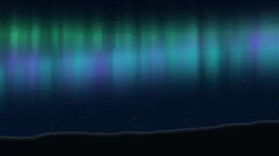

<!-- Generated by tools/gallery.mjs from showcase.yaml and build.json; do not edit. -->
# Aurora Title Card

[Film](../README.md) › [Titles & Graphics](../README.md#titles--graphics) · `titles` `keyframes` `opacity` `motion` `demo-footage`

An opening title fades in over a moving aurora, with a slow push-in on the footage.



<sub>Animated preview: 0–3 s, 30 frames rendered by Kition Film. Still: [thumb.png](thumb.png)</sub>

| | |
|---|---|
| Document | [aurora-title-card.kfilm](aurora-title-card.kfilm) (14 KB) |
| Contents | 1280 × 720 @ 24 fps; 16.0 s; 2 video clips; 1 effect; 2 animated effects |
| Features | `film.graphics.text-basics`, `film.effects.keyframes`, `film.timeline.basics` |
| Built by | `kition-film` @ `27c94b23fd`: 8 commands in 29 ms |

## About

The aurora scene is the kit's procedural demo footage, so the sample needs no media files.
The title's opacity is keyframed from 0 to 100 over the first second, and the footage's
Motion scale goes from 100 to 112 over four seconds: two keyframed parameters on two tracks.

## Checks

- `inspect.sequence.name`: `"Title Card"`
- `inspect.sequence.settings.width`: `1280`
- `inspect.sequence.video.0.items`: `{"count":1}`
- `inspect.sequence.video.1.items`: `{"count":1}`
- `inspect.sequence.video.0.items.0.effects.0.params.scale.keyframes`: `[{"time":0,"value":100},{"time":1016064000000,"value":112}]`
- `inspect.sequence.video.1.items.0.effects.1.params.opacity.keyframes`: `[{"time":0,"value":0},{"time":254016000000,"value":100}]`
- diagnostics: none (the kit's check finds nothing wrong)
- the saved document opens again; the thumbnail matches `thumb.png` within the `render` tolerance

## Steps

<details><summary>8 commands (from <a href="showcase.yaml">showcase.yaml</a>, after the <code>demo-footage</code> prelude)</summary>

```yaml
- command: file.newSequence
  params:
    name: Title Card
    width: 1280
    height: 720
    fps: 24
    video: 2
    audio: 1
  as: sequence
- command: timeline.place
  params:
    item: 6
    track: V1
    seconds: 0
    audio: false
  as: footage
- command: effects.setParam
  params:
    clip: $footage.clips.0
    effect: motion
    param: scale
    value: 100
    seconds: 0
- command: effects.setParam
  params:
    clip: $footage.clips.0
    effect: motion
    param: scale
    value: 112
    seconds: 4
- command: graphics.newText
  params:
    text: NORTHERN LIGHTS
    position:
      - 640
      - 380
    size: 96
    seconds: 4
    track: 1
    time: 0
  as: title
- command: graphics.set
  params:
    clip: $title.clip
    props:
      font_style: Bold
      align: center
      tracking: 120
      fill_color: "#f2f7ff"
      shadow: true
- command: effects.setParam
  params:
    clip: $title.clip
    effect: opacity
    param: opacity
    value: 0
    seconds: 0
- command: effects.setParam
  params:
    clip: $title.clip
    effect: opacity
    param: opacity
    value: 100
    seconds: 1
```

</details>
