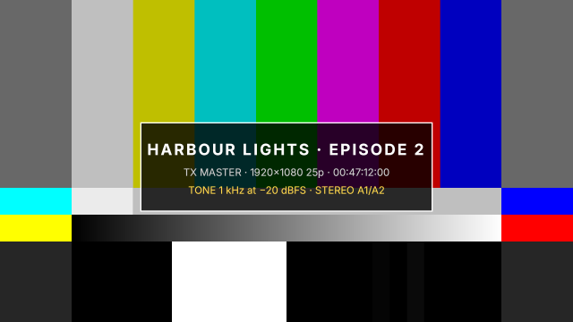

<!-- Generated by tools/gallery.mjs from showcase.yaml and build.json; do not edit. -->
# Bars and Tone Line-Up

[Film](../README.md) › [Audio](../README.md#audio) · `audio` `bars-and-tone` `leader` `delivery` `broadcast`

A delivery master's head build of colour bars with a 1 kHz reference tone at −20 dBFS, an ident box and a counting leader.



| | |
|---|---|
| Document | [bars-and-tone-lineup.kfilm](bars-and-tone-lineup.kfilm) (16 KB) |
| Contents | 1920 × 1080 @ 25 fps; 15.0 s; 3 video clips; 2 audio clips; 4 effects |
| Features | `film.audio.basics`, `film.file.new-items`, `film.graphics.text-basics` |
| Built by | `kition-film` @ `27c94b23fd`: 15 commands in 25 ms |

## About

Broadcast and festival deliveries start with a line-up: ten seconds of Bars and Tone so the
receiving facility can set picture and sound levels, then a Universal Counting Leader. The
reference tone peaks at −20 dBFS; clip.audioPeak measures it on the timeline and
clip.audioGain normalizes the peak to exactly that level. An ident box over the bars names the
programme and the audio layout.

## Checks

- `results.tone.peakDb`: `{"approx":-20,"tol":0.01}`
- `results.lineup.clips`: `{"count":2}`
- `inspect.sequence.video.0.items`: `{"count":2}`
- `inspect.sequence.video.0.items.0.name`: `"Bars and Tone"`
- `inspect.sequence.video.0.items.1`: `{"name":{"matches":"Leader"},"startFrame":250}`
- `inspect.sequence.audio.0.items.0.name`: `"Bars and Tone"`
- `inspect.sequence.video.1.items.0.effects.3.params`: `{"stroke":{"value":true},"stroke_type":{"option":"Inner"}}`
- diagnostics: none (the kit's check finds nothing wrong)
- the saved document opens again; the thumbnail matches `thumb.png` within the `render` tolerance

## Steps

<details><summary>15 commands (from <a href="showcase.yaml">showcase.yaml</a>)</summary>

```yaml
- command: sequence.settings
  params:
    name: Harbour Lights TX Master
    fps: 25
- command: file.newBarsAndTone
  params:
    seconds: 10
  as: bars
- command: timeline.place
  params:
    item: $bars.item
    track: V1
    seconds: 0
  as: lineup
- command: clip.audioGain
  params:
    clips:
      - $lineup.clips.1
    mode: normalizeMax
    db: -20
- command: clip.audioPeak
  params:
    clips:
      - $lineup.clips.1
  as: tone
- command: file.newCountingLeader
  as: leader
- command: timeline.place
  params:
    item: $leader.item
    track: V1
    seconds: 10
  as: countdown
- command: graphics.newRectangle
  params:
    position:
      - 960
      - 560
    size:
      - 980
      - 300
    seconds: 10
    track: 1
    time: 0
  as: ident
- command: graphics.set
  params:
    clip: $ident.clip
    props:
      fill_color: "#000000"
      opacity: 96
      stroke: true
      stroke_color: "#ffffff"
      stroke_width: 4
      stroke_type: Inner
- command: graphics.newText
  params:
    clip: $ident.clip
    text: HARBOUR LIGHTS · EPISODE 2
    position:
      - 960
      - 520
    size: 52
- command: graphics.set
  params:
    clip: $ident.clip
    props:
      font_style: Bold
      align: center
      tracking: 120
      fill_color: "#ffffff"
- command: graphics.newText
  params:
    clip: $ident.clip
    text: TX MASTER · 1920×1080 25p · 00:47:12:00
    position:
      - 960
      - 590
    size: 34
- command: graphics.set
  params:
    clip: $ident.clip
    props:
      align: center
      fill_color: "#d0d0d0"
- command: graphics.newText
  params:
    clip: $ident.clip
    text: TONE 1 kHz at −20 dBFS · STEREO A1/A2
    position:
      - 960
      - 650
    size: 34
- command: graphics.set
  params:
    clip: $ident.clip
    props:
      align: center
      fill_color: "#ffd84d"
```

</details>
