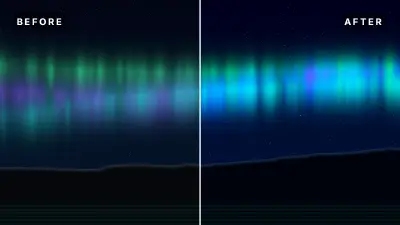

<!-- Generated by tools/gallery.mjs from showcase.yaml and build.json; do not edit. -->
# Before & After Grade Split

[Film](../README.md) › [Effects & Color](../README.md#effects--color) · `color` `lumetri` `grading` `split-screen` `crop` `demo-footage`

A split-screen comparison of an aurora shot, ungraded on the left and colour-graded on the right, with a divider and labels.



<sub>Animated preview: 0–3 s, 24 frames rendered by Kition Film. Still: [thumb.png](thumb.png)</sub>

| | |
|---|---|
| Document | [before-after-grade-split.kfilm](before-after-grade-split.kfilm) (21 KB) |
| Contents | 1920 × 1080 @ 24 fps; 16.0 s; 3 video clips; 5 effects |
| Features | `film.color.lumetri`, `film.effects.basics`, `film.graphics.text-basics` |
| Built by | `kition-film` @ `27c94b23fd`: 17 commands in 30 ms |

## About

The same aurora clip sits on V1 and V2. The copy on V2 carries the grade (Lumetri Color: more
exposure, contrast and saturation, deeper blacks) and a Crop effect that removes its left half,
so the untouched clip on V1 shows through. A thin white bar marks the split and two labels name
the halves: the usual way to show a client what the grade does.

## Checks

- `inspect.sequence.video.0.items.0.item`: `6`
- `inspect.sequence.video.0.items.0.effects`: `{"none":{"effect":"lumetri"}}`
- `inspect.sequence.video.1.items.0.item`: `6`
- `inspect.sequence.video.1.items.0.effects.0.effect`: `"lumetri"`
- `inspect.sequence.video.1.items.0.effects.0.params`: `{"exposure":{"value":0.6},"contrast":{"value":30},"blacks":{"value":-20},"saturation":{"value":150},"vibrance":{"value":30}}`
- `inspect.sequence.video.1.items.0.effects.1`: `{"effect":"crop","params":{"left":{"value":50}}}`
- `inspect.sequence.video.2.items.0.effects`: `{"count":6}`
- diagnostics: none (the kit's check finds nothing wrong)
- the saved document opens again; the thumbnail matches `thumb.png` within the `render` tolerance

## Steps

<details><summary>17 commands (from <a href="showcase.yaml">showcase.yaml</a>, after the <code>demo-footage</code> prelude)</summary>

```yaml
- command: file.newSequence
  params:
    name: Grade Comparison
    width: 1920
    height: 1080
    fps: 24
    video: 3
    audio: 1
- command: timeline.place
  params:
    item: 6
    track: V1
    seconds: 0
    audio: false
  as: before
- command: timeline.place
  params:
    item: 6
    track: V2
    seconds: 0
    audio: false
  as: after
- command: effects.apply
  params:
    clips:
      - $after.clips.0
    effect: lumetri
- command: effects.setParam
  params:
    clip: $after.clips.0
    effect: lumetri
    param: exposure
    value: 0.6
- command: effects.setParam
  params:
    clip: $after.clips.0
    effect: lumetri
    param: contrast
    value: 30
- command: effects.setParam
  params:
    clip: $after.clips.0
    effect: lumetri
    param: blacks
    value: -20
- command: effects.setParam
  params:
    clip: $after.clips.0
    effect: lumetri
    param: saturation
    value: 150
- command: effects.setParam
  params:
    clip: $after.clips.0
    effect: lumetri
    param: vibrance
    value: 30
- command: effects.apply
  params:
    clips:
      - $after.clips.0
    effect: crop
- command: effects.setParam
  params:
    clip: $after.clips.0
    effect: crop
    param: left
    value: 50
- command: graphics.newRectangle
  params:
    position:
      - 960
      - 540
    size:
      - 6
      - 1080
    seconds: 16
    track: 2
    time: 0
  as: labels
- command: graphics.set
  params:
    clip: $labels.clip
    props:
      fill_color: "#ffffff"
- command: graphics.newText
  params:
    clip: $labels.clip
    text: BEFORE
    position:
      - 80
      - 120
    size: 44
- command: graphics.set
  params:
    clip: $labels.clip
    props:
      font_style: Bold
      tracking: 200
      fill_color: "#ffffff"
      background: true
      background_color: "#000000"
      background_opacity: 55
      background_size: 18
- command: graphics.newText
  params:
    clip: $labels.clip
    text: AFTER
    position:
      - 1840
      - 120
    size: 44
- command: graphics.set
  params:
    clip: $labels.clip
    props:
      font_style: Bold
      align: right
      tracking: 200
      fill_color: "#ffffff"
      background: true
      background_color: "#000000"
      background_opacity: 55
      background_size: 18
```

</details>
